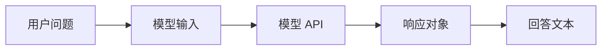
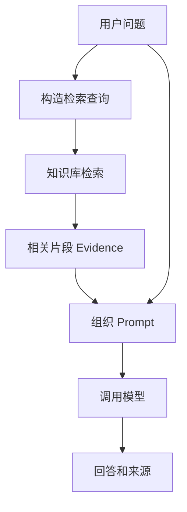
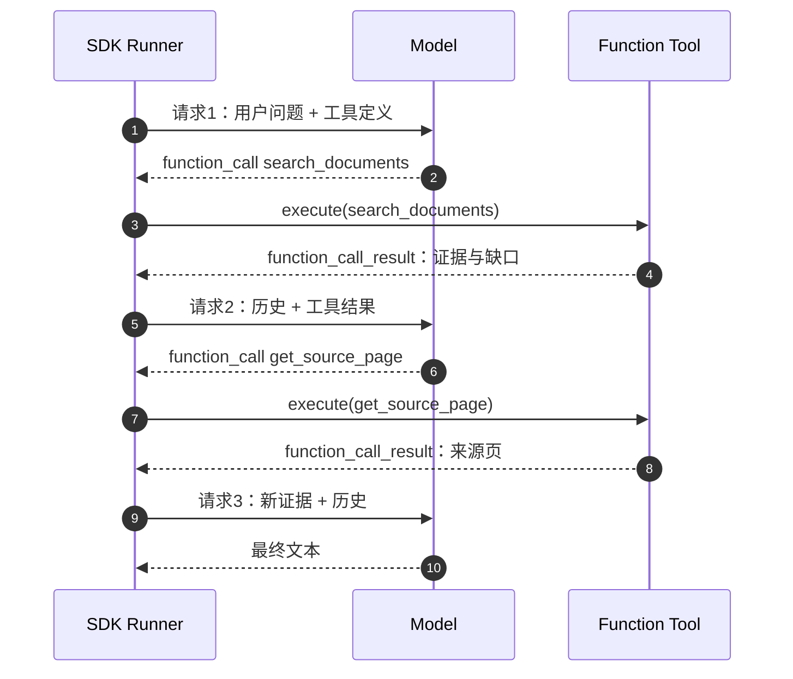
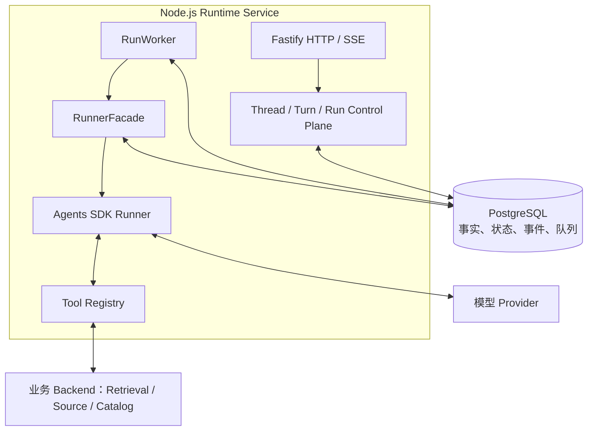
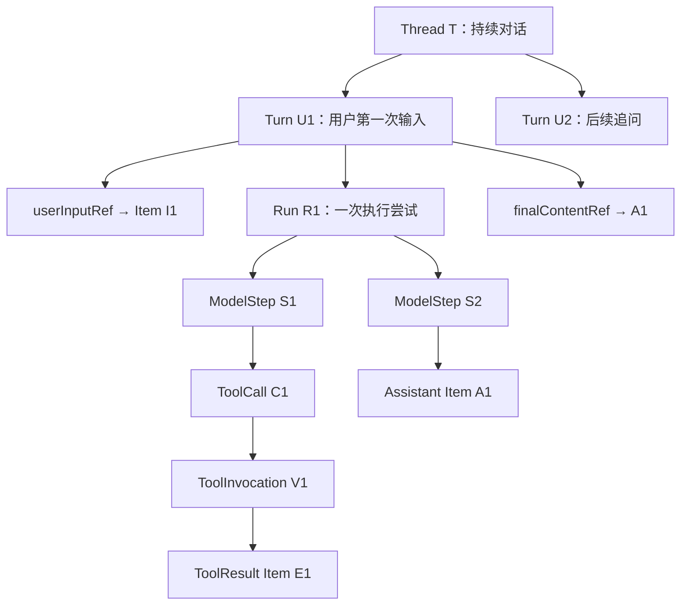
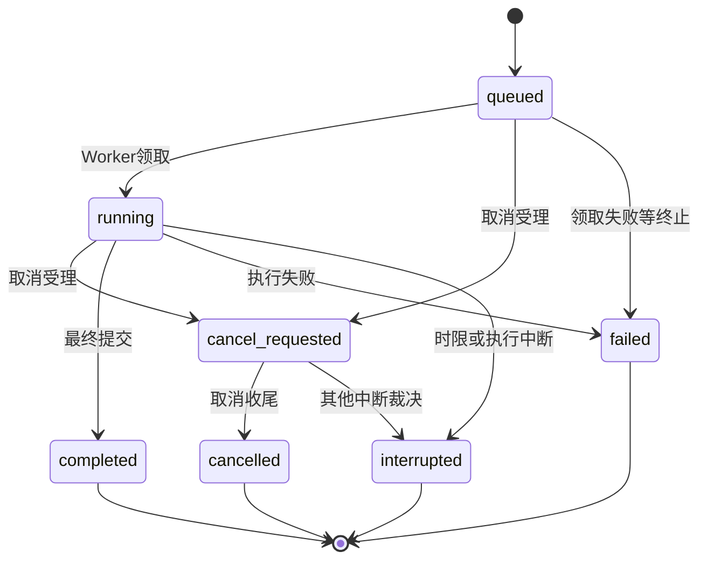
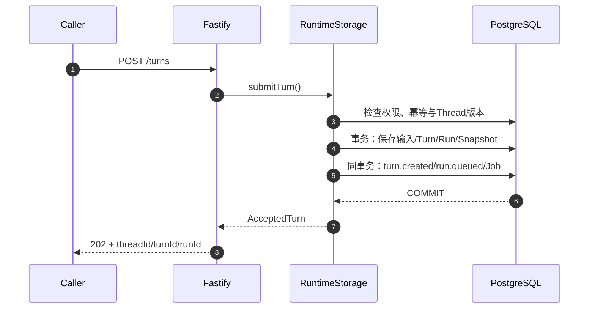
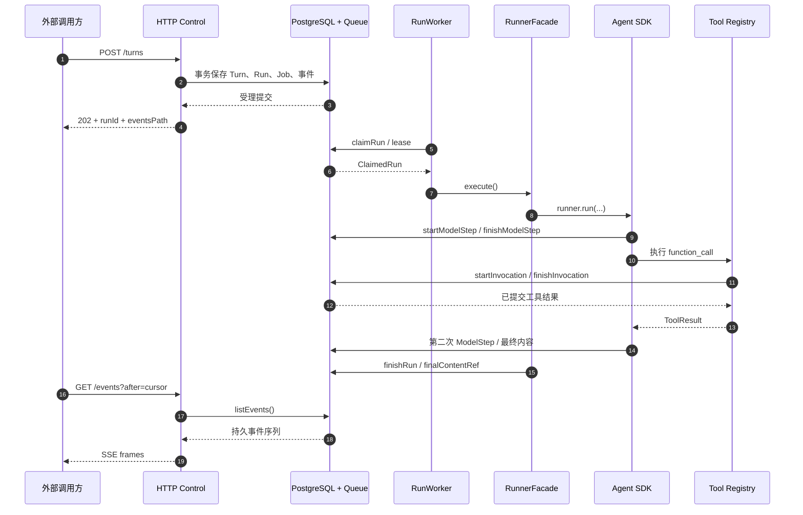

# 从一次知识查询认识 Agent Harness：它是什么、长什么样、怎样运行？

“查一下示例保障甲的等待期，并告诉我条款写在哪一页。”

假设你正在开发一个面向专业顾问的资料查询服务。收到这句话时，最容易想到的是：从知识库找到相关文字，把文字交给大语言模型，再把答案返回。这个程序能在很短时间内写出来。真正接入用户之后，问题会自然延伸：检索第一次只拿到定义，没有拿到例外条件怎么办？同一个请求因网络超时被提交两次怎么办？工具取得结果后服务进程退出怎么办？另一个服务又怎样知道任务已经完成？

这些问题把一次模型调用扩展成了一个可以长期运行的软件系统。这里讨论的 **Harness（智能体执行控制系统）**，就是让模型与工具的执行具有可信入口、明确身份、可控生命周期、持久事实和稳定输出的产品运行层。

本文以保险条款检索为贯穿案例，主要从真实实现解释 Harness。你不需要熟悉保险业务；示例产品、条款、运行 ID 和日志片段都采用**明确标注的合成数据**。涉及已有工程成果的地方，会给出源码位置和测试依据，区分“源码已经实现的行为”“历史测试验证的行为”与“帮助理解的演示轨迹”。

读完本文，应该能够从一条输入实际画出：HTTP 请求如何创建运行对象，Worker 怎样领取任务，SDK 怎样调用模型和工具，事实怎样写入数据库，以及外部如何读到运行事件。

<details open>
<summary><strong>快速认识本文的三种材料</strong></summary>

| 标记 | 代表什么 | 阅读方式 |
| --- | --- | --- |
| **源码摘编** | 来自已读取的 TypeScript 实现，保留关键调用和条件 | 对照文末源码路径理解真实机制 |
| **合成协议样本** | 手工构造但遵循所展示的协议字段 | 用于认识输入、输出和关联身份 |
| **历史测试观察** | 项目测试文件中已包含的断言或以其执行记录为依据的结论 | 结合当时源码与测试环境判断覆盖范围 |

实例源码以 `c66112dfd8676b47b143dc2e26739278cf4b0dde` 快照为阅读基准；每段示例都应在自己的环境中复核适用版本。

</details>

## 01｜从一个具体需求开始：用户实际希望 Agent 做什么？

先看问题本身：

> 请说明示例保障甲的等待期。如果发生意外伤害，该等待期是否仍然适用？请标出原始条款出处。

这其实要求得到三类不同的信息：**等待期的定义或期限**、**意外情形的适用条件**、**可以反向核查的原文来源**。只找到第一类证据，仍然不能把整个问题视为已经充分回答。

从用户视角，产品可以表现为一个很普通的问答入口。用户输入目标，系统在执行过程中给出当前状态，完成后返回回答和来源。真正重要的是这些状态都能由服务端事实解释：查询是否开始了、工具是否正在读取、结果是否已提交、任务是否最终结束。

<table>
<thead><tr><th align="left">可观察的界面元素</th><th align="left">其背后的产品事实</th></tr></thead>
<tbody>
<tr><td><kbd>发送</kbd> 后收到受理标识</td><td>用户输入已经关联到一个 Turn 和 Run</td></tr>
<tr><td>“正在查询条款”</td><td>模型声明的工具动作及其执行状态</td></tr>
<tr><td>出现原文引用</td><td>工具结果包含可以被授权解析的来源引用</td></tr>
<tr><td>回答完成</td><td>最终内容已提交，Run 进入终态</td></tr>
<tr><td>刷新后继续观察</td><td>可以根据持久事件序号恢复观察位置</td></tr>
</tbody>
</table>

这一节先只把用户需求翻译成系统需要输出的可观察信息。具体 UI 组件属于应用层；Harness 负责提供这些元素背后的状态和证据。

<details>
<summary><strong>展开：合成咨询结果在数据层可能是什么样</strong></summary>

```json
{
  "question": "示例保障甲的等待期及意外适用条件是什么？",
  "claims": [
    {
      "topic": "等待期",
      "value": "示例条款约定的期限",
      "evidenceStatus": "supported",
      "sourceRef": "由服务端签发的来源引用"
    },
    {
      "topic": "意外情形",
      "value": null,
      "evidenceStatus": "requires_additional_evidence",
      "sourceRef": null
    }
  ]
}
```

这是一份便于理解的业务答案视图，**不是**该项目已发布的 HTTP DTO。它的作用是展示“某个结论有证据支持、另一个结论仍需查证”这种状态可以被结构化表达。产品的实际 DTO 和工具结果稍后再看。

</details>

## 02｜最简单的 LLM 问答程序是什么、长什么样？

**LLM（Large Language Model，大语言模型）**在程序里通常体现为一次远程 API 调用。开发者给它输入，服务返回一份结构化 Response（响应）。模型能够生成内容、选择工具，具体由所使用的 API 能力和本次请求决定。

**Prompt（提示词）**指提供给模型的任务说明及相关上下文。它既可以是直接的用户文字，也可以包含开发者指令、历史消息和外部证据。程序应该清楚区分这些来源，尤其要把来自文档的正文作为待使用数据，而不是当作新的系统指令。

从最简单的场景看，流程就是一份输入和一份输出：



下面是官方 `openai` Node.js SDK 的基本调用形状。`MODEL_ID` 和 API 凭证来自调用者自己的受控配置；代码在实际执行时才会产生网络请求与对应计费。

```ts
import OpenAI from "openai";

const model = process.env.MODEL_ID;
if (!model) throw new Error("MODEL_ID_REQUIRED");

const client = new OpenAI();

const response = await client.responses.create({
  model,
  input: [{
    role: "user",
    content: "请解释示例保障甲的等待期概念。",
  }],
});

console.log(response.output_text);
```

注意 `response.output_text` 是 SDK 提供的便捷文本读取方式。实际响应还可能包含消息条目、用量信息和其他与当前 API 能力有关的结构。因此，“打印文本”只是消费模型结果的一种方式，不等于完整保存了一次执行。

为了理解底层数据，可以把一次**示意性**的响应表示为：

```json
{
  "id": "resp_synthetic_001",
  "output": [{
    "type": "message",
    "role": "assistant",
    "content": [{
      "type": "output_text",
      "text": "等待期需要依据产品正式条款判断。"
    }]
  }]
}
```

这是教学化的结构摘录，省略实际 Provider 的其他字段。稍后我们的 Harness 会引入 `ModelStep`，把模型调用、对应输出和产品执行身份连接起来；现在先知道模型 API 实际返回的是**可解析的数据对象**。

## 03｜RAG 是什么？一个检索增强程序长什么样？

**RAG（Retrieval-Augmented Generation，检索增强生成）**在生成之前取得外部知识证据。它把一个“模型直接回答”的程序，变为“先找材料，再根据材料生成回答”的程序。对保险条款、合同、内部规范和知识库问答，这通常是第一个实际可用的技术链。

一份 PDF 进入知识系统时，常见的数据对象有：

| 概念 | 是什么 | 可以观察到什么 |
| --- | --- | --- |
| Original PDF（原始文档） | 原始业务资料文件 | 文件身份、版本、物理页码 |
| Parsed Document（解析文档） | 从 PDF 提取的文字与版面内容 | 页面、表格、区块以及解析警告 |
| Chunk（检索片段） | 供检索使用的内容单元 | `chunkId`、正文、关联文档及可能的页码 |
| Embedding（向量表示） | 由模型把文本编码成数值表示 | 一串浮点数、维度与模型版本 |
| Evidence（证据） | 一次查询实际取得的相关内容 | 片段、来源、排序信息和元数据状态 |

Embedding 本身通常是一组向量分量，适合检索算法做相似性匹配；它不包含面向人阅读的完整条款解释。检索结果需要携带可读内容与来源信息，模型才能使用它回答问题。

典型固定 RAG：



**检索请求**可以包含查询文字、产品筛选范围以及 `topK`（最多召回条数）。本项目的实际工具输入允许 `topK` 在 1 至 20 之间；这里用 `5` 表示一次普通查询。

```json
{
  "query": "示例保障甲 等待期 条款",
  "companyIds": null,
  "productIds": null,
  "topK": 5
}
```

检索响应通常不止一段文本；它还要说明命中的来源。例如一个教学化的 Evidence：

```json
{
  "chunkId": "SYN-CHUNK-001",
  "documentId": "SYN-DOC-001",
  "fileName": "示例保障条款.pdf",
  "page": 12,
  "text": "合成条款正文：等待期的定义与起算规则……",
  "score": 0.82,
  "scoreMetric": "example_similarity",
  "metadataStatus": "complete"
}
```

分数 `0.82` 仅是合成示例；不同检索器的相似度或距离度量不能无条件直接比较。`page` 在正式证据链中也需要经过原始 PDF 页码映射核验。

接着程序把检索证据加入模型输入。一个最小固定链路可以采用显式依赖接口：

```ts
type Evidence = {
  text: string;
  documentId: string | null;
  page: number | null;
};

interface RagDependencies {
  retrieve(query: string): Promise<Evidence[]>;
  generate(prompt: string): Promise<string>;
}

async function answerOnce(
  question: string,
  services: RagDependencies,
): Promise<{ answer: string; evidence: Evidence[] }> {
  const evidence = await services.retrieve(question);

  const references = evidence.map((item, i) =>
    "[" + (i + 1) + "] " + item.text +
    "（文档：" + (item.documentId ?? "待核实") +
    "，页：" + (item.page ?? "待核实") + "）"
  ).join("\n");

  const prompt =
    "请根据下列资料回答；缺少依据的要点说明证据不足。\n" +
    "用户问题：" + question + "\n资料：\n" + references;

  const answer = await services.generate(prompt);
  return { answer, evidence };
}
```

这段代码展示了输入与输出边界，`retrieve` 和 `generate` 需要由实际服务实现；它本身不包含外部账户、数据库和请求身份。为了让模型理解完整条款，检索取得的正文还应区分引用、可信指令和外部资料内容。

固定链路的调用顺序由代码决定。它既可以成为产品的一项简单能力，也可以作为后续 Agent 查询效果的 **Baseline（对照基线）**：相同问题、相同语料和检索配置下，比较固定一次检索与模型主动补查取得的证据覆盖。

<details>
<summary><strong>展开：一次固定 RAG 执行记录需要保存什么</strong></summary>

```json
{
  "caseId": "SYN-Q-001",
  "question": "等待期及意外情形如何规定？",
  "retrieval": {
    "query": "示例保障甲 等待期 条款",
    "topK": 5,
    "returnedChunks": 1,
    "foundTopics": ["等待期"],
    "missingTopics": ["意外情形"]
  },
  "generation": {
    "answer": "当前资料支持等待期定义，意外情形需要补充条款。",
    "answerableRequirements": 1,
    "totalRequirements": 2
  },
  "dataMode": "synthetic"
}
```

这是实验记录的示意，并非项目当前实际导出 Schema。它让后续比较具有明确目标：新增模型自主动作，究竟带来了什么证据，而不是只增加了多少文本。

</details>

## 04｜Tool 是什么？普通业务函数怎样呈现给模型？

**Tool（工具）**首先是一个可以执行的能力。程序员可以把 `searchDocuments(input)` 理解为一份普通业务函数：收到查询参数，调用检索服务，返回结果。

要让模型选择它，程序还需提供模型可见的名称、描述和参数约束。这类包装一般称为 **Function Tool（函数工具）**。它保留了普通函数“输入 → 执行 → 输出”的本质，但把函数规格提供给了模型。

项目里使用两种不同的名称：

- `capabilityId`：产品内部的能力标识，例如 `knowledge.search_documents`；
- `modelName`：提供给模型的函数名，例如 `search_documents`。

为什么分成两个？产品需要稳定地管理权限、版本和后端，模型只需要一个它能选择的函数名称。对应代码位于 `apps/runtime/src/registry/catalog.ts` 与 `packages/contracts/src/tools.ts`。

工具输入真实契约的精简摘录：

```ts
const searchDocumentsInput = z.strictObject({
  content: z.string().min(1).max(240),
  query: z.string().min(1).max(2000),
  companyIds: z.array(z.string()).nullable(),
  productIds: z.array(z.string()).nullable(),
  topK: z.number().int().min(1).max(20),
});
```

上面使用 `z` 表示 Zod（运行时 Schema 校验库），省略了实际项目对 ID 最大长度等共用原语的约束。`content` 是模型生成的**公开动作说明**，用于表达“正在做什么”；真正交给检索业务函数的参数是剩余字段。

一次完整合法的工具调用参数例如：

```json
{
  "content": "查找示例保障甲等待期的正式条款依据",
  "query": "示例保障甲 等待期 条款",
  "companyIds": null,
  "productIds": null,
  "topK": 5
}
```

工具返回也有明确结构。工程的业务结果定义包含 `status`、`data`、`sourceRefs`、`coverage`、`missing`、`warnings` 和 `provenance`。其中 `provenance`（数据来源说明）包含模式、后端身份、数据集版本及观察时间。

下面展示其中一个合成返回的完整外层形状，`data` 在此使用一条简化证据行供阅读：

```json
{
  "status": "partial",
  "data": [{
    "evidenceId": "SYN-E-001",
    "chunkId": "SYN-CHUNK-001",
    "documentId": "SYN-DOC-001",
    "fileName": "示例保障条款.pdf",
    "page": 12,
    "text": "合成条款：等待期起算定义……",
    "company": "示例保司",
    "productName": "示例保障甲",
    "sourceRef": null,
    "score": 0.82,
    "scoreMetric": "example_similarity",
    "chunkType": "text",
    "metadataStatus": "partial",
    "provenance": {
      "mode": "synthetic",
      "backendId": "example-backend",
      "datasetVersion": "example-v1",
      "observedAt": "2026-01-01T00:00:00Z"
    }
  }],
  "sourceRefs": [],
  "coverage": "partial",
  "missing": ["SOURCE_DOCUMENT_NOT_ADMITTED"],
  "warnings": [],
  "provenance": {
    "mode": "synthetic",
    "backendId": "example-backend",
    "datasetVersion": "example-v1",
    "observedAt": "2026-01-01T00:00:00Z"
  }
}
```

这里工具执行可以成功返回，却明确报告来源仍不具备可直接读取的 `sourceRef`。这种“调用成功，但证据尚不完整”的情况十分常见。对 Harness 来说，成功保存工具结果与业务证据是否足够是两个不同的判断。

## 05｜Tool Calling 究竟是什么？模型说“我要查”时发回了什么？

**Tool Calling（工具调用）**不是模型自己在服务器上执行任意代码，而是模型通过一份结构化响应表达“希望调用哪个工具、使用什么参数”。后续实际函数执行由 SDK 与受控运行环境承担。

在本项目使用的规范化 SDK 模型事件中，工具调用可以表示成下面的 `function_call` 条目。注意 `arguments` 是一个 JSON 字符串，而非已经执行过的函数返回值：

```json
{
  "type": "function_call",
  "callId": "call-syn-001",
  "name": "search_documents",
  "arguments": "{\"content\":\"查找等待期依据\",\"query\":\"示例保障甲 等待期\",\"companyIds\":null,\"productIds\":null,\"topK\":5}"
}
```

这是**按项目 SDK 规范化形状构造的示例**。原始模型供应商在 HTTP 层采用什么字段名称，由适配器和协议版本决定；不要把上述内部规范化对象直接当成所有供应商统一的网络回包。

各字段的意义相当具体：

| 字段 | 解释 |
| --- | --- |
| `type` | 这条输出属于函数调用意图 |
| `callId` | 当前调用意图的身份，用来关联后续结果 |
| `name` | 模型选择的工具名称 |
| `arguments` | 模型为工具生成的参数 |

SDK（软件开发工具包）读取意图，找到已注册的函数工具，校验参数并执行，然后把结果转成可以加入会话历史的工具结果条目。对工具循环来说，下面的两个对象需要正确配对：

```text
模型输出：function_call（callId = call-syn-001）
    ↓
执行工具：search_documents(...)
    ↓
SDK 可见结果：function_call_result（属于 call-syn-001）
```

为什么保存 `callId`？因为模型一次响应可以提出多个工具调用，结果的完成顺序又可能不同。唯一调用身份使程序可以准确连接每一个意图和每一份结果。

<details>
<summary><strong>展开：这一步在产品里还会出现哪些实体</strong></summary>

模型的 `function_call` 属于一次模型响应输出，因此归属当前 `ModelStep`（模型调用步骤）。实际工具执行由 Harness 创建独立 `ToolInvocation`（工具执行实例），包含自己的 `invocationId`、`providerCallId`、状态、执行参数和结果引用。

```text
ModelStep S1
  └── function_call C1（callId）
       └── ToolInvocation V1（invocationId）
            └── ToolResult Item E1
```

这样，一次“模型决定要查”与一次“工具实际执行并保存结果”就有了不同的事实身份。后续需要做故障恢复、审计或统计时，这个区分极其重要。

</details>

## 06｜Agent 是什么？Agent Loop 在运行时究竟长什么样？

**Agent（智能体）**在这里指一种执行单元：它拥有目标、模型、可以选择的工具，以及根据当前输入和工具结果持续决定下一步的能力。它不需要自己拥有数据库，也不要求必须是多个 Agent 协作；一个 Agent 使用多个工具就可以完成不少实际任务。

**Agent Loop（智能体执行循环）**是它最容易观察的执行形态：模型请求、解析输出、必要时调用工具、保存并加入结果、再次调用模型，直到形成最终输出或遇到运行边界。OpenAI Agents SDK（智能体软件开发工具包）负责驱动这种循环。[^sdk-running]

先看最小 SDK 对象的组成：

```ts
// 结构摘编：实际模型、工具依赖由外层运行环境提供。
const agent = new Agent({
  name: "Insurance advisor",
  model: recordedModel,
  tools: boundTools,
  instructions: "根据可用证据回答问题，必要时继续使用授权工具。",
});

const runner = new Runner({
  toolExecution: { maxFunctionToolConcurrency: 2 },
  tracingDisabled: true,
});

const stream = await runner.run(agent, userInput, {
  stream: true,
  session,
  context: { runId },
  signal,
  maxTurns: 6,
});
```

上述选项与工程真实入口一致，`userInput`、`session`、`signal` 和 `recordedModel` 由外层提供；它展示装配形状而非可独立复制运行的完整程序。`tracingDisabled` 的使用需要结合实际数据授权策略。

如果想知道“循环到底发生了什么”，可以按模型步骤观察。假设第一次检索只找到等待期定义，第二次模型要求补充原文，第三次形成回答：



这是**可由模型选择的合理路径**，并非每个问题必须经过三个模型请求。模型可能第一次直接回答，也可能连续查证多次。一次模型调用可以输出多个工具意图，工具执行也可能并发。

三个经常混淆的计数应从这里开始分开：**用户发起一次 Turn**，SDK 内部可能经历多个 loop iteration，而产品的 **ModelStep** 用来记录一次模型请求尝试。后面工具还会获得独立 **ToolInvocation** 记录。只有分别建模，才能知道成本来自模型、执行还是业务服务。

<details>
<summary><strong>展开：一段带有调用结果的合成模型历史</strong></summary>

```json
[
  {
    "type": "message",
    "role": "user",
    "content": "示例保障甲的等待期及意外规则是什么？"
  },
  {
    "type": "function_call",
    "callId": "call-syn-001",
    "name": "search_documents",
    "arguments": "{\"content\":\"查等待期\",\"query\":\"示例保障甲 等待期\",\"companyIds\":null,\"productIds\":null,\"topK\":5}"
  },
  {
    "type": "function_call_result",
    "callId": "call-syn-001",
    "output": "已找到等待期定义；意外情形条件仍缺证据"
  },
  {
    "type": "message",
    "role": "assistant",
    "content": "已取得等待期依据，继续核对意外情形。"
  }
]
```

这里只展示**阅读层面的精简历史**，不是可以原样提交给 SDK Session parser 的完整 `ModelItem[]`。真实结构还包含状态和内容部件等字段，实际对象需按锁定 SDK 的 Schema 读取。

</details>

模型知道如何选择动作，不代表它在执行系统中自动获得无限能力。它只会看到本次授予的工具集合；预算、权限、取消、状态和结果保存由接下来的 Harness 负责。

## 07｜Harness 是什么？在真正的软件项目里长什么样？

可以把 **Harness** 看作包围 Agent Loop 的产品执行层。它接收用户或服务的命令，创建和调度运行，提供模型与工具所需依赖，记录已发生的事实，并提供对外查询与观察接口。

它既不必是一个独立 npm 包，也不必拆成很多微服务。当前工程采用 **TypeScript / Node.js 服务 + PostgreSQL + 持久队列 + OpenAI Agents SDK** 的组合；首版以单 Agent 模式运行，每次 Run 的模型、历史和工具依赖在可信服务端装配。[^goal]

从源码目录来看，它实际就是若干职责清楚的模块：

```text
apps/runtime/src/
├── composition/          # 启动、配置读取、各依赖装配
│   ├── start.ts
│   ├── runtime.ts
│   ├── registry.ts
│   └── synthetic-worker.ts
├── transport/http/       # HTTP 控制面、Schema、SSE
│   ├── app.ts
│   └── sse.ts
├── control/              # Principal 与运行权限
├── storage/              # PostgreSQL、事务、队列、事实、检查点
│   ├── schema.ts
│   └── store.ts
├── runner/               # Worker、RunnerFacade、ModelStep、Session
│   ├── worker.ts
│   ├── facade.ts
│   ├── model.ts
│   ├── tools.ts
│   └── session.ts
├── registry/             # 工具规格、Profile、后端绑定
└── business/             # 检索、来源、目录、事实等业务 Port/Adapter
packages/contracts/src/  # HTTP/事件/工具契约
tests/                   # 控制面、SDK、Runner、恢复与事件测试
```

这份目录树来自已读取的项目结构，省略了具体辅助模块。它比概念图更直接：你能够找到启动入口、函数工具绑定、模型包装器、数据库表定义和事件输出函数。

**运行起来以后长什么样？** 它会提供类似以下的 HTTP 能力：

| 接口类型 | 示例路径 | 用户或程序实际能做什么 |
| --- | --- | --- |
| 运行状态 | `GET /health/ready` | 检查服务与部分依赖是否就绪 |
| Thread | `POST /v1/threads` | 创建一次持久对话 |
| Turn | `POST /v1/threads/{threadId}/turns` | 正式提交用户输入 |
| Run | `GET /v1/runs/{runId}` | 读取一次执行尝试状态 |
| 运行细节 | `GET /v1/runs/{runId}/steps` | 读取模型步骤 |
| 工具细节 | `GET /v1/runs/{runId}/tool-invocations` | 读取工具执行记录 |
| 事件 | `GET /v1/threads/{threadId}/events` | 重放并持续观察执行变化 |

其中路径花括号是变量。API 的对象归属、身份认证和数据 Schema 均由服务端管理；具体操作还包含取消、重试、恢复、历史和来源查询。第一篇先认识入口和输出，完整 API 契约留到后续章节。

### Harness 的一张物理与逻辑关系图



这个图把“物理可以在同一 Node 进程中”和“逻辑上分成多层”同时表达出来。数据库与模型服务位于边界之外，Node 内部则可以随规模扩展为不同进程，但执行语义保持一致。

<details>
<summary><strong>展开：本项目的合成启动模式到底验证了什么？</strong></summary>

`SyntheticControlModel` 是一个实现 SDK Model 接口的本地确定性模型，回复固定文本：

```text
合成模式：控制面执行链已完成。
```

它也会产生模型完成所需的规范化事件，并通过真正的 Worker、RunnerFacade 和数据库走完生命周期。这条路径验证服务受理与执行、内容提交和事件输出，但该固定模型**不会自动发起工具调用**。

要验证自主工具循环，需要受控 `ScriptedModel`（会按测试剧本返回 `function_call` 的模型）或已授权真实模型。在第一篇后半段，我们会把两种模式分别展示，避免把“工具目录可见”直接等同于“模型实际调用过工具”。

</details>

## 08｜最重要的执行对象有哪些？Thread、Turn、Run 长什么样？

理解 Harness 的最快方式，是先认识它真正保存了哪些对象。当前实现没有把“一段聊天文本”当作全部状态，而是保留**持续对话、用户回合、执行尝试、模型调用、工具执行和内容事实**几种不同身份。

先观察一个完整关系：



### Thread：一段持续存在的对话

Thread（对话线程）拥有自己的 ID、机构和主体归属、状态、资源版本，以及顺序递增的事件游标。顾问连续询问同一款产品，两个回合可以属于同一 Thread。

它解决的问题是：**哪段历史属于一起？谁有权读取和继续它？**

### Turn：一次正式受理的用户输入

Turn（用户回合）带有线程内顺序、`userInputRef`、当前 Run ID 和 `finalContentRef`（最终内容引用）。第一次问等待期是一个 Turn，随后问意外例外是新的 Turn。

它解决的问题是：**用户到底交给系统哪一次输入？哪个回答属于这次输入？**

### Run：完成一个 Turn 的一次执行尝试

Run（执行尝试）持有状态、尝试次数、工具集快照身份、队列任务 ID、模型与工具用量，以及重试或恢复关联。一个 Turn 遇到失败后重新执行，可以产生新的 Run，而保留原输入和原尝试记录。

它解决的问题是：**这一次实际执行从何开始、现在怎样、最后如何结束？**

### ModelStep：一次模型调用尝试

ModelStep 记录 Run 内调用顺序、状态、请求标识（如果取得）、开始结束时间以及输出条目引用。当前包装器在调用模型 Provider 前先创建 Step，并在响应完成时提交规范化模型输出。

它解决的问题是：**第几次进入模型边界？模型实际返回了哪些条目？**

### ToolInvocation：一次工具执行实例

ToolInvocation 保存模型步骤关联、调用 ID、能力与版本、参数、结果引用、来源集合和执行状态。工具的结果可以在模型步骤已经结束之后才返回。

它解决的问题是：**模型提出的那个动作是否实际执行过？结果是否提交了？**

### Runtime Item：一条权威内容事实

Runtime Item（运行条目）保存用户输入、模型输出、工具调用和工具结果的规范化内容。其 `canonical` 字段保留 SDK 规范化结构，条目 ID 供 Session、工具结果和最终内容引用。

它解决的问题是：**哪一份内容已经正式写入，其他读取路径该引用哪一份？**

把它们放回一个实际数据结构：

<details open>
<summary><strong>展开：一次 Run 的关联对象（教学化的产品事实视图）</strong></summary>

```json
{
  "thread": {
    "threadId": "SYN-T-01",
    "revision": 1
  },
  "turn": {
    "turnId": "SYN-U-01",
    "userInputRef": "SYN-I-USER",
    "currentRunId": "SYN-R-01",
    "finalContentRef": "SYN-I-FINAL"
  },
  "run": {
    "runId": "SYN-R-01",
    "status": "completed",
    "modelCalls": 2,
    "toolCalls": 1
  },
  "modelSteps": [
    {"stepId": "SYN-S-01", "ordinal": 1, "status": "completed"},
    {"stepId": "SYN-S-02", "ordinal": 2, "status": "completed"}
  ],
  "toolInvocations": [{
    "invocationId": "SYN-V-01",
    "modelStepId": "SYN-S-01",
    "providerCallId": "call-syn-001",
    "status": "succeeded",
    "resultItemRef": "SYN-I-RESULT"
  }]
}
```

这是一份**将多个真实对象投影合并后的教学视图**；产品实际 HTTP 接口分别返回 Thread、Turn、Run、ModelStep 和 ToolInvocation 对象，不存在需要一次返回以上所有字段的通用 `getEverything` 接口。

为什么需要如此多的 ID？因为故障定位依靠稳定关系。例如 `ToolInvocation.modelStepId` 表示动作来自哪个模型响应，`resultItemRef` 指向已经持久化的结果，`Turn.finalContentRef` 指向最终已提交的助手条目。同样的回答文本出现两次，也不应让两个实际发生的条目共享一个内容 ID。

</details>

## 09｜执行状态是什么？程序怎样知道任务是否已经结束？

在页面上看到一个“处理中”，很容易以为程序内部也是一个布尔变量。实际 Harness 必须管理几种不同对象的生命周期（Lifecycle）。

以 Run 为例，可以将主流程画成：



这是用于认识常见路径的状态图，具体异常、租约和取消竞争由存储方法及测试裁决。应注意 `cancel_requested`（已请求取消）和 `cancelled`（取消已收尾）是两个不同的时刻。

同样，模型步骤通常经历 `running → completed/failed/cancelled`，工具实例具有 `running/succeeded/failed/timed_out/denied/outcome_unknown` 等状态。**模型调用结束不代表工具已完成，工具成功也不代表整个 Run 已完成。**

这些状态保存在数据库，而不是只挂在某一个进程的变量上。这样进程重启或 HTTP 观察连接断开后，系统仍可以读取最后已经提交的事实。

为什么需要状态转换？一方面它限定谁可以合法写入下一条记录，另一方面外部可以明确地观察执行阶段。例如：

```text
Run queued
  → run.started
  → model_step.started
  → model_step.completed
  → tool_invocation.started
  → tool_invocation.completed
  → model_step.started
  → model_step.completed
  → turn.completed
  → run.completed
```

这是一条成功单工具测试可以产生的**事件类型子序列**。实际事件之间还可以插入 `content.delta`、`checkpoint.created` 等事件；不应以一个示意序列替代系统支持的全部事件协议。

## 10｜Event 是什么？Harness 对外的一帧消息长什么样？

**Runtime Event（运行事件）**描述一条已经发生并持久记录的产品变化。例如 Run 被受理、模型调用完成、工具结果已经提交。Event 的用途是让外部调用方按既定顺序观察执行，而不必把内部 SDK 对象直接交出去。

本实现的事件具有共同信封（Event Envelope）：

```json
{
  "schemaVersion": "1.0",
  "eventId": "SYN-EVENT-07",
  "threadId": "SYN-T-01",
  "seq": "7",
  "turnId": "SYN-U-01",
  "runId": "SYN-R-01",
  "occurredAt": "2026-01-01T00:00:00Z",
  "type": "tool_invocation.completed",
  "payload": {
    "invocationId": "SYN-V-01",
    "resultItemRef": "SYN-I-RESULT"
  }
}
```

`eventId` 是事件身份，`seq` 是 Thread 内的顺序游标。`seq` 使用十进制字符串，是因为 PostgreSQL `bigint` 的范围超过 JavaScript 普通 Number 的全部安全整数范围。外部处理需要按协议保留其精度。

不同 `type` 对应不同 `payload`。例如 `run.queued` 保存运行 ID，`model_step.completed` 保存 Step ID，`tool_invocation.completed` 保存执行 ID 和结果条目引用。具体 Schema 位于 `packages/contracts/src/events.ts`。

这些持久事件可以通过 HTTP 查询逻辑被读取，也可以使用 **SSE（Server-Sent Events，服务器发送事件）**持续输出。一帧 SSE 在传输层可以长这样：

```text
id: 7
event: tool_invocation.completed
data: {"schemaVersion":"1.0","eventId":"SYN-EVENT-07","threadId":"SYN-T-01","seq":"7","turnId":"SYN-U-01","runId":"SYN-R-01","occurredAt":"2026-01-01T00:00:00Z","type":"tool_invocation.completed","payload":{"invocationId":"SYN-V-01","resultItemRef":"SYN-I-RESULT"}}

```

其中空行表示帧结束；`id` 用于连接恢复和去重，`event` 是事件类型，`data` 是完整 JSON 事件。HTTP/SSE 观察连接是外部读取通道，关闭观察连接不会自动取消后台 Run。

<details>
<summary><strong>展开：运行事件与模型流式事件有什么关系？</strong></summary>

模型流可能产生 `output_text_delta`（文本增量）、`response_done`（当前模型响应结束）等 SDK 事件。`RecordedModel` 会把这些事件处理成产品事实：例如将文本增量累积到某一助手条目，并写入 `content.delta`；当前模型响应完成后提交 ModelStep 和规范化输出。

因此，模型流事件是**模型边界收到的变化**，Runtime Event 是**产品经过规则处理并写入的运行变化**。二者相关，但不需要共享同一套对象格式。

当模型输出已提交后，`finalContentRef` 为最终内容提供稳定引用；事件读取、历史读取和对话导出可以沿同一个引用取得相同内容，而不是各自维护一份可能发生偏差的副本。

</details>

## 11｜服务是怎样启动的？从 `start.ts` 看到真实装配过程

前面认识了对象与协议，现在可以顺着真正的程序执行路径往下走。程序运行起来的第一步，还没有用户问题：它要先知道数据库在哪里、当前采用什么身份配置、提供哪些工具、使用什么模型实现。

工程启动入口是 `apps/runtime/src/composition/start.ts`。它首先读取私有配置引用，选择 Synthetic（合成）或已经被明确配置和授权的产品运行模式，之后建立 Registry（工具注册系统）所需的能力与快照解析器，最后调用 `composeRuntime()`。

这里有一个容易忽略的设计点：**配置引用只是服务端加载私有内容的路径，模型与业务服务的秘密值不应跟随用户请求在 HTTP 正文中传入。** 本地测试和部署时，配置路径可以作为环境变量输入：

```bash
# 在已安装锁定依赖的项目目录使用合成环境。
# 私有配置文件应来自受控测试实例。
export INSURANCE_DATABASE_CONFIG=/absolute/private/db-config.json
export INSURANCE_HTTP_CONFIG=/absolute/private/http-config.json

corepack pnpm runtime:start
```

这段命令展示真实项目脚本和必需配置入口；私有 JSON 的完整内容由环境及仓库配置规范决定。不能把示意路径直接当成一个已经存在的部署。

### Composition Root 是什么？

**Composition Root（依赖装配入口）**不是一个抽象名词堆砌的模块，它就是创建组件、连接依赖并负责释放资源的位置。`composeRuntime()` 的实际顺序非常直接：

```ts
// apps/runtime/src/composition/runtime.ts：摘出主要创建顺序。
const storage = await createRuntimeStorage(options.database, {
  ...(options.migrate === undefined ? {} : { migrate: options.migrate }),
  ...(options.authorizeClaim ? { authorizeClaim: options.authorizeClaim } : {}),
});

const maintenance = new RuntimeMaintenance(storage, options.maintenance ?? {});
const worker = options.workerFactory?.({ storage, modelProvider: options.modelProvider });

const app = await createControlHttpApp({
  storage,
  authenticator: options.authenticator,
  snapshots: options.snapshots,
  cursorSigner: options.cursorSigner,
  registry: options.registry,
  onClose: dispose,
});

await worker?.start();
await maintenance.start();
```

这是方便阅读的**摘编**：正式代码还处理可选维护配置、类型分支和异常清理。重要的是创建顺序和同一 `storage` 的依赖共享关系。

`createRuntimeStorage` 创建产品数据库访问与队列，`createControlHttpApp` 注册 HTTP 路由，`workerFactory` 创建后台执行器。它们可以在同一个 Node.js 进程里，但彼此并非同一个任务生命周期。HTTP 接受命令，Worker 从持久队列领取任务，存储连接两边的权威状态。

为什么不直接在 HTTP handler 中写 `await runner.run(...)`？因为模型执行可能持续很久，业务响应需要异步观察、取消或恢复。把“受理”和“完成”分成两种产品行为，就可以让后台任务独立于某一个请求连接存活。

### 实际合成运行形态

默认合成装配使用 `createSyntheticRegistryRuntime()` 与 `createSyntheticWorker()`。后者将 `SyntheticControlModel` 放进真正的 `RunnerFacade` 与 `RunWorker`，并使用真实的 `PgSdkSession`（PostgreSQL 会话历史适配器）。

这一点值得特别观察：**合成的是模型输出，不是整套 Harness 的运行过程。** 这样的测试可以让业务和付费模型网络保持隔离，同时验证产品执行生命周期。

实际启动报告需要区分这几种状态：

- 服务已经监听本地端口；
- 数据库与队列通过 readiness（就绪）检查；
- 当前 Registry 提供了哪些已授权能力；
- 某次 Run 真正由 Worker 领取并到达终态。

它们分别由不同接口或执行事实确认。一个 `GET /health/ready` 返回成功说明当前健康检查范围内的依赖满足条件，还不足以证明模型已经完成某个具体业务问题。

## 12｜一次用户输入怎样变成 Run？从 HTTP 走到 PostgreSQL 事务

准备好服务后，外部调用方先创建 Thread，再提交 Turn。我们以本地合成模式为例，用真实的 API 路由观察两次命令。

**第一步，创建 Thread。**

```http
POST /v1/threads HTTP/1.1
Authorization: Bearer <TEST_TOKEN>
Content-Type: application/json
Idempotency-Key: example-create-thread-001

{
  "title": "示例条款查询"
}
```

一个成功的创建操作返回 `201 Created`，生成 Thread ID 和初始 revision（线程资源版本）。这里的 `<TEST_TOKEN>` 是占位符，需要在已授权的本地环境中替换。

**第二步，向该 Thread 提交用户问题。**

```http
POST /v1/threads/{threadId}/turns HTTP/1.1
Authorization: Bearer <TEST_TOKEN>
Content-Type: application/json
Idempotency-Key: example-submit-turn-001

{
  "input": {
    "text": "请查询示例保障甲的等待期。"
  },
  "agentProfileId": "synthetic-profile",
  "expectedThreadRevision": 0
}
```

`synthetic-profile` 是项目受控 HTTP 测试所采用的示例配置名称。它能否在实际实例中使用，取决于当前服务加载的 Profile 与权限；实际 `threadId` 取上一步返回的值。

受理成功时，返回 `202 Accepted` 与一组稳定标识：

```json
{
  "threadId": "SYN-T-01",
  "turnId": "SYN-U-01",
  "runId": "SYN-R-01",
  "threadRevision": 1,
  "eventsPath": "/v1/threads/SYN-T-01/events"
}
```

**这是一份示意值的 `AcceptedTurn` 响应**。正式接口生成实际 ID；字段形状来自当前项目的合同。`202` 说明受理成功，之后可以用 `runId` 查询运行状态，用 `eventsPath` 观察事件，而不必让提交请求一直等待模型结束。

### `submitTurn()` 真正写入了什么？

后端进入 `createControlHttpApp()` 的 `submitTurn` 分支，再调用 `RuntimeStorage.submitTurn()`。

该函数在一个 PostgreSQL 事务里处理：当前主体与 Thread 归属、幂等命令重放、Thread 行锁与版本、可信 RunSnapshot（运行快照），然后创建用户输入条目、Turn、Run、事件和 pg-boss Job。



这里的 “COMMIT” 是重要完成条件：只有事务中所有必须保持一致的记录一起成功，API 才能返回已受理事实。Job 通过 `fromDrizzle(tx, sql)` 使用相同数据库事务；因此不会自然出现“Run 已提交、队列却完全没有对应 Job”的半完成双写结果。

关键源码（删去部分事务参数以突出关系）：

```ts
// storage/store.ts：submitTurn 内的局部执行形状（摘编）
const turnId = randomUUID();
const runId = randomUUID();
const itemId = randomUUID();
const queueJobId = randomUUID();

await tx.insert(schema.turns).values({ /* Turn 与 userInputRef */ });
await this.writeItem(tx, { threadId, turnId, runId: null }, {
  itemId,
  role: "user",
  origin: "user",
  text: parsed.input.text,
  canonical: { type: "message", role: "user", content: parsed.input.text }
});
await tx.insert(schema.runs).values({ /* Run / Snapshot / Job 关系 */ });
await this.emit(tx, { threadId, turnId, runId }, {
  type: "turn.created",
  payload: { turnId, userInputRef: itemId }
});
await this.emit(tx, { threadId, turnId, runId }, {
  type: "run.queued",
  payload: { runId }
});
await this.boss.send(this.queueName, { runId }, {
  id: queueJobId,
  db: fromDrizzle(tx, sql)
});
```

源码里还会更新 Thread revision 并保存幂等回执。注意 `RunSnapshot` 从服务端可信配置解析，用户通过 `agentProfileId` 选择已允许配置，而不负责直接提交模型密钥或任意后端地址。

### 为什么需要 Idempotency-Key？

如果 HTTP 受理成功但响应在网络上丢失，调用方可能重试相同请求。**Idempotency（幂等）**让相同身份的命令返回原始受理对象，而不是新创建一次任务。真正判断时要同时核对当前主体、命令作用域、幂等键以及正文摘要。

已有控制面集成测试使用真实 PostgreSQL，验证相同键与相同输入得到相同响应、数据库只保存一次 Run 和用户输入，队列有对应 Job；同键不同正文则返回 `409 IDEMPOTENCY_CONFLICT`。同 Thread 并发不同命令另有 `THREAD_BUSY` 约束。

这说明一个简单的 `202` 响应背后，已经包含可复现的任务身份与事务语义。后续 Worker 就以这份受理事实开始执行。

<details>
<summary><strong>展开：合成受理之后，内部最小事实图是什么样</strong></summary>

```text
Thread SYN-T-01
  revision = 1
  Turn SYN-U-01
    userInputRef = SYN-I-USER
    Run SYN-R-01
      status = queued
      snapshotId = 服务端选择的配置快照
      queueJobId = 实际 pg-boss Job
      events:
        turn.created
        run.queued
```

这些是通过不同实体和表连接形成的阅读视图，不是一个单独数据库表的原始 JSON。展示聚合视图，是为了让你在阅读 `store.ts` 时能够理解每次写入为什么必须共享事务。

</details>

## 13｜谁开始执行 Run？从 Worker 到两次 ModelStep

### 第一段：持久队列交给 Worker

`RunWorker.start()` 从 pg-boss 领取 Job 数据，读取其中的 `runId`，调用 `claimRun()` 获得执行租约（Lease）。

```ts
// runner/worker.ts：核心路径摘编
const data = runJob.parse(job.data);

if (await storage.settleUnclaimedRun(data.runId, {
  status: "cancelled"
})) {
  continue;
}

const claimed = await storage.claimRun(
  data.runId,
  ownerId,
  leaseMs
);

if (!claimed) continue;

await facade.execute(claimed);
```

真实代码的 `settleUnclaimedRun` 返回规则还涉及已取消任务和其他终态；这段摘编强调调用顺序。领取资格时，数据库检查状态、租约和版本，写入 `run.started` 事件并返回带 Lease 的 `ClaimedRun`。

Lease（执行租约）可以理解为当前 Worker 进行状态提交的有效资格。它包含 `ownerId`、`fence`（单调代次标记）和 `expiresAt`。后续写入需要验证这份资格，防止旧执行器在失去控制权后继续提交结果。

### 第二段：RunnerFacade 组装本次执行

`RunnerFacade.execute(claimed)` 是产品执行与官方 SDK 的连接入口。它做几项具体事情：解析预算，建立 `AbortController`（运行取消控制器），创建运行环境，读取模型和工具绑定，构造 `PgSdkSession`（会话历史适配器），再创建 `RecordedModel` 和 SDK Tools。

真实组装形状：

```ts
// runner/facade.ts：中部装配代码摘编
const session = await dependencies.session(environment, facts);

const model = new RecordedModel(
  provider,
  environment,
  facts,
  dependencies.beforeModelCall,
  session instanceof PgSdkSession
    ? session.projectModelRequest.bind(session)
    : undefined
);

const tools = createRunTools(bindings, environment, facts);

const agent = new Agent({
  name: "Insurance advisor",
  model,
  tools,
  instructions: instructionsFromSnapshot
});

const runner = new Runner({
  toolExecution: {
    maxFunctionToolConcurrency: budget.maxConcurrentTools
  },
  tracingDisabled: true,
  traceIncludeSensitiveData: false,
  modelSettings: {
    maxTokens,
    store: false,
    retry: { maxRetries: 0 }
  }
});
```

`instructionsFromSnapshot` 是便于阅读的占位变量；实际代码从 `claimed.snapshot.modelConfig.instructions` 读取可信配置，并提供默认指令。`dependencies`、`environment` 和 `facts` 也来自实际门面上下文；摘编用于展示组装关系。

这里最关键的一组对象是：

- **RunEnvironment（本地运行环境）**：当前 Principal、Snapshot、预算、租约、存储、取消信号；
- **PgSdkSession（持久会话适配器）**：给 SDK 提供按顺序排列的历史条目；
- **RecordedModel（可记录模型边界）**：包住 Provider 调用并创建 ModelStep；
- **SDK Tool（模型可调用的函数工具）**：经执行包装器连接业务后端。

ModelContext（模型可见上下文）与 RunEnvironment 不同。模型只会经明确的数据通道看到指令、输入历史、工具定义和工具结果；它不会因为某个服务端对象存在，就自动获得数据库连接或密钥。

### 第三段：第一次模型请求如何留下记录

`RecordedModel.begin()` 在 Provider 请求发出之前先检查输入、调用预算和当前授权，然后保存一个新的 ModelStep。收到完整模型响应以后，`complete()` 提交规范化输出条目和步骤终态。模型可能输出工具调用条目；调用意图的 `callId` 被记录，用于后续工具执行关联。

```ts
// runner/model.ts：两个记录边界的简化调用
const stepId = randomUUID();

await storage.startModelStep(lease, {
  stepId,
  ordinal: currentOrdinal
});

// provider.getResponse(...) 或 getStreamedResponse(...)

await storage.finishModelStep(lease, stepId, {
  status: "completed",
  outputItems,
  tokenUsage: {
    inputTokens,
    outputTokens
  }
});
```

这里 `currentOrdinal`、`outputItems`、`inputTokens` 代表实际函数在运行中构造的值。这个片段展示核心调用关系，不是独立可执行函数。

重要区别是：**ModelStep 完成意味着此次模型响应结束，工具执行可以在这之后才开始。** 因此一次模型响应若提出查询意图，状态序列可以是：

```text
model_step.started (S1)
model_step.completed (S1)
tool_invocation.started (V1)
tool_invocation.completed (V1)
model_step.started (S2)
model_step.completed (S2)
```

这是基于实际存储边界的合理单工具轨迹。Provider 的实际请求次数还应结合传输与重试记录判断；当前源码在 Runner 配置里关闭了隐式模型重试，并为模型调用尝试建立单独步骤。

### 第四段：工具真正执行并保存结果

模型的 `callId` 进入 `createRunTools()` 后，执行包装器验证调用属于当前 Run、对应模型步骤已经记录、工具版本与权限合法、执行预算仍可使用，然后创建 ToolInvocation。

实际 `execute` 阶段将业务参数交给 `binding.execute`；取得结果后会按业务输出 Schema 校验，检查返回体字节上限并提取 `sourceRefs`（来源引用集合）。

与普通函数调用相比，Harness 的关键步骤是**结果先持久化，再允许 SDK 将结果用于下一次模型调用**。SDK 0.18.0 的 `customDataExtractor` 回调为它提供了准确的工具结果条目：

```ts
// runner/tools.ts：关键的结果提交顺序（摘编）
const call = pending.get(toolCall.callId);

const item = {
  ...runtimeItem(rawItem, randomUUID(), call.stepId),
  sourceRefs: [...call.sourceRefs],
};

await storage.finishInvocation(lease, call.invocationId, {
  status: "succeeded",
  resultItem: item,
  sourceRefs: call.sourceRefs,
  checkpoint: true,
});

recordFact(facts, rawItem, item.itemId);
pending.delete(toolCall.callId);
```

如果该数据库提交失败，下一次模型调用就不应把一个尚未保存的结果当作已经取得的事实。执行器会沿错误路径收尾或进入需要后续收敛的状态。此处只需要理解**先后顺序**；ToolInvocation 的全部状态和错误处理将在后续专题深入。

## 14｜最终内容和事件究竟怎样产生？

当 SDK 取得工具结果之后，会把结果加入下一次模型请求。若模型第二次生成了最终回答，`RecordedModel` 把助手输出写成已提交 Runtime Item（权威运行条目）。`PgSdkSession` 再把对应条目引用纳入当前模型历史视图。

一条简化的执行结果可以是：

```text
Run R1
  S1：模型输出 call-syn-001
    V1：调用 search_documents
      E1：保存 ToolResult
  S2：模型根据 E1 生成最终回答
    A1：保存 assistant content
  Turn.finalContentRef → A1
  Run.status → completed
```

`finalContentRef`（最终内容引用）保存的是条目 ID，而不是另一份复制的最终答案。`RunnerFacade` 等待 SDK stream 完成，读取最终助手条目引用，再调用 `RuntimeStorage.finishRun()`。

```ts
// runner/facade.ts：成功收尾的核心关系（摘编）
await completed;
controller.signal.throwIfAborted();

const finalContentRef = facts.finalAssistantIds.at(-1);

if (!finalContentRef) {
  throw new RunBoundaryError("FINAL_CONTENT_UNAVAILABLE");
}

await storage.finishRun(lease, {
  status: "completed",
  finalContentRef,
  usage: { elapsedMs },
});
```

`finishRun()` 在事务中检查引用有效性、当前租约和取消条件，然后提交 Turn/Run 终态与相关事件。对“最终内容已经在模型边界提交”的路径，`finalContentRef` 直接指向已有助手条目；仅在调用方显式提交新 `finalItem` 时，存储才会额外按该路径发出 `content.committed`。因此，应该依据最终引用和终态判断事实，而不能把某一种可选事件模式硬编码成所有成功运行的必经序列。

### SSE 是怎么把这些事件送出去的？

`DurableEventStreams` 先读取当前授权下的持久事件，再用同一数据库查询接口按 `seq` 不断读取后续事件。HTTP 层会把每条事件序列化为：

```text
id: 21
event: run.completed
data: {"schemaVersion":"1.0","eventId":"SYN-E-21","threadId":"SYN-T-01","seq":"21","turnId":"SYN-U-01","runId":"SYN-R-01","occurredAt":"2026-01-01T00:00:00Z","type":"run.completed","payload":{"runId":"SYN-R-01","finalContentRef":"SYN-I-FINAL"}}

```

这是结构正确的**合成 SSE 帧**，而不是实际运行的第 21 条事件。真实 Thread 的 `seq` 从数据库取得；`after` 和 `Last-Event-ID` 等参数用于重放与续接。观察连接关闭只结束观察者，后台 Run 仍沿自己的预算和取消规则执行。

### 一条从入口到出口的完整时序



请特别注意两条“返回”：提交接口很早就返回 `202`，而运行事件随后持续产生。前者是控制面命令回执，后者是执行事实的输出。它们共同描述一条任务，却属于不同生命周期。

## 15｜现在再比较：LLM、固定 RAG、Agent Loop 与 Harness 有什么区别？

已经见过具体代码，才适合讨论抽象层的差异。

**LLM（模型）**是接受输入并产生结构化输出的计算服务。它可以给出文字，也可以返回工具调用意图。

**固定 RAG** 是一种预先安排好的程序：先检索，再拼接材料和提示词，最后调用模型。检索几次、是否扩页，取决于开发者写好的流程。

**Agent Loop（智能体执行循环）**把工具选择放到模型与 SDK 的迭代中。模型根据当前历史和工具结果选择动作，SDK 执行并将结果送回后续模型请求。

**Harness（产品执行系统）**则承载这段执行进入真实服务后必须满足的约束：可信入口、任务身份、授权、预算、持久状态、运行调度和事件输出。

| 对象 | 真正管理的事 | 最有代表性的输入与输出 |
| --- | --- | --- |
| LLM | 内容生成与下一步动作选择 | ModelRequest → 模型响应 |
| 固定 RAG | 已定义的查询与生成顺序 | 问题 → 检索片段 → 模型回答 |
| Agent Loop | 模型—工具—模型的连续执行 | 模型响应中的 ToolCall → ToolResult → 下一次请求 |
| Harness | 持久执行、权限、状态与外部契约 | 提交 Turn → Run/ModelStep/Invocation → Events |

它们不是四种互斥产品。一个 Harness 可以运行 Agent；Agent 使用的某个检索工具内部也可以采用固定 RAG。我们区分的是**抽象层次与责任**。

### 五组工程上特别容易混淆的对象

**ToolCall 与 ToolInvocation。** `function_call` 是模型表达的动作意图；ToolInvocation 是实际执行记录。调用身份可以先出现，执行可能被权限、版本或预算边界拒绝。这也解释了为什么不能把模型输出的工具名称直接当作“工具已经成功”的事实。

**ModelStep 与 Run。** ModelStep 在一次模型响应完成时结束；Run 是更长的任务执行尝试，可能包含多个 ModelStep 和 ToolInvocation。用一次模型调用的结束时间作为任务结束时间，会使后续业务调用和结果提交落在错误的生命周期里。

**HTTP 受理与执行完成。** `202 Accepted` 说明存储已经受理输入和持久任务；`run.completed` 说明执行经过最终状态提交。一个请求可以先拿到 Run ID，再观察后台变化。

**SDK Session 与产品历史。** SDK 使用一份有序的历史引用视图，产品还要保留失败尝试、工具调用、结果、来源和检查点等审计事实。对模型输入进行裁剪，不应该连带擦掉完整权威历史。

**引用存在与业务证据充分。** `sourceRef` 能被当前授权解析，说明来源定位满足相应条件；它引用的正文是否支持“意外免责适用范围”这个结论，仍需依据原文和评测规则判断。

这些区别最终决定了代码该写在哪个模块、什么操作需要事务、测试该断言哪些字段，以及产品发生异常时该保存什么。

## 16｜模型、SDK、Harness 和业务服务分别承担什么职责？

架构图里的 **Boundary（边界）**可以理解为一份明确的责任约定：什么数据可以进入，谁能决定什么状态，发生错误由哪一层处理，以及下游能够依赖哪一种已成立的结果。

一个简单的例子是：模型返回 `callId = C1` 的查询意图，说明模型选择了工具；工具包装器真正执行并完成持久化，才能说明该调用有成功结果；最终 `finishRun()` 提交后，才能说当前用户任务已经成功完成。

| 组件 | 它拥有的核心能力 | 可以直接确定的事实 |
| --- | --- | --- |
| HTTP Control Plane | 用户命令、认证、幂等、资源版本 | 请求是否受理，关联什么 Thread/Turn/Run |
| RuntimeStorage | 数据库事务、租约、条目、终态与事件 | 哪些状态和内容已经持久提交 |
| RunWorker | 队列消费、领取与监督 | 哪个执行者持有当前运行资格 |
| RunnerFacade | 当前 Run 的执行环境与 SDK 包装 | 运行采用什么预算、信号、依赖与终态规则 |
| OpenAI Agents SDK | Agent Loop、模型与工具交互、Session 接口 | 循环中的下一次模型与工具处理如何衔接 |
| RecordedModel | 一次模型调用的边界与规范化输出 | 哪个 ModelStep 产生了哪些模型输出 |
| Tool Registry / Tool Wrapper | 能力可见性、绑定、权限、工具结果提交 | 哪一次合法工具调用取得并保存了什么 |
| Business Port / Adapter | 与实际检索、目录、来源服务通信 | 本次业务请求取得怎样的结构化返回 |
| DurableEventStreams | 持久事件查询、游标与 SSE 传输 | 外部能够按顺序观察哪些已提交变化 |

其中 **Provider（模型提供方适配器）**将 SDK Model 请求转换为具体模型网络调用；真正的模型服务在这条边界之外。与它相似，业务 Adapter 将稳定能力转换为不同上游接口的实际请求。两者都可以在不改变整个 Harness 公开 API 的前提下，按明确契约替换实现。

### 为什么在 SDK 外面仍要有 RunnerFacade？

SDK 的 `runner.run()` 知道如何推进工具循环，却不天然知道当前产品 Run 在哪个 Thread 下、数据库租约是否还有效、用户是否已经持久取消、历史内容应如何提交。门面在 SDK 前后建立这些条件，并把模型、工具、Session 接入统一存储。

这一层让 SDK 继续负责它擅长的模型与工具机制，而产品自己负责用户可感知的生命周期。具体错误定位也更直接：一次模型网络失败属于模型边界，一次结果存储失败属于执行持久化边界，当前授权被撤回属于本地策略边界。

### Continuation Decision（是否继续执行）究竟位于哪里？

当模型返回工具调用时，SDK Runner 将工具结果加入后续输入并继续循环；模型输出最终答复时，SDK 按其执行协议结束。当前工程把“调用哪个工具、怎样改写查询、是否补充检索”的选择交给模型与 SDK。Harness 保留预算、当前授权、取消、输出校验和运行终态约束。

所以在这个架构中，产品没有额外建立一套与 SDK 重复的独立 Agent Loop。确实需要跨任务调度、跨 Agent 目标分派或新的策略约束时，再明确新增决策层的输入、状态和权限。

### 模型输出为什么不能直接作为公开事件？

模型流式增量属于 SDK/Provider 的协议。Harness 还需要表述 Run 的受理、队列领取、工具执行、来源引用、取消和最终提交等产品事实。事件层通过稳定的 RuntimeEvent Schema 表达这些变化。

对外协议因此能够独立于模型供应商的内部字段演进。应用可以根据 `threadId/seq` 读取和续传事件，实际 SDK 会话和存储细节则由服务端控制。

## 17｜为什么工程选择这样的技术架构？

在真正的系统里，技术选型通常从具体需求倒推，而不是从流行组件清单开始。

### TypeScript、Node.js 与 Fastify

在线 Runtime 用 TypeScript，便于与 Agents SDK 的模型、工具和 Session 类型结合，也便于在同一个运行环境里维护 HTTP 契约和业务适配。Node.js 适合处理大量异步 I/O：模型网络请求、业务接口和数据库查询。

Fastify 提供路由、生命周期和请求校验；产品进一步用 Zod / JSON Schema 固定真实输入输出结构，并用路由清单检查实际注册操作是否与公开 OpenAPI 一致。**编译期类型与运行期校验是互补关系**：TypeScript 能约束本地代码，HTTP 和模型返回仍需实际解析。

### OpenAI Agents SDK 与单 Agent 执行

当前源码锁定 `@openai/agents@0.18.0`。SDK 已有 Agent、Runner、Model、Session 和 Function Tool 机制，产品把开发工作集中在运行治理、状态、工具契约和业务连接上。

单 Agent 也可以使用多个工具完成复杂问题：检索来源、读取产品目录、查询结构化事实、补充原始 PDF。选择一个 Agent 承担当前 Run，可以先把身份和状态所有权建立清楚；需要更复杂的任务委派时，再定义跨 Agent 的调度与上下文边界。

### PostgreSQL 与 pg-boss

数据库保存 Thread、Turn、Run、ModelStep、ToolInvocation、Canonical Items、检查点和持久事件。pg-boss 使用 PostgreSQL 提供任务交付，使受理事务能同时保存 Run、事件和 Job。

这个选择带来的实际保证是：请求提交成功后，有一份可以由 Worker 后续领取的持久任务。队列交付不直接等于执行资格，产品仍使用 `claimRun`、Lease 和 Fence 管理后续写入。

### RunSnapshot、Registry 与 Port/Adapter

RunSnapshot 记录模型、工具集合和策略的具体身份；Registry 管工具规格、Profile、后端绑定和当前授权；Port/Adapter 把稳定能力连接到真实业务系统。

它们支撑业务能力可替换，同时让旧 Run 可以解释自己当时采用的版本。仅靠工具名字相同，不足以保证新旧后端在字段、数据版本、分页和授权上的语义完全兼容。

### 独立 ModelStep/ToolInvocation 与权威事实

模型返回工具调用意图以后，工具执行可能仍在进行，甚至多个工具并发完成。分别记录模型步骤与工具执行实例，可以在真实故障中定位谁产生了什么、耗时在哪里、结果是否已持久提交。

产品保存一组权威运行条目，Session 从中维护有序引用，`finalContentRef` 复用最终内容身份，事件则投影已提交的状态变化。这样模型继续、历史查询和外部观察可以共享同一套事实基础。

### 这些选择带来了什么成本？

使用持久事务与分层边界，意味着更多数据库操作与版本管理；工具结果先提交再继续，可能增加一点请求延迟；事件续传需要处理游标和保留窗口；后端变化需要兼容性验证。

这些开销与我们要解决的实际问题直接相关：任务要能持续执行，工具结果要能追溯，用户控制要能跨进程生效，程序重启后要能恢复一致状态。后续可以根据负载调整进程部署和优化查询，但这些产品语义值得在第一版就明确。

## 18｜实际动手：怎样验证一条从请求入口到运行事件的链路？

到这里，概念与代码关系已经完整，可以把它们压缩到一个可观察的小任务：**提交一条合成知识查询，让 Harness 接受、执行并产出事件**。随后再运行会触发工具调用的受控模型，证明中间的 ModelStep 与 ToolInvocation 关系也确实成立。

这里使用两个层次的测试，目的各自明确。

### 先跑基础服务生命周期

需要一个已经启动、拥有本地受控测试凭证的合成 Runtime。仓库根目录 `package.json` 提供 `runtime:start`；启动所需的数据库与 HTTP 私有配置，通过前述环境变量引用传入。

先检查 `GET /health/ready`。这个接口会检查部分组件状态，例如数据库和队列可用情况。得到健康结果后，创建 Thread，再提交 Turn。

下面的 shell 命令针对一个**已经存在的本地受控实例**。`HARNESS_TEST_TOKEN` 需要由操作者在自己的终端设置；命令文本不包含真实凭证。

```bash
BASE_URL="http://127.0.0.1:3100"
: "${HARNESS_TEST_TOKEN:?Set your local test token}"

curl --fail-with-body --silent --show-error \
  "$BASE_URL/health/ready"

curl --fail-with-body --silent --show-error \
  -X POST "$BASE_URL/v1/threads" \
  -H "Authorization: Bearer $HARNESS_TEST_TOKEN" \
  -H "Idempotency-Key: demo-thread-20261014" \
  -H "Content-Type: application/json" \
  -d '{"title":"合成条款检索"}'
```

从实际响应读取 `threadId` 与 `revision`，例如新建 Thread 的 revision 通常为 `0`。之后将 `THREAD_ID` 设置为取得的真实值，再提交新回合：

```bash
# 根据上一条真实响应设置 THREAD_ID；同一命令重试时保留相同键。
curl --fail-with-body --silent --show-error \
  -X POST "$BASE_URL/v1/threads/$THREAD_ID/turns" \
  -H "Authorization: Bearer $HARNESS_TEST_TOKEN" \
  -H "Idempotency-Key: demo-turn-20261014" \
  -H "Content-Type: application/json" \
  -d '{
    "input": {"text":"请查询示例保障甲的等待期。"},
    "agentProfileId":"synthetic-profile",
    "expectedThreadRevision":0
  }'
```

`synthetic-profile` 是项目控制面合成测试使用的配置名称。实际实例是否启用该配置取决于服务端 Profile 与当前授权；命令应根据当前 `GET /v1/tools` 与可用配置进行确认。

返回的 `runId` 可以用于查询执行状态：

```bash
# RUN_ID 由 POST /turns 的成功响应取得。
curl --fail-with-body --silent --show-error \
  -H "Authorization: Bearer $HARNESS_TEST_TOKEN" \
  "$BASE_URL/v1/runs/$RUN_ID"
```

如果立刻查询，Run 可能仍处于 `queued` 或 `running`。之后再次查询，可以读到已经提交的终态。完成状态的判断来自实际数据库和 API 读回，而不是假定 HTTP 返回 `202` 时模型已经完成。

### 事件输出究竟长什么样？

可以通过这个 Thread 的事件接口持续观察：

```bash
curl --no-buffer --silent --show-error \
  -H "Authorization: Bearer $HARNESS_TEST_TOKEN" \
  -H "Accept: text/event-stream" \
  "$BASE_URL/v1/threads/$THREAD_ID/events?after=0"
```

`--no-buffer` 让终端尽快打印接收到的文本帧。SSE 连接可能一直保持打开，用 `Ctrl+C` 可以结束当前终端的**观察连接**；后台 Run 的取消应该通过专门的运行控制接口表达。

<details open>
<summary><strong>实践窗口 A｜默认合成运行的可验证结果</strong></summary>

工程里的 `SyntheticControlModel` 使用固定助手内容：

```text
合成模式：控制面执行链已完成。
```

这一模型不主动请求工具，因此基础合成链路的观察目标是：

| 观察维度 | 应该检查什么 | 结论 |
| --- | --- | --- |
| API | 返回稳定的 Thread / Turn / Run 身份 | 请求已经受理 |
| Worker | Run 从 `queued` 推进到执行状态 | 后台任务被领取 |
| ModelStep | 出现并完成模型调用步骤 | SDK 模型边界实际运行 |
| 工具 | 当前模型不产生工具调用 | 合成控制模式行为符合配置 |
| Final | `finalContentRef` 指向已提交助手条目 | 内容完成持久化 |
| Events | 能按 `seq` 读取运行变化 | 服务端事件出口可用 |

上表是从当前源码和既有测试得出的预期。实际调用的时间戳、ID 与最终事件序号由运行实例产生，读者应以自己取得的值为准。

</details>

### 再跑真正的 SDK 工具调用循环

要经过工具路径，工程使用 `tests/runner/runner.test.ts` 里的受控 `ScriptedModel`。它第一次输出 `function_call`，第二次返回固定答案 `synthetic answer`。虽然模型与业务数据是合成的，但测试使用真实的 PostgreSQL 存储、RunnerFacade、SDK 工具执行和会话适配器。

以下是**真实测试中存在的核心调用与断言**，去掉了夹具的创建代码：

```ts
const model = new ScriptedModel([
  [call()],
  [finalMessage("synthetic answer")],
]);

await facade(model, [binding]).execute(claimed);

const run = await storage.getRun(owner, accepted.runId);
const steps = await storage.listModelSteps(owner, accepted.runId);
const invocations = await storage.listInvocations(owner, accepted.runId);

expect(run.status).toBe("completed");
expect(run.usage.modelCalls).toBe(2);
expect(run.usage.toolCalls).toBe(1);
expect(steps).toHaveLength(2);
expect(invocations).toHaveLength(1);
expect(invocations[0]?.modelStepId).toBe(steps[0]?.stepId);
```

其余断言还核对最终内容引用、助手条目状态、SDK Session 中的工具结果，以及实际存储事件最后是否到达 `run.completed`。这是 SDK 执行与产品事实已经打通的有力证明：**两次模型步骤、一次工具执行、一个已提交的最终答案**。

<details>
<summary><strong>实践窗口 B｜按真实断言重建的完整执行轨迹</strong></summary>

```text
[HTTP/Storage] Turn U1 已受理
[Queue]        Run R1 queued

[Worker]       Run R1 claimed → running

[Model]        ModelStep S1 started
[Model]        ModelStep S1 completed
               output: function_call(callId=C1)

[Tool]         Invocation V1 started
               V1.modelStepId = S1
               V1.providerCallId = C1
[Tool]         Result Item E1 committed
               Invocation V1 succeeded

[Model]        ModelStep S2 started
               第二次请求已经包含 E1
[Model]        ModelStep S2 completed
               output: assistant Item A1

[Storage]      Turn.finalContentRef = A1
               Run R1 completed
[Events]       turn.completed / run.completed
```

这是**依据真实测试结构重新排版的教学轨迹**，字母 ID 是阅读用符号，并非从生产终端复制的 UUID。测试中的受控模型输出和合成工具返回被明确隔离于真实保险业务。

</details>

### 再观察一次重复提交

网络请求可能在接收 `202` 之后丢失响应。把同一个 `Idempotency-Key`、同一个 Thread 和同样正文再次提交，系统应返回**原来的受理身份**。只有使用新的命令身份，才可能产生新的 Turn；当前 Thread 如果已有活动 Run，其他命令还需遵守 `THREAD_BUSY` 约束。

<details>
<summary><strong>实践窗口 C｜四种请求与期望状态</strong></summary>

| 请求 | HTTP 预期 | 数据库层应发生什么 |
| --- | --- | --- |
| 第一次合法提交 | `202 Accepted` | 新 Turn、Run、Job 共同提交 |
| 原请求重放 | `202 Accepted`，同一组 ID | 复用原幂等回执 |
| 同键、不同正文 | `409 IDEMPOTENCY_CONFLICT` | 保留原命令身份 |
| 新命令争用活动 Thread | `409 THREAD_BUSY` | 一个 Thread 仍只有一个活动 Run |

`tests/control/http.test.ts` 通过真实 PostgreSQL 和 HTTP 测试验证这类条件，还会读取实际 pg-boss Job 与 RunSnapshot。它们说明的是**请求控制面的确定性行为**，与模型内容生成质量属于不同测试范围。

</details>

### 用实际测试命令复核

在已经安装项目锁定依赖、配置好隔离测试数据库的源码目录中，可以执行：

```bash
corepack pnpm typecheck
corepack pnpm check:contracts
corepack pnpm check:control

# Runner 与控制面集成测试使用受控数据库连接引用。
INSURANCE_STORAGE_TEST_CONFIG=/absolute/private/test-db.json \
  corepack pnpm test:runner

INSURANCE_STORAGE_TEST_CONFIG=/absolute/private/test-db.json \
  corepack pnpm test:control
```

`test:runner` 会检查数据库连接配置是否存在，然后运行 Runner 集成测试。该路径应指向用户有权限的隔离测试资源，并且与正式产品数据隔离。

项目历史的 `docs/implementation/runner-preparation.md` 保存过 13 项真实 PostgreSQL + SDK 合成模型纵向验收，包括两次 ModelStep、一次 ToolInvocation、Session 关联、取消、结果提交失败与工具并发等。它的测试结论绑定当时的源码与执行条件。本文没有把以上示意命令称为本轮重新运行的结果。

### 三次读回，定位同一条任务的不同事实

完整实践还需要练习沿一条 `runId` 检查三个位置。首先，通过授权的 `GET /v1/runs/{runId}` 读取当前运行状态；然后，用隔离测试数据库核对模型步骤、工具执行与最终内容引用；最后，从 `GET /v1/threads/{threadId}/events?after=...` 读取持久事件流。

数据库读取可以采用下面的参数化查询，`$1` 需要绑定实际运行 ID。它们只适用于当前授权的隔离测试库：

```sql
SELECT r.id, r.status, r.model_calls, r.tool_calls,
       t.final_content_ref
FROM runtime.runs r
JOIN runtime.turns t ON t.id = r.turn_id
WHERE r.id = $1;

SELECT id, ordinal, status, output_item_refs
FROM runtime.model_steps
WHERE run_id = $1
ORDER BY ordinal;

SELECT id, model_step_id, provider_call_id, status, result_item_ref
FROM runtime.tool_invocations
WHERE run_id = $1
ORDER BY started_at, id;
```

对单工具案例，预期为两个模型步骤和一条工具执行记录。工具的 `model_step_id` 指向提出调用意图的模型步骤，结果引用指向已保存的条目，而最终内容引用指向最后的助手条目。要证明第二次模型调用真正消费了 ToolResult，还需要检查 SDK Session 或模型输入，而不仅仅检查数据库行数。

<details>
<summary><strong>从现象回到执行边界</strong></summary>

| 观察到的现象 | 先检查哪里 |
| --- | --- |
| Run 已受理却一直排队 | pg-boss Job、Worker、Lease |
| 已有 ModelStep 却没有 ToolInvocation | 模型是否产生 `function_call`、工具名、权限与预算 |
| 工具有返回却没有后续模型调用 | 工具 Schema、结果提交、Session、取消状态 |
| Run 已结束但观察者缺少事件 | 持久 `seq`、SSE 游标、权限与保留窗口 |

第一种情况发生在模型执行之前；第二种情况还要区分“模型直接回答”和“模型提出调用但工具准入失败”；第三种情况要检查 ToolResult 是否已成为持久事实；第四种情况要区分服务端的 Run 生命周期与观察者的连接生命周期。沿着这些边界排查，能够把抽象的“Agent 没有完成任务”翻译成具体的代码和测试问题。

</details>

### 从测试里提取最重要的五条不变量

Invariant（不变量）就是系统无论怎样调度，都必须保持的规则。对第一篇来说，至少理解这些：

1. 一次被接受的命令有稳定身份，合法的幂等重放保留原 Turn / Run。
2. 写入运行状态需要当前有效的执行租约和授权条件。
3. 一个 ToolInvocation 必须能够追溯到提出调用的 ModelStep 和 `callId`。
4. ToolResult 必须在 SDK 消费它并继续调用模型之前完成持久化提交。
5. 最终 `finalContentRef` 只能指向合法的已提交助手内容，最终状态与事件以相应事务为准。

测试应同时检查数据库事实、SDK 模型输入和 HTTP 事件读取。只对最终助手文字做字符串比较，无法证明以上全部关系。

最后可以把这条路径当作排障地图：收到 `409` 看控制面状态和命令身份；模型调用未出现看 Worker/claim 和 ModelStep；工具结果缺失看 Invocation 与存储；最终内容不一致看 `finalContentRef` 和 Session；外部进度丢失看 `events` 游标与读取。

## 19｜重新理解一句用户请求背后的软件系统

回到文章开头：“查询示例保障甲的等待期，并给出原文依据。”

现在我们已经知道它进入系统之后的完整结构：

```text
用户输入
  → HTTP 请求校验与身份认证
  → Thread / Turn / Run 持久受理
  → pg-boss Job
  → Worker / Lease
  → RunnerFacade / RunEnvironment
  → RecordedModel / ModelStep
  → Agent SDK / ToolCall
  → Tool Registry / ToolInvocation
  → Business Adapter / ToolResult
  → 持久化结果与 Session 继续
  → 最终 Assistant Item / finalContentRef
  → Run 终态 / Runtime Events
  → HTTP / SSE 对外输出
```

这里包含了模型的智能选择，也包含了系统的工程约束。模型提出查询意图，SDK 驱动循环，Harness 管理合法执行、状态与事实，业务后端提供证据，事件把已发生的变化稳定表达出来。

当读者第一次接触 Harness 时，最重要的不是立即记住所有设计模式，而是建立一种足够具体的理解：**每个抽象概念都有一个实际对象，每个对象都有自己的数据形状，每次动作都有可追溯的输入与输出。**

之后再遇到“支持恢复”“工具注册”“事件重放”“会话上下文”这些设计问题，就能回到这条执行链，明确它属于哪个边界、应该修改哪类代码、又应该写什么测试。

下一篇继续深入这些对象的合同与可验证性：[让 Agent 的行为可以被验证：契约、运行实体与证据标尺](02-contracts-and-runtime-facts.md)。

---

## 实现依据与延伸阅读

本文正文中的源码摘编、数据模型和工程测试，主要依据 Insurance Agent Runtime 的 `c66112dfd8676b47b143dc2e26739278cf4b0dde` 快照。合成产品与 `SYN` 系列标识仅用于教学，不代表任何真实保险产品或生产执行记录。

| 主题 | 核心源码位置 |
| --- | --- |
| 项目整体目标与边界 | `docs/development-pack/goal-objective.md` |
| 启动和依赖装配 | `apps/runtime/src/composition/start.ts`、`runtime.ts` |
| HTTP 与请求受理 | `apps/runtime/src/transport/http/app.ts`、`apps/runtime/src/storage/store.ts` |
| 运行对象与数据库表 | `apps/runtime/src/storage/schema.ts` |
| 队列 Worker 与运行门面 | `apps/runtime/src/runner/worker.ts`、`facade.ts` |
| 模型与历史 Session | `apps/runtime/src/runner/model.ts`、`session.ts` |
| 工具执行和注册 | `apps/runtime/src/runner/tools.ts`、`apps/runtime/src/registry/registry.ts` |
| 业务工具输入输出 | `packages/contracts/src/tools.ts` |
| 运行事件与流 | `packages/contracts/src/events.ts`、`apps/runtime/src/transport/http/sse.ts` |
| 纵向运行和请求测试 | `tests/runner/runner.test.ts`、`tests/control/http.test.ts` |
| 历史 SDK/PG 验证记录 | `docs/implementation/runner-preparation.md` |

相关公开维护方资料：

- [OpenAI Agents SDK：Running agents](https://openai.github.io/openai-agents-js/guides/running-agents/)——SDK Agent Loop 与 Runner 的公开接口说明。[^sdk-running]
- [OpenAI Agents SDK：Tools](https://openai.github.io/openai-agents-js/guides/tools/)——Function Tool 和参数协议。
- [OpenAI Agents SDK：Sessions](https://openai.github.io/openai-agents-js/guides/sessions/)——SDK 历史会话适配。
- [Fastify：Validation and Serialization](https://fastify.dev/docs/latest/Reference/Validation-and-Serialization/)——HTTP 数据校验和服务处理。
- [PostgreSQL：Transaction Isolation](https://www.postgresql.org/docs/current/transaction-iso.html)——事务一致性与隔离。
- [GitHub：Collapsible Sections](https://docs.github.com/en/get-started/writing-on-github/working-with-advanced-formatting/organizing-information-with-collapsed-sections)——本文 `<details>` 展开块的渲染支持。
- [GitHub：Creating Diagrams](https://docs.github.com/en/get-started/writing-on-github/working-with-advanced-formatting/creating-diagrams)——Markdown 中的 Mermaid 图表。[^markdown-render]

[^sdk-running]: 本工程在所引用源码快照中锁定 `@openai/agents@0.18.0`；公开 SDK 文档可能持续更新，版本相关行为以项目源码及已验证测试为准。
[^markdown-render]: GitHub 原生支持 `<details>` 的折叠交互与 Mermaid 的浏览器图表呈现。本文采用这些 GitHub Markdown 原生能力，使代码、数据和执行轨迹能够在单篇 Markdown 内连续阅读。

[^goal]: 本文的产品范围和单 Agent 执行目标来自 `docs/development-pack/goal-objective.md`；项目行为以文中绑定的实现快照为准。
