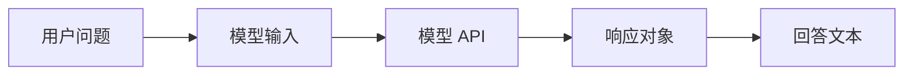
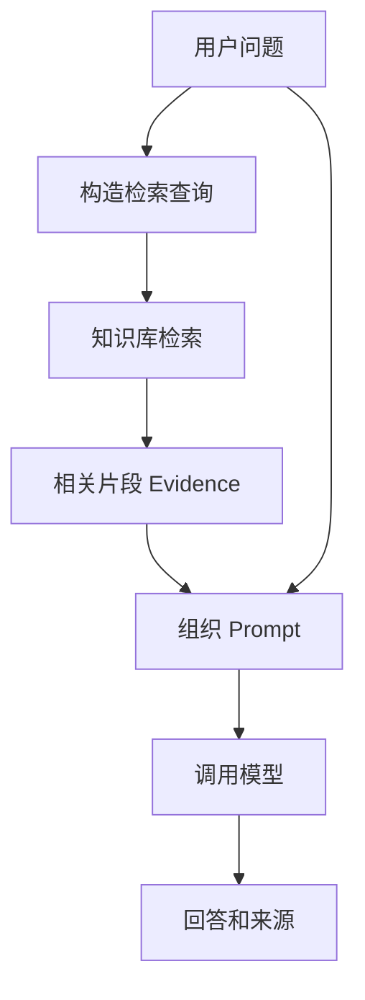
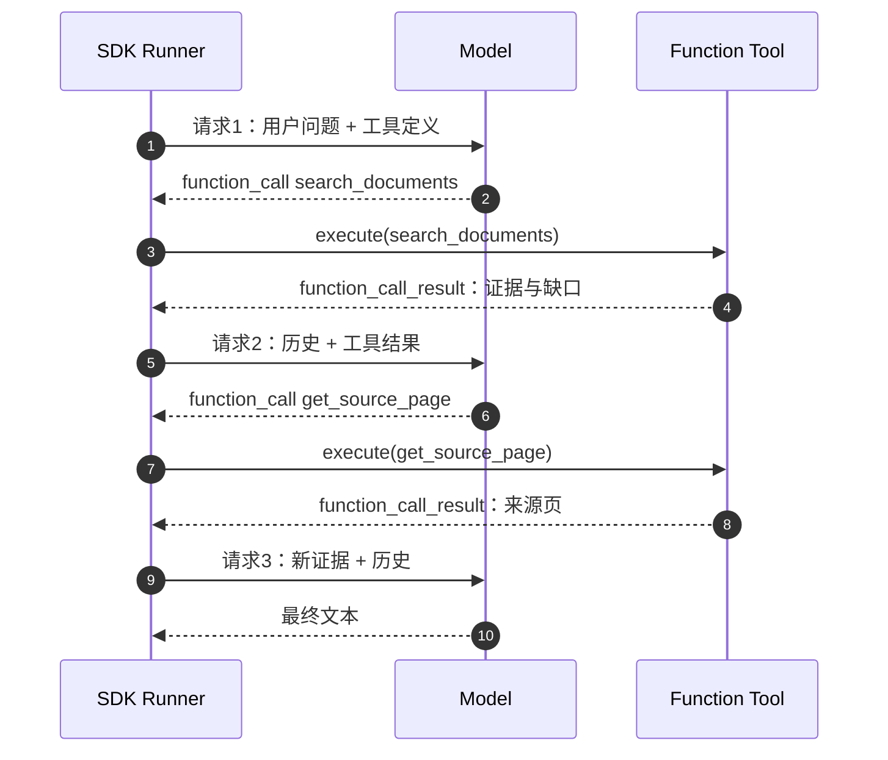
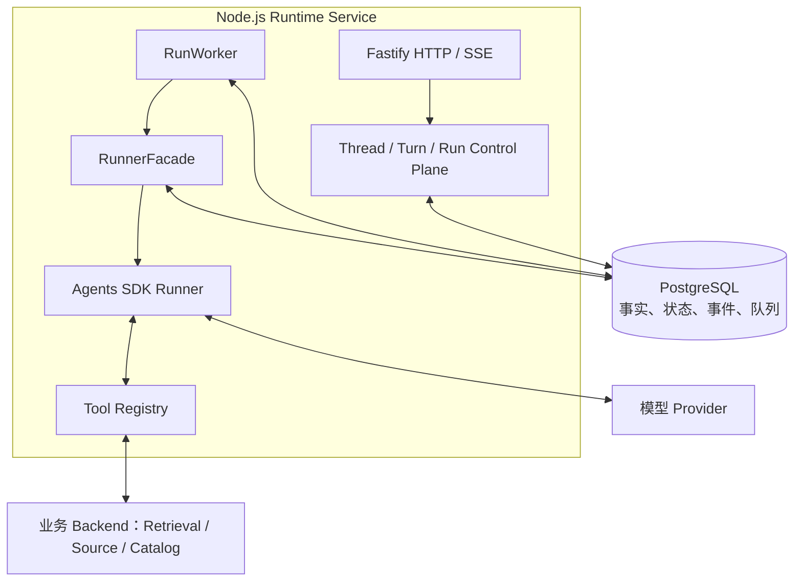
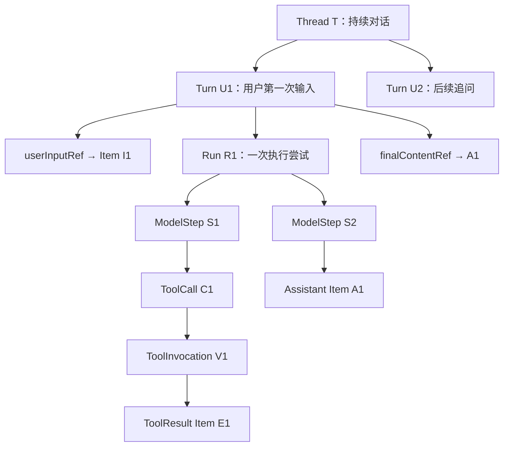
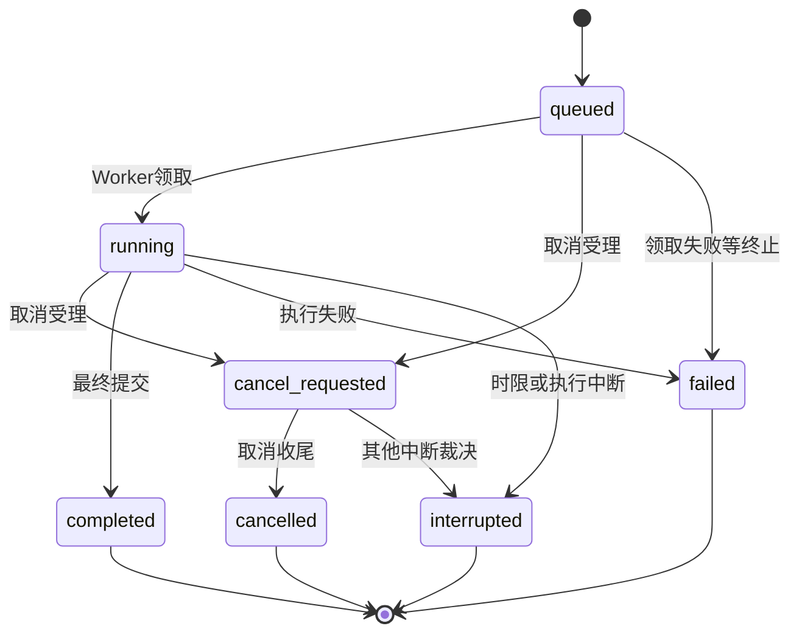
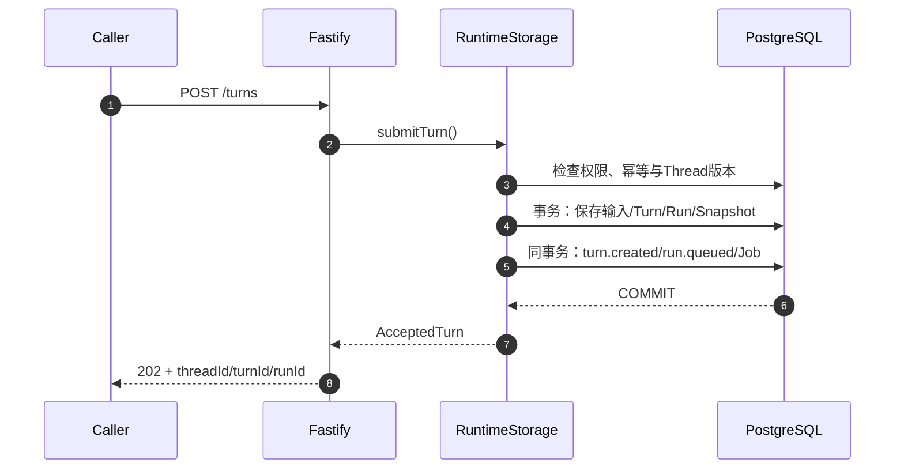
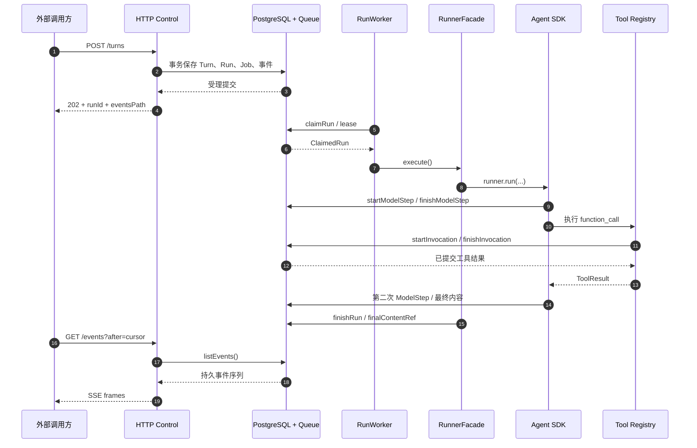

# 从一次知识查询认识 Agent Harness：它是什么、长什么样、怎样运行？

## 01｜从一个具体需求开始：用户实际希望 Agent 做什么？

> 请说明示例保障甲的等待期。如果发生意外伤害，该等待期是否仍然适用？请标出原始条款出处。

Agent（智能体）是利用模型选择下一步操作，并可调用外部工具的程序。本例要求 Agent 查询资料、核对条件并返回依据。

这个问题需要三类信息：**等待期的定义或期限**、**意外情形的适用条件**和**原始条款出处**。找到等待期定义之后，系统仍需核对意外情形的条件。

用户通过问答入口提交问题。系统查询资料，报告执行状态，并在完成时返回回答和来源。每一种状态都应对应服务端记录。

系统用 Turn（用户回合：一次已受理的输入）保存问题。系统用 Run（执行尝试：处理该输入的一次运行）记录执行过程。后续重试可以为同一个 Turn 创建新的 Run。

<table>
<thead><tr><th align="left">调用方看到的结果</th><th align="left">服务端记录的事实</th></tr></thead>
<tbody>
<tr><td><kbd>发送</kbd> 后收到受理标识</td><td>用户输入已经关联到一个 Turn 和 Run</td></tr>
<tr><td>“正在查询条款”</td><td>模型声明的工具动作及其执行状态</td></tr>
<tr><td>出现原文引用</td><td>工具结果包含可以被授权解析的来源引用</td></tr>
<tr><td>回答完成</td><td>最终内容已提交，Run 进入终态</td></tr>
<tr><td>刷新后继续观察</td><td>可以根据持久事件序号恢复观察位置</td></tr>
</tbody>
</table>

Harness（智能体执行控制系统）提供任务状态、内容与运行事件。应用使用这些数据展示进度。

<details>
<summary><strong>展开：合成咨询结果在数据层可能是什么样</strong></summary>

```json
{
  "question": "示例保障甲的等待期及意外适用条件是什么？",
  "claims": [
    {
      "topic": "等待期",
      "value": "示例条款约定的期限",
      "evidenceStatus": "supported",
      "sourceRef": "由服务端签发的来源引用"
    },
    {
      "topic": "意外情形",
      "value": null,
      "evidenceStatus": "requires_additional_evidence",
      "sourceRef": null
    }
  ]
}
```

这个合成 JSON 分别记录已支持的结论和待补充的条件。`sourceRef`（来源引用）是服务端签发的原文读取标识。值为 `null` 时，当前结果还没有该来源标识。

</details>

## 02｜最简单的 LLM 问答程序是什么、长什么样？

**LLM（Large Language Model，大语言模型）**接收输入并返回结构化结果。程序通常通过 API（应用程序接口）调用模型。Response（响应对象）可以包含回答文本或工具调用意图。实际输出取决于模型和请求配置。

**Prompt（提示词）**包含任务说明和模型需要的上下文。它可以包含用户问题、开发者指令、历史消息和检索证据。程序把检索正文当作待分析的数据，避免把文档文字当作新的系统指令。

一次基本模型调用包含输入、API 请求和响应：



Node.js 是服务端 JavaScript 运行环境。`openai` SDK（软件开发工具包）封装模型 API。下面代码发送一次 Responses API（模型响应接口）请求。`MODEL_ID` 和凭证由受控环境提供。

```ts
import OpenAI from "openai";

const model = process.env.MODEL_ID;
if (!model) throw new Error("MODEL_ID_REQUIRED");

const client = new OpenAI();

const response = await client.responses.create({
  model,
  input: [{
    role: "user",
    content: "请解释示例保障甲的等待期概念。",
  }],
});

console.log(response.output_text);
```

注意 `response.output_text` 是 SDK 提供的便捷文本读取方式。实际响应还可能包含消息条目、用量信息和其他与当前 API 能力有关的结构。因此，“打印文本”只是消费模型结果的一种方式，不等于完整保存了一次执行。

模型响应的主要字段如下（合成样本）：

```json
{
  "id": "resp_synthetic_001",
  "output": [{
    "type": "message",
    "role": "assistant",
    "content": [{
      "type": "output_text",
      "text": "等待期需要依据产品正式条款判断。"
    }]
  }]
}
```

上面的 JSON 只展示模型响应的主要字段。Provider（模型提供方）还可能返回用量和其他元数据。Harness 使用 ModelStep（单次模型调用记录）关联请求、状态和输出。

## 03｜RAG 是什么？一个检索增强程序长什么样？

**RAG（Retrieval-Augmented Generation，检索增强生成）**先从外部资料取得证据，再让模型依据证据回答。它适合保险条款、合同和知识库查询等需要核对原文的任务。

系统处理 PDF 后，通常会产生以下数据：

| 概念 | 是什么 | 可以观察到什么 |
| --- | --- | --- |
| Original PDF（原始文档） | 原始业务资料文件 | 文件身份、版本、物理页码 |
| Parsed Document（解析文档） | 从 PDF 提取的文字与版面内容 | 页面、表格、区块以及解析警告 |
| Chunk（检索片段） | 供检索使用的内容单元 | `chunkId`、正文、关联文档及可能的页码 |
| Embedding（向量表示） | 由模型把文本编码成数值表示 | 一串浮点数、维度与模型版本 |
| Evidence（证据） | 一次查询实际取得的相关内容 | 片段、来源、排序信息和元数据状态 |

Embedding 通常由一组数值组成，检索算法用它比较文本的相似程度。模型回答问题时，还需要读取可理解的正文和来源信息。

固定 RAG 的执行链如下：



**检索请求**可以包含查询文字、产品筛选范围以及 `topK`（最多召回条数）。本项目的实际工具输入允许 `topK` 在 1 至 20 之间；这里用 `5` 表示一次普通查询。

```json
{
  "query": "示例保障甲 等待期 条款",
  "companyIds": null,
  "productIds": null,
  "topK": 5
}
```

检索响应通常不止一段文本；它还要说明命中的来源。例如，一条 Evidence 可以包含以下字段（合成样本）：

```json
{
  "chunkId": "SYN-CHUNK-001",
  "documentId": "SYN-DOC-001",
  "fileName": "示例保障条款.pdf",
  "page": 12,
  "text": "合成条款正文：等待期的定义与起算规则……",
  "score": 0.82,
  "scoreMetric": "example_similarity",
  "metadataStatus": "complete"
}
```

分数 `0.82` 仅是合成示例；不同检索器的相似度或距离度量不能无条件直接比较。`page` 在正式证据链中也需要经过原始 PDF 页码映射核验。

接着程序把检索证据加入模型输入。一个最小固定链路可以采用显式依赖接口：

```ts
type Evidence = {
  text: string;
  documentId: string | null;
  page: number | null;
};

interface RagDependencies {
  retrieve(query: string): Promise<Evidence[]>;
  generate(prompt: string): Promise<string>;
}

async function answerOnce(
  question: string,
  services: RagDependencies,
): Promise<{ answer: string; evidence: Evidence[] }> {
  const evidence = await services.retrieve(question);

  const references = evidence.map((item, i) =>
    "[" + (i + 1) + "] " + item.text +
    "（文档：" + (item.documentId ?? "待核实") +
    "，页：" + (item.page ?? "待核实") + "）"
  ).join("\n");

  const prompt =
    "请根据下列资料回答；缺少依据的要点说明证据不足。\n" +
    "用户问题：" + question + "\n资料：\n" + references;

  const answer = await services.generate(prompt);
  return { answer, evidence };
}
```

`retrieve` 和 `generate` 是依赖接口。调用者需要连接实际检索和模型服务。这个函数展示固定 RAG 的数据流。为了让模型理解完整条款，检索取得的正文还应区分引用、可信指令和外部资料内容。

代码决定固定 RAG 的检索和生成顺序。我们可以把它作为 Baseline（对照基线）。对比时保持问题、模型、语料和检索配置一致，再观察自主补查带来了哪些新证据。

<details>
<summary><strong>展开：一次固定 RAG 执行记录需要保存什么</strong></summary>

```json
{
  "caseId": "SYN-Q-001",
  "question": "等待期及意外情形如何规定？",
  "retrieval": {
    "query": "示例保障甲 等待期 条款",
    "topK": 5,
    "returnedChunks": 1,
    "foundTopics": ["等待期"],
    "missingTopics": ["意外情形"]
  },
  "generation": {
    "answer": "当前资料支持等待期定义，意外情形需要补充条款。",
    "answerableRequirements": 1,
    "totalRequirements": 2
  },
  "dataMode": "synthetic"
}
```

这份合成记录展示问题、检索结果和回答状态。Schema（数据结构约束）定义接口字段和类型。对照实验计算新增证据，而不只比较答案长度。

</details>

## 04｜Tool 是什么？普通业务函数怎样呈现给模型？

**Tool（工具）**是一项可调用的能力。例如 `searchDocuments(input)` 接收查询参数，调用检索服务，然后返回数据。

模型需要知道工具名称、作用和参数结构。**Function Tool（函数工具）**把这些信息提供给模型，并连接实际执行函数。

项目为每个工具保存两种名称：

- `capabilityId`：产品内部的能力标识，例如 `knowledge.search_documents`；
- `modelName`：提供给模型的函数名，例如 `search_documents`。

为什么分成两个？产品需要稳定地管理权限、版本和后端，模型只需要一个它能选择的函数名称。对应代码位于 `apps/runtime/src/registry/catalog.ts` 与 `packages/contracts/src/tools.ts`。

工具输入真实契约的精简摘录：

```ts
const searchDocumentsInput = z.strictObject({
  content: z.string().min(1).max(240),
  query: z.string().min(1).max(2000),
  companyIds: z.array(z.string()).nullable(),
  productIds: z.array(z.string()).nullable(),
  topK: z.number().int().min(1).max(20),
});
```

上面使用 `z` 表示 Zod（运行时 Schema 校验库），省略了实际项目对 ID 最大长度等共用原语的约束。`content` 保存模型声明的动作说明。服务端将其他业务参数交给检索函数。

一次完整合法的工具调用参数例如：

```json
{
  "content": "查找示例保障甲等待期的正式条款依据",
  "query": "示例保障甲 等待期 条款",
  "companyIds": null,
  "productIds": null,
  "topK": 5
}
```

工具结果采用固定字段。`status` 表示业务结果状态，`data` 保存数据，`sourceRefs` 保存来源引用。`coverage` 表示覆盖范围，`missing` 和 `warnings` 说明缺口与警告。`provenance`（数据来源信息）保存后端身份、数据模式、版本和观察时间。

下面展示其中一个合成返回的完整外层形状，`data` 在此使用一条简化证据行供阅读：

```json
{
  "status": "partial",
  "data": [{
    "evidenceId": "SYN-E-001",
    "chunkId": "SYN-CHUNK-001",
    "documentId": "SYN-DOC-001",
    "fileName": "示例保障条款.pdf",
    "page": 12,
    "text": "合成条款：等待期起算定义……",
    "company": "示例保司",
    "productName": "示例保障甲",
    "sourceRef": null,
    "score": 0.82,
    "scoreMetric": "example_similarity",
    "chunkType": "text",
    "metadataStatus": "partial",
    "provenance": {
      "mode": "synthetic",
      "backendId": "example-backend",
      "datasetVersion": "example-v1",
      "observedAt": "2026-01-01T00:00:00Z"
    }
  }],
  "sourceRefs": [],
  "coverage": "partial",
  "missing": ["SOURCE_DOCUMENT_NOT_ADMITTED"],
  "warnings": [],
  "provenance": {
    "mode": "synthetic",
    "backendId": "example-backend",
    "datasetVersion": "example-v1",
    "observedAt": "2026-01-01T00:00:00Z"
  }
}
```

这里工具执行可以成功返回，却明确报告来源仍不具备可直接读取的 `sourceRef`。这种“调用成功，但证据尚不完整”的情况十分常见。对 Harness 来说，成功保存工具结果与业务证据是否足够是两个不同的判断。

## 05｜Tool Calling 究竟是什么？模型说“我要查”时发回了什么？

**Tool Calling（工具调用机制）**让模型输出工具名和调用参数。这个输出叫 ToolCall（工具调用意图）。SDK 根据意图调用服务端已注册的函数。模型负责选择动作，服务端负责实际执行。

本工程把模型的工具意图统一表示为 `function_call`。下面展示一个合成调用。`arguments` 是装有参数的 JSON 字符串。

```json
{
  "type": "function_call",
  "callId": "call-syn-001",
  "name": "search_documents",
  "arguments": "{\"content\":\"查找等待期依据\",\"query\":\"示例保障甲 等待期\",\"companyIds\":null,\"productIds\":null,\"topK\":5}"
}
```

这是**按项目 SDK 规范化形状构造的示例**。不同模型服务可以采用不同的网络响应字段。SDK 适配器把它们转为统一的模型条目。

各字段的意义相当具体：

| 字段 | 解释 |
| --- | --- |
| `type` | 这条输出属于函数调用意图 |
| `callId` | 当前调用意图的身份，用来关联后续结果 |
| `name` | 模型选择的工具名称 |
| `arguments` | 模型为工具生成的参数 |

SDK 读取 ToolCall，校验参数并执行已注册函数。它把 ToolResult（工具执行结果）写入后续模型可见的历史。对工具循环来说，下面的两个对象需要正确配对：

```text
模型输出：function_call（callId = call-syn-001）
    ↓
执行工具：search_documents(...)
    ↓
SDK 可见结果：function_call_result（属于 call-syn-001）
```

为什么保存 `callId`？因为模型一次响应可以提出多个工具调用，结果的完成顺序又可能不同。唯一调用身份使程序可以准确连接每一个意图和每一份结果。

<details>
<summary><strong>展开：这一步在产品里还会出现哪些实体</strong></summary>

模型的 `function_call` 属于一次模型响应输出，因此归属当前 `ModelStep`（模型调用步骤）。实际工具执行由 Harness 创建独立 `ToolInvocation`（工具执行实例），包含自己的 `invocationId`、`providerCallId`、状态、执行参数和结果引用。

```text
ModelStep S1
  └── function_call C1（callId）
       └── ToolInvocation V1（invocationId）
            └── ToolResult Item E1
```

这样，一次“模型决定要查”与一次“工具实际执行并保存结果”就有了不同的事实身份。后续需要做故障恢复、审计或统计时，这个区分极其重要。

</details>

## 06｜Agent 是什么？Agent Loop 在运行时究竟长什么样？

**Agent（智能体）**使用模型根据目标选择动作。它读取当前输入和工具结果，并决定是否继续调用工具。一个 Agent 就可以使用多个工具完成任务。

**Agent Loop（智能体执行循环）**反复处理模型请求和工具结果。模型提出工具调用时，SDK 执行工具并将结果交回模型。模型生成最终回答或达到执行边界时，当前循环结束。OpenAI Agents SDK 负责驱动这套循环。[^sdk-running]

Runner（SDK 执行器）驱动 Agent Loop。Session（会话历史接口）提供后续模型请求使用的消息。下面展示主要 SDK 对象：

```ts
// 结构摘编：实际模型、工具依赖由外层运行环境提供。
const agent = new Agent({
  name: "Insurance advisor",
  model: recordedModel,
  tools: boundTools,
  instructions: "根据可用证据回答问题，必要时继续使用授权工具。",
});

const runner = new Runner({
  toolExecution: { maxFunctionToolConcurrency: 2 },
  tracingDisabled: true,
});

const stream = await runner.run(agent, userInput, {
  stream: true,
  session,
  context: { runId },
  signal,
  maxTurns: 6,
});
```

上述代码展示 SDK 的装配方式。运行时需要提供 `userInput`、`session`、`signal` 和 `recordedModel` 等实际依赖。`tracingDisabled` 的使用需要结合实际数据授权策略。

如果想知道“循环到底发生了什么”，可以按模型步骤观察。假设第一次检索只找到等待期定义，第二次模型要求补充原文，第三次形成回答：



这是**可由模型选择的合理路径**，并非每个问题必须经过三个模型请求。模型可能第一次直接回答，也可能连续查证多次。一次模型调用可以输出多个工具意图，工具执行也可能并发。

执行系统分别统计用户回合、SDK 循环和模型请求。用户提交一个 Turn，SDK 可能多次请求模型。每次请求尝试由 ModelStep 记录。后面工具还会获得独立 **ToolInvocation** 记录。只有分别建模，才能知道成本来自模型、执行还是业务服务。

<details>
<summary><strong>展开：一段带有调用结果的合成模型历史</strong></summary>

```json
[
  {
    "type": "message",
    "role": "user",
    "content": "示例保障甲的等待期及意外规则是什么？"
  },
  {
    "type": "function_call",
    "callId": "call-syn-001",
    "name": "search_documents",
    "arguments": "{\"content\":\"查等待期\",\"query\":\"示例保障甲 等待期\",\"companyIds\":null,\"productIds\":null,\"topK\":5}"
  },
  {
    "type": "function_call_result",
    "callId": "call-syn-001",
    "output": "已找到等待期定义；意外情形条件仍缺证据"
  },
  {
    "type": "message",
    "role": "assistant",
    "content": "已取得等待期依据，继续核对意外情形。"
  }
]
```

这里省略了 ModelItem（SDK 规范化消息条目）的部分字段。正式 Session 使用结构解析器（parser）校验完整数据。

</details>

模型知道如何选择动作，不代表它在执行系统中自动获得无限能力。它只会看到本次授予的工具集合；预算、权限、取消、状态和结果保存由接下来的 Harness 负责。

## 07｜Harness 是什么？在真正的软件项目里长什么样？

**Harness（智能体执行控制系统）**接收任务，创建运行对象，并调度 Agent Loop。它保存运行状态、内容和事件，并提供外部查询接口。

当前工程将控制面、Runner 和工具注册装入一个 TypeScript / Node.js 服务。PostgreSQL（关系数据库）保存持久状态。pg-boss（基于 PostgreSQL 的队列组件）保存待执行的任务。每个 Run 使用一个 Agent，由服务端装配模型、历史和工具依赖。[^goal]

Worker（后台任务执行器）从队列领取 Run。RunnerFacade（运行门面）建立单次 Run 的 SDK 执行环境。Registry（工具注册系统）管理可用工具及其后端绑定。源码目录如下：

```text
apps/runtime/src/
├── composition/          # 启动、配置读取、各依赖装配
│   ├── start.ts
│   ├── runtime.ts
│   ├── registry.ts
│   └── synthetic-worker.ts
├── transport/http/       # HTTP 控制面、Schema、SSE（事件流）
│   ├── app.ts
│   └── sse.ts
├── control/              # Principal（认证主体）与运行权限
├── storage/              # PostgreSQL、事务、队列、事实、检查点
│   ├── schema.ts
│   └── store.ts
├── runner/               # Worker、RunnerFacade、ModelStep、Session
│   ├── worker.ts
│   ├── facade.ts
│   ├── model.ts
│   ├── tools.ts
│   └── session.ts
├── registry/             # 工具规格、Profile（运行配置）、后端绑定
└── business/             # Port（业务接口）与 Adapter（业务适配）
packages/contracts/src/  # HTTP/事件/工具契约
tests/                   # 控制面、SDK、Runner、恢复与事件测试
```

目录中的文件负责启动、工具绑定、模型调用、数据存储和事件输出。

运行中的 Harness 提供以下 HTTP 接口：

| 接口类型 | 示例路径 | 用户或程序实际能做什么 |
| --- | --- | --- |
| 运行状态 | `GET /health/ready` | 检查服务与部分依赖是否就绪 |
| Thread | `POST /v1/threads` | 创建一次持久对话 |
| Turn | `POST /v1/threads/{threadId}/turns` | 正式提交用户输入 |
| Run | `GET /v1/runs/{runId}` | 读取一次执行尝试状态 |
| 运行细节 | `GET /v1/runs/{runId}/steps` | 读取模型步骤 |
| 工具细节 | `GET /v1/runs/{runId}/tool-invocations` | 读取工具执行记录 |
| 事件 | `GET /v1/threads/{threadId}/events` | 重放并持续观察执行变化 |

其中路径花括号是变量。服务端管理 API 资源归属、认证和 Schema。控制面还提供取消、重试、恢复、历史与来源读取能力。这一组接口构成运行入口与输出边界。其他控制操作将在后续专题深入。

### Harness 的一张物理与逻辑关系图



Fastify 是 Node.js HTTP 服务框架。Principal 保存机构、用户和权限范围。Profile 指定可用模型和工具。SSE（Server-Sent Events，服务器发送事件）通过 HTTP 持续输出运行变化。

这些组件可以位于同一个 Node.js 进程中。数据库与模型服务通过独立接口连接。后续可以调整进程部署，而保留相同的执行契约。

<details>
<summary><strong>展开：本项目的合成启动模式到底验证了什么？</strong></summary>

`SyntheticControlModel`（合成控制模型）按固定规则返回文本。它实现 SDK 的 Model 接口：

```text
合成模式：控制面执行链已完成。
```

它也会产生模型完成所需的规范化事件，并通过真正的 Worker、RunnerFacade 和数据库走完生命周期。这条路径验证服务受理与执行、内容提交和事件输出，但该固定模型**不会自动发起工具调用**。

工具调用测试使用 ScriptedModel（按测试剧本返回模型输出的替身）或已授权真实模型。工具目录可见与实际工具执行是两个不同的结果。

</details>

## 08｜最重要的执行对象有哪些？Thread、Turn、Run 长什么样？

Harness 保存多种身份。Thread（对话线程）保存持续对话，Turn 保存用户输入，Run 保存执行尝试。ModelStep 记录一次模型调用，ToolInvocation 记录一次工具执行。Runtime Item（运行条目）保存内容事实。

先看这些对象怎样关联：



### Thread：一段持续存在的对话

Thread 拥有 ID、所属机构、主体、状态和资源版本。它还维护递增的事件序号。同一顾问的连续追问可以属于同一个 Thread。

它解决的问题是：**哪段历史属于一起？谁有权读取和继续它？**

### Turn：一次正式受理的用户输入

Turn 有线程内的顺序号和 `userInputRef`（用户输入条目引用）。它还保存当前 Run ID 和 `finalContentRef`（最终内容引用）。第一次提问与后续追问属于两个 Turn。

它解决的问题是：**用户到底交给系统哪一次输入？哪个回答属于这次输入？**

### Run：完成一个 Turn 的一次执行尝试

Run 保存执行状态、尝试次数、任务 ID、配置快照与用量。它还能指向前一次重试或恢复的来源。失败后重新执行会创建新 Run，原输入和旧执行记录继续保留。

它解决的问题是：**这一次实际执行从何开始、现在怎样、最后如何结束？**

### ModelStep：一次模型调用尝试

ModelStep 保存模型调用顺序、状态、时间和输出引用。`RecordedModel`（模型调用记录器）在发送请求前创建步骤。收到模型响应后，它提交规范化输出和步骤终态。

它解决的问题是：**第几次进入模型边界？模型实际返回了哪些条目？**

### ToolInvocation：一次工具执行实例

ToolInvocation 保存 `modelStepId`、调用 ID、工具能力及版本、参数和执行状态。完成后，它引用工具结果及来源。工具可能在模型步骤结束之后才返回。

它解决的问题是：**模型提出的那个动作是否实际执行过？结果是否提交了？**

### Runtime Item：一条权威内容事实

Runtime Item 保存用户输入、模型输出、工具调用和工具结果。`canonical`（权威规范化内容）保存 SDK 可识别的数据结构。SDK Session（会话历史接口）按条目 ID 引用这些内容。

它解决的问题是：**哪一份内容已经正式写入，其他读取路径该引用哪一份？**

把它们放回一个实际数据结构：

<details open>
<summary><strong>展开：一次 Run 的关联对象（教学化的产品事实视图）</strong></summary>

```json
{
  "thread": {
    "threadId": "SYN-T-01",
    "revision": 1
  },
  "turn": {
    "turnId": "SYN-U-01",
    "userInputRef": "SYN-I-USER",
    "currentRunId": "SYN-R-01",
    "finalContentRef": "SYN-I-FINAL"
  },
  "run": {
    "runId": "SYN-R-01",
    "status": "completed",
    "modelCalls": 2,
    "toolCalls": 1
  },
  "modelSteps": [
    {"stepId": "SYN-S-01", "ordinal": 1, "status": "completed"},
    {"stepId": "SYN-S-02", "ordinal": 2, "status": "completed"}
  ],
  "toolInvocations": [{
    "invocationId": "SYN-V-01",
    "modelStepId": "SYN-S-01",
    "providerCallId": "call-syn-001",
    "status": "succeeded",
    "resultItemRef": "SYN-I-RESULT"
  }]
}
```

这份合成 JSON 合并展示多个对象。实际 HTTP 接口分别读取 Thread、Turn、Run、ModelStep 和 ToolInvocation。每个实体在服务端都有自己的身份。

这些 ID 用来保持执行关系。`ToolInvocation.modelStepId` 指向提出动作的模型步骤。`resultItemRef` 指向已保存的工具结果，`Turn.finalContentRef` 指向最终助手条目。即使两次输出的文字相同，它们仍拥有不同的事实身份。

</details>

## 09｜执行状态是什么？程序怎样知道任务是否已经结束？

Lifecycle（生命周期）是对象从创建到结束的状态变化。Harness 分别管理 Run、ModelStep 和 ToolInvocation 的状态。

以 Run 为例，可以将主流程画成：



这是用于认识常见路径的状态图，具体异常、租约和取消竞争由存储方法及测试裁决。应注意 `cancel_requested`（已请求取消）和 `cancelled`（取消已收尾）是两个不同的时刻。

同样，模型步骤通常经历 `running → completed/failed/cancelled`，工具实例具有 `running/succeeded/failed/timed_out/denied/outcome_unknown` 等状态。**模型调用结束不代表工具已完成，工具成功也不代表整个 Run 已完成。**

这些状态保存在数据库，而不是只挂在某一个进程的变量上。这样进程重启或 HTTP 观察连接断开后，系统仍可以读取最后已经提交的事实。

为什么需要状态转换？一方面它限定谁可以合法写入下一条记录，另一方面外部可以明确地观察执行阶段。例如：

```text
Run queued
  → run.started
  → model_step.started
  → model_step.completed
  → tool_invocation.started
  → tool_invocation.completed
  → model_step.started
  → model_step.completed
  → turn.completed
  → run.completed
```

这是一次单工具执行的事件子序列。实际轨迹还可能包含 `content.delta`（内容增量事件）和 `checkpoint.created`（检查点创建事件）。

## 10｜Event 是什么？Harness 对外的一帧消息长什么样？

**Runtime Event（运行事件）**记录已经提交的状态变化。常见事件包括 Run 开始、模型步骤完成和工具结果提交。调用方使用这些事件按顺序观察运行。

Event Envelope（事件信封）包含事件的共同字段：版本、身份、顺序、时间、类型与数据。实际结构如下：

```json
{
  "schemaVersion": "1.0",
  "eventId": "SYN-EVENT-07",
  "threadId": "SYN-T-01",
  "seq": "7",
  "turnId": "SYN-U-01",
  "runId": "SYN-R-01",
  "occurredAt": "2026-01-01T00:00:00Z",
  "type": "tool_invocation.completed",
  "payload": {
    "invocationId": "SYN-V-01",
    "resultItemRef": "SYN-I-RESULT"
  }
}
```

`eventId` 标识事件，`seq`（线程内顺序号）确定事件次序。`seq` 使用十进制字符串。这样可以保留 PostgreSQL `bigint`（64 位整数）的完整精度。

不同 `type` 对应不同 `payload`。例如 `run.queued` 保存运行 ID，`model_step.completed` 保存 Step ID，`tool_invocation.completed` 保存执行 ID 和结果条目引用。具体 Schema 位于 `packages/contracts/src/events.ts`。

这些持久事件可以通过 HTTP 查询逻辑被读取，也可以使用 **SSE（Server-Sent Events，服务器发送事件）**持续输出。一帧 SSE 在传输层可以长这样：

```text
id: 7
event: tool_invocation.completed
data: {"schemaVersion":"1.0","eventId":"SYN-EVENT-07","threadId":"SYN-T-01","seq":"7","turnId":"SYN-U-01","runId":"SYN-R-01","occurredAt":"2026-01-01T00:00:00Z","type":"tool_invocation.completed","payload":{"invocationId":"SYN-V-01","resultItemRef":"SYN-I-RESULT"}}

```

其中空行表示帧结束；`id` 用于连接恢复和去重，`event` 是事件类型，`data` 是完整 JSON 事件。HTTP/SSE 观察连接是外部读取通道，关闭观察连接不会自动取消后台 Run。

<details>
<summary><strong>展开：运行事件与模型流式事件有什么关系？</strong></summary>

模型流可能产生 `output_text_delta`（文本增量）、`response_done`（当前模型响应结束）等 SDK 事件。`RecordedModel`（记录模型调用的包装器）处理 SDK 事件。它将文本增量写入助手条目，并记录 `content.delta`。模型响应结束时，它提交 ModelStep 和规范化输出。

因此，模型流事件是**模型边界收到的变化**，Runtime Event 是**产品经过规则处理并写入的运行变化**。二者相关，但不需要共享同一套对象格式。

`finalContentRef` 指向已提交的最终助手条目。事件、历史和导出功能使用这个引用读取相同内容。这避免了多份答案数据产生差异。

</details>

## 11｜服务是怎样启动的？从 `start.ts` 看到真实装配过程

服务启动时，程序先加载数据库、身份配置、模型与工具集合。准备好依赖后，它再启动 HTTP 服务和后台 Worker。

`apps/runtime/src/composition/start.ts` 是启动入口。它读取私有配置引用，并选择 Synthetic（合成）或已授权的产品运行模式。随后，它装配工具注册系统和运行快照解析器，并调用 `composeRuntime()`。

配置引用是服务端读取私有配置的文件路径。密钥、模型凭证和连接参数由服务端加载。用户请求不携带这些秘密值。 本地测试和部署时，配置路径可以作为环境变量输入：

```bash
# 在已安装锁定依赖的项目目录使用合成环境。
# 私有配置文件应来自受控测试实例。
export INSURANCE_DATABASE_CONFIG=/absolute/private/db-config.json
export INSURANCE_HTTP_CONFIG=/absolute/private/http-config.json

corepack pnpm runtime:start
```

命令使用项目实际启动脚本。操作者需要在私有配置文件中设置合法的数据库与 HTTP 参数。

### Composition Root 是什么？

**Composition Root（依赖装配入口）**创建组件，传入依赖，并在关闭时释放资源。`composeRuntime()` 实现这个过程：

```ts
// apps/runtime/src/composition/runtime.ts：摘出主要创建顺序。
const storage = await createRuntimeStorage(options.database, {
  ...(options.migrate === undefined ? {} : { migrate: options.migrate }),
  ...(options.authorizeClaim ? { authorizeClaim: options.authorizeClaim } : {}),
});

const maintenance = new RuntimeMaintenance(storage, options.maintenance ?? {});
const worker = options.workerFactory?.({ storage, modelProvider: options.modelProvider });

const app = await createControlHttpApp({
  storage,
  authenticator: options.authenticator,
  snapshots: options.snapshots,
  cursorSigner: options.cursorSigner,
  registry: options.registry,
  onClose: dispose,
});

await worker?.start();
await maintenance.start();
```

这是方便阅读的**摘编**：正式代码还处理可选维护配置、类型分支和异常清理。重要的是创建顺序和同一 `storage` 的依赖共享关系。

`createRuntimeStorage` 创建 RuntimeStorage（持久状态访问对象）和队列。`createControlHttpApp` 注册 HTTP 路由，`workerFactory` 创建 Worker。HTTP 接受命令，Worker 领取任务。双方通过同一套持久状态协作。

模型和工具执行可能持续较长时间。HTTP Handler（请求处理函数）负责受理任务，Worker 负责后台执行。调用方可以通过 Run ID 查询、取消或恢复任务。

### 实际合成运行形态

默认合成装配使用 `createSyntheticRegistryRuntime()` 与 `createSyntheticWorker()`。后者将 `SyntheticControlModel` 放进真正的 `RunnerFacade` 与 `RunWorker`，并使用真实的 `PgSdkSession`（PostgreSQL 会话历史适配器）。

**Synthetic 模式替换模型输出，仍然运行实际 Harness 代码。** 这样可以独立验证任务领取、SDK 执行和结果持久化。

实际启动报告需要区分这几种状态：

- 服务已经监听本地端口；
- 数据库与队列通过 readiness（就绪）检查；
- 当前 Registry 提供了哪些已授权能力；
- 某次 Run 真正由 Worker 领取并到达终态。

它们分别由不同接口或执行事实确认。`GET /health/ready` 表示服务通过已定义的就绪检查。该接口不代表某个具体用户任务已经完成。

## 12｜一次用户输入怎样变成 Run？从 HTTP 走到 PostgreSQL 事务

外部调用方先创建 Thread，再提交 Turn。下面使用本地合成模式的真实 HTTP 路由。

每个写命令带有 `Idempotency-Key`（幂等键：用于识别同一请求的重复提交）。Thread 使用 `revision`（资源版本号）检查客户端看到的状态是否仍有效。

**第一步：创建 Thread。**

```http
POST /v1/threads HTTP/1.1
Authorization: Bearer <TEST_TOKEN>
Content-Type: application/json
Idempotency-Key: example-create-thread-001

{
  "title": "示例条款查询"
}
```

创建成功后，接口返回 `201 Created`、Thread ID 和初始 `revision`。`<TEST_TOKEN>` 是测试令牌占位符。

**第二步：向该 Thread 提交用户问题。**

```http
POST /v1/threads/{threadId}/turns HTTP/1.1
Authorization: Bearer <TEST_TOKEN>
Content-Type: application/json
Idempotency-Key: example-submit-turn-001

{
  "input": {
    "text": "请查询示例保障甲的等待期。"
  },
  "agentProfileId": "synthetic-profile",
  "expectedThreadRevision": 0
}
```

`synthetic-profile` 是本项目测试用的 Profile（运行配置名称）。实际可用的 Profile 由服务端配置和当前权限决定。请求中的 `threadId` 使用第一步返回的值。

受理成功时，接口返回 `202 Accepted` 与三个执行标识：

```json
{
  "threadId": "SYN-T-01",
  "turnId": "SYN-U-01",
  "runId": "SYN-R-01",
  "threadRevision": 1,
  "eventsPath": "/v1/threads/SYN-T-01/events"
}
```

`AcceptedTurn`（回合受理回执）包含 Thread、Turn 和 Run 的 ID。`runId` 用于查询任务状态，`eventsPath` 指向事件流。接口返回 `202` 时，后台执行可以继续进行。

### `submitTurn()` 真正写入了什么？

后端进入 `createControlHttpApp()` 的 `submitTurn` 分支，再调用 `RuntimeStorage.submitTurn()`。

`submitTurn()` 在一个 PostgreSQL 事务中检查主体、Thread 归属、幂等键和资源版本。它解析 RunSnapshot（运行配置快照：保存本次模型、工具和策略身份）。然后创建用户条目、Turn、Run、事件与 Job（持久队列任务）。



COMMIT 表示数据库事务成功提交。`fromDrizzle(tx, sql)` 让 pg-boss Job 与 Run 使用同一个事务。Run、事件和 Job 因此共同提交或共同回滚。

关键源码（删去部分事务参数以突出关系）：

```ts
// storage/store.ts：submitTurn 内的局部执行形状（摘编）
const turnId = randomUUID();
const runId = randomUUID();
const itemId = randomUUID();
const queueJobId = randomUUID();

await tx.insert(schema.turns).values({ /* Turn 与 userInputRef */ });
await this.writeItem(tx, { threadId, turnId, runId: null }, {
  itemId,
  role: "user",
  origin: "user",
  text: parsed.input.text,
  canonical: { type: "message", role: "user", content: parsed.input.text }
});
await tx.insert(schema.runs).values({ /* Run / Snapshot / Job 关系 */ });
await this.emit(tx, { threadId, turnId, runId }, {
  type: "turn.created",
  payload: { turnId, userInputRef: itemId }
});
await this.emit(tx, { threadId, turnId, runId }, {
  type: "run.queued",
  payload: { runId }
});
await this.boss.send(this.queueName, { runId }, {
  id: queueJobId,
  db: fromDrizzle(tx, sql)
});
```

源码还会更新 Thread 的 `revision` 并保存幂等回执。服务端根据 `agentProfileId` 解析可信的 RunSnapshot。模型凭证和业务后端地址由服务端管理。

### 为什么需要 Idempotency-Key？

HTTP 响应可能在网络中丢失。**Idempotency（幂等处理）**使合法的重复请求返回原始回执。存储层会核对主体、命令范围、幂等键和请求正文摘要。

已有 PostgreSQL 集成测试检查重复提交。同键同正文返回相同 ID，存储只创建一条 Run 和用户输入。同键不同正文返回 `409 IDEMPOTENCY_CONFLICT`。同一 Thread 的并发新命令还受到 `THREAD_BUSY` 约束。

`202` 回执关联持久化的任务与队列记录。Worker 依据这些记录开始执行。

<details>
<summary><strong>展开：合成受理之后，内部最小事实图是什么样</strong></summary>

```text
Thread SYN-T-01
  revision = 1
  Turn SYN-U-01
    userInputRef = SYN-I-USER
    Run SYN-R-01
      status = queued
      snapshotId = 服务端选择的配置快照
      queueJobId = 实际 pg-boss Job
      events:
        turn.created
        run.queued
```

这些是通过不同实体和表连接形成的阅读视图，不是一个单独数据库表的原始 JSON。展示聚合视图，是为了让你在阅读 `store.ts` 时能够理解每次写入为什么必须共享事务。

</details>

## 13｜谁开始执行 Run？从 Worker 到两次 ModelStep

### 第一步：Worker 领取队列任务

`RunWorker.start()` 从 pg-boss 获取 Job（队列任务）。Job 携带 `runId`。Worker 调用 `claimRun()` 取得 Lease（执行租约：限定执行者的有效写入资格）。

```ts
// runner/worker.ts：核心路径摘编
const data = runJob.parse(job.data);

if (await storage.settleUnclaimedRun(data.runId, {
  status: "cancelled"
})) {
  continue;
}

const claimed = await storage.claimRun(
  data.runId,
  ownerId,
  leaseMs
);

if (!claimed) continue;

await facade.execute(claimed);
```

`settleUnclaimedRun` 处理尚未被领取的终止任务。`claimRun()` 检查 Run 状态和租约。领取成功后，数据库写入 `run.started`，并返回 ClaimedRun（已取得执行资格的 Run 对象）。

Lease 包含 `ownerId`（执行者 ID）、`fence`（执行资格代次）和 `expiresAt`（失效时间）。存储在每次关键写入时检查租约。旧执行器失去资格后，不能覆盖新的运行状态。

### 第二步：RunnerFacade 组装本次执行

`RunnerFacade.execute(claimed)` 是产品执行与官方 SDK 的连接入口。`RunnerFacade.execute()` 解析预算并创建 `AbortController`（取消信号控制器）。它读取模型和工具绑定，并建立 RunEnvironment（本地运行环境）。随后，它创建 `PgSdkSession`（PostgreSQL 会话历史适配器）、`RecordedModel` 和 SDK 工具。

真实组装形状：

```ts
// runner/facade.ts：中部装配代码摘编
const session = await dependencies.session(environment, facts);

const model = new RecordedModel(
  provider,
  environment,
  facts,
  dependencies.beforeModelCall,
  session instanceof PgSdkSession
    ? session.projectModelRequest.bind(session)
    : undefined
);

const tools = createRunTools(bindings, environment, facts);

const agent = new Agent({
  name: "Insurance advisor",
  model,
  tools,
  instructions: instructionsFromSnapshot
});

const runner = new Runner({
  toolExecution: {
    maxFunctionToolConcurrency: budget.maxConcurrentTools
  },
  tracingDisabled: true,
  traceIncludeSensitiveData: false,
  modelSettings: {
    maxTokens,
    store: false,
    retry: { maxRetries: 0 }
  }
});
```

源码从 `claimed.snapshot.modelConfig.instructions` 读取模型指令。示例中的 `instructionsFromSnapshot` 代表这个配置值。`dependencies` 和 `environment` 由服务端构造，`facts` 用于关联本次运行产生的条目。

这里最关键的一组对象是：

- **RunEnvironment（本地运行环境）**：当前 Principal、Snapshot、预算、租约、存储、取消信号；
- **PgSdkSession（持久会话适配器）**：给 SDK 提供按顺序排列的历史条目；
- **RecordedModel（可记录模型边界）**：包住 Provider 调用并创建 ModelStep；
- **SDK Tool（模型可调用的函数工具）**：经执行包装器连接业务后端。

ModelContext（模型可见上下文）包含指令、历史消息、工具定义和工具结果。RunEnvironment 则保存服务端依赖、租约、权限和取消信号。模型请求只接收明确投影给它的数据。

### 第三步：记录第一次模型调用

`RecordedModel.begin()` 检查模型输入、预算和授权，然后创建 ModelStep。收到完整响应后，`complete()` 保存输出条目并结束该步骤。如果模型输出工具意图，系统会保存 `callId`，供后续调用关联。

```ts
// runner/model.ts：两个记录边界的简化调用
const stepId = randomUUID();

await storage.startModelStep(lease, {
  stepId,
  ordinal: currentOrdinal
});

// provider.getResponse(...) 或 getStreamedResponse(...)

await storage.finishModelStep(lease, stepId, {
  status: "completed",
  outputItems,
  tokenUsage: {
    inputTokens,
    outputTokens
  }
});
```

这里 `currentOrdinal`、`outputItems`、`inputTokens` 代表实际函数在运行中构造的值。这个片段展示核心调用关系，不是独立可执行函数。

**ModelStep 完成表示本次模型响应结束。** 如果响应包含工具调用意图，工具随后才开始执行。状态序列例如：

```text
model_step.started (S1)
model_step.completed (S1)
tool_invocation.started (V1)
tool_invocation.completed (V1)
model_step.started (S2)
model_step.completed (S2)
```

上述轨迹用于展示模型与工具的记录顺序。真实网络请求次数需要结合传输日志核对。当前 Runner 配置关闭了隐式模型重试。

### 第四步：执行工具并保存结果

`createRunTools()` 检查当前 Run、模型调用 ID、工具版本、权限和预算。检查通过后，工具包装器创建 ToolInvocation。

`binding.execute`（后端执行绑定）调用业务函数。包装器检查结果 Schema 和字节上限。它还提取 `sourceRefs`（来源引用集合）。

Harness 先保存工具结果，再允许 SDK 将结果用于下一次模型调用。`customDataExtractor`（SDK 工具结果提取回调）提供需要持久化的结果条目：

```ts
// runner/tools.ts：关键的结果提交顺序（摘编）
const call = pending.get(toolCall.callId);

const item = {
  ...runtimeItem(rawItem, randomUUID(), call.stepId),
  sourceRefs: [...call.sourceRefs],
};

await storage.finishInvocation(lease, call.invocationId, {
  status: "succeeded",
  resultItem: item,
  sourceRefs: call.sourceRefs,
  checkpoint: true,
});

recordFact(facts, rawItem, item.itemId);
pending.delete(toolCall.callId);
```

如果该数据库提交失败，下一次模型调用就不应把一个尚未保存的结果当作已经取得的事实。执行器会沿错误路径收尾或进入需要后续收敛的状态。此处只需要理解**先后顺序**；ToolInvocation 的全部状态和错误处理将在后续专题深入。

## 14｜最终内容和事件究竟怎样产生？

SDK 将工具结果加入下一次模型请求。模型输出最终回答后，`RecordedModel` 保存助手条目。`PgSdkSession` 把该条目的 ID 加入有序历史引用。

一条简化的执行结果可以是：

```text
Run R1
  S1：模型输出 call-syn-001
    V1：调用 search_documents
      E1：保存 ToolResult
  S2：模型根据 E1 生成最终回答
    A1：保存 assistant content
  Turn.finalContentRef → A1
  Run.status → completed
```

`finalContentRef` 只保存最终助手条目 ID。`RunnerFacade` 等待 SDK 流执行结束，然后调用 `RuntimeStorage.finishRun()` 提交运行终态。

```ts
// runner/facade.ts：成功收尾的核心关系（摘编）
await completed;
controller.signal.throwIfAborted();

const finalContentRef = facts.finalAssistantIds.at(-1);

if (!finalContentRef) {
  throw new RunBoundaryError("FINAL_CONTENT_UNAVAILABLE");
}

await storage.finishRun(lease, {
  status: "completed",
  finalContentRef,
  usage: { elapsedMs },
});
```

`finishRun()` 在事务中检查最终引用、租约和取消状态。它提交 Turn、Run 的终态以及事件。对于已保存的助手条目，系统直接复用 `finalContentRef`。如果调用方提交新的 `finalItem`（最终助手条目），该路径还会产生 `content.committed` 事件。外部应结合最终引用和 Run 终态判断执行结果。

### SSE 是怎么把这些事件送出去的？

`DurableEventStreams` 先读取当前授权下的持久事件，再用同一数据库查询接口按 `seq` 不断读取后续事件。HTTP 层会把每条事件序列化为：

```text
id: 21
event: run.completed
data: {"schemaVersion":"1.0","eventId":"SYN-E-21","threadId":"SYN-T-01","seq":"21","turnId":"SYN-U-01","runId":"SYN-R-01","occurredAt":"2026-01-01T00:00:00Z","type":"run.completed","payload":{"runId":"SYN-R-01","finalContentRef":"SYN-I-FINAL"}}

```

这是结构正确的**合成 SSE 帧**，而不是实际运行的第 21 条事件。真实 Thread 的 `seq` 从数据库取得；`after` 和 `Last-Event-ID` 等参数用于重放与续接。观察连接关闭只结束观察者，后台 Run 仍沿自己的预算和取消规则执行。

### 一条从入口到出口的完整时序



请特别注意两条“返回”：提交接口很早就返回 `202`，而运行事件随后持续产生。前者是控制面命令回执，后者是执行事实的输出。它们共同描述一条任务，却属于不同生命周期。

## 15｜现在再比较：LLM、固定 RAG、Agent Loop 与 Harness 有什么区别？

下面使用前面的模型、工具和运行记录比较几种执行方式。ModelRequest（模型请求对象）包含消息、工具定义和模型设置。

LLM 接收输入并返回结构化输出。它可以返回回答文本，也可以返回 ToolCall。

**固定 RAG** 按代码指定的顺序检索和生成。程序决定检索次数及是否读取更多原文。

**Agent Loop** 根据模型输出推进工具调用。模型根据历史和工具结果选择动作。SDK 执行工具，再发送下一次模型请求。

**Harness** 管理受理、任务身份、权限、预算和持久状态。它还负责调度执行和输出运行事件。

| 对象 | 真正管理的事 | 最有代表性的输入与输出 |
| --- | --- | --- |
| LLM | 内容生成与下一步动作选择 | ModelRequest → 模型响应 |
| 固定 RAG | 已定义的查询与生成顺序 | 问题 → 检索片段 → 模型回答 |
| Agent Loop | 模型—工具—模型的连续执行 | 模型响应中的 ToolCall → ToolResult → 下一次请求 |
| Harness | 持久执行、权限、状态与外部契约 | 提交 Turn → Run/ModelStep/Invocation → Events |

这些机制可以组合。Harness 运行 Agent，Agent 又可以调用使用 RAG 的检索工具。各层处理不同的输入和状态。

### 五组工程上特别容易混淆的对象

**ToolCall 与 ToolInvocation。** ToolCall 记录模型选择的动作。ToolInvocation 记录该动作的实际执行和状态。权限、版本或预算检查可能阻止执行。因此，需要执行状态和结果引用确认工具是否成功。

**ModelStep 与 Run。** ModelStep 在一次模型调用结束时完成。Run 可以包含多个 ModelStep 和 ToolInvocation。Run 的结束时间取决于最终任务状态提交，而非某个模型响应。

**HTTP 受理与执行完成。** `202 Accepted` 表示存储已经接受任务。`run.completed` 表示 Run 已完成最终提交。调用方可以先取得 Run ID，再观察后台进度。

**SDK Session 与产品历史。** Session 按顺序提供模型可见消息。产品历史还保存失败尝试、工具执行、来源和检查点。调整模型输入范围时，持久历史保持不变。

**来源引用与业务证据。** 当前授权能够解析 `sourceRef`，说明系统可以定位来源。还需要核对原文，才能判断它是否支持对应的业务结论。

这些区别决定模块边界、事务位置和测试断言。发生异常时，系统也能据此确定要保留哪些事实。

## 16｜模型、SDK、Harness 和业务服务分别承担什么职责？

**Boundary（边界）**是组件之间的输入输出约定。它明确谁能更改状态、谁处理错误，以及下游可以依赖什么结果。

例如，模型返回 `callId = C1`，说明它选择了工具。工具包装器执行并保存结果后，该调用才具备成功记录。`finishRun()` 完成终态事务后，整个 Run 才算完成。

| 组件 | 它拥有的核心能力 | 可以直接确定的事实 |
| --- | --- | --- |
| HTTP Control Plane（HTTP 控制面） | 用户命令、认证、幂等、资源版本 | 请求是否受理，关联什么 Thread/Turn/Run |
| RuntimeStorage | 数据库事务、租约、条目、终态与事件 | 哪些状态和内容已经持久提交 |
| RunWorker | 队列消费、领取与监督 | 哪个执行者持有当前运行资格 |
| RunnerFacade | 当前 Run 的执行环境与 SDK 包装 | 运行采用什么预算、信号、依赖与终态规则 |
| OpenAI Agents SDK | Agent Loop、模型与工具交互、Session 接口 | 循环中的下一次模型与工具处理如何衔接 |
| RecordedModel | 一次模型调用的边界与规范化输出 | 哪个 ModelStep 产生了哪些模型输出 |
| Tool Registry / Tool Wrapper | 能力可见性、绑定、权限、工具结果提交 | 哪一次合法工具调用取得并保存了什么 |
| Business Port / Adapter（业务接口契约 / 适配实现） | 将统一请求映射到检索、目录与来源服务 | 本次业务请求取得什么结构化返回 |
| DurableEventStreams（持久事件输出器） | 持久事件查询、游标与 SSE 传输 | 外部能够按顺序观察哪些已提交变化 |

Provider 将 SDK 的模型请求转换为网络请求。业务 Adapter 将统一工具参数转换为上游接口请求。两者都通过明确契约连接外部服务。更新实现时，需保持公开接口的兼容性。

### 为什么在 SDK 外面仍要有 RunnerFacade？

SDK 的 `runner.run()` 推进模型与工具循环。RunnerFacade 提供 Thread/Run 身份、有效租约、取消信号和持久存储。它在运行前装配依赖，并在运行结束后提交终态。

SDK 负责工具循环。Harness 负责用户任务的生命周期。模型网络错误、数据库写入失败和权限变化分别由相应边界处理。

### Continuation Decision（继续执行判定）在什么位置？

Continuation Decision 指系统判断是否继续调用模型或工具。模型返回工具意图时，SDK 执行工具并继续循环。模型返回最终内容时，SDK 结束当前循环。Harness 在每次动作前检查预算、权限和取消状态。

本工程复用 SDK 的 Agent Loop。未来若增加跨任务或跨 Agent 调度，应为新控制层定义独立的状态和权限。

### 模型输出为什么不能直接作为公开事件？

SDK 产生模型流式增量。Harness 还要记录请求受理、工具执行、取消和运行终态。RuntimeEvent Schema（运行事件结构约束）统一表示这些产品变化。

外部按 `threadId` 与 `seq` 读取事件。内部模型协议变化时，Harness 可以保持稳定的事件契约。

## 17｜为什么工程选择这样的技术架构？

以下技术选择分别解决受理、执行、存储和维护问题。

### TypeScript、Node.js 与 Fastify

TypeScript 提供静态类型检查。它帮助开发者维护模型、工具、Session 和 HTTP 的数据契约。Node.js 处理模型网络请求、业务接口和数据库等异步 I/O（输入输出操作）。

Fastify 处理 HTTP 路由和请求生命周期。Zod 与 JSON Schema（JSON 数据结构规范）约束运行时数据。OpenAPI（HTTP 接口规范文档）描述公开操作。项目检查已注册路由与 OpenAPI 是否一致。TypeScript 负责编译期检查，外部输入仍由运行时 Schema 校验。

### OpenAI Agents SDK 与单 Agent 执行

当前源码锁定 `@openai/agents@0.18.0`。SDK 已有 Agent、Runner、Model、Session 和 Function Tool 机制，产品把开发工作集中在运行治理、状态、工具契约和业务连接上。

单个 Agent 可以调用多个工具，例如检索、目录和结构化事实查询。每个 Run 由一个 Agent 执行，身份与状态所有权明确。增加多 Agent 协作时，需要另行设计任务委派和上下文边界。

### PostgreSQL 与 pg-boss

PostgreSQL 保存运行实体、Canonical Items（权威运行条目）、检查点和事件。pg-boss 使用同一数据库管理 Job。受理事务可以同时提交 Run、事件和队列任务。

请求提交后，Worker 可以领取已保存的 Job。`claimRun` 验证当前状态和 Lease（执行租约）。Fence（租约代次）阻止失去资格的 Worker 继续写入。

### RunSnapshot、Registry 与 Port/Adapter

RunSnapshot 保存本次模型、工具集合和策略身份。Registry 管理工具规格、Profile 和执行授权。Port（业务接口契约）规定输入输出。Adapter（业务适配器）将统一请求转换为上游调用。

这些结构记录运行采用的能力版本。更换后端时，需要检查字段、数据版本、分页和授权是否兼容。

### 独立 ModelStep/ToolInvocation 与权威事实

模型返回工具调用意图以后，工具执行可能仍在进行，甚至多个工具并发完成。独立的步骤和工具记录帮助定位执行时间、错误位置和结果提交状态。

产品保存权威运行条目。Session 按顺序引用这些条目。`finalContentRef` 复用最终助手条目的 ID。事件输出已提交的状态变化。这样模型继续、历史查询和外部观察可以共享同一套事实基础。

### 这些选择带来了什么成本？

持久事务增加数据库操作。工具结果先提交可能增加响应延迟。事件续传需要管理游标和保留窗口。后端升级需要兼容性验证。

这些成本换来持久任务、可追溯结果和跨进程控制能力。系统重启后也能依据已保存事实进行恢复。后续可以按实际负载优化部署和查询。

## 18｜实际动手：怎样验证一条从请求入口到运行事件的链路？

下面用两个实验验证运行链。第一个实验提交合成请求，检查 Run 和 Events。第二个实验使用脚本化模型，检查 ModelStep、ToolInvocation 和 ToolResult 的关系。

两项测试分别检查服务生命周期和工具循环。

### 先跑基础服务生命周期

启动一个已配置凭证的本地合成 Runtime。`package.json` 提供 `runtime:start` 脚本。数据库和 HTTP 配置由私有文件提供。

先检查 `GET /health/ready`。这个接口会检查部分组件状态，例如数据库和队列可用情况。得到健康结果后，创建 Thread，再提交 Turn。

下面使用 curl（命令行 HTTP 客户端）访问本地测试实例。先在终端设置 `HARNESS_TEST_TOKEN`。

```bash
BASE_URL="http://127.0.0.1:3100"
: "${HARNESS_TEST_TOKEN:?Set your local test token}"

curl --fail-with-body --silent --show-error \
  "$BASE_URL/health/ready"

curl --fail-with-body --silent --show-error \
  -X POST "$BASE_URL/v1/threads" \
  -H "Authorization: Bearer $HARNESS_TEST_TOKEN" \
  -H "Idempotency-Key: demo-thread-20261014" \
  -H "Content-Type: application/json" \
  -d '{"title":"合成条款检索"}'
```

从实际响应读取 `threadId` 与 `revision`，例如新建 Thread 的 revision 通常为 `0`。之后将 `THREAD_ID` 设置为取得的真实值，再提交新回合：

```bash
# 根据上一条真实响应设置 THREAD_ID；同一命令重试时保留相同键。
curl --fail-with-body --silent --show-error \
  -X POST "$BASE_URL/v1/threads/$THREAD_ID/turns" \
  -H "Authorization: Bearer $HARNESS_TEST_TOKEN" \
  -H "Idempotency-Key: demo-turn-20261014" \
  -H "Content-Type: application/json" \
  -d '{
    "input": {"text":"请查询示例保障甲的等待期。"},
    "agentProfileId":"synthetic-profile",
    "expectedThreadRevision":0
  }'
```

`synthetic-profile` 是项目控制面合成测试使用的配置名称。使用前应确认服务端加载了对应 `agentProfileId`，且当前主体拥有调用权限。`GET /v1/tools` 只能列出工具状态。

返回的 `runId` 可以用于查询执行状态：

```bash
# RUN_ID 由 POST /turns 的成功响应取得。
curl --fail-with-body --silent --show-error \
  -H "Authorization: Bearer $HARNESS_TEST_TOKEN" \
  "$BASE_URL/v1/runs/$RUN_ID"
```

提交后立即查询，Run 可能仍处于 `queued` 或 `running`。执行完成后，接口返回持久终态。`202` 只代表受理成功。

### 事件输出究竟长什么样？

可以通过这个 Thread 的事件接口持续观察：

```bash
curl --no-buffer --silent --show-error \
  -H "Authorization: Bearer $HARNESS_TEST_TOKEN" \
  -H "Accept: text/event-stream" \
  "$BASE_URL/v1/threads/$THREAD_ID/events?after=0"
```

`--no-buffer` 让 curl 及时打印收到的事件。按 `Ctrl+C` 可以关闭观察连接。取消后台 Run 需要调用专门的控制接口。

<details open>
<summary><strong>实践窗口 A｜默认合成运行的可验证结果</strong></summary>

工程里的 `SyntheticControlModel` 使用固定助手内容：

```text
合成模式：控制面执行链已完成。
```

这一模型不主动请求工具，因此基础合成链路的观察目标是：

| 观察维度 | 应该检查什么 | 结论 |
| --- | --- | --- |
| API | 返回稳定的 Thread / Turn / Run 身份 | 请求已经受理 |
| Worker | Run 从 `queued` 推进到执行状态 | 后台任务被领取 |
| ModelStep | 出现并完成模型调用步骤 | SDK 模型边界实际运行 |
| 工具 | 当前模型不产生工具调用 | 合成控制模式行为符合配置 |
| Final | `finalContentRef` 指向已提交助手条目 | 内容完成持久化 |
| Events | 能按 `seq` 读取运行变化 | 服务端事件出口可用 |

上表列出合成模式的预期。实际 ID、时间和事件序号以运行时读回为准。

</details>

### 再跑真正的 SDK 工具调用循环

`tests/runner/runner.test.ts` 使用 ScriptedModel（脚本化模型替身）。它第一次返回 `function_call`，第二次返回 `synthetic answer`。测试使用真实 PostgreSQL、RunnerFacade、SDK 工具和 Session。模型输出与业务结果由测试夹具提供。

测试中的核心调用与断言如下。夹具负责创建 Run、模型和工具绑定：

```ts
const model = new ScriptedModel([
  [call()],
  [finalMessage("synthetic answer")],
]);

await facade(model, [binding]).execute(claimed);

const run = await storage.getRun(owner, accepted.runId);
const steps = await storage.listModelSteps(owner, accepted.runId);
const invocations = await storage.listInvocations(owner, accepted.runId);

expect(run.status).toBe("completed");
expect(run.usage.modelCalls).toBe(2);
expect(run.usage.toolCalls).toBe(1);
expect(steps).toHaveLength(2);
expect(invocations).toHaveLength(1);
expect(invocations[0]?.modelStepId).toBe(steps[0]?.stepId);
```

测试还检查最终引用、助手条目、Session 历史和 `run.completed` 事件。这条受控链包含**两次模型调用和一次工具执行**，并提交了最终内容。

<details>
<summary><strong>实践窗口 B｜按真实断言重建的完整执行轨迹</strong></summary>

```text
[HTTP/Storage] Turn U1 已受理
[Queue]        Run R1 queued

[Worker]       Run R1 claimed → running

[Model]        ModelStep S1 started
[Model]        ModelStep S1 completed
               output: function_call(callId=C1)

[Tool]         Invocation V1 started
               V1.modelStepId = S1
               V1.providerCallId = C1
[Tool]         Result Item E1 committed
               Invocation V1 succeeded

[Model]        ModelStep S2 started
               第二次请求已经包含 E1
[Model]        ModelStep S2 completed
               output: assistant Item A1

[Storage]      Turn.finalContentRef = A1
               Run R1 completed
[Events]       turn.completed / run.completed
```

轨迹按测试中实际存在的断言重建。字母 ID 是示意标识。模型输出和工具结果使用合成数据。

</details>

### 再观察一次重复提交

HTTP 响应可能丢失。调用方使用相同的幂等键和正文重试时，应得到相同 Run ID。新命令可以创建新 Turn，但活动 Thread 仍受 `THREAD_BUSY` 约束。

<details>
<summary><strong>实践窗口 C｜四种请求与期望状态</strong></summary>

| 请求 | HTTP 预期 | 数据库层应发生什么 |
| --- | --- | --- |
| 第一次合法提交 | `202 Accepted` | 新 Turn、Run、Job 共同提交 |
| 原请求重放 | `202 Accepted`，同一组 ID | 复用原幂等回执 |
| 同键、不同正文 | `409 IDEMPOTENCY_CONFLICT` | 保留原命令身份 |
| 新命令争用活动 Thread | `409 THREAD_BUSY` | 一个 Thread 仍只有一个活动 Run |

`tests/control/http.test.ts` 通过真实 PostgreSQL 和 HTTP 测试验证这类条件，还会读取实际 pg-boss Job 与 RunSnapshot。这些测试验证控制面的确定性行为。模型生成质量需要单独评测。

</details>

### 用实际测试命令复核

在已经安装项目锁定依赖、配置好隔离测试数据库的源码目录中，可以执行：

```bash
corepack pnpm typecheck
corepack pnpm check:contracts
corepack pnpm check:control

# Runner 与控制面集成测试使用受控数据库连接引用。
INSURANCE_STORAGE_TEST_CONFIG=/absolute/private/test-db.json \
  corepack pnpm test:runner

INSURANCE_STORAGE_TEST_CONFIG=/absolute/private/test-db.json \
  corepack pnpm test:control
```

`test:runner` 先检查数据库测试配置，然后运行 Runner 测试。连接配置应指向独立测试数据库。

历史工程记录 `runner-preparation.md` 包含 13 项 PostgreSQL + SDK 纵向测试。测试覆盖工具循环、Session、取消、结果提交失败和并发。结论对应当时的源码和测试环境。

### 从三处读回同一条 Run 的执行事实

使用同一个 `runId` 读取三处数据。先通过 HTTP 查询 Run 状态，再查询数据库中的模型、工具和最终内容。最后，通过 SSE 读取持久事件。

下面的 SQL（关系数据库查询语言）使用参数 `$1` 绑定实际 Run ID。只在已授权的隔离测试数据库执行：

```sql
SELECT r.id, r.status, r.model_calls, r.tool_calls,
       t.final_content_ref
FROM runtime.runs r
JOIN runtime.turns t ON t.id = r.turn_id
WHERE r.id = $1;

SELECT id, ordinal, status, output_item_refs
FROM runtime.model_steps
WHERE run_id = $1
ORDER BY ordinal;

SELECT id, model_step_id, provider_call_id, status, result_item_ref
FROM runtime.tool_invocations
WHERE run_id = $1
ORDER BY started_at, id;
```

单工具案例包含两次 ModelStep 和一次 ToolInvocation。工具的 `model_step_id` 指向首个模型步骤，结果引用指向已保存条目。最终引用指向助手条目。验证第二次模型输入时，还需检查 Session 或受控 ModelRequest。

<details>
<summary><strong>从现象回到执行边界</strong></summary>

| 观察到的现象 | 先检查哪里 |
| --- | --- |
| Run 已受理却一直排队 | pg-boss Job、Worker、Lease |
| 已有 ModelStep 却没有 ToolInvocation | 模型是否产生 `function_call`、工具名、权限与预算 |
| 工具有返回却没有后续模型调用 | 工具 Schema、结果提交、Session、取消状态 |
| Run 已结束但观察者缺少事件 | 持久 `seq`、SSE 游标、权限与保留窗口 |

第一种问题发生在模型执行前。第二种要核对模型是否真正提出工具调用。第三种要检查工具结果是否已经提交。第四种要检查运行事件和观察连接的状态。每种情况都能定位到具体代码和测试。

</details>

### 从测试里提取最重要的五条不变量

Invariant（不变量）是所有合法执行都必须满足的规则。当前案例检查五项关系：

1. 一次被接受的命令有稳定身份，合法的幂等重放保留原 Turn / Run。
2. 写入运行状态需要当前有效的执行租约和授权条件。
3. 一个 ToolInvocation 必须能够追溯到提出调用的 ModelStep 和 `callId`。
4. ToolResult 必须在 SDK 消费它并继续调用模型之前完成持久化提交。
5. 最终 `finalContentRef` 只能指向合法的已提交助手内容，最终状态与事件以相应事务为准。

测试应检查数据库、SDK 输入和 HTTP 事件。最终回答的字符串比较只验证文本内容。

排障时可沿执行链定位。收到 `409`，先看控制面状态。缺少模型步骤时，检查 Worker 和租约。缺少工具结果时，检查 Invocation 与持久化。最终内容异常时，检查 `finalContentRef` 和 Session。缺少事件时，检查游标与事件读取。

## 19｜重新理解一句用户请求背后的软件系统

用户最初的问题是：“查询示例保障甲的等待期，并给出原文依据。”

这个问题经过下列执行链：

```text
用户输入
  → HTTP 请求校验与身份认证
  → Thread / Turn / Run 持久受理
  → pg-boss Job
  → Worker / Lease
  → RunnerFacade / RunEnvironment
  → RecordedModel / ModelStep
  → Agent SDK / ToolCall
  → Tool Registry / ToolInvocation
  → Business Adapter / ToolResult
  → 持久化结果与 Session 继续
  → 最终 Assistant Item / finalContentRef
  → Run 终态 / Runtime Events
  → HTTP / SSE 对外输出
```

模型选择下一步动作。SDK 驱动循环，Harness 管理权限、状态和持久化。业务后端提供证据，Events 对外输出已提交变化。

**每个运行概念都对应实际对象。** 每个对象拥有明确字段、输入和输出。开发者可以根据这些对象追踪完整执行过程。

设计恢复、工具注册、事件重放或会话历史时，可先确定其所属执行边界。然后定位源码、状态和测试。

下一篇继续深入这些对象的合同与可验证性：[让 Agent 的行为可以被验证：契约、运行实体与证据标尺](02-contracts-and-runtime-facts.md)。

---

## 实现依据与延伸阅读

本文正文中的源码摘编、数据模型和工程测试，主要依据 Insurance Agent Runtime 的 `c66112dfd8676b47b143dc2e26739278cf4b0dde` 快照。合成产品与 `SYN` 系列标识仅用于教学，不代表任何真实保险产品或生产执行记录。

| 主题 | 核心源码位置 |
| --- | --- |
| 项目整体目标与边界 | `docs/development-pack/goal-objective.md` |
| 启动和依赖装配 | `apps/runtime/src/composition/start.ts`、`runtime.ts` |
| HTTP 与请求受理 | `apps/runtime/src/transport/http/app.ts`、`apps/runtime/src/storage/store.ts` |
| 运行对象与数据库表 | `apps/runtime/src/storage/schema.ts` |
| 队列 Worker 与运行门面 | `apps/runtime/src/runner/worker.ts`、`facade.ts` |
| 模型与历史 Session | `apps/runtime/src/runner/model.ts`、`session.ts` |
| 工具执行和注册 | `apps/runtime/src/runner/tools.ts`、`apps/runtime/src/registry/registry.ts` |
| 业务工具输入输出 | `packages/contracts/src/tools.ts` |
| 运行事件与流 | `packages/contracts/src/events.ts`、`apps/runtime/src/transport/http/sse.ts` |
| 纵向运行和请求测试 | `tests/runner/runner.test.ts`、`tests/control/http.test.ts` |
| 历史 SDK/PG 验证记录 | `docs/implementation/runner-preparation.md` |

相关公开维护方资料：

- [OpenAI Agents SDK：Running agents](https://openai.github.io/openai-agents-js/guides/running-agents/)——SDK Agent Loop 与 Runner 的公开接口说明。[^sdk-running]
- [OpenAI Agents SDK：Tools](https://openai.github.io/openai-agents-js/guides/tools/)——Function Tool 和参数协议。
- [OpenAI Agents SDK：Sessions](https://openai.github.io/openai-agents-js/guides/sessions/)——SDK 历史会话适配。
- [Fastify：Validation and Serialization](https://fastify.dev/docs/latest/Reference/Validation-and-Serialization/)——HTTP 数据校验和服务处理。
- [PostgreSQL：Transaction Isolation](https://www.postgresql.org/docs/current/transaction-iso.html)——事务一致性与隔离。
- [GitHub：Collapsible Sections](https://docs.github.com/en/get-started/writing-on-github/working-with-advanced-formatting/organizing-information-with-collapsed-sections)——本文 `<details>` 展开块的渲染支持。
- [GitHub：Creating Diagrams](https://docs.github.com/en/get-started/writing-on-github/working-with-advanced-formatting/creating-diagrams)——Markdown 中的 Mermaid 图表。[^markdown-render]

[^sdk-running]: 本工程在所引用源码快照中锁定 `@openai/agents@0.18.0`；公开 SDK 文档可能持续更新，版本相关行为以项目源码及已验证测试为准。
[^markdown-render]: GitHub 原生支持 `<details>` 的折叠交互与 Mermaid 的浏览器图表呈现。本文采用这些 GitHub Markdown 原生能力，使代码、数据和执行轨迹能够在单篇 Markdown 内连续阅读。

[^goal]: 本文的产品范围和单 Agent 执行目标来自 `docs/development-pack/goal-objective.md`；项目行为以文中绑定的实现快照为准。
