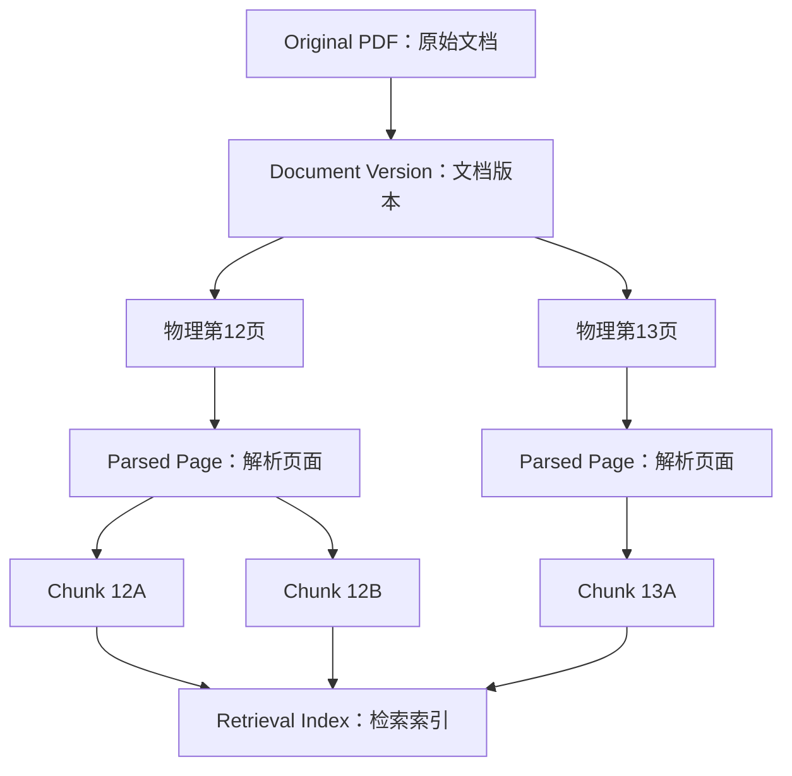
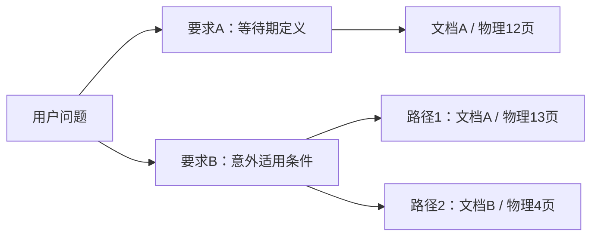
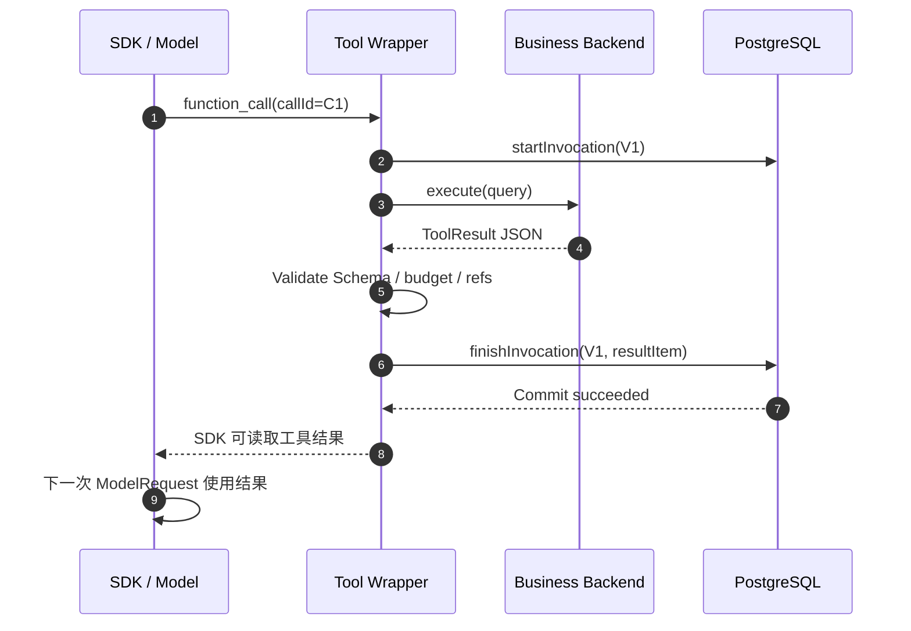
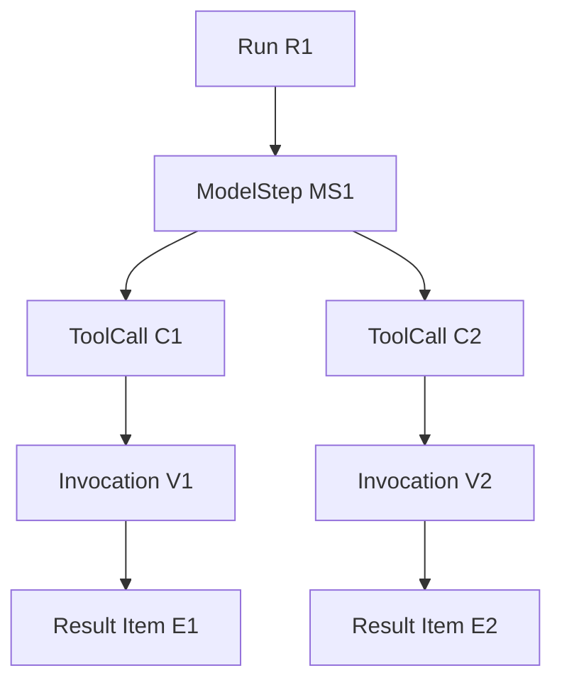
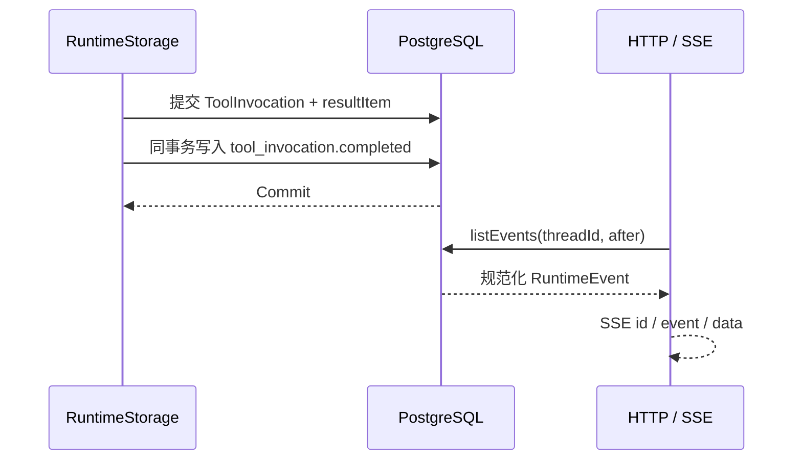
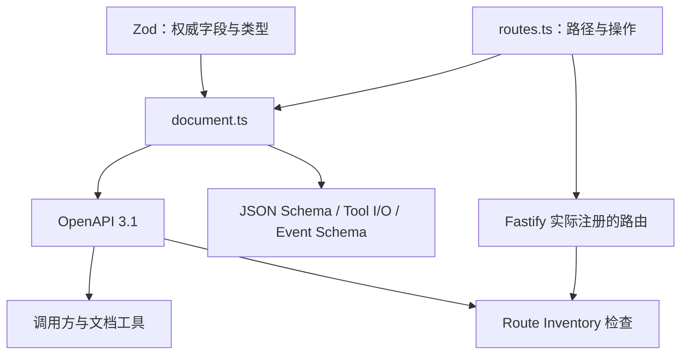
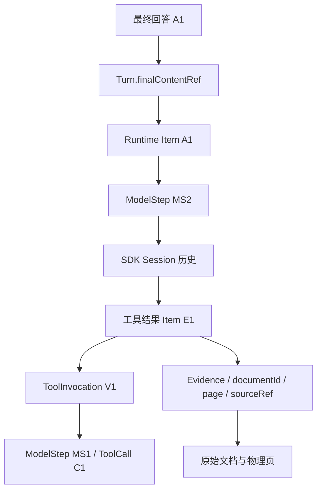
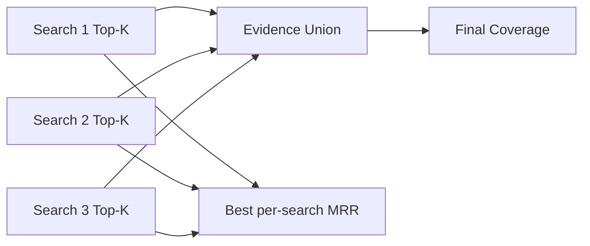
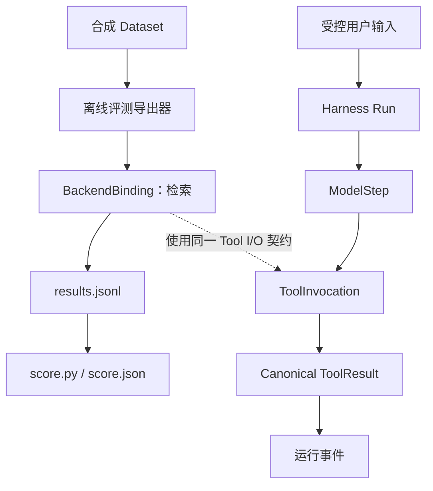

# 一次 Agent 回答怎样才能被核验：数据契约、运行事实与证据评测

## 01｜Agent 已经返回答案，怎样判断它找对了资料？

> 请查询示例保障甲的等待期。如果发生意外伤害，等待期规则是否改变？请提供正式条款和页码。

Agent 检索资料后返回两个结论：等待期的定义位于条款第 12 页，意外情形的条件位于第 13 页。开发者此时需要核对三个问题：**页面是否存在？原文是否支持该结论？Agent 是否实际读取过这份资料？**

这三个问题检查不同事实。页面可定位，表示来源身份有效。原文支持结论，表示业务证据充分。Agent 曾读取该资料，需要通过模型和工具执行记录确认。

下面是一个**合成**的回答及证据需求。它表示用户希望得到什么，并非真实产品条款。

```json
{
  "question": "示例保障甲的等待期及意外情形如何规定？",
  "answer": [
    {"claim": "等待期按约定时间起算", "source": "SYN-DOC-A / 物理第12页"},
    {"claim": "意外情形另有适用条件", "source": "SYN-DOC-A / 物理第13页"}
  ],
  "requirements": [
    "核对等待期定义",
    "核对意外情形适用条件"
  ]
}
```

一次回答可能包含多个 Claim（业务断言）。每个断言要关联一项或多项 Evidence Requirement（证据需求）。例如，第 12 页支持等待期定义，并不自动支持第 13 页的例外条件。

检索评测主要回答“相关页有没有被检索到”。语义评审回答“原文是否支持模型写出的结论”。运行时验证回答“系统是否真实执行并保存了对应调用”。三种检查可以使用同一批来源身份，但结果分别记录。

<details>
<summary><strong>展开：一次查询结束时可以核对哪些对象</strong></summary>

| 核对对象 | 最小字段 | 需要确定的事实 |
| --- | --- | --- |
| 检索结果 | `documentId`、`page`、`chunkId` | 检索返回了哪份资料 |
| 人工依据 | 机构、文档、物理页、证据要求 | 哪个页面支持哪个断言 |
| 工具执行 | `invocationId`、`modelStepId`、`resultItemRef` | 哪一次工具执行保存了结果 |
| 最终回答 | `finalContentRef` | 最终内容指向哪个已提交条目 |
| 运行事件 | `type`、`seq`、`runId` | 执行事实按什么顺序成立 |

这张表是核对关系的阅读视图。正式产品通过各自的 API 与存储实体提供这些字段。

</details>

## 02｜Evidence 是什么？一次检索到底返回什么？

Evidence（检索证据条目）是某次查询取得的候选内容。它通常包含正文、文档身份、页码和检索评分。查询工具可以返回多条 Evidence，原有排序就是本次检索结果的重要信息。

Insurance Agent Runtime 的 `search_documents_output` 采用统一 Tool I/O Contract（工具输入输出契约）。每个证据行包含下列实际字段：

| 字段 | 类型或语义 | 作用 |
| --- | --- | --- |
| `evidenceId` | 字符串 | 本次结果中证据行的身份 |
| `chunkId` | 字符串 | 检索片段身份 |
| `documentId` | 字符串或 `null` | 原始文档身份 |
| `fileName`、`page` | 文件名、从 1 开始的页码或 `null` | 定位候选页面 |
| `text` | 字符串 | 模型可读取的正文 |
| `score`、`scoreMetric` | 数值与分数类型 | 解释上游排序信号 |
| `metadataStatus` | `complete / partial / unresolved` | 当前元数据的确定程度 |
| `sourceRef` | 授权来源引用或 `null` | 读取原始资料的服务端标识 |
| `provenance` | 数据来源对象 | 数据模式、后端、版本和观察时间 |

一条合成证据可以长这样：

```json
{
  "evidenceId": "SYN-E-001",
  "sourceRef": null,
  "chunkId": "SYN-CHUNK-12A",
  "documentId": "SYN-DOC-A",
  "fileName": "示例保障条款.pdf",
  "page": 12,
  "text": "示例正文：等待期按合同约定的日期起算。",
  "company": "示例保司",
  "productName": "示例保障甲",
  "score": 0.82,
  "scoreMetric": "synthetic-similarity",
  "chunkType": "text",
  "metadataStatus": "partial",
  "provenance": {
    "mode": "synthetic",
    "backendId": "fixture-retrieval",
    "datasetVersion": "fixture-v1",
    "observedAt": "2026-10-01T00:00:00Z"
  }
}
```

这里 `score=0.82` 是教学用分数。不同检索器可能返回余弦相似度、距离或融合排序值。`scoreMetric` 需要与分数一起保存，才能解释数值的方向和范围。

`metadataStatus=partial` 表示来源信息尚有缺口。`documentId` 存在，并不意味着当前已经签发 `sourceRef`。后者还需要满足来源目录和授权规则。

<details>
<summary><strong>展开：一次检索的原始顺序为什么重要</strong></summary>

```text
rawRank 1  → Chunk A，文档 D1，第12页
rawRank 2  → Chunk B，文档 D1，第12页
rawRank 3  → Chunk C，documentId=null
rawRank 4  → Chunk D，文档 D1，第13页
```

这四条是检索器的原始顺序。两条 Chunk 可以对应同一个物理页。评分阶段会归并重复页，但会保留 `rawRank`（原始候选排名）。文档身份不完整的第三条仍会占据一个归一化排名位置。

保留原始顺序，才能准确评价检索器将有效证据放到了什么位置。

</details>

## 03｜一份 PDF 为什么会产生多种身份？

一个原始 PDF 进入知识库后，通常需要解析为页面和片段，再交给检索索引。每个处理阶段都可能产生自己的 ID。



**Original PDF（原始文件）**保存业务资料的实际字节。**Parsed Document（解析文档）**保存从 PDF 提取的文字、表格或版面信息。**Chunk（片段）**是检索器使用的内容单元。

同一页可以产生多个 Chunk。一个 Chunk 也可能包含跨页内容，具体取决于解析与切分策略。因此，Chunk ID 不能替代完整文档身份。

一组常见身份可以表示为：

```json
{
  "orgCode": "synthetic-org",
  "documentId": "SYN-DOC-A",
  "documentVersion": "v1",
  "physicalPage": 12,
  "chunkIds": ["SYN-CHUNK-12A", "SYN-CHUNK-12B"]
}
```

机构（`orgCode`）、文档 ID 和物理页码组成离线评分的基本定位单元。文档版本通常由数据集或源数据版本固定。文件名用于阅读，稳定 ID 用于关联。

页码也有不同含义。PDF 物理第 12 页不一定印着“12”。封面和目录可能不计入正文页码。解析 JSON 还可能采用从 0 开始的数组位置。评分器使用 **1-based physical page（从 1 开始的 PDF 物理页）**，数据准备阶段应先核对映射。

`sourceRef`（来源引用）又属于另一个层次。它由服务端签发，按当前主体、文档版本和允许的页码解析。人工评测使用稳定文档定位；运行时原文读取使用授权来源引用。两者通过服务端文档映射连接。

<details>
<summary><strong>展开：重建索引后，哪些身份应重新核对？</strong></summary>

假设文档版本保持 `v1`，但切分算法从每页两个 Chunk 改成每页三个。新的 `chunkId` 可能完全改变。原始物理页的 `documentId + page` 仍可以作为稳定评测单位。

如果 PDF 被修订，文档身份或版本应明确变化。旧页面是否仍然支持原结论，需要对新版本重新核对。仅比较文件名无法判断这一点。

</details>

## 04｜Gold Dataset 是什么？标准证据怎样写进数据文件？

Gold Dataset（人工核验评测集）记录了问题以及能够支持它的已核验来源。评测前先确定参照，再用参照检查检索结果。

一个 Dataset（数据集）包含数据集版本、标注类型和多个 Case（问题样本）。Case 保存 `caseId`、`orgCode`、`question`、`answerability` 与 `evidenceRequirements` 等字段。

项目的 `tools/evaluation/examples/dataset.synthetic.json` 包含实际**合成夹具**。下面沿用该文件的字段形状，构造一个等待期问题：

```json
{
  "schemaVersion": "insurance-evaluation/1",
  "datasetId": "synthetic-clauses",
  "datasetVersion": "fixture-v1",
  "labelKind": "synthetic_fixture",
  "cases": [{
    "caseId": "waiting-period",
    "orgCode": "synthetic-org",
    "question": "示例保障甲的等待期和意外情形如何规定？",
    "answerability": "answerable",
    "evidenceRequirements": [{
      "requirementId": "waiting-period-definition",
      "alternatives": [[{
        "orgCode": "synthetic-org",
        "documentId": "SYN-DOC-A",
        "page": 12
      }]]
    }, {
      "requirementId": "accident-condition",
      "alternatives": [[{
        "orgCode": "synthetic-org",
        "documentId": "SYN-DOC-A",
        "page": 13
      }], [{
        "orgCode": "synthetic-org",
        "documentId": "SYN-DOC-B",
        "page": 4
      }]]
    }],
    "evidenceType": "multi_document",
    "notes": "synthetic fixture",
    "annotator": "synthetic-fixture-builder",
    "reviewedAt": "2026-10-03T00:00:00Z",
    "verification": "synthetic_contract_fixture",
    "queryReplay": [{
      "query": "等待期",
      "companyIds": null,
      "productIds": null,
      "topK": 2
    }]
  }]
}
```

这段是根据工程契约写出的完整合成 Case。其用途是展示结构和逻辑，不代表某个真实条款已经经过人工核验。

`labelKind` 指明标注来源，当前协议提供三种类型：

| `labelKind` | 验证含义 | 适合的结论 |
| --- | --- | --- |
| `synthetic_fixture` | 人工构造的合成夹具 | 验证评分程序与数据契约 |
| `machine_reference` | 尚待人工核对的机器参照 | 用于阶段性定位测试 |
| `human_reviewed_gold` | 已核对原始 PDF 的人工 Gold | 支持正式的来源定位评测 |

`answerability` 可以是 `answerable`（已知有证据可答）、`unanswerable`（已核验不可答）或 `unresolved`（证据状态待确认）。评分器将后两类分别计数，正例检索指标只对 `answerable` 计算。

正式人工标注需要根据原始 PDF 审核需求和来源页。合成夹具即使全部通过，也只能证明评分流程正常。

## 05｜一个问题有多项要求时，怎样表示“证据齐全”？

`evidenceRequirements` 将一个问题拆成多项可核验要求。每项要求包含若干 `alternatives`（备选证据路径）。

规则很清楚：**同一路径中的所有页面都需要命中；同一要求中的任一完整路径成立即可。**



如果要求 B 需要两个页面共同支持，某一条 `alternative` 可以包含两个对象：

```json
{
  "requirementId": "accident-condition",
  "alternatives": [
    [
      {"orgCode": "synthetic-org", "documentId": "SYN-DOC-A", "page": 13},
      {"orgCode": "synthetic-org", "documentId": "SYN-DOC-A", "page": 14}
    ],
    [
      {"orgCode": "synthetic-org", "documentId": "SYN-DOC-B", "page": 4}
    ]
  ]
}
```

这表达两条可行路径：同时取得 A13 与 A14，或者取得 B4。A13 单独出现时，该路径仍然缺少一个页面。

评测代码可以把证据定位统一写成元组：

```python
Locator = tuple[str, str, int]  # orgCode, documentId, physicalPage
```

已获得的证据构成一个集合，记作 `O`。对于每个要求 `r`，只要存在一条备选路径 `a`，使 `a` 的全部页面都属于 `O`，该要求就计为已覆盖。

这里使用集合包含关系，天然表达了“一个要求可以由多个页面共同支持”的情况。它也能处理多个等价来源，避免要求检索器把互斥的替代路径全部找齐。

<details>
<summary><strong>展开：同一份结果的两种覆盖情况</strong></summary>

```text
要求 A = {A:12}
要求 B = {A:13, A:14} 或 {B:4}

结果 O1 = {A:12, A:13}
  要求 A：完成
  要求 B：未完成
  RequirementCoverage = 1 / 2 = 0.5

结果 O2 = {A:12, A:13, A:14}
  要求 A：完成
  要求 B：完成
  RequirementCoverage = 2 / 2 = 1.0
```

`RequirementCoverage`（完整需求覆盖率）检查要求是否得到完整证据。它与“命中了多少个相关页面”是两个不同指标。

</details>

## 06｜一次检索只返回部分资料，工具怎样表达这个事实？

业务工具返回一个结果对象。模型需要读取正文，也需要知道查询的覆盖范围。ToolResult（工具结果）因此同时保存数据与执行时的业务状态。

项目 `packages/contracts/src/tools.ts` 定义了下列字段：

| 字段 | 数据形状 | 如何解读 |
| --- | --- | --- |
| `status` | `ok / partial / empty / unavailable / denied / error` | 本次业务调用的结果状态 |
| `data` | 证据数组 | 本次取得的结构化内容 |
| `sourceRefs` | 字符串数组 | 已准入的来源引用 |
| `coverage` | `complete / partial / unknown` | 此次查询覆盖范围 |
| `missing` | 字符串数组 | 已知缺失项 |
| `warnings` | 字符串数组 | 需要保留的警告 |
| `provenance` | 来源对象 | 数据模式、后端、版本与时间 |

`status=partial` 表示工具取得了部分可用内容。它与 ToolInvocation（工具执行实例）的 `status=succeeded` 可以同时成立：业务查询返回了部分数据，Harness 则成功执行并保存了整个结果。

下面是一份**符合搜索结果外层结构的合成样本**：

```json
{
  "status": "partial",
  "data": [{
    "evidenceId": "SYN-E-002",
    "sourceRef": null,
    "chunkId": "SYN-CHUNK-13A",
    "documentId": null,
    "fileName": "示例保障条款.pdf",
    "page": 13,
    "text": "示例正文：意外情形的适用条件……",
    "company": "示例保司",
    "productName": "示例保障甲",
    "score": 0.75,
    "scoreMetric": "synthetic-similarity",
    "chunkType": "text",
    "metadataStatus": "partial",
    "provenance": {
      "mode": "synthetic",
      "backendId": "fixture-retrieval",
      "datasetVersion": "fixture-v1",
      "observedAt": "2026-10-01T00:00:00Z"
    }
  }],
  "sourceRefs": [],
  "coverage": "partial",
  "missing": ["SOURCE_DOCUMENT_NOT_ADMITTED"],
  "warnings": [],
  "provenance": {
    "mode": "synthetic",
    "backendId": "fixture-retrieval",
    "datasetVersion": "fixture-v1",
    "observedAt": "2026-10-01T00:00:00Z"
  }
}
```

这里检索器找到了文本，但 `documentId` 尚未确定。因此，服务端当前没有签发可直接读取原文的 `sourceRef`。下一次模型调用可以继续查询，也可以明确说明来源缺口。

`null`、`partial` 与 `unknown` 具有不同语义。`null` 是某个字段当前没有值。`partial` 表示部分数据已获得。`unknown` 表示系统没有足够信息判断完整性。

<details>
<summary><strong>展开：业务状态与执行状态可以组合出现</strong></summary>

| ToolInvocation 状态 | ToolResult 状态 | 实际含义 |
| --- | --- | --- |
| `succeeded` | `ok` | 工具执行并成功提交正常业务结果 |
| `succeeded` | `partial` | 工具成功提交，但业务证据仍有缺口 |
| `succeeded` | `empty` | 查询正常完成，本次匹配为空 |
| `failed` | 无可用结果条目 | 执行边界报告失败 |
| `outcome_unknown` | 结果提交未完成确认 | 需要按持久事实与恢复策略处理 |

状态名称来自不同层次。一个布尔 `success` 无法精确表达这些情况。

</details>

## 07｜运行事实是什么？工具返回值怎样成为可追溯数据？

假设检索函数已经返回上一节的 JSON。此时数据仍在进程内。Harness 必须把它转换成可持久读取的事实，再允许模型消费。

**Canonical Fact（权威运行事实）**是经过产品状态规则接受并保存的数据。项目用 `runtime_items` 保存规范化消息，用 `tool_invocations` 保存工具执行，并在同一事务中维护相应事件。



这条执行链包含两个不同完成条件：

第一，后端调用完成。它说明 `binding.execute()` 已经得到业务响应。

第二，产品提交完成。它说明 `finishInvocation()` 已经写入合法结果条目、更新 Invocation 状态，并记录对应持久事件。

工程使用 SDK 0.18.0 的 `customDataExtractor`（工具结果条目回调）取得实际模型可见的结果条目。存储提交完成后，这个回调才结束。

```ts
// apps/runtime/src/runner/tools.ts：关键提交顺序摘编
const call = pending.get(toolCall.callId);
if (!call) throw new RunBoundaryError("TOOL_RESULT_IDENTITY_MISMATCH");

const itemId = randomUUID();
const item = {
  ...runtimeItem(rawItem, itemId, call.stepId),
  sourceRefs: [...call.sourceRefs]
};

await environment.storage.finishInvocation(
  environment.lease,
  call.invocationId,
  {
    status: "succeeded",
    resultItem: item,
    sourceRefs: call.sourceRefs,
    checkpoint: true
  }
);

recordFact(facts, rawItem, itemId);
pending.delete(toolCall.callId);
```

这是按实际代码提取的局部片段。`pending` 保存当前调用尚待提交的结果，`rawItem` 是 SDK 形成的规范化工具结果条目。它与业务端直接返回的 JSON 对象属于不同数据层。

这段代码有一条明确顺序：**工具结果持久提交先于下一次模型请求消费该结果。**

如果结果提交失败，Wrapper 尝试记录 `outcome_unknown`（结果状态不确定）并中断后续处理。数据库仍不可用时，实际收敛状态要通过后续监督和读回确认。

## 08｜Thread、Turn、Run 与 ModelStep 的契约具体包含哪些字段？

第一篇介绍了这些实体的用途。现在继续看它们的 DTO（Data Transfer Object，接口数据对象）与数据库字段。

DTO 是系统通过 API 公开的结构。数据库表负责持久化。两者可以有不同字段，但必须保持相同的业务身份。

| 对象 | 公开 DTO 的关键字段 | 数据库中值得观察的字段 |
| --- | --- | --- |
| Thread | `threadId`、`revision`、`activeRunId`、`lastEventSeq` | `org_code`、`subject_id`、`last_event_seq` |
| Turn | `turnId`、`ordinal`、`userInputRef`、`currentRunId`、`finalContentRef` | `thread_id`、`user_input_ref`、`final_content_ref` |
| Run | `runId`、`attempt`、`status`、`usage` | `queue_job_id`、`toolset_snapshot_id`、`fence` |
| ModelStep | `stepId`、`ordinal`、`providerRequestId`、`outputItemRefs` | `run_id`、`output_item_refs` |
| ToolInvocation | `invocationId`、`providerCallId`、`resultItemRef`、`status` | `model_step_id`、`call_item_ref`、`data_mode` |

下面把几个对象合并成一份**教学用的读取视图**。实际 API 分别返回各实体。

```json
{
  "thread": {
    "threadId": "SYN-T-01",
    "revision": 1,
    "activeRunId": null,
    "lastEventSeq": "12"
  },
  "turn": {
    "turnId": "SYN-U-01",
    "ordinal": 1,
    "status": "completed",
    "userInputRef": "SYN-I-USER",
    "currentRunId": "SYN-R-01",
    "finalContentRef": "SYN-I-FINAL"
  },
  "run": {
    "runId": "SYN-R-01",
    "attempt": 1,
    "status": "completed",
    "toolsetSnapshotId": "SYN-SNAPSHOT",
    "usage": {
      "modelCalls": 2,
      "toolCalls": 1,
      "inputTokens": null,
      "outputTokens": null,
      "elapsedMs": 164
    }
  },
  "modelSteps": [
    {"stepId": "SYN-MS-01", "ordinal": 1, "status": "completed"},
    {"stepId": "SYN-MS-02", "ordinal": 2, "status": "completed"}
  ]
}
```

这里 `inputTokens=null` 表示当前没有可用的用量计数。它与 `0` 具有不同意义。空值需要在后续成本估算中保留。

数据身份带来两个好处。第一个是稳定定位：通过 `runId` 找到当前尝试，通过 `stepId` 找到某次模型调用。第二个是状态关系：工具结果必须属于合法的模型步骤，最终内容必须属于当前回合的已提交历史。

### 哪些字段属于长期事实，哪些属于当前状态？

`threadId`、`turnId` 和 `runId` 是对象身份。`status` 随执行变化。`revision` 反映 Thread 资源版本。`lastEventSeq` 记录事件游标。

`attempt` 与 `retryOfRunId` 描述重试关系。新的 Run 会获得新身份，旧 Run 的调用和终态仍然保留。因此，“同一用户问题”可以对应多个执行尝试。

<details>
<summary><strong>展开：从实体关系到真实 PostgreSQL 表</strong></summary>

```sql
SELECT t.id AS thread_id, u.id AS turn_id, r.id AS run_id,
       u.user_input_ref, u.final_content_ref, r.status
FROM runtime.threads AS t
JOIN runtime.turns AS u ON u.thread_id = t.id
JOIN runtime.runs AS r ON r.turn_id = u.id
WHERE r.id = $1;
```

`$1` 是参数化绑定的真实 Run ID。这条只读查询适合有权限的隔离测试库。它显示三个实体如何通过外键关联，而不是把它们复制进一个巨大的 JSON 行。

</details>

## 09｜Canonical Item 是什么？为什么一段文本还需要独立 ID？

模型可能在不同位置返回完全相同的文本。例如同一个助手在两个 ModelStep 中都输出“正在查询”，或者用户连续两次发送“继续”。

文本相同，不代表这两次发生的事实相同。系统需要为每个独立内容条目分配自己的 `itemId`。

内部 `runtime.runtime_items` 表包含：

```text
item_id             内容身份
thread_id           所属 Thread
turn_id             所属 Turn
run_id              产生该内容的执行尝试
model_step_id       对应模型步骤（如果存在）
item_ordinal        Thread 内条目顺序
canonical           规范化 SDK 内容 JSON
digest              内容摘要
role                user / assistant / tool / system
origin              user / model / harness
status              streaming / committed / interrupted
text                可读文本投影
source_refs         来源引用集合
```

`canonical` 保存 SDK 可以识别的规范化对象。`text` 是方便读取的文本字段。`digest`（内容摘要）可以辅助核验内容，但不取代 `itemId` 的发生身份。

例如，同一句合成答案可能存在于不同模型步骤：

```json
[
  {
    "itemId": "SYN-I-A",
    "modelStepId": "SYN-MS-01",
    "role": "assistant",
    "text": "正在查询。",
    "status": "committed"
  },
  {
    "itemId": "SYN-I-B",
    "modelStepId": "SYN-MS-02",
    "role": "assistant",
    "text": "正在查询。",
    "status": "committed"
  }
]
```

它们文字相同，但 `itemId` 和 `modelStepId` 不同。项目已有 Runner 测试专门验证重复助手内容仍然保持不同事实身份。[^runner]

### 内部事实与公开 ContentItem 有什么关系？

内部 `runtime_items` 允许 `user / assistant / tool / system` 四类 `role`。当前公开 `ContentItem` DTO 将 `role` 限制为 `user / assistant`。工具执行信息通过 ToolInvocation 等独立接口暴露。

这不是字段丢失。它是一种 **Projection（投影）**：从完整内部数据中选择适合该接口公开的字段与记录。

项目的 `PgSdkSession`（PostgreSQL SDK 会话适配器）也保存投影。它在 `runtime.sdk_session_views` 中维护有序 `itemRefs`，并使用它们读取已提交的 `canonical` 对象。`popItem` 和 `clearSession` 修改会话视图，原来的权威历史继续保留。

## 10｜ToolCall、ToolInvocation 与 ToolResult 怎样连接成一条记录？

ToolCall（模型工具调用意图）产生于模型响应。它包含 `callId`、工具名称和参数。ToolInvocation（工具执行实例）则由 Harness 创建，用自己的 `invocationId` 记录实际执行。

两者通过 `providerCallId` 建立对应关系，并使用 `modelStepId` 关联提出动作的模型步骤。



一个 ModelStep 可以产生多个 ToolCall。两个工具可以并发执行，因此完成顺序不必与模型输出顺序相同。

数据库里的 `tool_invocations` 实际保存 `provider_call_id`、`model_step_id`、`capability_id`、`version`、`status`、`arguments`、`call_item_ref` 和 `result_item_ref`。这些字段覆盖了从模型意图到工具结果的主要关系。

```sql
SELECT id AS invocation_id, model_step_id, provider_call_id,
       capability_id, status, call_item_ref, result_item_ref
FROM runtime.tool_invocations
WHERE run_id = $1
ORDER BY started_at, id;
```

对于一次成功工具调用，`call_item_ref` 指向已记录的 `function_call` 条目，`result_item_ref` 指向工具结果。不同工具返回 `partial` 或 `empty`，都可能是一次成功的执行实例。

<details>
<summary><strong>展开：通过数据库检查一个成功 Invocation</strong></summary>

```text
ModelStep MS1 (completed)
  outputItemRefs contains C1

ToolInvocation V1 (succeeded)
  modelStepId = MS1
  providerCallId = call-syn-001
  callItemRef = C1
  resultItemRef = E1

Runtime Item E1 (committed)
  canonical = SDK function_call_result
```

这是按真实存储关系整理的合成示例。它说明 C1 与 E1 属于同一次工具调用，并能够追溯到 MS1。下一次模型是否使用了 E1，还需检查 SDK Session 或 ModelRequest 的实际输入。

</details>

## 11｜finalContentRef 是什么？最终答案为什么只保存一个引用？

模型完成回答后，Harness 需要确认哪一个助手条目是当前 Turn 的最终内容。项目采用 `finalContentRef`（最终内容引用）保存已提交的 `itemId`。

```text
Turn U1
  userInputRef  ──→ Runtime Item I1（用户问题）
  currentRunId  ──→ Run R1
  finalContentRef ──→ Runtime Item A1（最终回答）

Run R1
  ModelStep MS1 → ToolCall C1 → ToolResult E1
  ModelStep MS2 → Assistant Item A1
```

`A1` 代表已经提交的规范化助手内容。Turn、历史读取、会话导出与完成事件都可以引用同一个 ID。

`RecordedModel.complete()`（模型边界的响应提交函数）会保存模型输出。`RunnerFacade.execute()` 等待 SDK 执行结束后，读取 `facts.finalAssistantIds` 中最后一个已提交助手条目的 ID，再调用 `finishRun()`。

```ts
// apps/runtime/src/runner/facade.ts：成功收尾摘编
await completed;
controller.signal.throwIfAborted();

const finalContentRef = facts.finalAssistantIds.at(-1);
if (!finalContentRef) {
  throw new RunBoundaryError("FINAL_CONTENT_UNAVAILABLE");
}

await storage.finishRun(environment.lease, {
  status: "completed",
  finalContentRef,
  usage: { elapsedMs }
});
```

这段代码展示关键顺序。`elapsedMs` 和其他依赖由当前 Run 计算，完整错误收尾还包含取消与预算处理。

`finishRun()` 会检查当前租约、Run 状态和最终引用的归属，随后更新 Turn 与 Run，并提交终态事件。接口返回 `finalContentRef`，而不是重新创造一份答案副本。

要验证这个关系，可以从 Turn 的 `final_content_ref` 读取对应 `runtime_items.id`：

```sql
SELECT u.id AS turn_id, u.final_content_ref,
       i.id AS item_id, i.role, i.status, i.text
FROM runtime.turns AS u
LEFT JOIN runtime.runtime_items AS i
  ON i.id = u.final_content_ref
WHERE u.id = $1;
```

对于已成功完成的 Turn，预期 `item_id` 等于 `final_content_ref`，条目 `role=assistant`，状态为 `committed`。

### 重试时的最终内容如何处理？

同一个 Turn 可以经历多个 Run。每次尝试都有自己的 ID 和状态。最终完成的 Run 应建立合法最终引用，旧尝试的事实仍可用于审计。

这里要区分历史事实与当前投影：数据库保留旧执行记录，当前 Turn 的 `currentRunId` 和 `finalContentRef` 表达对外可见的当前关系。

## 12｜RunSnapshot 与 Provenance 是什么？如何复现一次执行？

今天与明天提交同一个问题，返回结果可能不同。模型版本、检索语料、工具实现或权限都可能发生变化。要解释这种变化，就必须保存执行采用的配置身份。

**RunSnapshot（运行配置快照）**记录某次 Run 选择的模型 Profile、SDK 版本、工具集和策略身份。项目将它保存到 `runtime.snapshots`，并通过 `runs.toolset_snapshot_id` 关联。

其内部关键字段包括：

```text
snapshot_id
profile_id
model_profile_id
sdk_version
model_config
toolset
toolset_hash
policy_hash
binding_versions
digest
created_at
```

`toolset_hash`（工具集摘要）帮助比较工具集合身份。`policy_hash`（策略摘要）帮助比较权限与策略配置。`binding_versions` 记录能力规格的版本关联。执行恢复和后端切换仍需核对当前可用状态和授权。

下面的内容是**字段结构的合成样本**，用于观察它怎样关联一个 Run：

```json
{
  "runId": "SYN-R-01",
  "toolsetSnapshotId": "SYN-SNAPSHOT-01",
  "modelProfileId": "synthetic-model",
  "snapshotSummary": {
    "sdkVersion": "0.18.0",
    "profileId": "synthetic-profile",
    "toolsetHash": "synthetic-hash",
    "policyHash": "synthetic-policy",
    "bindingVersions": {
      "knowledge.search_documents": "1.0.0"
    }
  }
}
```

这不是可直接提交给 `RunSnapshot` 解析器的完整对象。实际 `toolsetHash` 和 `policyHash` 为内容摘要，运行时还包含完整工具定义与约束。

工具结果另有 **Provenance（数据来源记录）**，描述当前数据来自何处：

```json
{
  "mode": "synthetic",
  "backendId": "fixture-retrieval",
  "datasetVersion": "fixture-v1",
  "observedAt": "2026-10-01T00:00:00Z"
}
```

`mode` 是业务数据模式。`synthetic` 表示合成，`recorded` 表示录制回放，`real` 表示声明的真实业务返回。

模型执行模式是另一条维度。脚本化模型可以测试真实 Runtime 流程；真实模型也可以调用合成工具。需要同时记录两种身份，才能说明“这个结果来自哪种执行”。

<details>
<summary><strong>展开：能复现一次运行，至少需要哪些信息？</strong></summary>

| 信息 | 建议关联的标识 |
| --- | --- |
| 程序代码 | Git commit、tree 与工作区修改状态 |
| SDK / Model | SDK 版本、请求的模型 ID、请求参数 |
| 工具集合 | Profile、Toolset Snapshot、后端修订 |
| 检索数据 | 语料版本、数据集版本、查询参数 |
| 用户输入 | Thread、Turn、原始提交内容 |
| 实际结果 | ModelStep、ToolInvocation、Canonical Item、Events |
| 评分参照 | Dataset ID、Dataset 版本、内容 SHA-256 |

这些值服务于不同维度。`RunSnapshot` 是在线运行配置身份。`Evaluation Manifest`（评测清单）保存离线实验的代码、模型、数据和预算信息。它们不必使用同一份 JSON，但要有可核对的连接依据。

</details>

## 13｜Runtime Event 的契约是什么？事件怎样关联执行事实？

Runtime Event（运行事件）记录产品状态变化。模型响应完成、工具结果提交和 Run 结束，都会产生对应的事件。

项目的事件采用统一信封（Event Envelope），并按事件类型定义 `payload`（事件负载）。下面是一条结构完整的合成事件：

```json
{
  "schemaVersion": "1.0",
  "eventId": "SYN-EVENT-09",
  "threadId": "SYN-T-01",
  "seq": "9",
  "turnId": "SYN-U-01",
  "runId": "SYN-R-01",
  "occurredAt": "2026-10-01T00:00:00Z",
  "type": "tool_invocation.completed",
  "payload": {
    "invocationId": "SYN-V-01",
    "resultItemRef": "SYN-E1"
  }
}
```

`schemaVersion` 定义事件格式版本，`eventId` 标识本条事件。`threadId` 确定对话范围，`runId` 和 `turnId` 关联执行。`seq` 是 Thread 内单调递增的顺序号。

`seq` 使用十进制字符串，因为 PostgreSQL `bigint` 可以超过 JavaScript Number 的全部安全整数范围。客户端需要保留字符串或使用精确整数类型。

不同事件有不同负载：

| 事件类型 | `payload` 的主要字段 |
| --- | --- |
| `turn.created` | `turnId`、`userInputRef` |
| `run.queued` | `runId` |
| `model_step.completed` | `stepId` |
| `tool_invocation.completed` | `invocationId`、`resultItemRef` |
| `run.completed` | `runId`、`finalContentRef` |
| `content.delta` | `contentRef`、`delta`、`offset` |

这些约束定义在 `packages/contracts/src/events.ts`。例如，当 `type=tool_invocation.completed` 时，负载必须包含对应执行 ID 和结果引用。

一个结果提交事务会更新执行状态，并保存运行事件。HTTP/SSE 读取的是持久事件，而非某个模型网络连接的临时消息。



`ToolInvocation` 与 Event 引用同一 `invocationId`。事件中的 `resultItemRef` 连接到已提交工具结果。外部可以先按序号读取进度，再通过授权接口查询需要的详细内容。

事件流的断线续传、背压和保留窗口将在事件专题中深入。本节关注事件数据结构怎样与执行事实保持一致。

## 14｜Contract 是什么？TypeScript、Zod、JSON Schema 有什么作用？

Contract（数据契约）规定输入输出的字段、类型与取值条件。模型可能返回 JSON，HTTP 调用方也可以提交 JSON。程序需要确认这些数据满足业务接口要求。

下面以一次 Turn 提交为例。项目的实际输入包含三个字段：`input.text`、`agentProfileId`、`expectedThreadRevision`。

TypeScript Type（编译期类型）描述开发时的结构。Zod（运行时校验库）可以检查程序实际收到的数据。JSON Schema 是跨语言的 JSON 数据规范，适合生成文档和供其他系统验证。

```ts
import { z } from "zod";

// 演示版本；生产契约在 packages/contracts/src/api-schemas.ts。
const SubmitTurn = z.strictObject({
  input: z.strictObject({ text: z.string().min(1).max(50000) }),
  agentProfileId: z.string().min(1).max(128),
  expectedThreadRevision: z.number().int().min(0)
});

type SubmitTurn = z.infer<typeof SubmitTurn>;

const good = SubmitTurn.safeParse({
  input: { text: "查询示例保障甲的等待期" },
  agentProfileId: "synthetic-profile",
  expectedThreadRevision: 0
});

const bad = SubmitTurn.safeParse({
  input: { text: "查询等待期" },
  agentProfileId: "synthetic-profile",
  expectedThreadRevision: "0"
});

console.log(good.success); // true
console.log(bad.success);  // false
```

第二次校验失败，因为 `expectedThreadRevision` 必须是整数。`"0"` 是字符串。`strictObject` 还拒绝未声明字段。

这里的重点是：**TypeScript 类型在编译后不会自动检查 HTTP 请求。** 运行时 Schema 负责接收和拒绝外部数据。

当前工程使用 Zod 定义权威 API Schema，再用 `document.ts` 生成 OpenAPI 与 JSON Schema 结构。HTTP 层还通过 `parseRouteRequest()` 解析路径、查询、请求头和正文。

<details>
<summary><strong>展开：三种非法请求分别违反什么规则？</strong></summary>

```json
[
  {
    "case": "missing_text",
    "body": {"input": {}, "agentProfileId": "synthetic-profile", "expectedThreadRevision": 0},
    "reason": "缺少 input.text"
  },
  {
    "case": "string_revision",
    "body": {"input": {"text": "查询"}, "agentProfileId": "synthetic-profile", "expectedThreadRevision": "0"},
    "reason": "expectedThreadRevision 应为整数"
  },
  {
    "case": "unknown_field",
    "body": {"input": {"text": "查询"}, "agentProfileId": "synthetic-profile", "expectedThreadRevision": 0, "apiKey": "SHOULD_NOT_BE_ACCEPTED"},
    "reason": "严格 Schema 不接受额外字段"
  }
]
```

上面是一组合成负面测试输入。服务应按实际契约返回结构化错误。错误状态码和错误信封由对应 HTTP 路由与全局错误处理器决定。

</details>

这里也需要区分 `nullable` 与 `optional`。`nullable` 表示字段必须存在、但值可以是 `null`。`optional` 表示字段可以省略。二者对请求兼容性有不同影响。

一个 Schema 设计决定的不只是 TypeScript 编译结果，还决定外部调用方可以提交什么，以及业务升级时哪些行为属于兼容变化。

## 15｜HTTP API 的输入与输出契约长什么样？

HTTP API Contract（接口契约）定义路径、方法、请求头、正文和响应。以提交用户回合为例，接口为 `POST /v1/threads/{threadId}/turns`。调用方提供已获授权的 Thread ID、幂等键和请求正文。

```json
{
  "input": {"text": "查询示例保障甲的等待期"},
  "agentProfileId": "synthetic-profile",
  "expectedThreadRevision": 0
}
```

上面是合成业务输入。`SubmitTurn` 的真实契约如下：

```ts
// packages/contracts/src/api-schemas.ts：保留实际字段约束的摘编
export const SubmitTurn = z.strictObject({
  input: z.strictObject({
    text: text({ minLength: 1, maxLength: 50000 })
  }),
  agentProfileId: text({ minLength: 1, maxLength: 128 }),
  expectedThreadRevision: integer.min(0)
});
```

`text` 和 `integer` 是工程的公共 Schema 原语。`agentProfileId` 让调用方选择已授权配置。`expectedThreadRevision` 指明提交时读取的 Thread 版本。

成功受理后，系统返回 `202 Accepted`，并生成一份 `AcceptedTurn`：

```json
{
  "threadId": "SYN-T-01",
  "turnId": "SYN-U-01",
  "runId": "SYN-R-01",
  "threadRevision": 1,
  "eventsPath": "/v1/threads/SYN-T-01/events"
}
```

`runId` 用于读取执行状态。`eventsPath` 是事件输出路径。`202` 确认受理事务已提交，后台 Worker 后续独立执行。

### 请求错误怎样表示？

`ErrorEnvelope`（错误信封）包含 `error` 对象。其核心字段为 `code`、`message` 和 `requestId`。部分错误还会包含 `details`。

```json
{
  "error": {
    "code": "INVALID_ARGUMENT",
    "message": "The request does not match the operation contract.",
    "requestId": "SYN-REQUEST-01"
  }
}
```

例如 `expectedThreadRevision` 必须为整数。输入字符串 `"0"` 会违反契约。Fastify 入口关闭自动类型转换，并调用 `Api.parseRouteRequest()` 解析权威 Schema。非法形状返回 `400 INVALID_ARGUMENT`。

### 版本与幂等是两种不同的规则

`expectedThreadRevision` 用于乐观并发控制。调用方声明自己基于哪一个 Thread 版本提交请求。

`Idempotency-Key`（幂等键）用于识别命令重放。服务端综合主体、操作范围、键和正文摘要判断是否复用先前回执。资源版本检查与幂等处理属于两个不同条件。

<details>
<summary><strong>展开：四种输入分别触发什么检查？</strong></summary>

| 请求条件 | 主要校验 | 预期响应 |
| --- | --- | --- |
| 字段、身份和资源状态合法 | Schema 与控制面 | `202 Accepted` |
| 版本字段类型为字符串 | Schema | `400 INVALID_ARGUMENT` |
| 同键、不同正文 | 幂等摘要 | `409 IDEMPOTENCY_CONFLICT` |
| Thread 版本过期 | 资源版本 | `409 REVISION_CONFLICT` |

通过 Schema 校验的请求仍要经过身份、资源归属和状态检查。

</details>

## 16｜Tool I/O Contract 如何校验模型参数与业务结果？

模型通过 ToolCall（工具调用意图）生成参数。输入来自外部模型，必须经过运行时校验。

项目 `knowledge.search_documents` 的工具输入有五个字段：`content`、`query`、`companyIds`、`productIds` 与 `topK`。其中 `topK` 必须是 1 到 20 的整数。

```ts
// packages/contracts/src/tools.ts：实际约束的阅读摘编
export const search_documents_input = z.strictObject({
  content: text({ minLength: 1, maxLength: 240 }),
  query: text({ minLength: 1, maxLength: 2000 }),
  companyIds: z.union([
    z.array(text({ minLength: 1, maxLength: 128 })),
    z.null()
  ]),
  productIds: z.union([
    z.array(text({ minLength: 1, maxLength: 128 })),
    z.null()
  ]),
  topK: integer.min(1).max(20)
});
```

`content` 保存模型公开描述的动作目的。工具执行器将其余参数交给受控后端。实际机构身份、资源权限和服务配置来自 RunEnvironment（本地执行环境）。

下面的两个对象可以直接使用 `search_documents_input.safeParse()` 验证：

```ts
const valid = search_documents_input.safeParse({
  content: "查找正式等待期条款",
  query: "示例保障甲 等待期",
  companyIds: null,
  productIds: null,
  topK: 5
});

const invalid = search_documents_input.safeParse({
  content: "查找正式等待期条款",
  query: "示例保障甲 等待期",
  companyIds: null,
  productIds: null,
  topK: 21
});

console.log(valid.success);   // true
console.log(invalid.success); // false
```

第二份参数的 `topK=21` 超出允许范围，不能当作合法业务输入继续执行。

### 输出也有独立 Schema

业务函数返回数据后，Registry（工具注册系统）使用 `search_documents_output` 校验结果。外层必须包含：

```text
status
data[]
sourceRefs[]
coverage
missing[]
warnings[]
provenance
```

数组里的 Evidence 行还须满足字段约束。例如 `page` 必须是从 1 开始的整数或 `null`；`metadataStatus` 必须属于 `complete / partial / unresolved`。

`createRunTools()` 在后端执行后运行 `binding.outputSchema.parse(result)`。它还检查结果字节上限与来源引用。Registry 会核对 `provenance` 与所选后端身份是否一致。

因此，需要分别确认两项事实：**业务结果通过结构校验**，以及**结果条目已经成功持久化**。前者在参数与数据边界完成，后者在 ToolInvocation 提交事务完成。

### SDK 包装层与业务校验层为什么都存在？

当前工程锁定 Agents SDK 0.18.0。`createRunTools()` 在 SDK 工具包装层使用宽对象 `outputSchema`，并在执行函数内部保留严格的业务 `binding.outputSchema.parse(result)`。

这个做法处理锁定 SDK 版本下的工具错误转译行为。不能只读取包装层的一份 Schema，就判断真正的业务校验已经放宽。需要沿实际 `execute`、`Registry.invoke` 与 `finishInvocation` 检查完整边界。

<details>
<summary><strong>展开：两个输出校验反例</strong></summary>

**结构类型错误：** 上游返回 `page: "12"`。如果 Schema 要求数字页码，此值会被拒绝。

**数据来源不一致：** 当前调用使用录制后端，而 ToolResult 声明 `mode=real`。来源校验应识别与后端身份不一致的记录。

两种失败应通过具体工具错误与执行状态定位。模型下一次调用只能依赖已接受的合法结果。

</details>

## 17｜OpenAPI 是什么？怎样让接口文档与代码保持一致？

OpenAPI（HTTP 接口描述规范）定义服务对外提供什么操作。它描述路径、方法、参数、请求结构和响应结构。

项目把 Zod Schema 作为主要契约源。`packages/contracts/src/document.ts` 使用 `z.toJSONSchema` 生成 JSON Schema，再组合公开的 OpenAPI 文档。`routes.ts` 保存各个 Operation（接口操作）的路径与协议定义。



一个 `submitTurn` 操作在 OpenAPI 中具有下面这种结构：

```yaml
paths:
  /v1/threads/{threadId}/turns:
    post:
      operationId: submitTurn
      parameters:
        - name: threadId
          in: path
          required: true
          schema:
            type: string
      requestBody:
        required: true
        content:
          application/json:
            schema:
              $ref: '#/components/schemas/SubmitTurn'
      responses:
        '202':
          description: Turn accepted
          content:
            application/json:
              schema:
                $ref: '#/components/schemas/AcceptedTurn'
```

这段只展示关键结构。真实生成内容还包含认证要求、错误响应和完整参数引用。

### Schema Drift 是什么？

Schema Drift（契约漂移）指文档、运行时 Schema 或路由实现出现不一致。例如代码新增必填字段，生成的 OpenAPI 仍使用旧版本。调用方依照旧文档提交，就会遇到运行时拒绝。

项目除生成静态 OpenAPI 外，还使用 `onRoute` 收集实际注册的 HTTP 操作。`createControlHttpApp()` 比较该清单与 `declaredRouteInventory()`。清单不一致会产生 `ROUTE_INVENTORY_CONFLICT`。

这让接口文档与当前服务器的操作清单可以接受自动检查。

```bash
corepack pnpm typecheck
corepack pnpm check:contracts
corepack pnpm check:control
```

`typecheck` 验证 TypeScript 调用关系。`check:contracts` 验证契约生成物，`check:control` 检查控制面契约和实现。脚本的最新行为以项目当前 `package.json` 为准。

<details>
<summary><strong>展开：新增一个字段为什么影响多个文件？</strong></summary>

假设 `SubmitTurn` 增加必填 `locale`。该变化会影响请求 Schema、OpenAPI 和合法请求测试。尚未提交 `locale` 的旧客户端将无法通过新 Schema。

设计者需要确定兼容策略。例如提供新版本，或将字段设为可选并定义明确语义。之后再更新生成物和相关测试。

这个例子说明：Schema 是代码与外部调用方共同依赖的协议，不只是 TypeScript 文件中的类型提示。

</details>

契约检查能够确认接口和工具交换的数据形状。业务结论是否得到正确来源支持，还需要沿真实运行记录与离线评测分别检查。

## 18｜怎样从最终回答反向找到模型、工具和原始证据？

用户看见的是一句回答。Harness 保存的是一组具有稳定 ID 的运行事实。反向追踪的目标，是沿引用找到产生这段答案的完整记录。

假设一次合成运行包含两次模型调用和一次搜索工具执行。结果如下：

```text
Turn U1
  ├── userInputRef = I1
  ├── currentRunId = R1
  └── finalContentRef = A1

Run R1
  ├── ModelStep MS1 → function_call C1
  ├── ToolInvocation V1 → resultItemRef E1
  └── ModelStep MS2 → Assistant Item A1

Evidence
  └── E1 中的 SYN-DOC-A / 物理第12页
```

第一篇已经介绍这些对象。本节重点是**如何从 ID 实际读回关系**。



这张图展示两种不同的关联方式。

**数据库引用**可以验证 Turn、Run、模型步骤和工具结果是否互相一致。

**业务证据映射**可以验证检索结果能否指向原始文档，以及该页面是否支持业务结论。

数据库关系正确，是整个验证的基础，但不能直接代替原文语义审核。

### 第一步：读取 Turn 的最终内容引用

在授权的隔离 PostgreSQL 环境中，使用真实 `turnId` 作为参数 `$1`：

```sql
SELECT t.id AS turn_id, t.thread_id, t.current_run_id,
       t.final_content_ref, i.id AS item_id, i.role, i.status,
       i.model_step_id, i.text
FROM runtime.turns AS t
LEFT JOIN runtime.runtime_items AS i
  ON i.id = t.final_content_ref
WHERE t.id = $1;
```

对于成功完成的 Turn，最终引用应定位到 `role=assistant`、`status=committed` 的条目。`model_step_id` 帮助找到产生该内容的模型步骤。

`LEFT JOIN`（左连接）让缺少最终引用的未完成回合仍可查询。测试应根据 Turn 当前状态判断空引用是否合理。

### 第二步：找到这次 Run 的模型与工具记录

```sql
-- $1 绑定真实 runId
SELECT id AS step_id, run_id, ordinal, status,
       provider_request_id, output_item_refs
FROM runtime.model_steps
WHERE run_id = $1
ORDER BY ordinal;

SELECT id AS invocation_id, model_step_id,
       provider_call_id, capability_id, version,
       status, call_item_ref, result_item_ref, source_refs
FROM runtime.tool_invocations
WHERE run_id = $1
ORDER BY started_at, id;
```

一次受控单工具案例应包含两个 ModelStep 和一个成功 ToolInvocation。后者的 `model_step_id` 指向首个模型步骤，`call_item_ref` 引用已保存的调用意图。`result_item_ref` 指向工具结果条目。

源码 `RecordedModel.complete()` 把模型输出中的 `callId` 映射到当前 Step。`createRunTools()` 据此建立 Invocation。系统先提交结果，再允许 SDK 继续。

### 第三步：查看工具结果与来源引用

```sql
-- $1 绑定已核对的 resultItemRef
SELECT id, role, origin, status, canonical,
       source_refs, model_step_id
FROM runtime.runtime_items
WHERE id = $1;
```

`canonical` 是 SDK 规范化结果条目。它通常包含工具结果内容。`source_refs` 保存已签发的来源引用。如果检索只返回部分资料，工具结果中的 `missing` 和 `coverage` 也应保留。

要继续验证原始 PDF，使用受控来源读取服务解析 `sourceRef`。它会检查当前主体、文档版本和可访问页。离线 Gold 使用稳定的 `orgCode/documentId/page`，两种来源身份需要在服务端映射。

### 第四步：核对事件是否指向同一份结果

```sql
-- $1 绑定真实 threadId
SELECT seq, type, payload, run_id, occurred_at
FROM runtime.events
WHERE thread_id = $1
ORDER BY seq;
```

查看 `tool_invocation.completed` 事件中的 `resultItemRef`，确认它与 Invocation 的结果引用一致。查看 `run.completed` 事件中的 `finalContentRef`，确认它与 Turn 指向同一助手内容。

`seq` 是 PostgreSQL `bigint`。公开事件将它转为十进制字符串。对比时应使用保留完整精度的类型。

<details>
<summary><strong>展开：为什么还要检查下一次模型输入？</strong></summary>

数据库中有工具结果，说明系统保存了该结果。要确认模型实际使用了它，还需要检查 `PgSdkSession` 的有序条目或受控 `ModelRequest` 输入。

Harness 将 Canonical Item（权威条目）与模型历史投影分开管理。一个 `resultItemRef` 存在，不能单独证明后续模型请求已经读取它。

项目 Runner 测试验证了工具结果进入 SDK Session，随后第二次模型调用完成。这类测试连接了“存储事实”和“模型可见事实”两层。

</details>

### 反向查询也需要遵守权限边界

公开 HTTP 接口按当前 Principal（认证主体）提供 Thread、Turn、Run、内容和工具记录。数据库查询用于受控测试与维护，不应让普通调用方直接执行。

跨机构隔离是运行正确性的一部分。相同 `documentId`、相同文件名或相同 `sourceRef` 字符串，都不能替代服务端主体与资源授权。

完成这一条追踪后，已经能够确认运行记录的结构一致性。下一步需要用 Gold 判断结果中的证据是否覆盖问题要求。

## 19｜AnyHit、MRR、EvidenceRecall 和 RequirementCoverage 怎样计算？

检索结果已经具有文档和页码身份，Gold 又定义了正确证据要求。接下来就可以计算指标。

项目的离线评分器位于 `tools/evaluation/score.py`。它直接比较规范化后的候选页面与 Gold 页面，不依赖模型生成文字的主观判断。

| 指标 | 中文理解 | 计算目标 |
| --- | --- | --- |
| `AnyHit@K` | 前 K 个评分单位是否命中相关页 | 是否至少找到一个相关证据 |
| `MRR@K` | 首个相关证据排名的倒数 | 相关来源出现得是否靠前 |
| `EvidenceRecall@K` | 最佳可行证据路径的召回比例 | 一组完整可行证据还缺多少 |
| `RequirementCoverage` | 完整证据需求覆盖率 | 多少项问题要求已经满足 |

### K 作用于什么位置？

评分器把 `orgCode/documentId/page` 作为一个可评分单位。同一页的多个 Chunk 合并成一个单位，保持首次出现顺序。

无法定位文档和页码的结果也要保留位置。它会占据一个未命中的评分槽位。否则，移除这些结果会使后面的有效证据排名被人为提高。

```text
原始搜索结果：
  rank 1 → A:12
  rank 2 → A:12（同一物理页，重复 Chunk）
  rank 3 → 文档身份未知
  rank 4 → B:4

归一化后的前 K 单位：
  位置1 → A:12
  位置2 → UNKNOWN（保留非命中槽位）
  位置3 → B:4
```

这里 raw rank（原始排名）仍单独保存。Normalized Rank（归一化排名）用于计算当前评分结果。

### 用一个可执行 Python 示例算四个指标

下面的代码只使用 Python 标准库。它演示当前工程评分器的核心定义，不替代完整的 `score.py` 输入校验和报告格式。

```python
from itertools import product

# 每个定位单位：(机构、文档、从1开始的物理页码)
A12 = ("synthetic-org", "SYN-DOC-A", 12)
A13 = ("synthetic-org", "SYN-DOC-A", 13)
B4 = ("synthetic-org", "SYN-DOC-B", 4)

# 一项要求可以有多条备选路径；每条路径是必须齐备的页面集合。
requirements = [
    [{A12}],
    [{A13}, {B4}],
]

# None 表示候选暂时无法定位，仍占一个评分位置。
candidates = [A12, None, B4]


def normalize(rows):
    seen = set()
    units = []
    for row in rows:
        if row is None:
            units.append(None)
        elif row not in seen:
            seen.add(row)
            units.append(row)
    return units


def report(rows, k):
    top = normalize(rows)[:k]
    observed = {unit for unit in top if unit is not None}

    paths = [
        set().union(*choice)
        for choice in product(*requirements)
    ]
    relevant = set().union(*paths)

    first_rank = next(
        (i for i, unit in enumerate(top, 1)
         if unit is not None and unit in relevant),
        None
    )
    covered = sum(
        any(alternative <= observed for alternative in group)
        for group in requirements
    )
    return {
        "AnyHit@K": int(first_rank is not None),
        "MRR@K": 0 if first_rank is None else 1 / first_rank,
        "EvidenceRecall@K": max(
            len(path & observed) / len(path) for path in paths
        ),
        "RequirementCoverage": covered / len(requirements),
    }


print("K=2", report(candidates, 2))
print("K=3", report(candidates, 3))
```

预期输出：

```text
K=2 {'AnyHit@K': 1, 'MRR@K': 1.0, 'EvidenceRecall@K': 0.5, 'RequirementCoverage': 0.5}
K=3 {'AnyHit@K': 1, 'MRR@K': 1.0, 'EvidenceRecall@K': 1.0, 'RequirementCoverage': 1.0}
```

K 从 2 增加到 3 时，系统取得 B4。两项证据需求因此全部满足。AnyHit 和 MRR 仍然为 1，因为第一位就已经出现相关来源。

这个例子说明：**一个命中指标很高的查询，仍然可能缺少完成整个问题所需的证据。**

### EvidenceRecall 为什么选择最佳可行路径？

若某项要求可以由 A13 或 B4 证明，评分不应强制同时找到两条替代路径。评分器会从各要求的 alternatives 中选择可行组合，再计算每条组合被观察结果覆盖的比例。最后取最大值。

例如要求 A 需要 A12，要求 B 可选 A13 或 B4。可行组合有 `{A12,A13}` 和 `{A12,B4}`。只要找到 A12 和 B4，就已经具备一套完整证据，不必继续寻找 A13。

实际 `score.py` 对相同比例的结果还采用确定性的字典序规则，确保 `selectedEvidencePath`（选中的证据路径）在重复运行时保持稳定。它同时限制可行路径数量，避免组合数量无限增长。

### First 和 Final 分别代表什么？

当一次实验执行多次搜索时，评分器分别计算每轮和最终结果。

`First` 使用第一次搜索的归一化前 K 个证据单位。`Final` 使用**每次搜索各自前 K 单位的并集**，计算累计覆盖。

最终 `MRR@K` 采用各轮 `MRR@K` 的最大值。它表示“最佳单次搜索排名”，不表示一个不存在的全局合并搜索排名。



这个定义让补充检索的证据价值可以累计，同时保留各次查询原有的排名身份。

<details>
<summary><strong>展开：还有哪些统计需要保留独立口径？</strong></summary>

`exactQueryRepeatRate` 比较原始 `query` 字符串。`exactRequestRepeatRate` 还比较过滤条件和 `topK`。相同查询文字、不同 TopK 的两次调用，在前者看来是重复查询，在后者看来是不同请求。

`answerability=unanswerable` 与 `unresolved` 的案例分别计数，其正例指标为 `null`。没有正例时，汇总指标也为 `null`。这可以保留数据状态，而不是给没有评测依据的样本填入虚构的零分。

成本计算需要模型用量、明确价格版本和币种。字段不齐时，报告为 `unknown`。合成模型只有在提供合成价格夹具时才能报告模拟成本。

</details>

## 20｜动手建立完整的执行与证据验证链

现在把问题、工具结果、运行身份和评分联系起来。实践使用工程中已有的合成数据集。整个过程分成**离线评分实验**和**Harness 运行时实验**。两条路径验证不同的事情。

### 实践 A：导出一份固定检索基线

实验目录位于 `tools/evaluation/`。`dataset.synthetic.json` 包含多文档问题、已确认不可回答的合成样本，以及状态待核验的合成样本。

项目的 `fixed_baseline` 每个 Case 执行一次原问题检索，再执行一次答案生成。`deterministic_query_replay` 则按夹具预先指定的查询参数依次检索。两种模式都调用同一个工具契约。

下面的命令在项目源码根目录执行。示例使用新的临时目录和独立 Python 环境：

```bash
# 生成未被占用的输出目录。
EVAL_ROOT="$(mktemp -d)"

# 建立隔离评分环境，并安装项目锁定的 Python 依赖。
python3 -m venv "$EVAL_ROOT/venv"
"$EVAL_ROOT/venv/bin/python" -m pip install \
  -r tools/evaluation/requirements.txt

# 检查评分 Schema 与当前源码是否一致。
node tools/evaluation/generate-schema.ts --check

# 固定基线：原问题检索一次，生成一次回答。
node tools/evaluation/cli.ts \
  --dataset tools/evaluation/examples/dataset.synthetic.json \
  --output "$EVAL_ROOT/baseline" \
  --variant fixed_baseline \
  --top-k 2

# 基于导出的原始记录评分。
"$EVAL_ROOT/venv/bin/python" tools/evaluation/score.py \
  --dataset tools/evaluation/examples/dataset.synthetic.json \
  --manifest "$EVAL_ROOT/baseline/manifest.json" \
  --results "$EVAL_ROOT/baseline/results.jsonl" \
  --output "$EVAL_ROOT/score.json" \
  --k 2
```

`mktemp -d` 会创建一个新目录。导出器要求输出目标原先不存在，因此脚本在临时根目录下创建新的 `baseline` 子目录。

当前导出器默认使用 `SyntheticControlModel`（合成控制模型）和合成检索绑定。运行时会调用项目真实的工具契约与评分处理代码。它不调用外部真实模型或保险业务服务。

### 输出文件实际长什么样？

完成导出后，目录包含：

```text
baseline/
  manifest.json
  results.jsonl
score.json
```

`manifest.json`（实验清单）保存实验的稳定上下文：源码 commit/tree 与 dirty 状态、模型标识、SDK 版本、工具和后端修订、检索参数、语料与数据集版本、预算、输出时间等。

`results.jsonl`（逐行 JSON 记录）保存每个 Case 的检索调用、原始排序、候选证据、工具结果、生成响应和失败状态。

`score.json`（评分报告）保存 First、Final、逐次搜索指标、重复查询统计、数据集类型和解释字段。

例如，`manifest` 中一部分字段可以被读取为下列合成摘要：

```json
{
  "experimentId": "SYN-EXPERIMENT-001",
  "variant": "fixed_baseline",
  "datasetId": "synthetic-pipeline-fixtures",
  "datasetVersion": "fixture-v1",
  "model": {
    "modelId": "synthetic-control-model",
    "dataMode": "synthetic"
  },
  "dataMode": "synthetic",
  "repetitions": 1,
  "resourceAdmission": "local_synthetic_or_recorded_only"
}
```

这是一份用于阅读的**字段摘录**，真实 `manifest` 还有 `code`、`toolset`、`budget` 等必填信息。评分器对完整文件执行 Schema 和身份检查。

### 实践 B：观察多次检索的累计结果

使用同一个数据集，运行 `deterministic_query_replay`：

```bash
node tools/evaluation/cli.ts \
  --dataset tools/evaluation/examples/dataset.synthetic.json \
  --output "$EVAL_ROOT/replay" \
  --variant deterministic_query_replay \
  --top-k 2

"$EVAL_ROOT/venv/bin/python" tools/evaluation/score.py \
  --dataset tools/evaluation/examples/dataset.synthetic.json \
  --manifest "$EVAL_ROOT/replay/manifest.json" \
  --results "$EVAL_ROOT/replay/results.jsonl" \
  --output "$EVAL_ROOT/replay-score.json" \
  --k 2
```

这项实验会重放数据集中预先定义的查询列表。例如 `multi-doc` 案例预设了针对不同产品的多个检索请求。它用于验证多次搜索的导出与累计评分。

`deterministic_query_replay` 是**确定性查询重放**。其查询参数由数据集提供，模型没有自主选择或改写这些查询。因此，这个结果可以验证累计评分器，而不是直接证明 Agent 的补充检索能力。

### 实践 C：通过 Harness 运行事实检查工具调用

要验证真实 Agent Runtime 的执行协议，使用 `tests/runner/runner.test.ts`。该测试用 `ScriptedModel`（按脚本返回结果的模型替身）执行一个工具循环。

关键断言来自已有源码：

```ts
const model = new ScriptedModel([
  [call()],
  [finalMessage("synthetic answer")]
]);

await facade(model, [binding]).execute(claimed);

const run = await storage.getRun(owner, accepted.runId);
const steps = await storage.listModelSteps(owner, accepted.runId);
const calls = await storage.listInvocations(owner, accepted.runId);

expect(run.status).toBe("completed");
expect(run.usage.modelCalls).toBe(2);
expect(run.usage.toolCalls).toBe(1);
expect(steps).toHaveLength(2);
expect(calls).toHaveLength(1);
expect(calls[0]?.modelStepId).toBe(steps[0]?.stepId);
```

`facade`、`binding`、`claimed` 和 `storage` 由同一测试文件建立。其余断言会检查工具结果、Session、最终助手条目及事件。

Runner 集成测试需要独立 PostgreSQL 测试配置：

```bash
INSURANCE_STORAGE_TEST_CONFIG=/absolute/private/test-db.json \
  corepack pnpm test:runner
```

连接引用需要指向隔离测试数据库。历史工程记录 `docs/implementation/runner-preparation.md` 保存了真实 PostgreSQL + SDK 受控模型的纵向测试依据。

### 两条实验链为什么必须分别记录？

这里有一个非常具体的实现事实。

**离线评测导出器**直接调用 `BackendBinding.retrieval.invoke()`，再调用注入的 SDK Model。它复用工具契约，却没有通过 HTTP 创建 Thread、Turn 和 Run，也没有创建产品 ToolInvocation。

**Harness Runner 测试**则经过真正的 Run、ModelStep、ToolInvocation、Session 和持久事件，但其业务数据是受控夹具。



两条链可共用检索能力的输入输出 Schema，也可使用相同数据集。但当前离线导出记录**没有自动生成或关联产品 Run ID**。如果需要对真实 Agent Run 评分，就应另行实现带稳定身份的运行导出或明确的实验关联字段。

这项区别能帮助工程师准确解释结果：离线脚本证明评分机制，Runner 测试证明执行机制，真实模型和人工核验资料用于验证业务效果。

### 数据校验如何防止错误评分？

评分器会校验 Dataset、Manifest 和每条 Attempt（实验尝试）。例如：重复 Case ID、外机构定位、非法页码、未知 Attempt、重复搜索 ID、缺失重复轮次、非法排名和不匹配版本，都会被拒绝。

它还拒绝非有限数值、重复 JSON 键和不一致的价格模型身份。评分之前先确定数据合法性，能避免无效输入产生看似准确的统计结果。

<details>
<summary><strong>展开：一次实验报告至少应明确四种结论</strong></summary>

| 验证层 | 输入 | 可以证明什么 |
| --- | --- | --- |
| Harness 协议 | ScriptedModel + 真实存储与 SDK Runner | 身份、状态、工具执行和事件不变量 |
| 真实业务接口 | 获得授权的实际请求 | 参数、返回结构、来源和分页行为 |
| 真实模型行为 | 真实模型 + 已声明的数据模式 | 选择了哪些工具，是否补查和停止 |
| 业务证据质量 | 人工核验 Gold + 实际检索记录 | 有效来源的覆盖与回答支持性 |

这些结论使用不同的证据。只有证据范围一致时，才能组合成完整的产品验收报告。

</details>

### 从数据契约走向可验证的系统

一个可靠的 Agent 需要保存四类事实：用户目标、模型和工具动作、外部数据来源，以及最终回答的证据。

数据契约规定结构。稳定 ID 保持事件与内容的关联。持久事务保存已发生的结果。评测数据提供独立的证据标尺。

这些关系让排障有明确入口。可以检查拒绝参数的 Schema、发起动作的 ModelStep、已提交的工具结果，以及仍未覆盖的证据要求。

下一篇将沿这些契约继续进入控制面，完整分析请求受理、幂等、Thread 版本和事务一致性：[用户点击发送之后：请求受理、幂等与执行事务](03-request-admission-and-transactions.md)。

---

## 实现依据与延伸阅读

本系列的工程实现依据以 `c66112dfd8676b47b143dc2e26739278cf4b0dde` 源码快照为准。示例中的 `SYN` 标识表示合成数据。实际生产资料需要使用其所属权限和版本信息读取。

| 主题 | 真实工程位置 |
| --- | --- |
| 产品实体与公开 DTO | `packages/contracts/src/api-schemas.ts` |
| HTTP 路由、参数解析与 OpenAPI | `packages/contracts/src/routes.ts`、`requests.ts`、`document.ts` |
| 工具输入与输出 | `packages/contracts/src/tools.ts` |
| 事件信封与类型 | `packages/contracts/src/events.ts` |
| PostgreSQL 表和字段关系 | `apps/runtime/src/storage/schema.ts` |
| Canonical Item、Invocation 与最终提交 | `apps/runtime/src/storage/store.ts` |
| 模型边界和工具结果 | `apps/runtime/src/runner/model.ts`、`tools.ts` |
| 持久 SDK 历史 | `apps/runtime/src/runner/session.ts` |
| 离线导出、数据集与评分 | `tools/evaluation/exporter.ts`、`score.py`、`examples/dataset.synthetic.json` |
| 运行时确定性测试 | `tests/runner/runner.test.ts` |
| 离线验收边界 | `docs/implementation/evaluation-preparation.md` |

其他公开技术资料：

- [JSON Schema 2020-12](https://json-schema.org/draft/2020-12)：跨语言 JSON 结构约束。
- [OpenAPI Specification](https://spec.openapis.org/oas/latest.html)：HTTP 操作与响应定义。
- [Zod](https://zod.dev/)：TypeScript 运行时 Schema。
- [PostgreSQL](https://www.postgresql.org/docs/current/ddl-constraints.html)：表约束、外键与唯一性约束。
- [GitHub Mermaid](https://docs.github.com/en/get-started/writing-on-github/working-with-advanced-formatting/creating-diagrams)：Markdown 中的结构图。
- [GitHub Collapsible Sections](https://docs.github.com/en/get-started/writing-on-github/working-with-advanced-formatting/organizing-information-with-collapsed-sections)：本文 `<details>` 展开内容的呈现方式。

[^runner]: `tests/runner/runner.test.ts` 验证重复内容的独立身份、模型步骤与 ToolInvocation 关联，以及工具结果回流。完整断言及环境以历史测试源码为准。
