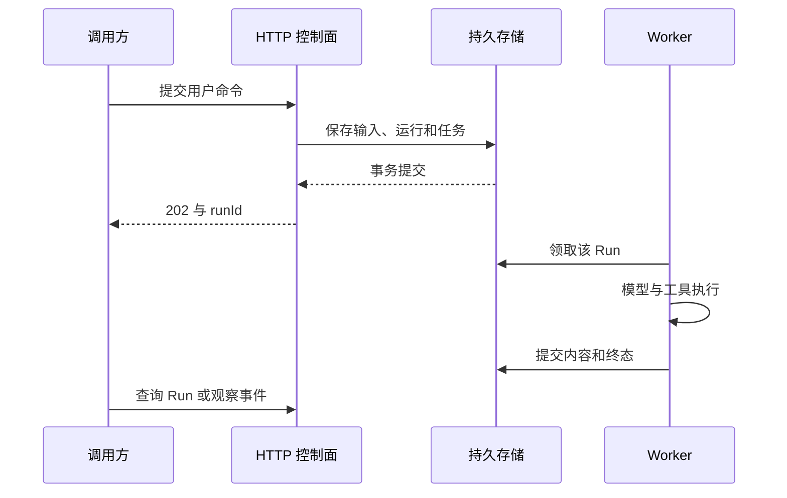
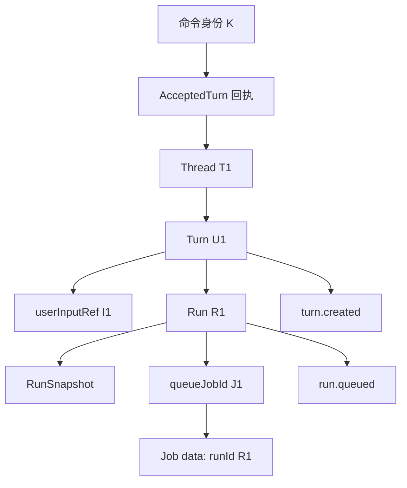
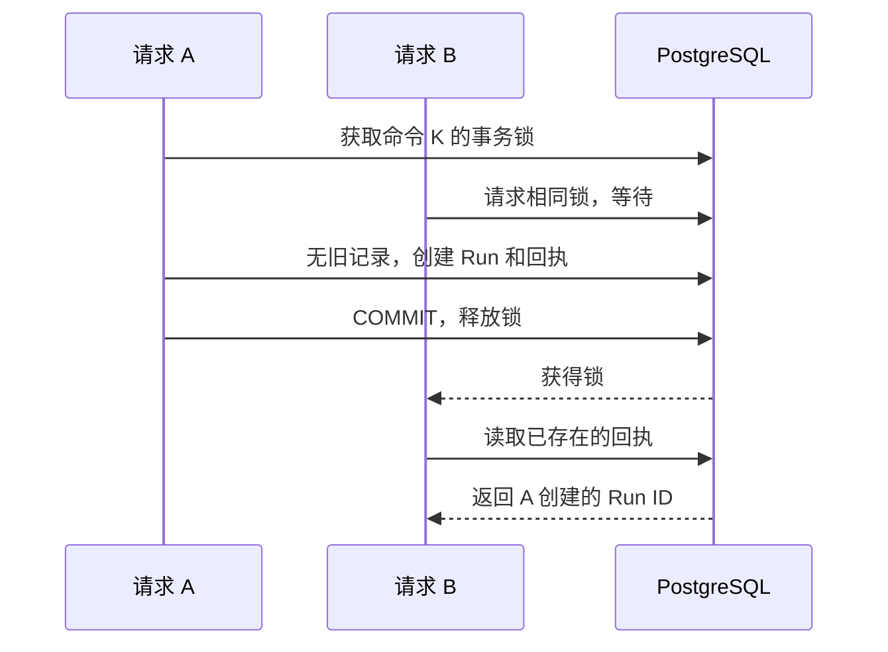
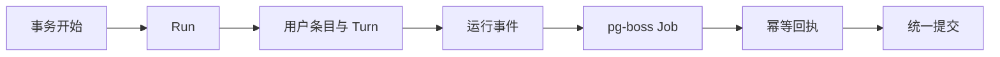

# 用户点击发送之后：请求受理、幂等与执行事务

## 01｜用户再次点击发送，服务实际收到什么？

> 请查询示例保障甲的等待期，并给出原文出处。

顾问提交这条问题后，网络连接中断。他再次点击发送。服务可能遇到两种情况：第一次请求尚未受理，或者任务已经开始，只是回执没有送达。

程序必须先确定第二次请求代表什么。它可能是重放原命令，也可能是用户明确发起的新任务。问题文字相同，无法单独表达这一区别。

HTTP Request（网络请求）是一次传输。Command（业务命令）表达一次操作意图。同一个命令可以因网络重试产生多个 HTTP 请求。控制面需要把这些请求连接到同一份受理结果。

```text
用户命令 C1：查询等待期
  ├── HTTP 请求 H1：服务完成受理，响应丢失
  └── HTTP 请求 H2：调用方重试
             ↓
        同一个 Turn U1 / Run R1
```

Turn（用户回合）保存一次正式受理的输入。Run（执行尝试）记录处理这个输入的一次运行。新的追问应创建新 Turn；旧命令重放应返回原来的 Turn 和 Run。

这条规则需要数据库记录支持。只在网页上暂时禁用发送按钮，无法处理另一台设备、另一个进程或自动重试的 HTTP 客户端。

## 02｜Control Plane 是什么？它提供哪些操作？

Control Plane（控制面）是一组创建、查询和控制运行对象的接口。Harness（智能体执行控制系统）通过这些接口接受任务，而后台执行器负责完成模型与工具循环。

Thread（对话线程）是持续会话。控制面围绕 Thread、Turn 和 Run 提供操作：

| 操作 | 典型接口 | 产生或读取的对象 |
| --- | --- | --- |
| 创建对话 | `POST /v1/threads` | Thread |
| 提交输入 | `POST /v1/threads/{threadId}/turns` | Turn、Run、受理回执 |
| 查看执行 | `GET /v1/runs/{runId}` | Run 状态与用量 |
| 查看回合 | `GET /v1/threads/{threadId}/turns/{turnId}` | 输入与最终内容引用 |
| 取消执行 | `POST /v1/runs/{runId}/cancel` | 持久取消意图 |
| 重试回合 | `POST /v1/threads/{threadId}/turns/{turnId}/runs` | 新 Run |
| 恢复执行 | `POST /v1/runs/{runId}/resume` | 检查点关联的新 Run |

路径来自本工程的控制面契约。取消、重试和恢复有各自前提，并非对任意历史位置进行同一种操作。[^contract]

控制面的一项基本选择是把受理与执行分开。`202 Accepted` 表示服务已保存任务。任务何时完成，由 Run 的终态和后续事件表达。



Worker（后台执行器）的启动时间可以晚于 HTTP 回执。调用方拿到稳定 ID 后，就有了查询和控制入口。

## 03｜从一份 HTTP 报文认识受理契约

创建 Thread 时，调用方提交标题。随后向该 Thread 提交问题。下面是一份合成请求，令牌和 ID 使用占位值：

```http
POST /v1/threads/SYN-T-01/turns HTTP/1.1
Authorization: Bearer <LOCAL_TEST_TOKEN>
Content-Type: application/json
Idempotency-Key: query-command-001

{
  "input": {"text": "查询示例保障甲的等待期"},
  "agentProfileId": "synthetic-profile",
  "expectedThreadRevision": 0
}
```

`threadId` 是路径参数。`Idempotency-Key` 是识别同一命令的幂等键。`agentProfileId` 选择服务端开放的运行配置。`expectedThreadRevision` 声明调用方所依据的线程版本。

`synthetic-profile` 是工程测试使用的配置名称。实际实例是否接受它，取决于当前服务配置与主体权限。模型凭证、上游地址和机构身份由服务端加载。

Schema（数据结构约束）首先检查字段与类型。该工程的 `SubmitTurn` 要求问题正文、Profile ID 和非负整数版本号。字符串 `"0"` 与数字 `0` 具有不同类型。

受理回执如下：

```json
{
  "threadId": "SYN-T-01",
  "turnId": "SYN-U-01",
  "runId": "SYN-R-01",
  "threadRevision": 1,
  "eventsPath": "/v1/threads/SYN-T-01/events"
}
```

这份 `AcceptedTurn`（回合受理回执）记录一次命令产生的稳定身份。`eventsPath` 指向该线程的运行事件。字段结构与实际契约一致，示例值为合成 ID。

<details>
<summary><strong>展开：受理成功与任务完成分别读哪里？</strong></summary>

| 观察结果 | 对应事实 |
| --- | --- |
| 提交接口返回 `202` | 命令已经持久受理 |
| Run 为 `queued` | 等待后台领取 |
| Run 为 `running` | 已取得执行资格并开始处理 |
| Run 为 `completed` | 最终结果经过终态提交 |
| Turn 的 `finalContentRef` 有值 | 可以定位该回合的最终内容 |

HTTP 状态码描述这次接口处理。Run 状态描述后台业务执行。轮询得到 `200`，也可能读到一个 `failed` 的 Run。

</details>

## 04｜Principal 是什么？谁有权提交这个 Thread？

Principal（认证主体）是服务端确认的调用者身份。它包含机构、主体和权限范围：

```ts
// 与工程身份结构一致的合成样本。
const principal = {
  orgCode: "synthetic-org",
  subjectId: "synthetic-user",
  scopes: ["runtime:read", "runtime:write", "knowledge:read"],
};
```

`runtime:write` 允许提交和控制运行。`runtime:read` 允许读取运行资源。`knowledge:read` 约束业务知识工具。这几类权限管理不同对象。

HTTP 认证器读取服务端认可的令牌，将结果传入控制面。存储方法再次调用 `requireRuntimeScope()` 和 `ownedThread()`。前者检查动作范围，后者检查 Thread 是否属于当前机构与主体。

这建立了两层约束。一个用户可能可以创建运行，但只能在自己可见的 Thread 上创建。一个 Thread ID 即使真实存在，也不能让另一主体绕过资源归属。

工程使用当前资源可见性处理读取与重放。已删除资源不会因为旧幂等回执仍存在，就重新变成可访问资源。删除操作本身有专门的重放规则，普通提交按当前可见范围执行。[^storage]

身份检查不能只留在 HTTP 入口。内部测试、Worker 或其他可信服务也可能直接调用存储方法。将资源约束放在存储边界，可以使不同入口共享同一业务规则。

## 05｜Fastify 怎样处理这条请求？

Fastify 是 Node.js 的 HTTP 服务框架。`createControlHttpApp()` 将框架生命周期与产品契约连接起来。[^http]

主要处理顺序如下：

```text
网络请求
  → onRequest：识别操作、检查敏感请求头、认证主体
  → preValidation：解析路径、查询、请求头和正文
  → handler：执行对应控制命令
  → response：返回回执或资源对象
  → error handler：统一错误信封
```

入口首先拒绝重复的敏感请求头，包括认证头、幂等键、资源版本头和事件游标头。它检查原始头列表，而不是依赖框架合并后的一个字符串。这避免代理和客户端对重复字段采用不同解释。

在 Schema 处理上，工程关闭三种隐式改写：

```ts
// apps/runtime/src/transport/http/app.ts，配置摘编。
const app = Fastify({
  requestIdHeader: false,
  genReqId: () => randomUUID(),
  ajv: {
    customOptions: {
      removeAdditional: false,
      coerceTypes: false,
      useDefaults: false,
    },
  },
});
```

`removeAdditional` 决定是否自动删除额外字段，`coerceTypes` 决定是否隐式转换类型，`useDefaults` 决定是否自动注入默认值。产品在明确解析层处理需要的转换，而不是让框架静默修改输入。

查询参数有自己的编码特点。HTTP 查询中的 `limit=20` 原本是字符串。`parseRouteRequest()` 根据参数 Schema 显式解码数值，并统一请求头名称。正文中的整数仍按正文契约校验。

这不是“所有字符串都拒绝转换”。更准确的规则是：转换必须属于公开协议，并发生在指定边界。[^contract]

错误使用 `ErrorEnvelope`（错误信封）：

```json
{
  "error": {
    "code": "INVALID_ARGUMENT",
    "message": "The request does not match the operation contract.",
    "requestId": "SYN-HTTP-REQUEST"
  }
}
```

调用方根据错误代码决定刷新资源、修正请求还是稍后重试。内部堆栈、正文和凭证不进入这份公开错误。

## 06｜Thread、Turn、Run、Job 和回执怎样关联？

Thread 保存持续对话。Turn 保存正式输入。Run 保存执行尝试。Job 是队列交付给 Worker 的任务通知。回执保存命令所生成的 ID。



`RunSnapshot`（运行配置快照）记录本次模型、工具和策略身份。它由可信服务端根据 Profile 解析。新运行获得明确的配置；重放原命令则继续指向原 Run。

`queueJobId` 与 `runId` 不相同。队列系统使用 Job ID 管理交付，产品使用 Run ID 管理执行。Worker 得到 `{runId}` 后仍要检查当前状态并领取租约。

用户输入条目在 Run 开始前就已保存。它属于 Turn，后续重试复用这份输入身份。模型返回的助手条目和工具结果则归属相应执行尝试。

这种设计使受理成为一个清楚的分界。接口返回后，即使原 HTTP 处理函数退出，任务身份和输入也继续存在。

## 07｜Idempotency-Key 怎样识别同一个命令？

Idempotency（幂等处理）表示重复提交同一命令时复用原受理结果。工程将命令身份限定为：

```text
orgCode + subjectId + operation + key
```

`operation` 还包含目标资源，例如 `submitTurn:<threadId>`。同一个键可以在不同授权操作范围内具有独立意义。正文通过 `contentDigest()`（规范化内容摘要）核对一致性。

数据库 `runtime.idempotency` 保存上述身份、正文摘要、Thread ID 和原回执。它的复合主键对应精确的命令范围。[^schema]

| 原记录 | 新请求 | 行为 |
| --- | --- | --- |
| 无记录 | 合法新命令 | 执行受理并保存回执 |
| 已有记录 | 同身份、同正文 | 返回原回执 |
| 已有记录 | 同身份、不同正文 | `IDEMPOTENCY_CONFLICT` |
| 已有记录 | 当前无资源访问权 | 按当前权限拒绝读取 |

重放原命令时，不需要模型重新回答。系统返回同一组 Turn/Run ID，调用方再查询该 Run 当前状态。

### 一个可独立运行的命令分类示例

下面的 Python 仅说明身份规则。真正的并发和持久性由后面的数据库事务保证。

```python
import hashlib
import json


def digest(body):
    data = json.dumps(body, sort_keys=True, separators=(",", ":"),
                      ensure_ascii=False, allow_nan=False).encode("utf-8")
    return hashlib.sha256(data).hexdigest()


def classify(records, scope, body):
    previous = records.get(scope)
    if previous is None:
        return "new"
    return "replay" if previous["digest"] == digest(body) else "conflict"


scope = ("org-a", "user-a", "submitTurn:T1", "command-1")
body = {"input": {"text": "查询等待期"}, "expectedThreadRevision": 0}
records = {}
assert classify(records, scope, body) == "new"
records[scope] = {"digest": digest(body), "runId": "R1"}
assert classify(records, scope, body) == "replay"
assert classify(records, scope, {**body, "expectedThreadRevision": 1}) == "conflict"
print("new → replay；修改正文 → conflict")
```

如果调用方修改版本或问题，应当视为新命令，并使用新键。重试同一网络命令时，保留原键和原正文。否则服务无法判断你是在找回旧回执，还是要求新的操作。

## 08｜记录还不存在时，两个请求怎样避免重复创建？

仅仅“先查幂等表，查不到就创建”，仍有并发窗口：

```text
请求 A：查询 K → 无记录
请求 B：查询 K → 无记录
请求 A：创建 Run R1
请求 B：创建 Run R2
```

工程在查询前取得 transaction-scoped advisory lock（事务级应用锁）。应用根据命令范围构造锁键，数据库保证同一键的事务依次进入检查。[^locking]

```ts
// RuntimeStorage.idempotent，真实逻辑摘编。
const scope = [
  principal.orgCode,
  principal.subjectId,
  operation,
  key,
];

await tx.execute(sql`
  SELECT pg_advisory_xact_lock(
    hashtextextended(${JSON.stringify(scope)}, 0)
  )
`);
```

这个锁保护的是包括“尚未出现的记录”在内的命令范围。事务完成或回滚后，数据库释放事务级锁。



散列仅用于锁调度。实际幂等判断仍用机构、主体、操作和键的精确字段。理论上的锁键散列碰撞会增加不必要的等待，不应把两个不同命令合并成同一个业务身份。

锁也有成本。一个慢事务会延长相同命令的等待时间。应限制事务内的不必要工作，并观察锁等待和超时。多处使用锁时，还要保持一致的获取顺序，以降低死锁风险。

## 09｜Thread 行锁、revision 和活动 Run 各管什么？

幂等锁管理相同命令。不同命令提交到同一个 Thread，还需要线程级并发规则。

Row Lock（行锁）让一个事务在修改 Thread 时保护这行资源。`revision` 是客户端看到的资源版本。活动 Run 限制则决定该 Thread 当前能否接受另一项执行。

三者的职责如下：

| 机制 | 检查的问题 |
| --- | --- |
| 幂等命令锁 | 是否有人同时处理同一个命令？ |
| Thread 行锁 | 是否有人同时修改同一个线程状态？ |
| `expectedThreadRevision` | 客户端依据的资源版本是否仍有效？ |
| 活动 Run 唯一约束 | 同一线程是否已经有未结束的执行？ |

当前工程将 `queued`、`running` 和 `cancel_requested` 都视为活动状态。数据库使用 Partial Unique Index（部分唯一索引）限制同一 Thread 的活动 Run：

```sql
-- 与 schema.ts 定义对应的 SQL 形状，用于说明约束。
CREATE UNIQUE INDEX one_active_run_per_thread
ON runtime.runs (thread_id)
WHERE status IN ('queued', 'running', 'cancel_requested');
```

这条语句是结构说明，已有产品数据库应通过正式迁移管理索引。业务方法先检查状态并返回清晰错误，唯一索引提供最后的数据一致性约束。

当两个不同命令同时提交，先取得 Thread 资格的命令可以创建 Run。另一个命令随后观察到活动 Run，返回 `THREAD_BUSY`。不同 Thread 可以独立受理，实际执行并行度由 Worker 决定。

`readyThread()` 同时检查线程是否 active、是否忙以及版本是否匹配。错误优先级属于产品行为。测试需要按真实方法顺序判断，而不是仅凭请求包含一个旧版本就认定必然返回版本错误。

## 10｜submitTurn 的一个事务究竟保存什么？

`RuntimeStorage.submitTurn()` 是受理路径的核心。入口首先检查 runtime 写权限并解析请求，准备配置解析函数，再确认当前 Thread 对调用方可见。

随后进入数据库事务和 `idempotent()`。如果是新命令，才执行以下步骤：[^storage]

```text
readyThread：归属、状态、活动 Run 和 revision
  → resolveSnapshot：解析可信配置
  → persistSnapshot：记录配置身份
  → 创建 Turn 和 userInputRef
  → 保存用户 Runtime Item
  → 创建 queued Run
  → 写 turn.created、run.queued
  → 写入 pg-boss Job
  → 更新 Thread revision 和回合序号
  → 形成 AcceptedTurn
  → 保存幂等回执
  → COMMIT
```

用户条目、Run、事件和 Job 共同成立。中途失败则整个事务回滚。

源码中队列发送之后检查返回 Job ID，再更新线程版本：

```ts
// submitTurn 的后半段摘编。
const job = await this.boss.send(
  this.queueName,
  { runId },
  { id: queueJobId, db: fromDrizzle(tx, sql) },
);
if (job !== queueJobId) throw new StorageError("INVALID_STATE");

await tx.update(schema.threads).set({
  revision: thread.revision + 1,
  nextTurnOrdinal: thread.nextTurnOrdinal + 1,
}).where(eq(schema.threads.id, threadId));

return Api.AcceptedTurn.parse({
  threadId, turnId, runId,
  threadRevision: thread.revision + 1,
  eventsPath: `/v1/threads/${encodeURIComponent(threadId)}/events`,
});
```

`tx` 是当前事务对象。`fromDrizzle()` 将 ORM（对象关系映射库）中的事务连接传给队列适配。所有写入都使用同一个数据库提交边界。

事件序号也在事务中更新。若受理回滚，外部不会读取到该事务尚未成立的 `run.queued`。这使事件能够表达已经提交的状态，而非执行函数曾经尝试过什么。

<details>
<summary><strong>展开：为什么用户条目的 runId 可以为空？</strong></summary>

用户输入在 Run 运行之前已经受理。它属于 Turn，并通过 `userInputRef` 连接回合。首次执行失败后，新 Run 继续处理同一个输入。

因此，用户输入条目不必被解释为某一次模型运行产生的内容。模型和工具输出才关联具体 Run 与 ModelStep。这能避免每次重试都复制一份相同用户输入。

</details>

## 11｜为什么 Job 必须与 Run 共同提交？

如果先保存 Run，再向独立队列发消息，中间存在故障窗口。数据库已经提交，但网络队列写入失败，Run 可能长期排队。反过来，先发送消息再保存 Run，Worker 也可能收到尚未存在的产品任务。

当前工程使用同一个 PostgreSQL 事务写 Run 和 pg-boss Job。它直接消除了这条部署路径上的双写窗口。



将来使用独立消息系统时，需要重新建立投递协议。Outbox（事务发件箱）是一种常见设计：业务事务保存 Run 和待投递记录，独立发送器重复尝试发布，并由接收方按命令身份去重。

这只是替换队列时的设计推导，不是当前源码另有一套 Outbox。当前实现的保证来自 `fromDrizzle(tx, sql)` 和同库事务。

还要限定“恰好一次”的范围。幂等受理保证同一命令复用同一受理身份。队列可能重复交付，Worker 仍要检查 Run 状态和租约。外部工具是否重复产生效果，则属于工具幂等和恢复策略。不能把受理层保证扩展为所有网络动作天然只发生一次。

## 12｜为什么原回执重放要早于新配置解析？

这是一个很适合源码复盘的案例。

第一次提交已经创建 R1。随后模型配置暂时不可用。客户端为了找回丢失的回执，再次提交同一键和同一正文。如果服务每次都先解析最新配置，这个原命令的重放就会失败。

但此时需要返回的是 R1 的身份，而不是创建新运行。工程让 `prepareSnapshot()` 只准备解析动作，再将真正的 `prepared.resolve()` 放在新命令分支里。

```ts
// submitTurn 的结构摘编。
const prepared = this.prepareSnapshot(options);
await this.ownedThread(principal, threadId);

return this.db.transaction(tx => this.idempotent(
  tx, principal, `submitTurn:${threadId}`,
  prepared.key, { threadId, command: parsed }, threadId,
  async () => {
    const thread = await this.readyThread(
      principal, threadId, parsed.expectedThreadRevision, tx,
    );
    const snapshot = await prepared.resolve();
    // 后续执行新命令的事务写入。
    return createAcceptedResult(thread, snapshot);
  },
));
```

`createAcceptedResult` 是阅读用占位，实际源码在此直接执行前节列出的写入。关键在于：幂等旧记录存在时，`action` 不会执行，所以新配置也不被重新解析。

当前资源授权仍然检查。旧回执不能恢复已经撤销的访问资格。这里分开的只是“读取原受理结果”和“解析一个新执行环境”。

`tests/control/http.test.ts` 包含对应回归：第一次解析成功，之后解析器改为抛错，再重复提交。测试要求返回相同回执，并且解析器调用次数保持一次。它还检查冲突和 Thread 忙的请求不会额外解析配置。[^tests]

## 13｜归档、删除和取消怎样影响受理？

Thread 有 `active`、`archived` 和 `deleted` 状态。新任务需要符合当前状态规则。归档表示会话不再接收普通新运行；删除表示资源进入删除和清理流程。

控制状态与运行状态还要一起检查。活动 Run 存在时，归档或删除等改变线程生命周期的命令会受到限制。源码 `patchThread()` 在请求改变线程状态时检查活动 Run；修改标题与改变运行状态不是同一种操作。

取消命令针对 Run。它先保存 `cancel_requested`，等待执行器收尾。在取消确认前，这个 Run 仍算活动。否则，新 Run 可能与尚未退出的旧执行同时写入同一线程。

删除采用逻辑状态与后台清理分离。事务先写 `deleted`、删除事件和清理 Job。回执可以表示 `cleanup: queued`。重复删除命令具有专门的已删除回放规则，而普通 Turn 提交仍受当前资源可见性约束。

<details>
<summary><strong>展开：读取历史与继续执行是两种权限判断</strong></summary>

一个已完成 Run 可能允许历史读取，但不允许重新提交成功终态。一个完成历史分支可以被 Fork（创建新 Thread 分支），但并不因此允许任意位置原地编辑。

当前产品的恢复和重试都具有明确前提。调用方应读取支持能力和对应操作契约，再决定使用哪项控制命令。

</details>

这些规则让历史内容、后台执行和资源生命周期保持一致。它们应在控制面和存储测试中验证，而不是由界面是否显示按钮决定。

## 14｜怎样在本地观察受理结果？

使用已配置的隔离 Runtime，准备一个拥有必要权限的测试主体。创建新 Thread，读取其实际 ID 与 revision，然后提交一次问题。示例使用的 `synthetic-profile` 需在该实例启用。

为了避免重复编码认证和错误处理，下面给出一个小型 Python 请求函数。它只访问本地实例，不跟随重定向。运行会创建测试资源。

```python
import json
import os
import uuid
from urllib.error import HTTPError
from urllib.parse import urlsplit
from urllib.request import Request, build_opener, ProxyHandler, HTTPRedirectHandler


class NoRedirect(HTTPRedirectHandler):
    def redirect_request(self, req, fp, code, msg, headers, newurl):
        return None


base = os.environ.get("HARNESS_BASE_URL", "http://127.0.0.1:3100").rstrip("/")
url = urlsplit(base)
if (url.scheme not in {"http", "https"}
        or url.hostname not in {"127.0.0.1", "localhost", "::1"}
        or url.username or url.password or url.path not in {"", "/"}
        or url.query or url.fragment):
    raise ValueError("需要本地测试服务的根地址")
token = os.environ["HARNESS_TEST_TOKEN"]
profile = os.environ["HARNESS_TEST_PROFILE"]
opener = build_opener(ProxyHandler({}), NoRedirect())


def request(method, path, body=None, key=None):
    headers = {"Authorization": "Bearer " + token}
    data = None
    if body is not None:
        data = json.dumps(body, ensure_ascii=False).encode("utf-8")
        headers["Content-Type"] = "application/json"
    if key:
        headers["Idempotency-Key"] = key
    req = Request(base + path, data=data, headers=headers, method=method)
    try:
        with opener.open(req, timeout=10) as response:
            return response.status, json.load(response)
    except HTTPError as error:
        return error.code, json.loads(error.read().decode("utf-8"))


status, thread = request("POST", "/v1/threads", {"title": "受理验证"}, str(uuid.uuid4()))
assert status == 201, thread
path = "/v1/threads/" + thread["threadId"] + "/turns"
body = {
    "input": {"text": "查询示例保障甲的等待期"},
    "agentProfileId": profile,
    "expectedThreadRevision": thread["revision"],
}
key = str(uuid.uuid4())
first_status, first = request("POST", path, body, key)
assert first_status == 202, first
replay_status, replay = request("POST", path, body, key)
assert replay_status == 202 and replay == first
changed = {**body, "input": {"text": "查询另一项责任"}}
conflict_status, conflict = request("POST", path, changed, key)
assert conflict_status == 409
assert conflict["error"]["code"] == "IDEMPOTENCY_CONFLICT"
print(json.dumps({"runId": first["runId"], "replaySame": True}, ensure_ascii=False))
```

脚本测试幂等受理，不要求模型完成业务问题。即使 Run 已经结束，原命令的合法重放仍应返回原回执。数据集与 Profile 的实际资源准入会影响首次提交，错误时应先处理该前提。

数据库核对使用参数化只读查询：

```sql
-- $1 是实际 threadId；仅在授权测试数据库执行。
SELECT id, ordinal, user_input_ref, current_run_id
FROM runtime.turns WHERE thread_id = $1 ORDER BY ordinal;

SELECT id, turn_id, status, queue_job_id, toolset_snapshot_id
FROM runtime.runs WHERE thread_id = $1 ORDER BY created_at;

SELECT operation, key, body_digest, response
FROM runtime.idempotency WHERE thread_id = $1;

SELECT seq, type, payload
FROM runtime.events WHERE thread_id = $1 ORDER BY seq;
```

读回应显示一次合法受理的 Turn、Run 和回执。当前 Run 的步骤数量由模型行为决定，不能用工具数作为幂等受理断言。

## 15｜怎样固定竞争顺序并验证回滚？

Concurrency Test（并发测试）需要控制动作的先后。只靠 `sleep(100)` 等待，可能因机器负载不同命中不同窗口。Barrier（同步屏障）让测试明确停在某个边界。

```ts
// 独立的测试同步组件；测试套件还应设置整体超时。
function deferred<T>() {
  let resolve!: (value: T) => void;
  const promise = new Promise<T>(r => { resolve = r; });
  return { promise, resolve };
}

const entered = deferred<void>();
const release = deferred<void>();

async function controlledResolver() {
  entered.resolve(undefined);
  await release.promise;
  return validSnapshot; // 由项目测试夹具提供。
}
```

测试先启动请求 A，等它到达配置解析边界，再启动请求 B。释放屏障后，检查两个响应与数据库记录。这段只是安排时间的辅助代码，真正的锁应仍由真实 PostgreSQL 执行。

Fault Injection（故障注入）还可以验证受理事务。例如让队列写入失败，检查用户条目、Turn、Run、事件和幂等回执都没有作为成功事务留下。配置解析失败也应在创建正式执行之前被拒绝。

这些是应执行的验证剧本。已有 `http.test.ts` 明确覆盖同键创建、相同 Turn 重放、一个 Thread 一个活动 Run，以及配置解析顺序。具体故障注入是否已成为当前测试，还应对照测试代码，不能把建议用例写成新增通过结果。

运行现有套件的入口为：

```bash
corepack pnpm check:contracts
corepack pnpm check:control
INSURANCE_STORAGE_TEST_CONFIG=/absolute/private/test-db.json \
  corepack pnpm test:control
```

数据库配置须指向独立测试资源。测试结果要记录源码版本、命令、实际执行组和跳过组。仅运行不需要数据库的检查，不等于已经验证真实事务。

## 16｜从一份回执得到可靠的运行起点

一次受理成功后，系统已经拥有输入、主体、配置、Run、Job、事件和原命令回执。模型尚未生成答案，但工作已经成为稳定的产品对象。

这层设计最重要的约束可以归纳为：同一命令复用原受理身份，资源访问遵守当前授权，新任务依据明确版本创建，相关记录共同提交，后台执行从持久任务开始。

它们也提供排障顺序。请求形状错误看 Schema；身份不可见看 Principal 与归属；重复任务看命令键和摘要；一直排队看 Job 与 Worker；状态竞争看 Thread 锁与活动 Run 规则。

到这里，控制面已完成“把输入变成可靠工作”的任务。下一篇继续看后台如何取得执行资格，并把 Run 接到 SDK 模型循环：[Worker、执行租约与 RunnerFacade](04-worker-and-model-loop.md)。

## 实现依据

[^contract]: Insurance Agent Runtime 源码快照 `c66112dfd8676b47b143dc2e26739278cf4b0dde`：`packages/contracts/src/api-schemas.ts`、`requests.ts`、`routes.ts`。示例 ID 与业务内容为合成数据。
[^http]: 同一快照：`apps/runtime/src/transport/http/app.ts` 的认证、请求钩子、严格校验与错误信封。框架机制参阅 [Fastify Validation and Serialization](https://fastify.dev/docs/latest/Reference/Validation-and-Serialization/)。
[^storage]: 同一快照：`apps/runtime/src/storage/store.ts` 的 `idempotent`、`ownedThread`、`readyThread`、`prepareSnapshot`、`submitTurn`、`patchThread`、`deleteThread`。本文源码摘编保留实际边界，省略处另有标注。
[^schema]: 同一快照：`apps/runtime/src/storage/schema.ts` 中的幂等复合主键、运行状态约束和活动 Run 部分唯一索引。SQL 是结构与只读查询示例。
[^locking]: [PostgreSQL 16：Explicit Locking](https://www.postgresql.org/docs/16/explicit-locking.html) 与 [Partial Indexes](https://www.postgresql.org/docs/16/indexes-partial.html)。应用锁需要各调用路径遵守协议，约束索引独立保护数据库合法性。
[^tests]: 同一快照：`tests/control/http.test.ts` 与 `docs/implementation/storage-preparation.md`。文章区分已有测试断言、教学脚本和待执行故障剧本；此处不声明重新运行完整产品回归。
