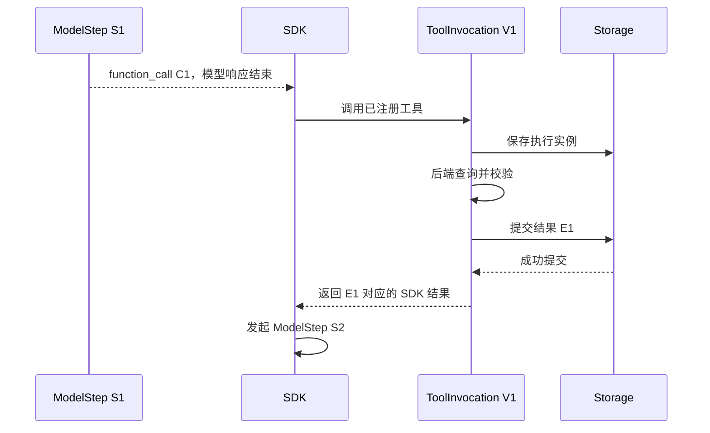

# 从排队任务到模型循环：Worker、执行租约与 RunnerFacade

## 01｜接口已经返回 Run ID，模型为什么还没有开始？

> 请查找示例保障甲的等待期，并核对意外情形的适用条件。

提交接口已经返回 `202`。数据库中也存在 Run，但状态仍是 `queued`。这个状态表示工作已经被保存，尚未由执行器正式领取。

Run（执行尝试）是产品对象，Job（队列任务）是后台交付通知。API 创建二者后便可返回。后台 Worker（任务执行器）随后读取 Job，并申请执行这个 Run。

```json
{
  "run": {"runId": "SYN-R-01", "status": "queued"},
  "job": {"id": "SYN-J-01", "data": {"runId": "SYN-R-01"}}
}
```

这是一份合成阅读视图。实际 Run 与 Job 存在于不同表和接口中，通过 `queueJobId` 与 `runId` 关联。

HTTP 请求完成和 Run 完成具有不同时间线。浏览器断开连接后，持久任务继续存在。执行器是否开始、是否仍有资格写入、最终如何结束，都需要由后台机制确定。

## 02｜Worker 是什么？它与进程和 Agent 有什么关系？

Worker 是接收任务并组织执行的程序对象。在此工程中，它是 `RunWorker` 类。一个 Node.js 进程可以同时运行 HTTP 服务和 Worker，也可以按部署需要拆开。

Agent（智能体）使用模型选择工具动作。Worker 不负责替模型选择业务查询。它负责从队列取得 Run，将 Run 交给 RunnerFacade（运行门面），并管理该执行的生命周期。

```text
物理进程：Node.js
  ├── HTTP 应用：接受命令
  ├── RunWorker：领取任务
  ├── RunnerFacade：装配和收尾 Run
  └── Agents SDK：模型与工具循环
```

当前 `RunWorker` 保存几个重要成员：

| 成员 | 含义 |
| --- | --- |
| `ownerId` | 当前 Worker 的身份 |
| `workerId` | 队列组件返回的订阅身份 |
| `executions` | 仍在执行的 Promise 集合 |
| `supervisor` | 周期性状态监督任务 |
| `leaseMs` | 领取时请求的租约时长 |
| `stopping` | 是否正在停止领取新任务 |

Promise（异步结果对象）代表尚未结束的执行。`executions` 用于停机时等待本地任务收尾，数据库则保存跨进程的运行事实。

Worker 是逻辑职责，不等于一台专用服务器。真正需要分离的是命令接收、执行资格和模型循环的语义。

## 03｜队列怎样交付任务？本地并发如何配置？

源码通过 pg-boss（PostgreSQL 持久任务队列）订阅运行队列：[^worker]

```ts
// RunWorker.start() 的队列设置。
this.workerId = await this.storage.boss.work<{ runId: string }>(
  this.storage.queueName,
  {
    batchSize: 1,
    localConcurrency: 1,
    pollingIntervalSeconds: 0.5,
  },
  async jobs => {
    // 逐项解析 Job，并领取对应 Run。
  },
);
```

`batchSize` 是一次获取的任务数量。`localConcurrency` 是当前订阅处理任务的并行度。这里两者均为 1，说明这份 Worker 配置串行处理本地 Run。

模型工具的 `maxFunctionToolConcurrency` 则约束一个 Run 内的工具并发。它不能直接增加 Worker 同时处理的 Run 数量。

```text
Worker 并发：同时执行几个 Run
模型并发：同时存在几个模型请求
工具并发：同一个 Run 同时执行几个工具
```

三种资源各有预算。把工具并发调到 4，并不等于当前单 Worker 同时执行四个用户任务。

队列任务只携带产品 Run ID。配置、用户输入和权限从可信存储读取。这样，Job 不需要复制整段对话，也不会自然成为一份过期的权限快照。

<details>
<summary><strong>展开：为什么队列可能再次交付同一任务？</strong></summary>

网络、进程退出和确认失败会让任务交付面对不确定性。产品因此把 Job 交付看作“请检查这个 Run 是否需要执行”。

收到任务后仍要读取 Run 状态和租约。已经领取、完成或不再允许执行的 Run，不应因为又收到 Job 而再次从头产生动作。

</details>

## 04｜claimRun 怎样取得执行资格？

`RunWorker` 先校验 Job 数据，再处理尚未开始的取消任务。随后调用 `claimRun()`：

```ts
// worker.ts 的核心顺序摘编。
const data = runJob.parse(job.data);
if (await this.storage.settleUnclaimedRun(data.runId, {
  status: "cancelled",
})) continue;

const claimed = await this.storage.claimRun(
  data.runId,
  this.ownerId,
  this.leaseMs,
);
if (!claimed) continue;

const execution = this.facade.execute(claimed);
this.executions.add(execution);
try {
  await execution;
} finally {
  this.executions.delete(execution);
}
```

`settleUnclaimedRun()` 只对符合条件的未启动任务收尾。正常 queued Run 不会被这次调用直接取消。

`claimRun()` 在事务中锁定所属 Thread，重新读取 Run，检查是否已有租约和开始时间。合法候选可以是 queued，或已经记录取消但尚未开始的特殊路径。普通 Worker 会优先确认取消，竞争条件下仍要根据实际状态处理。

领取时更新 Run 和 Turn，创建租约，保存 `run.started`，读取配置并核对主体。当前授权不满足时，事务会回滚；领取函数返回前还检查租约仍然有效。[^lease]

成功返回的 ClaimedRun（已取得执行资格的运行对象）包含：

```text
run                公开 Run 数据
principal          当前认证主体
snapshot           本次模型和工具配置
lease              写入资格令牌
cancelRequested    是否已存在取消意图
```

这份对象比一个裸 `runId` 多了实际执行前提。RunnerFacade 以它开始工作，而不是重新相信队列传入的一组未经核验参数。

## 05｜Lease、Owner 和 Fence 长什么样？

Lease（执行租约）是有期限的写入资格。Owner（持有者）确定哪个 Worker 使用它。Fence（隔离代次）区分不同资格版本。

```json
{
  "runId": "SYN-R-01",
  "ownerId": "SYN-WORKER-A",
  "fence": "1",
  "expiresAt": "2026-10-01T00:00:30Z"
}
```

示例中的代次以字符串传输，以保持数据库大整数的精度。实际值由存储产生。

`assertLease()` 同时核对 Run、Owner、Fence 和数据库时间。`withLease()` 在事务开始检查资格，执行具体写入，然后在返回前再次检查。允许状态限定为运行中或已请求取消。[^lease]

```ts
// withLease 的结构摘编。
return this.db.transaction(async tx => {
  const { run } = await this.lockRun(tx, token.runId);
  await this.assertLease(tx, token);
  if (!["running", "cancel_requested"].includes(run.status)) {
    throw new StorageError("LEASE_LOST");
  }
  const result = await action(tx, run, token);
  await this.assertLease(tx, token);
  return result;
});
```

为什么检查两次？一次写入可能经过异步等待。事务开始时有效的资格，在提交前可能已经过期。后置检查保护的是整个操作结束时仍满足条件。

租约不是“从第几个 token 继续”的位置。它只管理谁现在可以提交状态。恢复位置由检查点和历史引用定义。

### 用一个小程序理解隔离令牌

下面是可独立运行的规则示例。真实系统还需要数据库锁和事务。

```python
from dataclasses import dataclass


@dataclass(frozen=True)
class Lease:
    run: str
    owner: str
    fence: int
    expires: int


def can_write(current, presented, database_now):
    return (current.run == presented.run
            and current.owner == presented.owner
            and current.fence == presented.fence
            and database_now < current.expires)


old = Lease("R1", "W1", 1, 30)
assert can_write(old, old, 29)
assert not can_write(old, old, 30)
replacement = Lease("R1", "W2", 2, 60)
assert not can_write(replacement, old, 31)
assert can_write(replacement, replacement, 31)
print("有效资格通过；过期或旧代次拒绝")
```

最后两条演示通用 Fence 规则。当前产品不会任意重新领取已开始的旧 Run：过期运行由监督逻辑收敛，再通过新 Run 重试或恢复。不能把教学中的资格替换解释为本工程自动重启同一个 Run。

## 06｜RunnerFacade 为什么需要 RunEnvironment？

RunnerFacade 负责让一个已领取 Run 使用 SDK 执行，并按产品规则收尾。它首先检查同一门面是否已经运行该 Run，避免本地重复调用。

之后构造 RunEnvironment（本地执行环境）：

```ts
// facade.ts，实际环境字段摘编。
const environment = {
  claimed,
  principal: claimed.principal,
  snapshot: claimed.snapshot,
  storage: this.storage,
  signal: controller.signal,
  budget,
  lease: claimed.lease,
};
```

`principal` 确定主体与权限。`snapshot` 固定本次模型和工具身份。`storage` 提供事实提交。`signal` 传递取消。`budget` 限制资源。`lease` 控制当前写入资格。

这些对象是本地依赖。模型实际看见的是指令、消息、工具定义和工具结果。将数据库对象放入服务端上下文，不会使模型自动获得它。

源码传给 SDK 的 context 主要是 `{runId}`。业务客户端和权限规则保留在受控工厂及闭包中。Local Context（本地上下文）与 Model Context（模型可见上下文）因此有明确的数据通道。[^context]

## 07｜Agent、Runner、Model 和 Session 怎样装配？

Agent 定义模型、工具和指令。Runner 驱动执行循环。Model 是 SDK 对模型请求的接口。Session 提供有序历史读取和追加。

门面按以下顺序装配：

```text
读取执行状态
  → 创建实际模型 Provider
  → 获取工具绑定
  → 检查恢复引用（如有）
  → 创建 PgSdkSession
  → 用 RecordedModel 包装 Provider
  → 通过 createRunTools 包装工具
  → 创建 Agent 与 SDK Runner
  → 调用 runner.run
```

Provider（模型提供方适配器）将 SDK 请求转成具体模型服务调用。`RecordedModel` 在它外面增加产品记录。`PgSdkSession` 使用 PostgreSQL 保存历史引用。

```ts
// facade.ts 的主要装配代码，局部摘编。
const session = await this.dependencies.session(current, facts);
const model = new RecordedModel(
  provider, current, facts, this.dependencies.beforeModelCall,
  session instanceof PgSdkSession
    ? session.projectModelRequest.bind(session)
    : undefined,
);
const tools = createRunTools(bindings, current, facts);
const agent = new Agent({
  name: "Insurance advisor",
  model,
  tools,
  instructions,
});
const runner = new Runner({
  toolExecution: {
    maxFunctionToolConcurrency: budget.maxConcurrentTools,
  },
  tracingDisabled: true,
  traceIncludeSensitiveData: false,
  modelSettings: {
    maxTokens,
    store: false,
    retry: { maxRetries: 0 },
  },
});
```

`instructions` 和 `maxTokens` 在实际代码中从可信快照解析。上面的片段省略取值分支，但保留依赖关系。

产品锁定 Agents SDK 0.18.0。该版本的配置和回调经过项目测试。阅读持续更新的公开文档时，应区分通用机制与这个锁定版本的集成行为。[^sdk]

## 08｜一次模型请求何时成为 ModelStep？

ModelStep（模型调用步骤）在模型边界创建。`RecordedModel.begin()` 先投影输入、检查上下文和调用次数预算，再执行当前授权回调，最后创建持久步骤。

```ts
// model.ts：begin 的关键顺序。
const projected = this.projectRequest?.(request) ?? request;
assertModelInputBudget(
  projected,
  contextBudgetFor(this.environment.snapshot.modelConfig),
);
await this.beforeModelCall?.(this.environment, projected);
this.environment.signal.throwIfAborted();

const stepId = randomUUID();
await this.environment.storage.startModelStep(
  this.environment.lease,
  { stepId, ordinal: ++this.ordinal },
);
```

完整源码在异步授权前后检查模型调用次数。片段只突出预算、授权、取消和持久步骤的排列。

`getResponse()` 随后调用真实 Provider。响应返回后，`complete()` 创建规范化输出条目，并提交步骤终态、请求标识与用量。失败时，`failed()` 根据取消状态写入 failed 或 cancelled。

```text
begin / startModelStep
  → Provider 网络请求
  → ModelResponse
  → finishModelStep + outputItemRefs
```

由于步骤在发送前保存，ModelStep 是模型边界上的尝试记录。它不保证网络请求已经到达供应商。客户端若内部重试，也可能产生多个传输请求。因此，严格费用统计需要结合实际用量和传输身份。

模型步骤完成也不代表用户任务完成。响应可能只包含工具调用意图，后续还有工具和下一次模型请求。

## 09｜流式响应怎样保存为内容条目？

Stream（流式响应）按增量返回数据。项目模型接口使用 `output_text_delta` 表示文本增量，使用 `response_done` 表示当前模型响应完整结束。

`RecordedModel` 为一个助手输出分配稳定 item ID，累计文字，并通过 `appendRuntimeItems()` 保存 streaming 条目与 `content.delta` 事件。

```json
{
  "type": "content.delta",
  "payload": {
    "contentRef": "SYN-ITEM-A",
    "delta": "正在核对条款。",
    "offset": 0
  }
}
```

这是事件负载的合成摘录，完整产品事件还包含 Thread、Run、序号和时间。

当 `response_done` 到达，包装器用稳定 ID 将内容收敛为完整输出。SDK 原始状态不是 completed 的助手条目，会被标记为 interrupted，而不会自动成为可提交的最终答案。

如果流在完成事件到达前结束，包装器报告 `MODEL_STREAM_INCOMPLETE`。已收到的部分文字可以保存为中断内容，ModelStep 则按失败或取消收尾。[^model]

<details>
<summary><strong>展开：收到最后一个文本片段就能确认成功吗？</strong></summary>

文本增量描述目前收到的内容。完整响应结束还需要协议完成事件。产品最终成功还需要步骤提交、SDK 循环结束，以及 Run 的终态事务。

因此，外部看到一段完整语句，只说明文字已经出现。确认任务完成应读取 Run 状态和最终内容引用。

</details>

## 10｜function_call 怎样推进为工具执行？

模型输出的 `function_call` 是 ToolCall（工具调用意图）。它具有 `callId`、工具名和参数。模型包装器保存调用条目，并建立调用 ID 到 ModelStep 的映射。

```json
{
  "type": "function_call",
  "callId": "call-syn-01",
  "name": "search_documents",
  "arguments": "{\"content\":\"查询等待期\",\"query\":\"示例保障甲 等待期\",\"companyIds\":null,\"productIds\":null,\"topK\":5}"
}
```

这是 SDK 规范化调用样本，不是所有模型供应商都采用的原始网络格式。

SDK 找到同名工具后，`createRunTools()` 检查 Run、调用身份、能力版本、权限和预算，再创建 ToolInvocation（工具执行实例）。业务返回后，它验证结果并等待持久提交。



工具拥有独立开始、结束和状态。多个工具可以属于同一个模型步骤。下一次模型请求在工具结果可用后才发生。

这条链的关键不是工具返回一段文字，而是调用意图、实际执行、持久结果与后续模型输入都具有一致身份。

## 11｜为什么既要遍历 stream，又要等待 completed？

异步迭代器提供事件序列，完成 Promise 表示整个 SDK 运行已经结束。两种观察面可能暴露同一个执行错误，调用者需要及时处理。

源码在获得 stream 后立即建立完成错误监听：

```ts
const stream = await runner.run(agent, sdkInput, {
  stream: true,
  session,
  context: { runId },
  signal: controller.signal,
  maxTurns: budget.maxSdkTurns,
});
const completed = stream.completed.then(
  () => undefined,
  (error: unknown) => { throw error; },
);
void completed.catch(() => undefined);

for await (const event of stream) {
  // 产品事实在模型、工具和 Session 的可等待边界记录。
}
await completed;
controller.signal.throwIfAborted();
```

这里 `void completed.catch(...)` 提前接住可能很快发生的拒绝；后面的 `await completed` 仍会把错误带入门面的统一处理。它不是把业务错误当成成功忽略。

遍历循环中没有把每个 SDK 事件都重复写成产品状态。实际持久化已经发生在 RecordedModel、工具结果回调和 Session 的 awaited（等待完成）方法中。

这使记录本身能约束执行顺序。若持久化只是事件旁路，模型可能在记录还没完成时继续请求，重启后就无法复原当时输入。

## 12｜finishRun 怎样确定最终成功？

SDK 完成后，门面先检查最终输出类型，再取得 `facts.finalAssistantIds` 中最后一个已提交助手条目。随后等待心跳处理结束，停止定时器，并重新读取取消状态。

```ts
// 成功收尾摘编。
await completed;
controller.signal.throwIfAborted();
if (typeof stream.finalOutput !== "string") {
  throw new RunBoundaryError("FINAL_CONTENT_UNAVAILABLE");
}
const finalContentRef = facts.finalAssistantIds.at(-1);
if (!finalContentRef) {
  throw new RunBoundaryError("FINAL_CONTENT_UNAVAILABLE");
}
await heartbeat;

const state = await this.storage.getLeasedRun(current.lease);
if (state.status === "cancel_requested") {
  controller.abort(new RunBoundaryError("USER_CANCELLED"));
}
controller.signal.throwIfAborted();
await this.storage.finishRun(current.lease, {
  status: "completed",
  finalContentRef,
  usage: { elapsedMs: Math.floor(performance.now() - started) },
});
```

`finalContentRef`（最终内容引用）指向已经保存的助手条目。存储检查其合法归属，并与 Turn、Run 终态共同提交。

这里仍有取消和租约规则。模型已经返回，不代表旧执行器永远有权提交成功。状态竞争由数据库事务裁决，门面的内存检查只是其中一层。

Run 的完成事件由这次产品提交产生。外部 HTTP/SSE 读取相同最终引用，避免另外维护一份“看起来相同”的答案副本。

## 13｜错误、取消和停机怎样收尾？

`failureCode()` 将 SDK 错误和产品错误归一为稳定代码。它会识别模型输出无效、SDK 循环预算耗尽、存储错误和工具包装的底层原因。

门面据此选择终态：用户取消通常为 cancelled；租约丢失、进程停止和预算耗尽通常为 interrupted；其他执行失败为 failed。具体映射以该快照的代码为准。

| 情况 | 关键事实 |
| --- | --- |
| 用户取消 | 持久取消意图与本地 AbortSignal |
| 模型输出不符合协议 | ModelStep 错误与 SDK 解析结果 |
| 工具结果提交失败 | Invocation 状态与已保存条目 |
| 租约丢失 | 旧 Worker 无法继续写入 |
| 进程正常停止 | 本地运行信号中断，等待执行收尾 |

Worker 的 `stop()` 先标记停止，关闭监督计时器，通知门面停止活动 Run，再注销队列工作器，等待活动 Promise 和监督链结束。

```text
停止新工作
  → 取消本地运行信号
  → 解除队列订阅
  → 等待执行与监督收尾
  → 上层再关闭数据库
```

租约已经失效时，旧 Worker 不能继续提交自己的终态。源码对 `LEASE_LOST` 保留监督程序的最终裁决权。这个设计避免晚到的旧执行覆盖已经收敛的运行状态。

## 14｜怎样验证模型—工具—模型这条纵向链？

ScriptedModel（脚本化模型替身）按确定剧本返回输出。它第一次返回一个工具调用，第二次检查已有结果并返回固定答案。业务工具使用合成数据，SDK、Worker 和 PostgreSQL 使用实际实现。

```ts
// 摘编自项目 Runner 集成测试，依赖同文件中的夹具。
const model = new ScriptedModel([
  [call()],
  [finalMessage("synthetic answer")],
]);
await facade(model, [binding]).execute(claimed);

const run = await storage.getRun(owner, accepted.runId);
const steps = await storage.listModelSteps(owner, accepted.runId);
const invocations = await storage.listInvocations(owner, accepted.runId);
expect(run.status).toBe("completed");
expect(steps).toHaveLength(2);
expect(invocations).toHaveLength(1);
expect(invocations[0]?.modelStepId).toBe(steps[0]?.stepId);
```

还应检查结果条目已提交、第二次请求读取了该结果、最终引用合法，以及事件终态一致。只检查调用次数，不足以证明数据真正进入模型输入。

<details>
<summary><strong>展开：一条受控运行的关键观察点</strong></summary>

```text
R1 queued
R1 claimed，租约 L1
S1 started → S1 completed，产生 call C1
V1 started → result E1 committed → V1 succeeded
S2 started，输入含 E1
S2 completed，产生助手条目 A1
Turn.finalContentRef=A1
R1 completed
```

这是教学化轨迹，ID 为合成符号。实际测试使用生成的身份和真实数据库读回。模型动作与业务数据受控，不代表一次新取得的真实保险咨询结果。

</details>

正常链通过后，再验证重复 Job、已取消未启动任务、流缺少完成事件、模型响应后存储失败和失效租约。这些故障应停在确定边界，再检查记录和后续调用。

## 15｜怎样定位慢任务或卡住的 Run？

排障从执行对象开始，而不是先调整模型提示词。

Run 一直 queued，检查 Job、Worker 订阅和 `claimRun()`。Run 已 running 却没有 ModelStep，检查配置装配、当前授权与输入读取。ModelStep 长时间 running，检查 Provider 请求和取消传播。工具已结束但模型未继续，检查结果提交与 Session。

只读查询可以按实际 Run ID 展开：

```sql
-- $1 是测试 Run ID。
SELECT id, status, started_at, ended_at, model_calls, tool_calls
FROM runtime.runs WHERE id = $1;

SELECT owner_id, fence, expires_at, heartbeat_at
FROM runtime.run_leases WHERE run_id = $1;

SELECT id, ordinal, status, provider_request_id, output_item_refs
FROM runtime.model_steps WHERE run_id = $1 ORDER BY ordinal;

SELECT id, model_step_id, provider_call_id, status, result_item_ref
FROM runtime.tool_invocations WHERE run_id = $1 ORDER BY started_at, id;
```

租约查询使用数据库时间判断有效性。应用日志中的本地时间用于诊断，不能替代存储校验。

测试入口：

```bash
INSURANCE_STORAGE_TEST_CONFIG=/absolute/private/test-db.json \
  corepack pnpm test:runner
```

该命令需要独立测试数据库。已有 Runner 验证记录覆盖了 SDK 工具循环、持久取消、结果提交与并发预算等边界。本文的教学程序只演示局部规则，不替代这些集成测试。[^tests]

从队列到最终答案，执行经历领取、装配、模型、工具和终态五个边界。Worker 确定谁执行，RunnerFacade 建立本地条件，SDK 推进循环，存储确认事实。模型下一次应该看到什么，则由会话历史与上下文投影决定：[Session 与 Context](05-session-and-context.md)。

## 实现依据

[^worker]: Insurance Agent Runtime `c66112dfd8676b47b143dc2e26739278cf4b0dde`：`apps/runtime/src/runner/worker.ts`。队列并发、轮询、监督和停机参数描述该快照。
[^lease]: 同一快照：`apps/runtime/src/storage/store.ts` 的 `settleUnclaimedRun`、`claimRun`、`assertLease`、`withLease`、`heartbeat`、`startModelStep` 和 `finishModelStep`。
[^context]: [OpenAI Agents SDK：Context](https://openai.github.io/openai-agents-js/guides/context/)，以及该工程 `runner/types.ts`、`runner/facade.ts` 的本地环境与 SDK context。
[^sdk]: [OpenAI Agents SDK：Running agents](https://openai.github.io/openai-agents-js/guides/running-agents/)。产品使用锁定的 0.18.0；集成行为以对应源码为准。
[^model]: 同一快照：`apps/runtime/src/runner/model.ts`，规范化事件、流中断与输出身份。
[^tests]: `tests/runner/runner.test.ts`、`docs/implementation/runner-preparation.md`。既有测试说明与本轮新执行证据分别记录。
