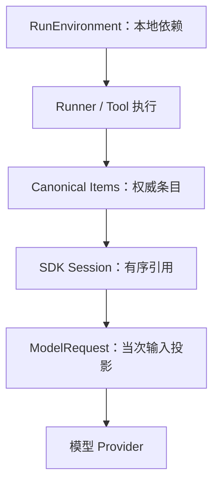
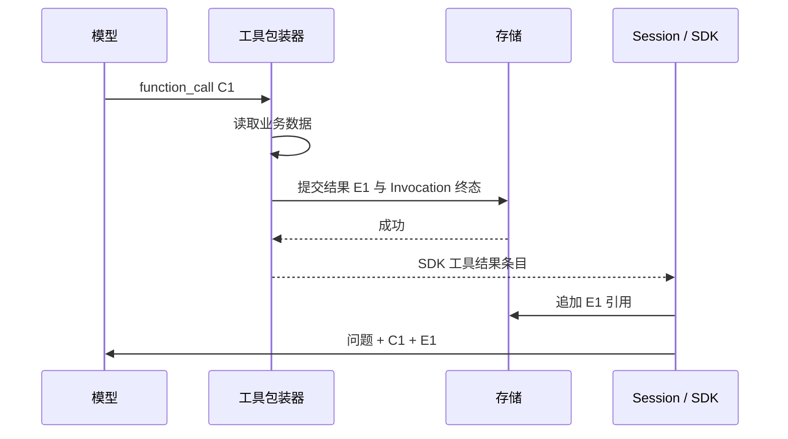
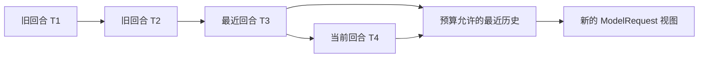

# 为什么 Agent 能够继续查：会话历史、工具结果与上下文投影

## 01｜第二次查询怎样知道第一次找到了什么？

> 请查清示例保障甲的等待期，并说明意外伤害是否适用同样规则。

第一次检索找到了等待期定义，却没有覆盖意外情形。Agent（使用模型选择动作的程序）需要继续查询。下一次模型请求至少要知道原问题、已经执行的动作和工具实际返回的内容。

如果只再次发送原问题，模型无法识别前一次查询的缺口。如果把全部数据库记录直接发送，旧失败尝试、重复内容和过长历史又可能混入输入。

持续查询需要一条明确的数据链：

```text
问题与工具定义
  → 模型提出查询
  → 工具返回证据
  → 保存工具结果
  → 将结果加入后续模型输入
  → 模型决定补查或回答
```

这里的“记住”有具体实现。Harness（智能体执行控制系统）保存内容身份，Session（会话历史接口）组织顺序，ModelRequest（模型请求）承载某一次调用真正可见的数据。

## 02｜Context、Session 和 Memory 分别是什么？

Context（上下文）经常被用来指很多不同对象。开发时需要先分清数据在哪一层。

| 对象 | 保存什么 | 谁直接使用 |
| --- | --- | --- |
| RunEnvironment | 主体、配置、存储、租约、信号和预算 | 服务端执行代码 |
| SDK Session | 按顺序读取和追加的会话条目 | SDK 模型循环 |
| ModelRequest | 本次消息、指令、工具定义与参数 | 模型适配器 |
| 持久运行历史 | 用户、模型、工具、失败与恢复事实 | 存储、审计与历史读取 |

RunEnvironment（本地运行环境）中的数据库连接不会自动进入模型输入。模型可见的内容必须通过明确的消息、指令或工具返回传递。OpenAI Agents SDK 同样区分本地 Context 与模型上下文。[^sdk]

Memory（记忆能力）还可以指应用额外保存的偏好、摘要或检索知识。当前讨论的 Session 是执行历史适配器，不应仅凭其存在就推断系统拥有自动长期记忆。



一个任务能持续执行，取决于正确的数据从上一轮进入下一轮，而不是某个名为 context 的对象自动具有所有能力。

## 03｜Canonical Item 怎样成为历史基础？

Canonical Item（权威运行条目）保存一次已发生的内容。它具有稳定 item ID、所属 Thread/Turn/Run、角色、状态和规范化内容。

Thread（对话线程）承载持续会话。Turn（用户回合）对应一次正式输入。Run（执行尝试）处理某个 Turn。模型调用和工具执行产生的条目与这些身份连接。

```json
{
  "itemId": "SYN-I-RESULT",
  "threadId": "SYN-T-01",
  "turnId": "SYN-U-01",
  "runId": "SYN-R-01",
  "modelStepId": "SYN-MS-01",
  "role": "tool",
  "status": "committed",
  "sourceRefs": []
}
```

这是一份合成字段视图。实际内部条目还包含 `canonical`（SDK 规范化内容）等数据。

`streaming` 表示内容仍在形成，`committed` 表示条目已完成提交，`interrupted` 表示部分内容因中断结束。会话的正常模型历史读取要求条目满足当前合法状态。

相同文字可以发生多次。两个用户回合都输入“继续”，应保留两个不同输入 ID。两个模型步骤都输出“正在查询”，也应有不同身份。

内容摘要可以辅助比较字节是否一致，但不能单独表示发生身份。否则重复文本会被错误地合并，执行顺序也会丢失。

## 04｜PgSdkSession 长什么样？它保存了整份聊天记录吗？

`PgSdkSession` 是项目实现的 PostgreSQL Session 适配器。它实现 SDK 的 `getItems`、`addItems`、`popItem` 和 `clearSession` 方法。[^session]

底层 `sdk_session_views` 保存的是引用：

```text
run_id       当前执行尝试
item_refs    有序条目 ID 数组
base_run_id  继承历史的来源 Run
version      引用视图的修改版本
```

正文仍保存在 `runtime_items`。Session 通过 ID 读取相同的规范化内容，而不是再维护一套相互独立的聊天文本。

```json
{
  "runId": "SYN-R-02",
  "baseRunId": "SYN-R-01",
  "version": 2,
  "itemRefs": ["I1", "C1", "E1", "A1", "I2"]
}
```

这是会话引用视图的合成样本。`I1` 是前一回合输入，`C1/E1` 是工具调用与结果，`A1` 是前一回答，`I2` 是当前输入。

SDK 的 `getSessionId()` 返回 Thread ID，而数据库视图按 Run 保存。二者服务不同目的：SDK 使用持续对话身份，产品为每次尝试保留自己的历史视图。

<details>
<summary><strong>展开：为什么同时需要 Thread ID 和 Run ID？</strong></summary>

同一个 Thread 会产生多个 Turn，每个 Turn 还可能重试。Session 的外部身份可以仍然表示这段对话，但某次失败尝试使用的历史需要独立记录。

按 Run 保存引用视图，能够明确哪个尝试继承了什么历史、恢复时选择了哪些条目，以及当前模型输入经过怎样的修改。

</details>

## 05｜新回合怎样选择已接受的历史？

Session 创建时，先读取 `getExecutionState()`，确认当前用户输入已经提交。随后调用 `initSdkSessionView()` 初始化引用视图。

存储中的 `initialSessionState()` 查找前一个已完成 Turn 的 Session，取得当前运行允许访问的条目集合。如果 Run 来自检查点，则使用检查点引用，并与当前允许集合取交集。[^storage]

```text
前一已完成回合的 Session 引用
                 + 当前可用历史范围
                 + 当前输入或恢复引用
                             ↓
                     本 Run 的初始视图
```

失败尝试的审计事实仍保留，但不会因为它们位于同一数据库，就全部进入下一次模型输入。历史选择需要遵守“哪些结果已经被当前回合接受”的规则。

原始用户输入也有特殊身份。它由控制面先保存，随后 SDK 追加当前输入时应复用同一个 `userInputRef`。否则一次问题会在历史中出现两份。

恢复前尚未初始化 Session 的场景尤其重要。检查点和 Session 初始化必须使用同一历史种子规则。若两者各自挑选历史，中断前后的模型输入就可能不同。

## 06｜getItems 怎样把 ID 还原成模型条目？

`getItems()` 从存储读取当前 Run 的有序引用，再对每一条 `canonical` 使用 SDK Schema 解析。

```ts
// runner/session.ts，getItems 的主要逻辑。
const entries = await storage.readSdkSessionEntriesForExecution(
  principal,
  runId,
);
this.captureHistory(entries);
const items = entries.map(entry => {
  const item = protocol.ModelItem.parse(entry.canonical);
  this.known.set(item, {
    itemId: entry.itemId,
    digest: contentDigest(item),
  });
  return item;
});
return limit === undefined ? items : limit === 0 ? [] : items.slice(-limit);
```

`ModelItem`（SDK 规范化消息条目）可能是用户消息、助手消息、函数调用或工具结果。解析确保它满足当前 SDK 接口。

`known` 是 WeakMap（以对象为键的弱引用映射）。它把返回给 SDK 的对象关联到产品 item ID 和摘要。对象之后再次传回 Session 时，适配器能够识别它原来的身份。

`limit` 只影响这次返回多少条。它不删除数据库内容。`getItems(0)` 返回空数组，读取最后几条则使用末尾切片。正式调用仍需遵守 SDK 对该参数的约定。

存储按 `itemRefs` 的顺序还原条目，并检查引用存在且为 committed。数据库查询返回的行顺序不能直接代替引用数组的顺序。

## 07｜addItems 怎样识别当前输入、重复内容与已记录事实？

`addItems()` 接到 SDK 要保存的条目后，并非直接插入一份新 JSON。它先确定条目对应哪个已经记录的事实。

实际代码分四种路径：

| 路径 | 判断依据 | 动作 |
| --- | --- | --- |
| 已知对象 | WeakMap 中存在对象身份 | 核对摘要并复用原 item ID |
| 当前用户输入 | 内容匹配已受理输入 | 复用 `userInputRef` |
| 恢复待持久化条目 | 匹配恢复后缀与摘要 | 复用检查点关联的 item ID |
| 新模型或工具条目 | 当前事实索引与发生顺序 | 找到尚未占用的已记录 ID |

如果 SDK 交回的已知对象被修改，适配器报告 `SESSION_FACT_MODIFIED`。如果条目从未通过模型或工具边界保存，报告 `SESSION_FACT_UNRECORDED`。

```ts
// 已知对象路径，源码摘编。
const known = this.known.get(item);
if (known) {
  if (contentDigest(item) !== known.digest) {
    throw new RunBoundaryError("SESSION_FACT_MODIFIED");
  }
  refs.push(known.itemId);
  occupied.add(known.itemId);
  continue;
}
```

`occupied`（已使用身份集合）防止同一个事实在一次追加过程中被错误分配多次。对于文本相同的多个新输出，事实索引保存各次发生的 ID，适配器按发生位置逐个选取。

完整处理结束后，`appendSdkSessionRefs()` 只追加合法且未存在的引用。恢复持久化游标也在追加成功后前进。

这条提交顺序保证失败时可以再次确认原事实身份，而不是把一个尚未保存的后缀当作已经完成。

## 08｜popItem 和 clearSession 实际修改什么？

`popItem()` 从当前 Session 视图末尾移除一个引用，并返回对应条目。`clearSession()` 清空当前 Run 的引用数组。原始 `runtime_items` 保持存在。

```text
执行前
  Session refs = [I1, C1, E1, A1]
  Canonical items = I1, C1, E1, A1

popItem 后
  Session refs = [I1, C1, E1]
  Canonical items = I1, C1, E1, A1

clearSession 后
  Session refs = []
  Canonical items = I1, C1, E1, A1
```

这解释了“修改模型历史视图”与“删除产品历史”的不同。删除 Thread、编辑用户消息和创建历史分支，还涉及资源归属、活动 Run、回合版本与清理策略。

不能仅调用 `clearSession()` 就宣布实现了任意回退。它只修改 SDK 的历史接口状态。

<details>
<summary><strong>展开：pop 后重新加入原条目会发生什么？</strong></summary>

适配器在 `popItem()` 返回对象时记录其 ID 和摘要。之后 SDK 若原样追加这个对象，`addItems()` 可以复用原事实身份。

如果调用方修改了对象内容再追加，摘要检查会识别变化。这保护了已经提交事实的含义，同时允许合法的引用视图调整。

</details>

## 09｜工具结果什么时候进入下一次模型输入？

模型先返回 ToolCall（调用意图）。工具包装器创建 ToolInvocation（执行实例），调用业务后端，再提交 ToolResult（工具结果）条目。提交成功后，SDK 才获得可以用于继续执行的结果。



`pending`（尚待结果提交的调用映射）属于执行器内部状态。只有后端函数返回，不足以证明结果已经成为持久事实。

如果 `finishInvocation()` 失败，模型循环应通过异常路径收尾。后续请求不能依赖一个重启后已经找不到的结果。

工具结果还需要表达业务缺口。`missing`、`coverage` 和来源引用告诉模型本次取得了什么。模型再根据问题决定补查查询、读取原文，或说明仍有信息待核对。

这里的继续选择来自模型与 SDK。Harness 提供合法工具和可靠反馈，不必为所有条款问题预设同一查询顺序。

## 10｜上下文预算限制的是 token、字符还是字节？

Context Budget（上下文预算）限制当次模型输入规模。这个版本采用四项产品参数：[^budget]

| 参数 | 限制对象 | 默认值 |
| --- | --- | --- |
| `maxHistoryTurns` | 可保留的历史回合数量 | 8 |
| `maxHistoryBytes` | 历史部分的 UTF-8 JSON 字节 | 131072 |
| `maxEvidenceBytes` | 工具结果条目的总字节 | 196608 |
| `maxRequestBytes` | 可序列化模型请求总字节 | 262144 |

这些数值描述该源码快照，不是所有模型通用的推荐值。

UTF-8 字节、JavaScript 字符串长度和 token（模型分词单位）是不同量。中文、emoji 和 JSON 转义都会影响计数。

```python
import json

text = "条款😀"
encoded = json.dumps({"text": text}, ensure_ascii=False,
                     separators=(",", ":")).encode("utf-8")
print("Unicode code points:", len(text))
print("UTF-8 JSON bytes:", len(encoded))
assert len(text) == 3
assert len(encoded) > len(text)
```

代码点数量不等于模型 token 数。产品使用字节预算保护请求体和存储边界，模型本身的上下文与输出 token 限制仍需单独配置。

源码 `serializedModelRequest()` 只选择 SDK 的可序列化请求字段。AbortSignal（取消信号）等本地依赖不作为模型输入 JSON 计数。

`jsonInputBytes()` 还检查非有限数值、函数、bigint 和循环引用。无法合法编码的数据，在网络发送前就被拒绝。

## 11｜projectHistoricalTurns 如何选择历史？

历史裁剪应保留协议完整性。一个工具调用被保留、对应结果被删掉，可能破坏模型输入。当前算法按完整 Turn 分组，而不是从中间截断字符串。

其主要步骤是：

```text
1. 按 Turn 分组历史条目。
2. 对照本次输入，匹配完整且已知的历史前缀。
3. 遇到当前回合、非完整回合或不匹配条目就停止匹配。
4. 从最近历史回合向前选择连续后缀。
5. 达到历史回合数或字节预算时停止。
6. 保留当前输入和全部未匹配部分。
7. 返回独立克隆，原历史保持不变。
```

这是一项谨慎的投影策略。算法只删除能够确认归属的完整历史部分。无法匹配的数据保持原状，再由总请求预算决定能否发送。

```ts
// context-budget.ts：选择最近连续历史后缀的摘编。
const kept: AgentInputItem[][] = [];
for (const turn of eligible.toReversed()) {
  if (kept.length >= policy.maxHistoryTurns) break;
  const candidate = [turn.input, ...kept].flat();
  if (jsonInputBytes(candidate) > policy.maxHistoryBytes) break;
  kept.unshift(turn.input);
}
return structuredClone([...kept.flat(), ...input.slice(offset)]);
```

注意这里使用 `break`。如果最近一个历史回合已经过大，算法不会跳过它再选一个更老的小回合。保留连续后缀有助于维持对话顺序和上下文关系。



`structuredClone()` 创建新的输入对象。数据库条目、原 Session 引用和 SDK 状态不因一次 Provider 请求裁剪而被删除。

### 一个独立的后缀选择示例

```python
import copy
import json


def size(value):
    return len(json.dumps(value, ensure_ascii=False,
                          separators=(",", ":")).encode("utf-8"))


def select_suffix(history_turns, current, max_turns, max_bytes):
    kept = []
    for turn in reversed(history_turns):
        if len(kept) >= max_turns:
            break
        candidate = [turn] + kept
        flat = [item for group in candidate for item in group]
        if size(flat) > max_bytes:
            break
        kept = candidate
    return copy.deepcopy([item for group in kept for item in group] + current)


history = [[{"id": "T1-user"}, {"id": "T1-answer"}],
           [{"id": "T2-user"}, {"id": "T2-call"}, {"id": "T2-result"}]]
current = [{"id": "T3-user"}]
original = copy.deepcopy(history)
selected = select_suffix(history, current, max_turns=1, max_bytes=1000)
assert [x["id"] for x in selected] == ["T2-user", "T2-call", "T2-result", "T3-user"]
assert history == original
assert select_suffix(history, current, 0, 0) == current
print("保留最近完整回合和当前输入，原历史不变")
```

这个教学函数假定历史已经被确认且完整。实际工程还执行前缀匹配、Schema 解析和当前回合保护，不能只复制后缀切片就替代正式算法。

## 12｜保护后的输入仍然过大怎么办？

裁剪历史后，当前工具结果本身仍可能超过预算。`assertModelInputBudget()` 先统计函数工具结果的字节，再统计完整可序列化请求。

如果证据超过上限，抛出 `EVIDENCE_BUDGET_EXHAUSTED`。如果整个请求过大，抛出 `CONTEXT_BUDGET_EXHAUSTED`。错误携带预算版本、上限、观察值和单位。

```json
{
  "code": "CONTEXT_BUDGET_EXHAUSTED",
  "details": {
    "policyVersion": "context-budget/1",
    "limit": "maxRequestBytes",
    "maximum": 262144,
    "observed": 300000,
    "unit": "utf8_json_bytes"
  }
}
```

这是内部预算错误的合成说明，不是完整公共 HTTP 错误信封。

系统不会把工具结果从 JSON 中间截断，也不会凭空摘要后声称原引用仍代表同一份输入。需要减少证据体积时，可以调整工具返回范围、请求原文页或设计明确的摘要组件。

自动摘要是一种可能扩展。它需要说明摘要来源、遗漏信息、版本和恢复方法。当前历史投影算法本身没有实现语义摘要，因此不能把它称为“自动压缩记忆”。

## 13｜持续补查怎样表现为真实的数据变化？

假设第一次请求返回等待期定义，第二次模型请求看到了工具结果和原始问题。它可以选择扩大检索数量，或者根据来源引用读取更完整页面。

```text
请求1输入：用户问题 + 工具定义
模型1输出：search_documents，topK=5
结果1：等待期片段，例外条件尚缺

请求2输入：问题 + 调用1 + 结果1
模型2输出：补充查询或 get_source_page
结果2：新的适用条件与来源

请求3输入：累计已提交结果
模型3输出：分项回答并附引用
```

这是一条合成的合理执行路径。真实模型是否采取这条路径，应以实际调用参数和返回记录确认。

工程历史中存在模型自行调整 TopK、补充来源和同 Thread 追问的行为记录。它们说明动作发生过，不能单凭一次动作就断言所有问题效果提高。证据是否新增、查询是否重复、答案是否得到原文支持，需要分别评测。

最有价值的分析是比较第二次请求究竟增加了什么。仅增加相同片段，可能只增加成本；新增一个缺失条件，则可以提高证据需求覆盖。

## 14｜恢复为什么依赖准确的会话引用？

Checkpoint（检查点）需要保存可继续执行的历史身份。若检查点引用一套条目，恢复初始化又选另一套历史，模型就可能重复工具或丢失原输入。

工程让 Session 初始化与预初始化检查点使用相同的 `initialSessionState()` 规则。恢复后的 SDK 持久化还会处理已经生成但尚待追加的后缀，并复用原事实 ID。

`resumePersistenceCursor` 只有在引用追加成功后才前进。这避免一次失败追加导致下次错误跳过条目。

<details>
<summary><strong>展开：最终 Session 能证明每一次历史请求的全部输入吗？</strong></summary>

最终引用视图说明当前 Session 保存了哪些历史。某次模型调用还可能经过上下文裁剪，并使用不同的工具、指令或参数。

要精确重建第 N 次 ModelRequest，需要记录该次请求投影或相应的可验证摘要。当前 Session 的最终数组不能自动当作所有历史请求的逐次快照。

受控模型测试可以直接检查收到的请求。这是验证“某个工具结果确实进入下一次输入”的合适边界。

</details>

这一限定不削弱持久历史价值。它明确了不同记录能证明什么，也避免把存储引用错误解释为完整网络请求审计。

## 15｜怎样测试会话连续性和上下文裁剪？

测试可以围绕具体数据关系展开。

同一 Thread 发送两个回合，检查后续 Session 继承已完成历史。让两个用户输入文本相同，检查其 ID 不同。弹出一个条目再原样加入，检查身份保持；修改对象后再加入，检查摘要保护。

工具循环测试则让 ScriptedModel（受控模型替身）第一次返回调用意图，第二次断言输入含对应结果。工具结果写入失败时，第二次调用应保持未发生。

上下文测试需要检查完整回合选择、最近连续后缀、当前回合保护和原输入不变。未知或无法匹配的输入保持受保护，再由总预算决定是否拒绝发送。

```sql
-- $1 为授权测试 Run ID。
SELECT run_id, base_run_id, version, item_refs
FROM runtime.sdk_session_views WHERE run_id = $1;

-- 用实际 item_refs 逐项读取并保持引用顺序。
SELECT id, role, status, canonical
FROM runtime.runtime_items WHERE id = ANY($1::text[]);
```

第二条 SQL 的参数是条目 ID 数组。SQL 返回顺序需要调用方按原 `item_refs` 重建，不能假定与数组顺序相同。

现有项目测试入口为：

```bash
INSURANCE_STORAGE_TEST_CONFIG=/absolute/private/test-db.json \
  corepack pnpm test:runner
```

已有上下文和恢复记录包含相关回归。实际最新通过范围以当次运行报告为准。本文的独立 Python 示例验证局部选择规则，不能替代真实 SDK Session 集成。

## 16｜连续性来自事实、顺序和请求视图

模型连续查询由多次独立请求组成。每次请求都依赖此前已经取得并提交的结果。

Canonical Item 保存发生过什么。Session 维护当前执行使用的有序引用。ModelRequest 投影决定本次模型实际收到什么。RunEnvironment 提供本地权限、预算和依赖。

这些对象分工后，系统可以同时保留完整历史、控制模型输入大小，并为中断恢复提供稳定身份。遇到“Agent 忘记了工具结果”，就可以沿结果提交、Session 追加和请求投影依次检查。

接下来需要回答：执行能持续多久，用户怎样停止，失败后又从哪里继续？下一篇深入[预算、取消与检查点恢复](06-budgets-cancellation-recovery.md)。

## 实现依据

[^sdk]: [OpenAI Agents SDK：Context](https://openai.github.io/openai-agents-js/guides/context/) 与 [Sessions](https://openai.github.io/openai-agents-js/guides/sessions/)。本地依赖与模型输入的接口原则来自官方文档，项目具体行为以锁定版本为准。
[^session]: Insurance Agent Runtime `c66112dfd8676b47b143dc2e26739278cf4b0dde`：`apps/runtime/src/runner/session.ts`，`PgSdkSession` 的初始化、读取、追加、弹出和清空方法。
[^storage]: 同一快照：`apps/runtime/src/storage/store.ts` 的 `initialSessionState`、`initSdkSessionView`、`sdkSessionEntries`、`appendSdkSessionRefs`、`popSdkSessionRef`、`clearSdkSessionRefs`。
[^budget]: 同一快照：`apps/runtime/src/runner/context-budget.ts` 的 `ContextBudgetSchema`、`jsonInputBytes`、`serializedModelRequest`、`assertModelInputBudget` 与 `projectHistoricalTurns`。默认值为版本特定配置。
[^verification]: `docs/implementation/context-budget-preparation.md`、`recovery-boundaries-fix.md` 与 `tests/runner/`。正文中的合成轨迹用于解释结构，未代替实际模型请求读回。
