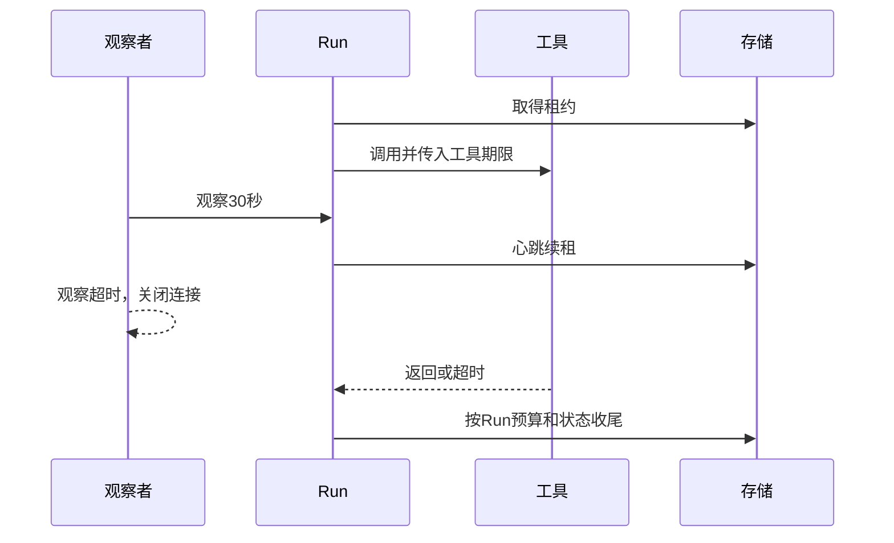
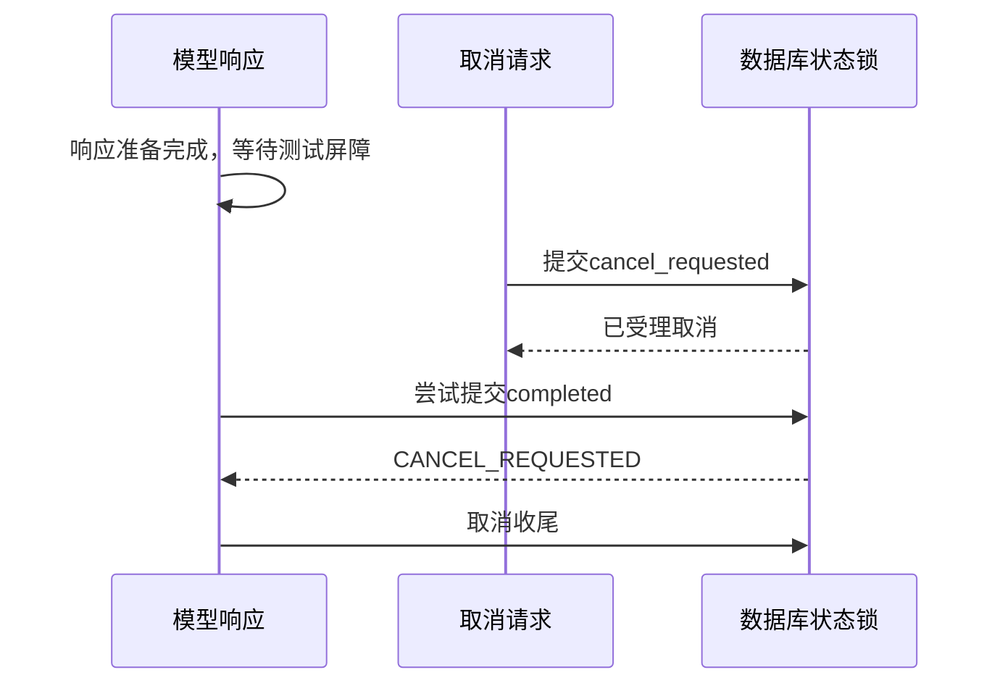
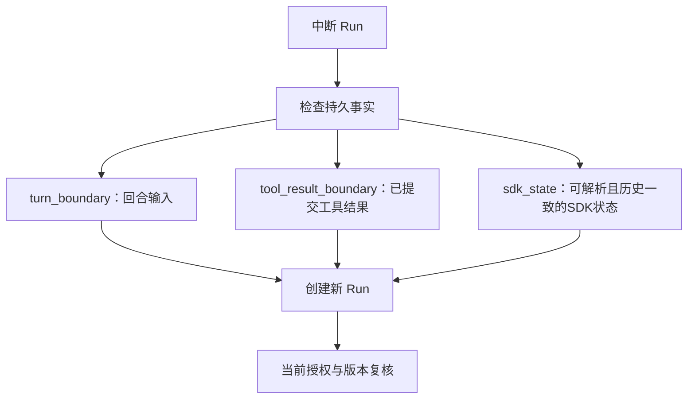

# 让自主执行保持有界：预算、取消与检查点恢复

## 01｜查询尚未完成，系统为什么需要停止？

> 比较几款示例产品的等待期、免责条件和原文出处。

Agent 已经查到部分资料，还准备继续搜索。此时可能发生四件事：工具次数达到上限、一个来源接口长期无响应、用户要求停止，或承载运行的进程退出。

这些情况都要求 Run（执行尝试）结束，但不一定表示用户问题已完整解决。Harness（智能体执行控制系统）需要保存已取得的证据，停止后续动作，并说明下一次可以从什么位置继续。

运行控制的目标不是让模型永远执行，而是让每次动作都处于明确的资源和状态边界内。

```text
自主动作选择
  + 可用工具和权限
  + 调用与时间预算
  + 持久执行事实
  + 明确终态和恢复位置
  = 可管理的 Agent 运行
```

本文沿实际代码解释这些边界。业务问题使用合成产品，源码细节绑定文末快照。

## 02｜运行预算具体限制什么？

RunBudget（运行预算）是一组不同单位的限制。只说“最多十步”不够，因为用户回合、SDK 循环、模型请求和工具调用不是同一个计数。

| 参数 | 约束对象 | 本快照的默认值 |
| --- | --- | --- |
| `maxSdkTurns` | SDK 循环次数 | 12 |
| `maxModelCalls` | 当前 Run 的模型调用尝试 | 采用明确值，否则继承 maxTurns，默认12 |
| `maxToolCalls` | 工具调用预留次数 | 6 |
| `maxConcurrentTools` | 同时执行的工具 | 4 |
| `maxElapsedMs` | 当前 Run 经过时间 | 120000 毫秒 |
| `maxToolResultBytes` | 单次工具结果大小 | 200000 字节 |

这些值来自 `budgetFor()`，是该工程版本的配置，不是通用生产建议。解析器还限制允许范围，例如 Run 总时限最高为900000毫秒。[^budget]

上下文另有历史、证据和完整请求的字节预算。模型输出 `maxTokens` 则采用 token（模型分词单位）。字节、字符和 token 应分别记录。

预算还需要定义作用域。当前参数主要约束一个 Run。重试创建新 Run，整体 Turn 的累计成本需要另行汇总。不能把一次尝试的限制自动解释为整段对话的总费用上限。

## 03｜预算怎样进入当前运行？

控制面受理时保存 RunSnapshot（运行配置快照）。它确定本次模型、工具集合和策略身份。Worker 领取 Run 后，RunnerFacade（运行门面）从快照解析预算，并放入 RunEnvironment（本地执行环境）。

```ts
// facade.ts 中 budgetFor 的主要逻辑摘编。
const config = claimed.snapshot.modelConfig;
const toolset = claimed.snapshot.toolset;
const budget = budgets.parse({
  maxSdkTurns: config.maxTurns ?? 12,
  maxModelCalls: config.maxModelCalls ?? config.maxTurns ?? 12,
  maxToolCalls: toolset.maxToolCalls ?? 6,
  maxConcurrentTools: toolset.maxConcurrentTools ?? 4,
  maxElapsedMs: config.maxElapsedMs ?? 120_000,
  maxToolResultBytes: toolset.maxToolResultBytes ?? 200_000,
});
```

`budgets.parse()` 是运行时 Schema（数据结构校验），它拒绝非法范围和类型。设置参数不应只依赖 TypeScript 编译检查，因为配置也可能来自外部文件或管理入口。

快照保存配置，执行器保存当前计数。模型包装器记录已开始的 ModelStep（模型调用步骤），工具包装器记录已预留的动作。持久用量与预算计数有各自用途：一个记录事实，一个决定后续是否准入。

调用次数也不天然等于供应商账单请求数。步骤可能在网络发送前建立，传输层也可能重试。严格计量应结合实际用量与请求记录。

## 04｜多个工具同时出现时，怎样共享预算？

模型一次响应可以提出多个 ToolCall（工具调用意图）。SDK 按并发上限调度工具，但总量仍由共享预算约束。

工具包装器在准备执行时预留次数：

```ts
// createRunTools 中的调用预算边界。
if (++reserved > environment.budget.maxToolCalls) {
  throw new RunBoundaryError("TOOL_BUDGET_EXHAUSTED");
}
await environment.storage.startInvocation(
  environment.lease,
  invocationInput,
);
```

这段代码发生在真实动作入口，而不是只在最初提示词里告诉模型“最多查六次”。模型遵守提示有助于效率，但服务端仍必须自己检查。

总次数与并发数可以分别设置。例如最多6次调用、最多2个并发，表示六个动作可以分批执行。并发上限只影响同时运行数量，不增加总调用额度。

```text
maxToolCalls = 3
maxConcurrentTools = 2

时刻1：工具A、工具B同时执行
时刻2：工具C执行
时刻3：新的工具D被预算拒绝
```

这是调度示意，实际开始顺序由 SDK 和调用列表决定。拒绝第四个动作时，前三个已开始动作仍需按各自状态收尾。

## 05｜Deadline、Timeout 和 Lease 有什么区别？

Deadline（截止时间）是某个操作应停止的绝对或相对边界。Timeout（超时限制）是等待时长。Lease（执行租约）限定当前 Worker 的写入资格。

| 时间参数 | 主要问题 |
| --- | --- |
| Run 总时限 | 这次执行最多持续多久？ |
| 工具时限 | 某个外部动作最多等待多久？ |
| 模型或网络时限 | 一次请求多久应报告超时？ |
| Lease 有效期 | 当前执行者现在还有写入权吗？ |
| HTTP 观察超时 | 调用方愿意等这次读取多久？ |

这些时间可以同时存在。观察者等待30秒后离开，不应自然终止一个预算为120秒的后台 Run。工具超时也不必改变其他已提交工具结果的事实。



本地时间使用 `performance.now()` 衡量经过时长，可以避免墙上时钟调整影响计时。数据库租约有效性由数据库时钟判断。两种时钟服务不同目的。

## 06｜AbortController 和 AbortSignal 怎样传播取消？

AbortController（取消控制器）产生 AbortSignal（取消信号）。异步操作读取这个信号，尽快停止等待或拒绝后续动作。

```js
// Node.js 可独立运行的教学示例。
function abortableDelay(ms, signal) {
  return new Promise((resolve, reject) => {
    if (signal.aborted) {
      reject(signal.reason);
      return;
    }
    const finish = () => {
      signal.removeEventListener("abort", abort);
      resolve("done");
    };
    const timer = setTimeout(finish, ms);
    const abort = () => {
      clearTimeout(timer);
      signal.removeEventListener("abort", abort);
      reject(signal.reason);
    };
    signal.addEventListener("abort", abort, { once: true });
  });
}

async function demo() {
  const controller = new AbortController();
  const pending = abortableDelay(1000, controller.signal);
  controller.abort(new Error("USER_CANCELLED"));
  try {
    await pending;
    throw new Error("EXPECTED_ABORT");
  } catch (error) {
    if (error.message !== "USER_CANCELLED") throw error;
    console.log("取消信号已传播，定时器已清理");
  }
}
demo().catch(error => { console.error(error.message); process.exitCode = 1; });
```

这段程序演示协作式取消：代码需要监听或检查信号。信号不会自动撤销一个远端已经完成的操作。

工具包装器组合 Run 信号和 SDK 工具信号，Registry（工具注册执行层）还组合工具期限。调用前后检查信号，可以阻止超时结果继续进入模型循环。[^tools]

如果远端请求已经开始，它可能仍在远端执行。系统应把“停止等待”“不再接受结果”和“远端动作被撤回”分开表达。

## 07｜取消请求怎样从 HTTP 到达 Worker？

取消首先是一项控制命令。API 保存 `cancel_requested`，表示用户的停止意图已经正式受理。执行器再通过本地快速通知或心跳读取该状态。

```text
取消 API
  → 数据库：cancel_requested
  → Worker / RunnerFacade 观察到状态
  → AbortController.abort()
  → 模型与工具响应信号
  → 数据库：cancelled
```

`cancel_requested` 与 `cancelled` 之间可能存在时间差。前者是请求成立，后者是执行收尾确认。

RunnerFacade 的心跳会续租并读取持久 Run。如果发现取消请求，就触发本地信号。这样，取消即使来自另一个进程，也能被当前执行器观察。

尚未启动的 queued Run 可以通过 `settleUnclaimedRun()` 确认未执行并结束。已经取得租约的运行则走执行器的取消路径，避免把“尚未调用”和“正在执行”混为一谈。

<details>
<summary><strong>展开：为什么观察连接不拥有取消信号？</strong></summary>

SSE 或轮询是读取进度的通道。关闭通道只结束该观察者。Run 的取消由持久控制命令决定。

一个用户可以在多个终端观察同一 Run。某个终端退出，不应使其他观察者的任务突然结束。

</details>

## 08｜取消和成功同时到达时，谁决定结果？

模型即将返回时，用户可能已经提交取消。如果只检查内存信号，检查之后到事务提交前仍有竞争窗口。

存储因此在与 Run 相同的锁内检查取消状态。`finishModelStep()` 对已请求取消的 Run 拒绝新的成功模型提交：

```ts
if (input.status === "completed" && run.status === "cancel_requested") {
  throw new StorageError("CANCEL_REQUESTED");
}
```

RunnerFacade 最终提交前还会读取取消状态。`finishRun()` 负责在数据库中执行最后的状态判断。[^storage]



测试用屏障固定这个顺序，才能稳定重现竞争。将取消和响应同时启动后观察偶然结果，不能准确证明裁决规则。

已提交的工具结果仍然保留。取消改变运行终态，不会让此前实际发生的调用从审计历史中消失。

## 09｜Failed、Interrupted、Cancelled 与 Outcome Unknown 分别表示什么？

状态名称需要结合所属对象理解。Run 的 failed 表示执行失败，interrupted 表示进程、租约或预算等边界造成中断，cancelled 表示取消完成。

ToolInvocation 的 outcome_unknown（结果状态不确定）表示外部动作与本地结果提交无法完整确认。它不意味着业务必然失败，也不是成功别名。

| 事实 | 可用记录 | 后续判断 |
| --- | --- | --- |
| 模型返回合法答案并成功提交 | 助手条目、最终引用、终态 | completed |
| 用户取消已收尾 | 取消意图和终态 | cancelled |
| 预算耗尽 | 已提交部分结果、预算原因 | interrupted |
| 工具结果结构非法 | Invocation 错误及原边界 | failed 或对应拒绝 |
| 工具已返回但提交未确认 | 调用记录与不确定状态 | 需要重新核对 |

预算用完时，不保证仍有剩余模型调用来生成一段完整的“阶段总结”。系统可以保留部分内容和结构化结束原因。若产品要求始终生成总结，应预留独立预算并定义它的状态含义。

公开结果应说明已获得证据的范围。部分原文可用与整个问题已回答，是两个判断。

## 10｜Retry 和 Resume 分别创建什么？

Retry（重试）从同一 Turn 的输入重新开始。Resume（恢复）从一个可验证检查点继续。二者都创建新的 Run，并保留原尝试身份。

```json
{
  "turnId": "SYN-U-01",
  "attempts": [
    {"runId": "SYN-R-01", "status": "interrupted"},
    {
      "runId": "SYN-R-02",
      "status": "queued",
      "resumesRunId": "SYN-R-01",
      "checkpointId": "SYN-CP-01"
    }
  ]
}
```

这是一份合成聚合视图。实际 API 分别返回 Run 和检查点对象。

该版本限制在最后一个未完成回合进行相应重试或恢复，并检查当前 Run 身份、Thread revision 和授权。已完成历史的 Fork（建立新线程分支）是独立能力。

新 Run 有新的调用计数和执行资格。跨尝试统计应汇总旧 Run 的实际消耗，不能只保留成功尝试的费用。

## 11｜Checkpoint 到底保存哪些数据？

Checkpoint（检查点）描述一个经过确认的继续位置。公开接口提供模式、版本、是否可恢复及原因；私有存储保存有序条目引用和可选 SDK 状态。

```json
{
  "checkpointId": "SYN-CP-01",
  "runId": "SYN-R-01",
  "mode": "tool_result_boundary",
  "recoverable": true,
  "sdkVersion": "0.18.0",
  "toolsetSnapshotId": "SYN-TOOLSET",
  "modelProfileId": "SYN-MODEL-PROFILE",
  "schemaVersion": "insurance-recovery/1"
}
```

上面是公开检查点的字段摘录。内部状态包含 `inputItemRefs`，以及适用时的 `sdkState`。受限消息不应自动出现在公共摘要中。

三个条件需要分别检查：能够序列化、能够解析、可以在当前权限和版本下安全继续。一个 JSON 能读入，不等于它仍然表达正确的运行历史。

源码还固定状态格式与版本：引用格式、SDK 包版本、SDK 序列化版本各自保存。它们不是可以随意互换的一串版本号。[^recovery]

## 12｜三种恢复边界分别恢复什么？

### turn_boundary：当前回合起点

这一边界保留已完成历史和当前正式受理的用户输入。恢复从当前回合的清晰起点开始，适合尚无可复用工具结果的情况。

它不表示从任意 token 中途恢复，也不是重新创建一个不相关的用户问题。

### tool_result_boundary：已提交工具结果

这一边界使用已经成功保存、调用和结果关联完整的条目。恢复继续引用原 ToolResult，并标记对应调用已完成。

如果 SDK 再次尝试同一个已完成调用 ID，执行包装器会识别它，防止无意重复执行。后续新查询仍需使用自己的调用身份。

### sdk_state：已验证的 SDK 状态

这一边界尝试保存 SDK RunState（运行状态对象），并通过公开解析方法恢复。只有满足状态格式、上下文和历史一致性，才标记为可恢复。



不同模式保留不同继续信息。服务应按模式报告支持情况，而不是给整个运行一个模糊的“支持恢复”标签。

## 13｜SDK 状态怎样通过恢复准入？

`inspectSdkCheckpoint()` 先调用 `state.toString()`，检查序列化版本，再确认没有不支持的状态所有权。随后使用 SDK 的公开 parser（解析器）尝试恢复，并比较历史内容摘要。[^recovery]

检查项包括：

| 条件 | 原因 |
| --- | --- |
| SDK 序列化版本匹配 | 保证按正确格式解释状态 |
| 没有未支持的服务端会话所有权 | 避免混用本地历史与远端会话 |
| 没有未完成 Session 写入 | 避免跳过尚未成立的事实 |
| 本地 context 与当前 Run 一致 | 防止恢复到错误运行环境 |
| 已提交历史与 SDK history 一致 | 确认模型状态依据真实持久输入 |
| 中断类型受支持 | 仅恢复实现能够继续的路径 |

核心比较如下：

```ts
// runner/recovery.ts：校验历史的局部摘编。
const restored = await RunState.fromStringWithContext(
  agent,
  serialized,
  new RunContext({ runId }),
  { contextStrategy: "replace" },
);
const facts = entries.map(entry =>
  contentDigest(protocol.ModelItem.parse(entry.canonical))
);
const history = restored.history.map(item =>
  contentDigest(protocol.ModelItem.parse(item))
);
if (contentDigest(facts) !== contentDigest(history)) {
  return rejected("SDK_HISTORY_NOT_COMMITTED");
}
```

受限状态应保留原始原因。删除一个不理解的字段，再把剩余 JSON 解释为“恢复成功”，会改变 SDK 状态的真实含义。

当前恢复代码使用 `contextStrategy: replace` 将本地 context 关联到新 Run，同时验证其他已保存历史。它不是直接恢复旧进程的内存、网络连接或计时器。

## 14｜工具成功返回，但结果没有提交怎么办？

最危险的窗口位于外部效果与内部记录之间：

```text
外部工具请求已执行
  → 本地获得返回值
  → 数据库提交失败或进程退出
```

重启后，系统可能看见工具调用开始，却找不到可靠结果。此时不能把进程内曾经出现的对象当成已提交证据。

工具包装器尝试写入 `outcome_unknown` 并停止模型继续。如果连这次状态更新也失败，监督逻辑还要在数据库恢复后收敛未结束记录。

当前业务能力是只读查询。新尝试在当前授权下可以重新读取。但“只读”也可能产生费用、审计日志或新的数据版本，重查应记录新的观察时间。

未来接入业务写操作时，还需要上游幂等键、效果查询或补偿协议。例如支付或保单变更不能仅因本地没收到结果就盲目重发。本文的运行恢复机制不自动提供外部业务写入的恰好一次保证。

对于已经成功提交的 ToolResult，恢复沿用原条目和来源身份。旧结果的观察时间也保留，避免被重新标成最新读取。

## 15｜Worker 退出和 SDK 状态超限怎样处理？

Lease（租约）过期后，监督程序读取持久状态并结束失去执行者的 Run。旧执行器即使稍后恢复，也会因为 Fence 或有效期不符而失去写入权。

程序正常停机时，会先通知本地运行停止，再等待执行和监督收尾，最后关闭存储。异常退出则依赖已提交事实和租约监督恢复一致性。

状态大小同样影响恢复。当前私有恢复协议限制 SDK 状态字符串最多4000000个字符、引用最多10000项。字符限制与工具 UTF-8 字节限制使用不同单位。[^recovery]

两个合法工具结果合并后，仍可能使 SDK 状态超限。此时 SDK 状态模式可以不可恢复，但已经提交的工具结果边界仍可能可用。

<details>
<summary><strong>展开：恢复失败原因应怎样解释？</strong></summary>

`SDK_SCHEMA_VERSION_UNSUPPORTED` 表示格式不匹配。`SESSION_AUTHORITY_PENDING` 表示会话写入或事务尚未收敛。`SDK_HISTORY_NOT_COMMITTED` 表示 SDK 历史与持久事实不同。

这些原因不是同一种网络错误。调用方应按具体模式和原因选择重试、回合起点或工具结果恢复，而不是无限重复同一恢复请求。

</details>

## 16｜怎样验证预算、取消与恢复？

测试需要在明确边界暂停执行，再触发控制命令或故障。推荐使用同步屏障固定时序，而不是用短暂 sleep 猜测。

| 测试窗口 | 操作 | 核心断言 |
| --- | --- | --- |
| 下一次模型调用前 | 用完模型预算 | 不再开始新 ModelStep |
| 多工具调用入口 | 超过总量 | 超额工具不执行 |
| 模型即将完成 | 先提交取消 | 成功提交被状态规则拒绝 |
| 工具结果已保存 | 结束 Worker | 原结果仍可读取 |
| 租约过期 | 旧 Worker 写入 | `LEASE_LOST` |
| 恢复启动 | 改变工具版本 | 明确兼容性判断 |
| SDK 状态过大 | 保存检查点 | 模式和原因如实报告 |

只读查询可以检查运行与恢复对象：

```sql
SELECT id, status, termination_reason, model_calls, tool_calls
FROM runtime.runs WHERE id = $1;

SELECT id, mode, recoverable, reason, sdk_version,
       toolset_snapshot_id, through_event_seq
FROM runtime.checkpoints WHERE run_id = $1 ORDER BY created_at;

SELECT id, status, provider_call_id, result_item_ref
FROM runtime.tool_invocations WHERE run_id = $1;
```

参数 `$1` 是实际测试 Run ID。私有检查点状态可能含完整模型历史，应通过受控维护权限读取。

现有测试入口包括 Runner 与恢复套件。使用前准备隔离数据库配置：

```bash
INSURANCE_STORAGE_TEST_CONFIG=/absolute/private/test-db.json \
  corepack pnpm test:runner

INSURANCE_STORAGE_TEST_CONFIG=/absolute/private/test-db.json \
  corepack pnpm test:recovery
```

历史恢复记录覆盖 Session 引用、结果复用、取消与租约竞争以及状态大小边界。具体当前通过数量，以实际运行输出为准。[^tests]

## 17｜有界执行让模型能力进入产品生命周期

自主 Agent 需要行动空间，也需要资源与状态规则。预算约束调用，取消提供用户控制，检查点保存可继续的位置，租约确定谁可以提交。

对于开头的复杂查询，系统最终应说清楚：哪些证据已经获得，哪些结果已经保存，当前为什么结束，以及后续可以复用什么。一次结束不一定是完整业务成功，但必须是可以解释的执行状态。

这些规则会在每一次工具调用中落实。下一篇沿调用身份、权限和结果提交深入：[ToolInvocation 的完整生命周期](07-tool-invocation-lifecycle.md)。

## 实现依据

[^budget]: Insurance Agent Runtime `c66112dfd8676b47b143dc2e26739278cf4b0dde`：`apps/runtime/src/runner/facade.ts` 的预算解析，以及 `model.ts`、`tools.ts`、`context-budget.ts` 的执行边界。
[^tools]: 同一快照：`apps/runtime/src/runner/tools.ts`、`registry/registry.ts`。信号合并与期限检查属于该实现的本地控制机制。
[^storage]: 同一快照：`apps/runtime/src/storage/store.ts` 的取消、模型完成、运行完成、重试、恢复和租约检查。
[^recovery]: 同一快照：`apps/runtime/src/runner/recovery.ts` 与 `storage/recovery.ts`。SDK 包版本0.18.0、序列化版本1.20和恢复信封版本分别校验。
[^tests]: `docs/implementation/recovery-boundaries-fix.md`、`tests/recovery/`、`tests/runner/`。独立示例只验证局部信号行为，真实恢复仍需对应集成测试。
[^public]: [Node.js Globals：AbortController](https://nodejs.org/api/globals.html#class-abortcontroller)；[OpenAI Agents SDK](https://openai.github.io/openai-agents-js/)。产品恢复能力以锁定源码和测试为准。
