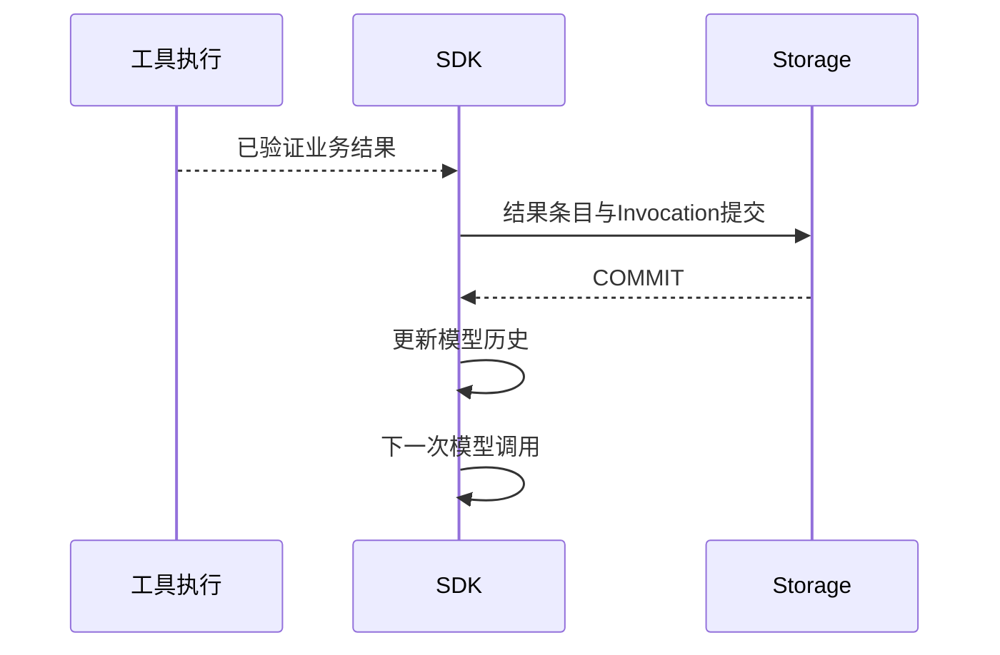
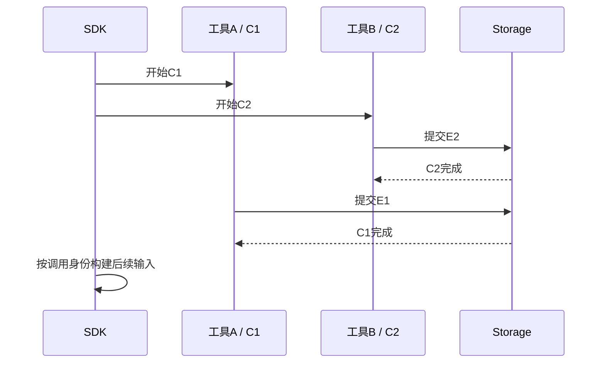

# 一次工具调用如何成为可靠执行：ToolInvocation 的完整生命周期

## 01｜模型同时查询两个产品，程序需要记录什么？

> 比较示例保障甲和示例保障乙的等待期，并列出对应条款出处。

模型可能在一次响应中提出两条检索调用。第一个接口很快返回，第二个还在等待。一个结果包含完整来源，另一个只找到部分正文。

用户看见的是一项比较任务。运行系统需要分别记录两个动作的身份、状态、参数和结果。否则，结果完成顺序改变时，很容易把产品甲的条款关联到产品乙。

ToolInvocation（工具执行实例）就是这项记录。它连接模型提出的动作与服务端实际取得的结果。一个用户任务可以包含多个实例，每个实例都有独立状态。

```text
一次模型响应
  ├── C1：查询产品甲
  │    └── V1：先完成，结果 E1
  └── C2：查询产品乙
       └── V2：后完成，结果 E2
```

C1、C2 是调用意图的 ID。V1、V2 是产品执行 ID。完成顺序由网络和后端决定，关联关系由稳定身份决定。

## 02｜Tool、ToolCall、ToolInvocation 和 ToolResult 分别是什么？

Tool（工具）是一项可调用能力，例如搜索文档。ToolCall（调用意图）是模型选择这项能力并生成参数的结构化输出。ToolInvocation 记录实际执行，ToolResult（工具结果）保存返回数据。

| 对象 | 主要字段 | 回答的问题 |
| --- | --- | --- |
| Tool | 名称、说明、Schema、执行函数 | 系统提供什么能力？ |
| ToolCall | callId、工具名、参数 | 模型要执行什么？ |
| ToolInvocation | invocationId、状态、引用 | 系统实际如何执行？ |
| ToolResult | 数据、来源、覆盖和缺口 | 工具取得了什么？ |

下面是模型可见的搜索参数，内容为合成示例：

```json
{
  "content": "分别核对示例产品的等待期",
  "query": "示例保障甲 等待期 正式条款",
  "companyIds": null,
  "productIds": null,
  "topK": 5
}
```

同一参数对象进入模型输出时，通常被放在 `function_call.arguments` 的 JSON 字符串里。具体原始字段由 SDK 模型适配器转换。

```json
{
  "type": "function_call",
  "callId": "call-syn-1",
  "name": "search_documents",
  "arguments": "{\"content\":\"查询等待期\",\"query\":\"示例保障甲 等待期\",\"companyIds\":null,\"productIds\":null,\"topK\":5}"
}
```

这条意图本身不证明工具已经执行。权限、版本、输入 Schema（结构约束）和预算都要在实际入口检查。

## 03｜ToolBinding 怎样变成 SDK FunctionTool？

ToolBinding（工具执行绑定）把稳定能力连接到具体本地执行函数。它包含产品能力 ID、模型可见名称、版本、输入 Schema、输出 Schema、权限范围和数据模式。

`createRunTools()` 遍历绑定，创建 SDK 的 FunctionTool（函数工具）。[^tools]

```ts
// runner/tools.ts，装配入口摘编。
return bindings.map(binding => {
  if (names.has(binding.modelName)) {
    throw new RunBoundaryError("DUPLICATE_TOOL_NAME");
  }
  names.add(binding.modelName);
  if (binding.effect !== "read") {
    throw new RunBoundaryError("TOOL_EFFECT_UNSUPPORTED");
  }
  if (!("content" in binding.parameters.shape)) {
    throw new RunBoundaryError("TOOL_CONTENT_SCHEMA_REQUIRED");
  }
  return tool({
    name: binding.modelName,
    description: binding.description,
    parameters: binding.parameters,
    outputSchema: z.object({}).catchall(z.unknown()),
    errorFunction: null,
    execute: /* 当前 Run 的执行包装器 */ execute,
    customDataExtractor: /* 结果提交回调 */ extract,
  });
});
```

`execute` 和 `extract` 在实际源码里直接作为闭包定义。片段使用名称突出两个阶段，不是可以独立运行的完整注册程序。

当前 `ToolSpecSchema`（工具规格约束）和工具包装器都只接受 `effect=read`。接入写操作时，需要共同扩展规格、权限、执行与恢复规则。[^registry]

唯一工具名保证 SDK 能找到确定的函数。版本检查保证这次运行使用的工具与快照一致。`content` 是动作说明，后续会与业务参数分开保存。

## 04｜调用 ID 怎样关联到 ModelStep？

ModelStep（模型调用步骤）记录一次模型边界调用。模型响应可能包含多个 `function_call`。`RecordedModel.complete()` 保存输出条目后，建立 `callSteps` 映射：

```ts
// model.ts 中响应完成后的事实索引。
if (raw.type === "function_call" && typeof raw.callId === "string") {
  this.facts.callSteps.set(raw.callId, {
    stepId,
    itemId: item.itemId,
    canonical: raw,
  });
}
```

工具入口从 SDK 的 `details.toolCall` 取得 callId，再查找该映射。它还核对工具名称和当前 Run。

```ts
const callId = details?.toolCall?.callId;
const call = callId ? facts.callSteps.get(callId) : undefined;
if (!callId || !call || details?.toolCall?.name !== binding.modelName) {
  throw new RunBoundaryError("TOOL_CALL_IDENTITY_MISMATCH");
}
```

这个检查保护的是调用来源。一个函数即使可以被本地代码调用，也不能随意伪装成当前模型已经提出的动作。

数据库还对同一 Run 的 `provider_call_id` 设置唯一约束。内存索引用于执行连接，持久约束保护最终事实，两层不能互相替代。

## 05｜工具开始前怎样检查授权和预算？

RunEnvironment（本地运行环境）包含当前主体、运行快照、存储、租约、预算和取消信号。工具执行使用这些可信条件，而不是从模型参数里读取身份。

包装器检查 `requiredScopes`（所需权限范围）是否被运行主体允许。后续 Registry（工具注册执行层）还会读取当前授权与资源状态。快照允许的能力和当前仍有效的权限共同限定执行。

恢复时，`completedCallIds` 保存已经成功执行的调用身份。如果 SDK 试图再次执行同一已完成 callId，包装器会报告 `RECOVERED_TOOL_CALL_ALREADY_COMPLETED`。

预算在动作入口预留：

```ts
if (++reserved > environment.budget.maxToolCalls) {
  throw new RunBoundaryError("TOOL_BUDGET_EXHAUSTED");
}
```

并发上限控制同时执行数量，调用预算控制总动作数。合法权限也不代表无限次数。

权限拒绝可能发生在创建 ToolInvocation 之前。此时存在模型调用意图，但没有对应的已开始执行实例。测试应观察拒绝发生的位置，不能要求所有模型意图都已有 running 记录。

## 06｜content 为什么与业务参数分开？

`content` 是模型生成的公开动作说明，例如“核对两款产品的等待期”。它帮助外部理解模型准备做什么，但不是隐藏推理全文，也不证明动作已完成。

业务服务真正需要的是 `query`、产品筛选和 TopK。因此执行器先拆分：

```ts
const { content, ...businessArguments } = parameters;
```

随后将动作说明和参数分别写入 Invocation。业务绑定只接收 `businessArguments`，当前主体和客户端依赖从本地环境传入。

```text
模型生成
  content：为什么调用这个公开工具
  query / filters：查什么

服务端提供
  principal：以谁的身份
  backend：调用哪个已配置服务
  signal：何时停止
  lease：谁有权写入结果
```

这种分工避免模型通过参数替换当前机构、服务地址或凭证。返回结果也应把文档正文当作业务数据，不将其内容自动提升为运行控制指令。

## 07｜startInvocation 怎样建立执行事实？

通过入口检查后，包装器生成新的 invocationId，调用存储：

```ts
await environment.storage.startInvocation(environment.lease, {
  invocationId,
  modelStepId: call.stepId,
  providerCallId: callId,
  capabilityId: binding.capabilityId,
  version: binding.version,
  content,
  arguments: businessArguments,
  dataMode: binding.dataMode,
  callItem: runtimeItem(call.canonical, call.itemId, call.stepId),
});
```

存储在租约保护下检查当前 Run 和取消状态。它确认 ModelStep 属于该 Run，保存调用条目，插入 running Invocation，更新 Run 的工具调用计数，再写 `tool_invocation.started` 事件。[^store]

这些写入共同提交。外部读到 started 事件时，就有对应的产品执行记录可以查询。

```json
{
  "invocationId": "SYN-V-01",
  "runId": "SYN-R-01",
  "modelStepId": "SYN-MS-01",
  "providerCallId": "call-syn-1",
  "capabilityId": "knowledge.search_documents",
  "version": "1.0.0",
  "status": "running",
  "resultItemRef": null,
  "dataMode": "synthetic"
}
```

这是执行记录的合成摘录。`resultItemRef=null` 表示当前尚未提交结果，而不是工具已经返回空业务数据。

## 08｜业务函数执行时还有哪些边界？

工具执行器组合 Run 级信号和 SDK 提供的工具信号。调用前检查取消，再把参数和本地环境交给后端绑定。

```ts
const signal = details.signal
  ? AbortSignal.any([environment.signal, details.signal])
  : environment.signal;
signal.throwIfAborted();
const result = await binding.execute(
  Object.freeze(businessArguments),
  { ...environment, signal },
);
```

AbortSignal（取消信号）负责协作式停止。后端 Adapter（业务适配实现）应把它继续传到网络或 SDK 请求，并在必要位置复核。

`Object.freeze()` 冻结这一层参数对象。它不是递归深冻结，也不是权限机制。嵌套对象仍需由 Schema 和业务边界处理。

只读效果也有实际影响。查询可能消耗配额、产生审计日志，或者读到不同版本数据。只读表示不修改目标业务状态，不代表调用完全没有成本。

当前错误分类依赖包装器能识别的错误类型和取消信号。未知异常会归一为通用工具执行失败。某个底层服务返回“超时”文字，不一定自动进入 `timed_out`，应检查适配层是否保留了规范错误代码。

## 09｜结果怎样通过结构、大小和来源校验？

业务返回值先经过 `binding.outputSchema.parse(result)`。Schema 确认字段和类型，例如页码是整数或 null，证据行包含约定的来源信息。

包装器随后将结果序列化为 JSON，检查 UTF-8 字节数，再提取 `sourceRefs`（来源引用集合）。

```ts
const validated = binding.outputSchema
  ? binding.outputSchema.parse(result)
  : result;
const serialized = JSON.stringify(validated);
if (typeof serialized !== "string"
    || Buffer.byteLength(serialized) > environment.budget.maxToolResultBytes) {
  throw new RunBoundaryError("TOOL_RESULT_BUDGET_EXHAUSTED");
}
const refs = [...(binding.sourceRefs?.(validated) ?? [])];
```

Registry 还验证 provenance（数据来源声明）与后端描述是否一致。数据模式、后端 ID 和数据集版本都应匹配。证据行中的来源引用也必须被结果外层引用集合覆盖。[^registry]

```json
{
  "status": "empty",
  "data": [],
  "sourceRefs": [],
  "coverage": "unknown",
  "missing": [],
  "warnings": [],
  "provenance": {
    "mode": "synthetic",
    "backendId": "example-retrieval",
    "datasetVersion": "fixture-v1",
    "observedAt": "2026-10-01T00:00:00Z"
  }
}
```

这是一份合法形状的合成空结果。它可以作为成功执行返回。最终是否足够回答用户问题，需要模型和业务评测另行判断。

SDK 外层使用宽对象 `outputSchema`，并不代表这里省略了业务校验。当前实现为了处理锁定 SDK 版本的工具错误转译，在内部保留了严格的业务 Schema。应沿完整执行链阅读，而不是只看 SDK 配置中的一行。

## 10｜为什么还需要 customDataExtractor？

后端返回的是业务对象。SDK 会把它转换成模型历史使用的工具结果条目。为了让存储与模型实际消费的结构一致，Harness 需要保存这个确切条目。

`pending` 映射暂存已经验证、尚待条目提交的结果，按 callId 关联。SDK 调用 `customDataExtractor`（结果条目提取回调）时提供 `rawItem`。

```text
Backend JSON
  → 业务校验
  → pending[callId]
  → SDK 形成 function_call_result
  → customDataExtractor 取得 rawItem
  → 规范化产品 Runtime Item
```

`rawItem` 在这里是 SDK 层的条目，不是上游 HTTP 的原始响应。`runtimeItem()` 将它包装为产品运行内容，并保存 itemId、模型步骤和来源引用。

这种位置选择解决一个实际问题：如果存储保存业务对象 A，而模型最终收到由 SDK 转换过的对象 B，恢复时必须知道真正的模型输入是哪一份。记录确切规范化结果，可以减少这层歧义。

## 11｜“先保存结果，再继续模型”怎样由代码保证？

关键不是发出一条异步日志，而是让 SDK 等待持久化回调完成。

```ts
// customDataExtractor 的核心提交顺序。
const call = pending.get(toolCall.callId);
if (!call) throw new RunBoundaryError("TOOL_RESULT_IDENTITY_MISMATCH");
const id = randomUUID();
const item = {
  ...runtimeItem(rawItem, id, call.stepId),
  sourceRefs: [...call.sourceRefs],
};
await environment.storage.finishInvocation(
  environment.lease,
  call.invocationId,
  {
    status: "succeeded",
    resultItem: item,
    sourceRefs: call.sourceRefs,
    checkpoint: true,
  },
);
recordFact(facts, rawItem, id);
pending.delete(toolCall.callId);
```

`finishInvocation()` 在一个事务里保存结果条目、执行实例终态、完成事件，以及适用的工具结果检查点。只有提交成功，SDK 才能结束该回调并推进后续调用。



### 一个可运行的先后关系测试

下面的 Python 示例只模拟因果顺序。它不代替数据库事务，却可以直观看见提交失败如何阻断模型继续。

```python
import asyncio


async def run_case(commit_fails):
    trace = []

    async def tool():
        trace.append("tool_returned")
        return {"evidence": "synthetic"}

    async def commit(result):
        trace.append("commit_started")
        if commit_fails:
            raise RuntimeError("COMMIT_FAILED");
        trace.append("commit_succeeded")

    result = await tool()
    await commit(result)
    trace.append("next_model_request")
    return trace


async def main():
    success = await run_case(False)
    assert success == ["tool_returned", "commit_started", "commit_succeeded", "next_model_request"]
    try:
        await run_case(True)
        raise AssertionError("需要提交失败")
    except RuntimeError as error:
        assert str(error) == "COMMIT_FAILED"
    print("提交成功后继续；提交失败时不进入后续模型调用")

asyncio.run(main())
```

实际产品测试应在真实 `finishInvocation()` 处注入失败，并检查模型调用计数及数据库事实。仅测试一个独立 Promise 链，不能证明 SDK 包装器已经使用了同样的等待关系。

## 12｜执行 succeeded 与业务 partial 为什么可以同时出现？

执行状态描述动作是否按协议完成。业务状态描述获得的数据是什么。来源状态描述这些数据能否进一步核对。

| 层次 | 典型字段 | 示例 |
| --- | --- | --- |
| 模型意图 | callId、name、arguments | 想查询产品甲 |
| 执行实例 | running、succeeded、failed | 查询及结果提交完成 |
| 业务结果 | ok、partial、empty | 只取得部分条款 |
| 证据来源 | metadataStatus、sourceRef | 原文定位尚待确认 |

一次查询返回空数组可以是合法业务结果。金额字段未知也可以用 null 和缺失说明表达。Harness 应保存这种信息，而不是为让调用“看起来成功”而填入猜测值。

同样，HTTP 200 只说明远端请求按其协议返回。结果结构错误、来源声明不符或输出过大，仍可能导致产品工具执行失败。

<details>
<summary><strong>展开：三种看似相似的“没有结果”</strong></summary>

`resultItemRef=null` 且 Invocation running：工具还未提交结果。

Invocation succeeded 且 ToolResult empty：合法查询没有命中。

Invocation failed：执行边界发生错误，需要读取对应错误代码。

它们应有不同的日志、事件和后续模型行为。

</details>

## 13｜多工具并发怎样保持结果关联？

并发改变完成顺序，不改变 callId。两个独立工具可以来自同一个 ModelStep，并按各自延迟结束。



存储事件可以先记录 V2 完成，再记录 V1 完成。这是实际时间顺序。模型输入如何排列由 SDK 协议决定，程序应按 ID 配对，不凭返回数组第几个元素猜测来源。

依赖查询则不同。若第二个动作需要第一个工具返回的产品 ID，通常需要下一次模型请求再生成参数。调高并发无法消除这种业务依赖。

共享预算也必须覆盖并发入口。一次模型响应返回十个调用，不代表十个都可以绕过总工具上限。超限动作被拒绝，已开始动作分别收尾。

## 14｜超时、取消和提交失败怎样结束？

执行函数内的异常会被归一为工具错误，并调用 `finishInvocation()` 保存 failed、cancelled、timed_out 或 denied 等状态。具体分类依赖可识别错误与信号。

结果提交阶段还有一个特殊窗口：业务已返回，SDK 结果也已形成，但数据库没有确认成功。这时包装器尝试保存 `outcome_unknown` 和 `TOOL_RESULT_COMMIT_FAILED`。

```text
外部效果已发生
  → 结果持久化失败
  → 尝试记录 outcome_unknown
  → SDK 后续模型调用被阻止
```

若数据库整体不可用，第二次收尾写入也可能失败。随后需要 Worker 监督、租约过期和维护流程收敛未完成状态。不能仅因代码调用了更新方法，就声称状态已经成功保存。

当前只读工具可以在新尝试中重新查询，但必须保留新的执行身份、时间与费用。未来写操作需要上游幂等、效果读回或补偿，不能直接复制查询重试逻辑。

取消同样无法撤销已经完成的远端动作。它控制后续准入与结果接受，并保留已提交的事实。

## 15｜怎样用数据库和故障测试验证完整生命周期？

对一条受控 Run，至少查询模型步骤、工具执行和结果条目：

```sql
SELECT id, ordinal, status, output_item_refs
FROM runtime.model_steps WHERE run_id = $1 ORDER BY ordinal;

SELECT id, model_step_id, provider_call_id, capability_id,
       status, call_item_ref, result_item_ref, source_refs
FROM runtime.tool_invocations WHERE run_id = $1;

SELECT id, role, status, canonical, source_refs
FROM runtime.runtime_items WHERE id = $2;
```

`$1` 绑定测试 Run ID，`$2` 绑定已核对的结果引用。查询需要授权的隔离数据库。

确定性测试使用 ScriptedModel（按剧本返回响应的模型替身）。首个响应产生工具调用，第二次检查收到的结果。断言两个 ModelStep、一个成功 Invocation、一个合法最终引用，以及事件关联一致。

故障用例应覆盖：重复工具名、错误 callId、缺少 scope、超预算、Schema 错误、来源不匹配、结果过大、提交失败、并发取消和恢复后重复调用。

其中部分拒绝发生在实例创建前，部分发生在实例已经 running 后。测试应验证对应边界的真实记录，而不是为每一种错误强造一条成功启动事件。

```bash
INSURANCE_STORAGE_TEST_CONFIG=/absolute/private/test-db.json \
  corepack pnpm test:runner
```

项目的 Runner 与 Registry 测试包含结果提交、工具并发和输出校验等断言。新故障剧本应执行后再报告结果，不能把设计表中的用例直接写为已通过。[^tests]

## 16｜复杂任务的可靠性来自每一个小动作

产品对比可能需要多次模型调用和多份证据。每项结论都依赖某个工具真正返回并保存的结果。

ToolInvocation 把模型意图、执行授权、业务返回和持久事实连接起来。调用身份让并发可追踪，结果 Schema 保持数据合法，提交顺序保证后续模型使用已成立的事实。

有了这些关系，复杂任务就能逐步核验：哪个动作提供了哪份证据，哪个失败需要重试，哪个结果可以用于恢复。下一篇继续追踪结果中的文档、页码与授权来源：[证据身份、来源引用与多跳查询](08-evidence-and-source-references.md)。

## 实现依据

[^tools]: Insurance Agent Runtime `c66112dfd8676b47b143dc2e26739278cf4b0dde`：`apps/runtime/src/runner/tools.ts`，`createRunTools` 与 `customDataExtractor`。SDK 相关行为绑定版本0.18.0。
[^store]: 同一快照：`apps/runtime/src/storage/store.ts` 的 `startInvocation`、`finishInvocation`、`recoveryEntries` 与工具结果检查点。数据库约束见 `storage/schema.ts`。
[^registry]: 同一快照：`apps/runtime/src/registry/contracts.ts`、`registry.ts`、`output.ts` 与 `packages/contracts/src/tools.ts`。工具规格、业务状态与来源校验由这些边界定义。
[^tests]: `tests/runner/`、`tests/registry/registry.test.ts` 与 `docs/implementation/runner-preparation.md`。教学轨迹使用合成 ID；结果提交故障等结论以实际测试证据为准。
[^sdk]: [OpenAI Agents SDK：Tools](https://openai.github.io/openai-agents-js/guides/tools/)。公开工具接口与本项目额外的执行治理分别说明。
