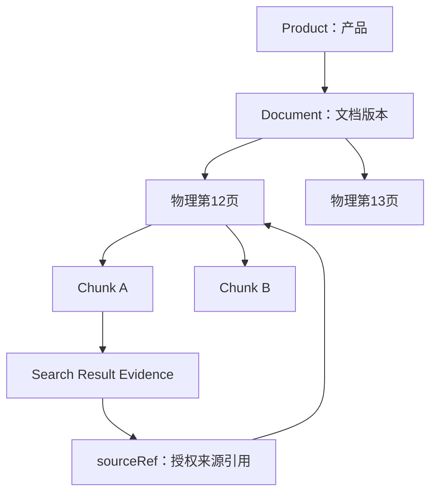
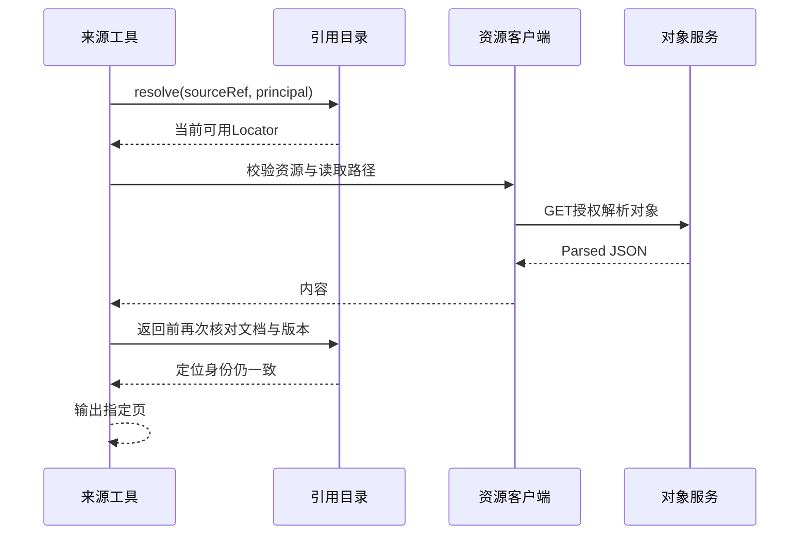
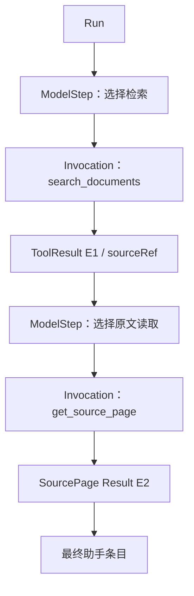

# 从检索片段到原始条款：证据身份、来源引用与多跳查询

## 01｜找到相关文字以后，怎样回答跨产品问题？

> 哪些示例产品支持保单拆分？请说明适用条件，并给出正式条款出处。

这个需求包含三件事：确定产品范围，逐个取得证据，再根据原文判断条件。仅返回几个包含“保单拆分”的片段，还不能说明候选产品已经全部检查。

Agent（使用模型选择动作的程序）可以先查询产品目录，再根据产品 ID 检索条款，最后读取原始页面。后一步参数来自前一步结果，这就是 Multi-hop Retrieval（多跳检索）。

```text
用户问题
  → 目录：确定产品身份和范围
  → 检索：获得条款片段
  → 来源读取：检查原始页面
  → 回答：按产品列出条件和依据
```

Harness（智能体执行控制系统）不必为所有问题写死这条顺序，但必须让每次调用保留正确身份。产品甲的检索结果不能在后续调用里被误当成产品乙的来源。

多跳查询的关键因此不是“调用了很多工具”，而是每一次身份转换都有明确的输入、输出与来源。

## 02｜产品、文档、片段和 Evidence 分别是什么？

一个产品可能对应产品介绍、正式条款和补充说明等多份文档。一份文档可以有多个页面，每一页又可能被切成多个检索片段。

| 标识 | 指向什么 | 主要用途 |
| --- | --- | --- |
| `productId` | 目录中的产品对象 | 业务实体匹配与查询过滤 |
| `documentId` | 一份原始资料 | 来源与评测定位 |
| 文档版本 | 该资料的具体修订 | 判断历史结果适用范围 |
| `chunkId` | 检索索引中的片段 | 定位本次命中 |
| `evidenceId` | 返回的证据条目 | 连接一次搜索结果 |
| `sourceRef` | 服务端发行的来源引用 | 读取当前允许访问的原文页 |

Evidence（检索证据）是某次搜索返回的内容，不等于文档的全量内容。相同物理页可以产生多个 Evidence，索引重建后片段 ID 也可能变化。



文件名适合显示，稳定 ID 适合关联。两个文件可以同名，也可能一份资料改名后内容未变。核验时需要文档身份、版本与物理页，而不是仅凭文件名字符串。

## 03｜工具结果怎样表达正文和缺口？

搜索工具返回 ToolResult（工具结果），其中 `data` 是证据数组。每条证据保存正文、文档、页码、检索评分和元数据状态。

```json
{
  "evidenceId": "SYN-E-01",
  "sourceRef": null,
  "chunkId": "SYN-CHUNK-01",
  "documentId": null,
  "fileName": "示例保障条款.pdf",
  "page": 12,
  "text": "合成条款：本项功能适用条件见合同约定。",
  "company": "示例保司",
  "productName": "示例保障甲",
  "score": 0.76,
  "scoreMetric": "synthetic_similarity",
  "chunkType": "text",
  "metadataStatus": "partial",
  "provenance": {
    "mode": "synthetic",
    "backendId": "example-retrieval",
    "datasetVersion": "fixture-v1",
    "observedAt": "2026-10-01T00:00:00Z"
  }
}
```

这是符合证据行字段形状的合成样本。文档身份未知，所以 `sourceRef` 为空。即使正文和文件名已经返回，也不能凭它们猜出一份可授权读取的原文。

`metadataStatus` 表示元数据完整程度。外层 `coverage` 表示本次查询结果的覆盖声明。`missing` 和 `warnings` 保留已知缺口。`provenance`（数据来源记录）保存模式、后端和版本。[^contracts]

一次工具执行可以成功提交部分业务数据。ToolInvocation（工具执行实例）为 succeeded，不代表答案已经拥有全部证据。模型要根据实际缺口决定继续查证或说明当前范围。

## 04｜SourceRef 是什么？为什么模型只传递一个引用？

SourceRef（授权来源引用）是由服务端管理的不透明标识。Opaque（不透明）表示调用方按原值传递，具体文档位置由服务端解释。

来源读取工具的输入很小：

```json
{
  "content": "读取刚才命中的正式条款页面",
  "sourceRef": "src:aaaaaaaaaaaaaaaaaaaaaaaaaaaaaaaaaaaaaaaaaaaaaaaaaaaaaaaaaaaaaaaa"
}
```

上述字符串只演示格式，不对应实际授权资料。真实引用从之前的工具结果取得。

模型不需要拼接对象存储地址，也不应该自行选择任意本地路径。SourcePort（来源读取接口）把引用交给 SourceReferenceDirectory（来源引用目录），再取得服务端 Locator（文档定位对象）。

```text
模型可见：sourceRef
服务端保存：主体、文档、对象路径、页码、版本、有效期
```

引用字符串也不是独立权限凭证。当前用户即使拿到了别人的引用，服务端仍需检查机构、主体、文档授权和有效期。

## 05｜来源目录怎样发行稳定引用？

`PgSourceReferenceDirectory` 将来源目录存储在 PostgreSQL。它的 `issue()` 先校验定位对象和当前权限，再按固定字段顺序计算摘要。[^directory]

元组包括命名空间、数据模式、机构、主体、对象键、文档 ID、文件名、默认页、解析页码基准、映射验证、来源版本和后端修订。

```ts
// pg-source-references.ts：来源身份元组摘编。
return [
  1, namespace, mode,
  value.owner.orgCode, value.owner.subjectId,
  value.objectKey, value.documentId, value.fileName,
  value.defaultPage, value.landingAiPageBase,
  value.pageMappingVerified, value.sourceVersion,
  value.bindingRevision,
];
```

引用采用 `src:` 加元组摘要。固定顺序使相同定位身份可以生成稳定引用。数据库还保存原始定位数据和摘要，读取时重新校验两者一致。

这份摘要描述身份，不替代授权。`authorizeDocument()`（当前文档授权回调）决定当前主体能否访问对应来源。数据库写入在它通过后发生。

真实模式要求目录具备 durable（持久）能力。进程内 Map 可以服务合成测试，但无法保证服务重启后还能解析之前发出的引用。

<details>
<summary><strong>展开：为什么主体属于引用身份的一部分？</strong></summary>

一份文档可能对不同主体有不同可见范围。将机构和主体纳入引用及读取条件，可以让来源身份与授权上下文明确对应。

这不是说哈希无法被复制，而是复制字符串不会跳过当前主体检查。权限仍由服务端策略判定。

</details>

## 06｜TTL 和重新发行怎样影响来源读取？

TTL（有效时长）限定引用可以使用的时间。当前目录在首次发行时写入失效时间。活动引用再次 `issue()` 时，不会自动延长它的有效期。

引用过期后，只有新的当前授权检查通过，才允许重新发行或续期。`resolve()`（解析引用）本身不续期。

```text
首次 issue：当前授权通过 → 保存引用和有效期
活动 issue：返回同一引用 → 保持原有效期
过期 issue：重新授权 → 更新允许的有效期
resolve：检查当前有效性 → 读取，不延长
```

解析还要考虑授权查询耗时。一个引用在查询开始时有效，授权等待结束时可能已经过期。源码在授权后再次读取当前行和数据库时间，确认定位身份与有效期仍然满足条件。

```ts
// resolve 的关键判断，字段条件有省略。
const row = await readLiveReference(sourceRef, principal);
if (!row) return null;
const locator = verifyStoredTuple(row, principal);
if (!await authorizeCurrentDocument(principal, locator, signal)) return null;
const stillLive = await rereadSameLiveReference(row);
return stillLive ? verifyStoredTuple(stillLive, principal) : null;
```

这些函数名是对实际方法的阅读简化，具体实现位于 `resolve()` 的数据库查询。重要的是复核发生在慢授权调用之后。

## 07｜资源授权与文档授权为什么分开？

Resource Authorization（资源授权）决定当前主体能否使用某个对象服务或接口。Document Authorization（文档授权）决定它能否读取具体文档、版本和页面。

访问对象存储服务的资格，不代表可以读取该服务的每一份资料。相反，拥有文档业务权限，也不代表当前网络客户端和资源配置一定可用。

`source.ts` 因此同时使用受控 HTTP 客户端和文档引用目录。每次来源读取先校验本地业务上下文，再解析文档引用，检查后端版本，然后才取得内容。



这些检查是有界的当前状态观察，不是跨数据库和对象服务的分布式事务。授权可能在两个独立系统之间变化，产品应说明自己实际检查的时间点和保证。

## 08｜Parsed Document 实际长什么样？

Parsed Document（解析文档）把原始 PDF 转成机器可读取的文字和版面块。当前适配器支持两种输入形状，并把它们归一成 ParsedSourceDocument。[^parser]

Paddle 样本按页面提供内容：

```json
[
  {
    "page_index": 0,
    "parsing_res_list": [
      {"block_label": "text", "block_content": "合成正文：保障范围。"},
      {"block_label": "table", "block_content": "项目 | 条件\n功能A | 满足合同条件"}
    ]
  },
  {"page_index": 1, "parsing_res_list": []}
]
```

LandingAI 样本按片段和 grounding（来源定位）提供内容：

```json
{
  "chunks": [
    {
      "text": "合成正文：适用条件。",
      "chunk_type": "text",
      "grounding": [{"page": 0}]
    }
  ]
}
```

解析函数只处理已经下载、已获授权的 JSON，不执行网络请求。它校验实际消费的字段，记录缺失块、页码和格式警告。

统一的块包含 `text`、`chunkType`、`rawPage`、归一 `page`、`mappingBasis`、`pageMappingVerified`、`format`、`location` 与 `warnings`。

`location` 是原始 JSON 中的诊断位置，例如 `chunks[0]`。出现格式问题时，可以精确定位哪一个块无法解释，而不是把整个文档粗略标记为失败。

## 09｜怎样把解析页码转换为 PDF 物理页？

PDF 物理页、页面上印刷的数字和解析数组下标是三种不同含义。产品对外使用从1开始的物理页码。

Paddle 的 `page_index` 按当前契约是零基，因此转换为 `page_index + 1`。LandingAI 的基准由明确配置提供，可以是0、1或未知。

如果基准未知，解析器保留原始页码，归一页码为 null，并记录 `SOURCE_PAGE_MAPPING_UNKNOWN`。系统不根据“看起来像第一页”自动猜测。

```python
# 可独立运行的页码转换规则示例。
def physical_page(raw_page, base):
    if base not in (0, 1, None):
        raise ValueError("PAGE_BASE_INVALID")
    if not isinstance(raw_page, int) or isinstance(raw_page, bool) or raw_page < 0:
        raise ValueError("RAW_PAGE_INVALID")
    if base is None:
        return None
    if raw_page < base:
        raise ValueError("RAW_PAGE_BELOW_BASE")
    return raw_page + (1 if base == 0 else 0)


assert physical_page(0, 0) == 1
assert physical_page(12, 0) == 13
assert physical_page(12, 1) == 12
assert physical_page(12, None) is None
try:
    physical_page(0, 1)
    raise AssertionError("应拒绝非法一基页码")
except ValueError:
    pass
print("页码基准明确时转换，未知时保留未知")
```

`pageMappingVerified`（页码映射已核验）是另一项事实。能执行加一运算，不代表映射已经对照原 PDF 核验。这个标志应来自已知文档和版本的验证。

核验样本应覆盖首部、中部和表格页面。只检查第一页，可能漏掉解析过程中缺页或跨页切分造成的偏移。

## 10｜同一页的正文、表格、空白和缺页如何区分？

一页可以包含多个块。来源适配器按解析顺序连接它们，并保留混合格式警告。所有块都是表格时，输出为 `parsed_table`；否则输出文本形式，并记录混合块信息。

这不是原 PDF 的视觉重建。表头、单位、跨页续表和注释仍需要业务核验。只有一段表格字符串，也不代表模型已经正确理解了数值关系。

空白页与不存在的页也不同。Paddle 输入中的合法空 `parsing_res_list` 会保留页面存在性。选择该页可以得到空块集合。请求一个未出现过的物理页，则会报告来源页缺失。

LandingAI 的一个片段可能有多个 grounding。当前解析器采用第一个页面定位，并添加 `SOURCE_MULTIPLE_GROUNDINGS_FIRST_PAGE` 警告。它没有把该片段自动展开成所有页的完整证据。

<details>
<summary><strong>展开：三种来源页返回</strong></summary>

| 情况 | 页面是否存在 | 返回含义 |
| --- | --- | --- |
| 合法空页 | 是 | 可以返回 empty，正文为空 |
| 请求页不存在 | 否 | unavailable，附缺页原因 |
| 页码基准未知 | 暂不能确认 | unavailable 或明确映射缺口 |

调用成功、页面存在、页面含正文和证据支持结论，是四种分别需要判断的事实。

</details>

## 11｜getSourcePage 怎样完成一次读取？

`createParsedJsonSourcePort()` 返回实现 SourcePort 的对象。实际入口依次执行以下动作：[^source]

```text
校验 BusinessContext 与输入Schema
  → 要求真实模式使用持久引用目录
  → resolve sourceRef
  → 检查主体与后端版本
  → 按受控 objectKey 读取解析对象
  → 归一格式与页码
  → 选择指定页面
  → 生成标准 ToolResult
  → 返回前复核引用与授权
```

Locator（来源定位对象）包含受限的 `objectKey`。当前 Schema 仅接受规定目录下的摘要 JSON 路径，不接受任意 URL 或文件路径。

```ts
// source.ts：从授权定位对象读取指定页，源码摘编。
const found = await directory.resolve(input.sourceRef, context);
if (!found) throw new RegistryError("TOOL_SCOPE_DENIED");
const locator = assertSourceLocator(found, context.principal, input.sourceRef);
if (locator.bindingRevision !== context.backendRevision) {
  throw new RegistryError("TOOL_BACKEND_REVISION_MISMATCH");
}
const document = parseParsedSourceDocument(
  await client.requestJson("GET_PARSED_OBJECT", "/" + locator.objectKey, context),
  {
    landingAiPageBase: locator.landingAiPageBase,
    pageMappingVerified: locator.pageMappingVerified,
  },
);
const blocks = selectParsedSourcePage(document, locator.defaultPage);
```

这个摘编省略了空页码、缓存和结构化 unavailable 分支。正式代码在 `defaultPage=null` 时先返回缺少定位的结果，再进行页面选择。

返回的页面对象可以是：

```json
{
  "sourceRef": "src:aaaaaaaaaaaaaaaaaaaaaaaaaaaaaaaaaaaaaaaaaaaaaaaaaaaaaaaaaaaaaaaa",
  "documentId": "SYN-DOC-A",
  "fileName": "示例保障条款.pdf",
  "page": 12,
  "text": "合成条款页面内容。",
  "format": "parsed_text",
  "pageMappingVerified": true,
  "dataMode": "synthetic",
  "warnings": []
}
```

这是业务结果中的一条合成 SourcePage。外层仍有 `status`、`coverage`、`missing` 和 provenance。

## 12｜缓存怎样保持版本与当前权限？

Cache（缓存）可以减少重复下载和解析。但缓存命中只说明本地已有某份内容，不说明当前主体仍有权读取。

源码在缓存查询前执行当前资源授权，引用解析也会核对文档授权。下载后准备缓存时再次检查 Locator 和资源条件。最终返回前，还会在所有资源等待之后重新解析来源引用。

```text
当前文档授权
  → 当前资源授权
  → 缓存查询或下载
  → 检查内容与页码
  → 再次核对Locator
  → 检查取消信号
  → 返回结果
```

只有符合条件的正常结果才进入缓存。后端修订、文档版本、主体和定位身份的变化不能被一个通用文件名缓存键掩盖。

时间语义也要仔细阅读。当前 `adapterProvenance()` 可以在本次工具调用时生成观察时间；缓存内容却可能来自更早下载。该字段不能单独证明上游刚刚被重新读取。

若产品需要证明内容的新鲜度，应同时记录获取时间、源版本或缓存年龄，并明确 `observedAt` 的含义。仅在返回 JSON 里写一个当前时间，不能使旧文档变成新文档。

## 13｜多跳结果怎样连接到 Harness 的执行事实？

每次工具执行拥有自己的 ToolInvocation。模型输出调用意图时，RecordedModel 保存 ModelStep（模型调用步骤）。结果提交后形成 Canonical Item（权威运行条目），其中保留业务数据和来源引用。



这条链可以证明某个 sourceRef 从哪次检索进入后续调用，来源工具返回了什么，以及这些结果是否真正持久化。

它还不能单独证明最终语句完全符合原文。模型可能读取正确页面，却误解表格或省略条件。执行关联和业务语义需要不同验证。

同样，最后一份 Session 历史不一定等于每次模型请求的全部输入。某次请求可能经过裁剪。精确判断模型看到了哪段资料，需要当次 ModelRequest 观察或对应测试断言。

## 14｜目录枚举和 TopK 检索怎样定义覆盖？

TopK（最多召回条数）回答“本次搜索返回多少候选”。Cursor（分页游标）回答“目录还有哪些记录需要继续读取”。二者不是同一覆盖机制。

假设目录有100个产品，检索返回5段条款。即使5段都相关，也不能据此声明其余95个产品不支持某项功能。

完整枚举需要确定候选集合，并对每个对象记录状态：已检查且有支持、已检查但不满足、资料不足、尚未检查。

```json
{
  "scope": "synthetic-catalog-v1",
  "candidates": 3,
  "checked": 2,
  "pending": ["SYN-PRODUCT-C"],
  "conclusionScope": "仅覆盖已核验的两个产品"
}
```

这是业务分析视图，不代表源码中另有固定的任务规划器。模型可以选择查询路线，工具目录和返回结果则提供完整范围判断所需的数据。

工具的 `coverage=complete` 也要结合能力契约理解。它可能表示当前来源页或当前数据集的范围，不能自然扩大为整个市场全部产品。

## 15｜怎样验证来源身份、页码与权限？

验证可以分为纯函数测试、持久目录测试和真实来源核验。

纯解析测试提供合成 Paddle/LandingAI JSON，检查页码转换、空页保留、非法块诊断和多 grounding 警告。它不需要下载真实 PDF。

持久目录测试使用隔离 PostgreSQL，检查同元组引用稳定、跨主体不可解析、活动发行不续期、过期重新授权、慢授权后过期拒绝。

真实来源核验则使用已授权 PDF 与对应解析文件，逐页对照文字、表格和物理页码。历史工程有具体样本的来源核验记录，结论应绑定其文档和版本，而不是泛化为全量语料均正确。

| 测试输入 | 关键断言 |
| --- | --- |
| 原始文档 ID 缺失 | 保留 metadata 缺口，不猜来源 |
| 页码基准未知 | 归一页码保持未知 |
| 引用属于另一主体 | 当前解析拒绝 |
| 缓存已有内容、授权撤回 | 缓存不能跳过当前检查 |
| 授权查询期间引用过期 | 返回前有效期复核失败 |
| 同引用 Locator 被改变 | 摘要或定位一致性检查拒绝 |

测试中的当前策略可以用受控回调替身模拟，数据库和接口执行边界仍应真实经过。通过一个字符串格式检查，不能替代授权测试。

## 16｜怎样从回答反向读取来源链？

先取得当前 Turn 的 `finalContentRef`，再找到产生助手内容的模型步骤。查询该 Run 的工具记录，读取结果中的 Evidence 和 sourceRef。

```sql
-- 在授权测试库执行；$1 为实际 runId。
SELECT id, model_step_id, capability_id, provider_call_id,
       result_item_ref, source_refs, status
FROM runtime.tool_invocations
WHERE run_id = $1 ORDER BY started_at, id;

-- $1 为已经核对的工具结果条目ID。
SELECT id, canonical, source_refs, status
FROM runtime.runtime_items WHERE id = $1;
```

通过当前授权的来源 API 解析引用，核对 documentId、sourceVersion、物理页与映射状态。私有 Locator 可能含对象位置，应仅在受控维护环境读取。

来源失效时，历史工具结果仍然描述当时取得的数据。当前无法重新读取原文，是另一项需要报告的状态。重新发行引用必须再次满足当前授权。

<details>
<summary><strong>展开：三层核验各自能证明什么？</strong></summary>

执行核验：工具确实调用并保存结果。

定位核验：来源引用和文档页码对应可读原文。

语义核验：原文支持最终回答中的具体断言。

完整业务验收需要三层信息。任意一层通过，都不能替代其余两层。

</details>

## 17｜可信多跳建立在每一次身份转换上

一个复杂问题从产品名称开始，经过目录、文档、片段和原文页，最终变成自然语言结论。每一步都可能改变数据形状，却应保留可解释的身份关系。

Harness 负责记录调用和结果，来源目录负责当前授权定位，解析器负责页面和内容归一，业务评测负责核对结论。多跳查询因此能够逐步增加有效证据，而不是堆积无法核验的文字。

下一篇回到模型可以选择的动作空间，说明这些能力怎样注册、授权和固定版本：[Tool Registry、能力版本与运行快照](09-tool-registry-and-snapshots.md)。

## 实现依据

[^contracts]: Insurance Agent Runtime 源码 `c66112dfd8676b47b143dc2e26739278cf4b0dde`：`packages/contracts/src/tools.ts` 的搜索和来源结果结构。
[^directory]: 同一快照：`apps/runtime/src/business/adapters/source-references.ts`、`pg-source-references.ts`。引用元组、TTL、当前授权和数据库复核来自这些实现。
[^parser]: 同一快照：`apps/runtime/src/business/adapters/parsed-source.ts`。Paddle 与 LandingAI 样本均为合成结构；实际多 grounding 和页码基准行为按该解析器说明。
[^source]: 同一快照：`apps/runtime/src/business/adapters/source.ts` 与 `source-cache.ts`。资源与文档检查属于有界观察，缓存不替代当前授权。
[^evidence]: 历史来源核验见 `docs/implementation/evidence/M09-real-component-gate-20261007.json` 与 `M10-real-component-gate-20261007.json`，适用范围限定于其绑定样本和执行版本。
