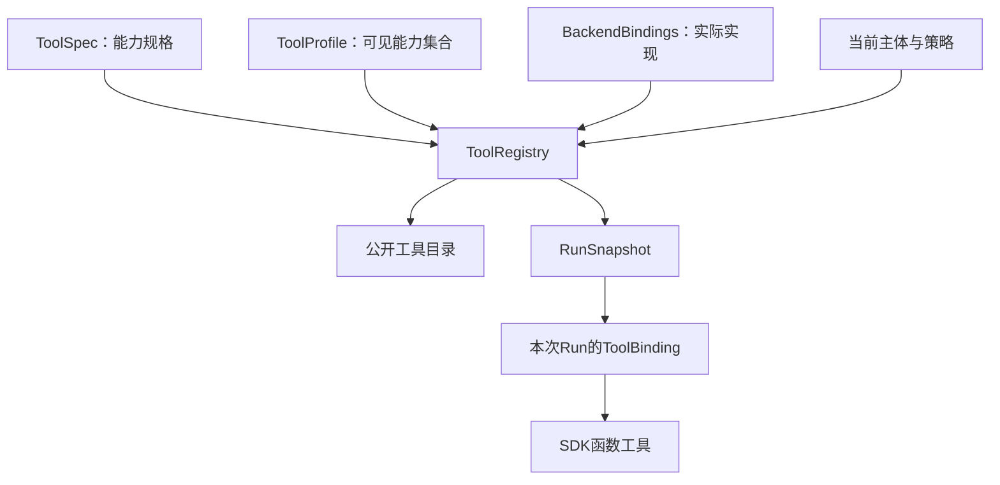
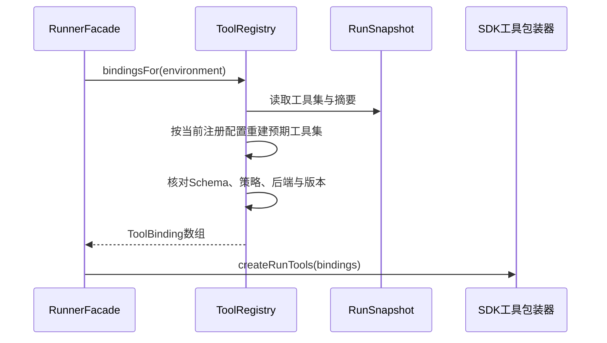
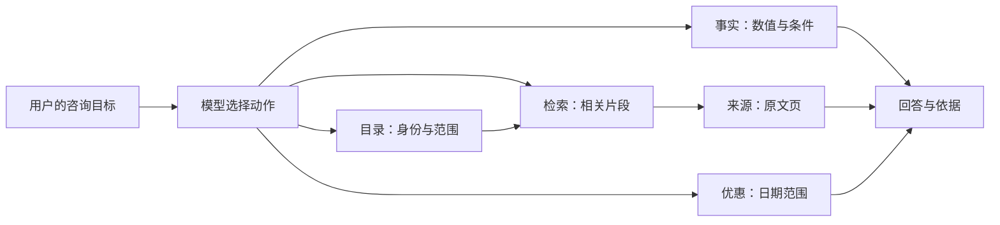

# 让模型自己选工具：Tool Registry、能力版本与运行快照

## 01｜为什么三种看似相近的问题，需要不同工具？

> 解释示例保障甲的等待期。它的最低保费是多少？还有哪些产品提供相同保障？

第一项问题需要读取条款。第二项需要精确字段和单位。第三项需要先确定产品范围，再逐项核对。它们可以属于同一次咨询，却未必适合使用同一个检索接口。

Agent（根据模型决策使用工具的程序）需要一个可选择的动作集合。模型应当知道每个工具能取得什么，系统则必须知道谁有权使用它、实际调用哪个后端，以及返回结果应是什么结构。

Tool Registry（工具注册系统）管理这套关系。它把业务能力变成模型可见的工具，同时固定执行版本、权限和返回契约。

```text
条款解释 → 搜索片段 → 按来源引用读取原文页
精确数值 → 产品字段查询 → 核对单位、有效期和来源
产品枚举 → 读取目录与分页 → 按产品逐项查证
```

这些是合理的任务路径，不是强制每个问题按同一顺序执行。Registry 定义动作空间，模型在其中选择。后续的 ToolInvocation（工具执行实例）负责记录选择后的实际动作。

## 02｜Tool Registry 在代码中究竟长什么样？

在一个最小示例里，工具可以只是函数数组。产品运行后，这个数组通常还需要关联版本、主体、后端和数据模式。把这些字段全部写在每个函数内部，会使修改和核验变得困难。

本工程的 `ToolRegistry` 接收三类主要输入：工具规格、工具 Profile（能力配置）和后端绑定集合。它还接收当前授权的策略接口。[^registry]

```ts
// Registry 的构造输入。类型细节来自本工程源码。
new ToolRegistry({
  specs: stableToolSpecs,
  profiles: stableToolProfiles,
  sets: backendBindingSets,
  policy: {
    version: policyVersion,
    current: readCurrentPrincipal,
  },
});
```

`stableToolSpecs` 描述能力，`backendBindingSets` 提供实际执行函数。`readCurrentPrincipal` 从可信授权来源读取当前主体权限。上述变量由依赖装配入口提供。

Registry 的主要方法可以分为四组：

| 方法 | 解决的问题 | 结果 |
| --- | --- | --- |
| `listTools` / `currentTools` | 当前能发现什么能力 | 公开工具描述 |
| `createSnapshot` | 这次 Run 使用什么配置 | RunSnapshot |
| `bindingsFor` | 快照如何变成可执行工具 | ToolBinding 数组 |
| `invoke` | 当前一次动作能否执行 | 验证后的业务结果 |

Run（执行尝试）是处理一次用户输入的运行。RunSnapshot（运行配置快照）保存本次模型、工具和策略身份。ToolBinding（执行绑定）则将工具规格连接到本地执行函数。



工具目录与运行绑定使用同一组规格，但它们的使用条件不同。目录可以展示待准备的能力，真正执行必须通过本次运行的准入检查。

## 03｜ToolSpec 包含哪些具体字段？

ToolSpec（工具规格）描述一项稳定能力。以文档检索为例，项目中的规格可展开为：

```json
{
  "capabilityId": "knowledge.search_documents",
  "modelName": "search_documents",
  "version": "1.0.0",
  "description": "搜索当前授权范围内的文档片段，并返回证据和来源引用。",
  "effect": "read",
  "requiredScopes": ["knowledge:read"],
  "bindingKey": "retrieval",
  "handlerKey": "searchDocuments",
  "inputSchemaRef": "urn:insurance-agent:tool-io:1.0#/$defs/search_documents_input",
  "outputSchemaRef": "urn:insurance-agent:tool-io:1.0#/$defs/search_documents_output",
  "timeoutMs": 5000,
  "maxOutputBytes": 200000
}
```

字段和值来自实际规格结构，描述文字为便于阅读的中文改写。模型在实际运行时使用仓库中的完整工具说明。[^catalog]

`capabilityId` 是产品内部能力名，`modelName` 是模型调用时使用的函数名。两者显式关联，便于稳定地管理契约和模型接口。

`bindingKey` 选择一类后端，例如 retrieval。`handlerKey` 记录对应处理入口。`inputSchemaRef` 和 `outputSchemaRef` 指向输入输出 Schema（数据结构约束），而不是在描述文字中隐含参数格式。

`effect=read` 表示业务读取效果。当前 `ToolSpecSchema` 直接将效果限制为 read，运行工具包装器也再次检查。增加写操作时，需要扩展规格、授权、执行与恢复机制，不能只改一个描述词。

`timeoutMs` 和 `maxOutputBytes` 是单项能力的限制。当前 Run 还可以提供更严格的结果预算。实际调用采用相应约束的交集。

<details>
<summary><strong>展开：能力版本、Schema 摘要和数据版本有什么区别？</strong></summary>

能力版本说明工具规格的身份。Schema 摘要说明参数与返回结构是否发生变化。后端修订说明具体实现版本。数据集版本说明使用的业务数据范围。

例如，搜索函数仍叫 `search_documents`，输入字段也没有变化，但语料重新导入了。此时模型可见工具名可以不变，数据集版本仍需更新。仅比较工具名无法解释结果差异。

</details>

## 04｜怎样编写模型能够使用的工具说明？

工具说明首先要回答三个问题：这个工具取得什么数据，输入参数如何限定范围，返回值可以怎样支持下一步。

对搜索工具，描述应说明返回的是候选片段。对来源工具，说明应要求传入已发行的 `sourceRef`（来源引用）。对目录工具，说明应明确返回业务 ID 与分页信息。

这让模型可以把结果连接起来：目录提供产品身份，搜索返回片段，来源工具读取原文页。工具说明、参数 Schema 和返回结构应相互一致。

```json
{
  "content": "查找示例保障甲等待期的正式条款",
  "query": "示例保障甲 等待期 起算条件",
  "companyIds": null,
  "productIds": null,
  "topK": 5
}
```

这是合法形状的合成搜索输入。`content` 是模型公开描述的动作目的，`query` 和筛选字段才是业务查询参数。

模型负责选择查询内容。机构、服务地址、凭证和可访问资源由服务端提供。把这些本地配置塞入工具参数，既增加模型负担，也会扩大不必要的控制面。

描述质量与模型行为相关，但正确性不能只依赖描述。模型即使生成 `topK=1000`，执行层也必须按 Schema 拒绝。描述是动作选择的提示，Schema 和授权是运行边界。

### 用任务观察说明是否有效

准备三类受控问题：解释条款、查询精确字段、列举产品。让真实模型在相同工具集合下运行，保存它选择的工具和参数。

检查是否出现正确业务分工。例如，查询保费时是否关注币种和缴费周期；列举产品时是否继续分页；读取原文时是否复制了结果中的精确来源引用。

这类实验评价工具说明是否帮助模型选择动作。Registry 的确定性测试则检查所有选择都经过相同治理。两种测试应分别记录。

## 05｜ToolProfile 怎样选择能力集合？

ToolProfile（工具可见性配置）规定一类运行可以使用哪些能力、允许哪些数据模式。项目的 Profile 定义包含 ID、版本、能力 ID 数组与 `allowedDataModes`。

```json
{
  "profileId": "advisor-synthetic",
  "version": "1.0.0",
  "capabilityIds": [
    "knowledge.search_documents",
    "knowledge.get_source_page",
    "catalog.list_insurers",
    "catalog.list_products",
    "facts.query_product_facts",
    "facts.query_promotions"
  ],
  "allowedDataModes": ["synthetic"]
}
```

这是源码中合成咨询 Profile 的展开形状。`contract-test` 允许 synthetic 和 recorded；`advisor-readonly` 允许 real。模型实际由什么服务提供，还由模型配置决定。[^catalog]

Profile 中出现一项能力，不表示每个主体都能使用。Registry 会继续检查其 `requiredScopes`。例如，缺少 `facts:read` 的主体不会因选择该 Profile 就自动获得字段查询能力。

实际运行还包含不同层次的配置身份：

| 名称 | 作用 |
| --- | --- |
| 外部 `agentProfileId` | 用户选择的服务端运行配置入口 |
| ToolProfile | 选择工具能力和允许数据模式 |
| `modelProfileId` | 指向服务端模型配置 |
| Backend Set ID | 选择一组本地业务实现 |

当前装配把这些配置明确关联。它们可以使用相同或相关名字，但语义不同。阅读代码时应沿解析器确认关系，而不是仅凭字符串相似判断它们是一个对象。

## 06｜BackendBinding 和就绪状态是什么？

BackendBinding（后端绑定）提供实际执行方法。BackendDescriptor（后端描述）保存它的身份与准入状态。

```json
{
  "backendId": "synthetic-retrieval",
  "revision": "fixture-backend-v1",
  "bindingKey": "retrieval",
  "dataMode": "synthetic",
  "readiness": "schema_verified",
  "enabled": true,
  "datasetVersion": "fixture-v1"
}
```

这是合成后端描述。真实对象还带有本地 `invoke()` 方法，函数本身不会被序列化进 JSON 快照。

Schema 允许 documented、configured、reachable、schema_verified 和 live_verified 等就绪标志。当前 `ready()` 的判断非常具体：

```ts
function ready(binding: BackendBinding): boolean {
  const value = binding.descriptor;
  return value.enabled && (
    value.dataMode === "real"
      ? value.readiness === "live_verified"
      : value.readiness === "schema_verified"
  );
}
```

这不是任意字符串排序。真实模式要求 live_verified；合成与录制模式要求 schema_verified。改成其他标志后是否满足条件，由代码明确判断。

就绪标志是 Registry 消费的配置事实。它的赋值应由受控验证流程支持。Registry 不会因为字段写着 live_verified，就替维护者自动完成真实接口核验。

### 为什么 enabled 与 readiness 分开？

一项已验证能力可能被临时停用。反过来，一项已启用配置还可能处于待验证状态。`enabled` 管理是否开放，`readiness` 描述准备程度。

公开目录将这些条件转换为 ready、pending_resource 或 disabled。它给调用方一个可解释状态，而不是一个含糊的成功布尔值。

## 07｜构造 Registry 时，为什么要校验并冻结配置？

构造器先解析所有 ToolSpec 和 Profile，再验证名字、引用与契约关系。它拒绝重复能力 ID、重复模型工具名、不存在的 Profile 能力，以及不匹配的绑定键。

规格还必须与权威 `toolContracts` 一致。模型名、处理入口、输入输出 Schema 引用和必要 scopes 需要满足已有能力定义。当前 Registry 不是接收任意插件描述就直接执行的通用插件加载器。

后端描述通过 Schema 解析并深冻结。执行方法则在构造时绑定到选定对象：

```ts
// registry.ts：后端对象捕获的核心形状。
const captured = Object.freeze({
  descriptor: freezeJson(BackendDescriptorSchema.parse(binding.descriptor)),
  invoke: binding.invoke.bind(binding),
});
```

`freezeJson()` 先复制 JSON 数据，再递归冻结。调用方之后修改原配置对象，不会修改 Registry 保存的描述。`bind()` 捕获执行方法，后续替换原对象的同名方法也不会直接替换当前绑定。

这保证配置身份稳定，但不意味着网络世界被永久冻结。远端服务可以变化，当前授权也会改变。因此每次执行仍需检查就绪和权限，结果还要通过契约校验。

Registry 的 `revision` 由规格、Profile 和公开 Schema 计算。具体绑定集合还有自己的 ID、revision 和 `bindingIdentity()`。一个摘要字段不代表已经覆盖所有外部配置。

## 08｜发现工具与执行工具有什么不同？

`listTools()` 返回公开能力目录。它检查 runtime 读取权限、工具 Profile 与必要业务 scope，然后生成 ToolDescriptor（工具描述对象）。

```json
{
  "capabilityId": "knowledge.search_documents",
  "modelName": "search_documents",
  "version": "1.0.0",
  "effect": "read",
  "availability": "pending_resource",
  "dataMode": "real"
}
```

这是公开描述的字段摘录；完整对象还包含说明和输入输出 Schema。一项能力可以被发现，同时尚未具备真实执行资源。

`currentTools()` 先调用当前策略，再使用过滤后的主体执行目录读取。`listTools()` 本身使用传入主体的范围。调用路径需要说明在哪一层完成当前授权查询。

真实 Run 创建时，`toolset()` 要求每个已选、对当前主体可见的能力都拥有符合 Profile 模式并已就绪的绑定。缺少其中一项时，可以拒绝创建这个工具集。

这是一种严格选择：发现阶段描述状态，执行快照阶段确定本次可用能力。产品也可以设计降级子集 Profile，但应明确配置，而不是在运行中悄悄替换或移除工具。

<details>
<summary><strong>展开：读取目录是否会读取保险业务资料？</strong></summary>

目录读取返回工具规格和就绪状态。它不需要执行实际搜索、读取 PDF 或查产品字段。

工具目录查询、Snapshot 创建和真实工具调用分别具有自己的权限与效果。一个只读工具列表不能被当作已经验证业务后端响应的证据。

</details>

## 09｜RunSnapshot 怎样固定本次动作空间？

创建快照时，Registry 先复制并解析模型选择和工具预算，再读取当前主体。随后构造工具集，并计算工具集与策略摘要。

```ts
// createSnapshot 的返回结构摘编。
return freezeJson({
  snapshotId: randomUUID(),
  profileId,
  modelProfileId: selectedModel.modelProfileId,
  sdkVersion: selectedModel.sdkVersion,
  modelConfig: selectedModel.modelConfig,
  toolset,
  toolsetHash: contentDigest(toolset),
  policyHash: contentDigest({
    owner: toolset.owner,
    scopes: toolset.scopes,
    policyVersion: this.policy.version,
  }),
  bindingVersions: Object.fromEntries(
    toolset.entries.map(entry => [entry.spec.capabilityId, entry.spec.version])
  ),
});
```

工具集内部还保存 Registry 修订、Profile 版本、绑定集合版本、主体、权限、预算和每项工具的 Schema 摘要。

```text
RunSnapshot
  ├── 模型身份与 SDK 版本
  ├── Toolset
  │    ├── 主体和原始权限范围
  │    ├── Profile / Binding Set 身份
  │    ├── 各项 ToolSpec
  │    ├── Schema Hash
  │    ├── Backend Descriptor
  │    └── 调用与结果预算
  ├── toolsetHash
  ├── policyHash
  └── bindingVersions
```

特别要看清 `bindingVersions`：本实现将能力 ID 映射到 ToolSpec 的版本。后端具体 revision 保存在工具集条目中的 BackendDescriptor。不能只读 `bindingVersions` 就断言已经检查了所有后端版本。

摘要表达配置内容身份。它不是密钥签名，也不授予访问权。可信快照来自服务端配置与存储，当前执行继续受权限检查约束。

## 10｜bindingsFor 怎样把快照还原成执行工具？

Worker 领取 Run 后，`bindingsFor(environment)` 根据快照重建预期工具集合。

它先检查快照中的工具集内容是否匹配 `toolsetHash`，再根据原主体范围、Profile、绑定集合和预算重建预期值。随后比较工具集、策略摘要和能力版本。



若不匹配，Registry 报告 `TOOL_SNAPSHOT_MISMATCH`。它不会静默使用另一个当前工具代替原工具。

合法绑定包括参数 Schema、结果 Schema、来源提取器和执行闭包：

```ts
return Object.freeze({
  capabilityId: spec.capabilityId,
  modelName: spec.modelName,
  version: spec.version,
  effect: spec.effect,
  dataMode: backend.descriptor.dataMode,
  requiredScopes: spec.requiredScopes,
  parameters: contract.input,
  outputSchema: contract.output,
  sourceRefs: result => result.sourceRefs,
  execute: (input, env) => this.execute(spec, backend, input, env),
});
```

这份对象交给 `createRunTools()` 后，才成为真正的 SDK FunctionTool。Registry 选择与验证能力，工具包装器处理具体 ToolInvocation 的身份和提交。

## 11｜已经有快照，为什么仍然检查当前授权？

Snapshot 固定了本次允许的最大能力范围。授权策略随后可能撤回权限，因此实际调用要重新读取当前授权。

`currentPrincipal()` 检查当前权限来源返回的是同一机构与主体，然后计算原请求范围和当前范围的交集。当前权限可以收紧，不能借重新查询扩大本次 Run 的权限。

Scope（权限范围）可能是精确操作、前缀通配或全局通配。字符串集合的普通交集无法正确处理这种包含关系。

下面的 Python 演示与当前代码一致的基本权限规则：

```python
def permits(scopes, required):
    prefix = required.split(":", 1)[0] + ":*"
    return "*" in scopes or required in scopes or prefix in scopes


def intersect_scopes(requested, current):
    candidates = set(requested) | set(current)
    return sorted(scope for scope in candidates
                  if permits(requested, scope) and permits(current, scope))


original = ["runtime:write", "knowledge:*"]
current = ["runtime:write", "knowledge:read", "facts:read"]
actual = intersect_scopes(original, current)
assert actual == ["knowledge:read", "runtime:write"]
assert not permits(actual, "facts:read")
assert not permits(actual, "knowledge:write")
assert intersect_scopes(["*"], ["knowledge:read"]) == ["knowledge:read"]
print(actual)
```

当前策略新增了 `facts:read`，原请求没有这项权限，所以本次运行仍然不能使用它。原请求有 `knowledge:*`，当前只剩 `knowledge:read`，结果则收紧到只读。

这个示例只说明本工程的全局和一级前缀匹配规则。更复杂的条件授权、资源属性和委派权限需要自己的策略模型。

<details>
<summary><strong>展开：授权查询返回了另一个主体会怎样？</strong></summary>

Registry 会检查 `orgCode` 和 `subjectId` 是否与原主体一致。授权服务不能通过返回一个更高权限的其他用户，让当前命令获得新的身份。

这种检查应位于每个消耗授权结果的边界。只有 scopes 看起来合法，仍不足以证明授权对象正确。

</details>

## 12｜一次调用怎样经过 Registry.invoke？

SDK 工具执行真正的业务能力时，Registry 首先组合调用取消信号和单工具 deadline（期限）。它随后获取当前主体并验证业务 scopes、后端就绪与参数 Schema。

```text
执行开始
  → 建立工具期限
  → 查询当前权限并收紧原范围
  → 检查所需业务scope
  → 检查后端ready
  → 解析去除content后的业务参数
  → BackendBinding.invoke
  → 检查取消与期限
  → 校验输出Schema
  → 校验provenance和来源引用
  → 收敛结果体积
  → 返回工具包装器
```

这里的 runtime 动作要求是 write，因为正在执行并记录一个产品 Run。业务工具的 `effect=read` 则表示它读取保险数据。这两个 read/write 描述不同资源，不能因为工具业务只读就移除运行控制权限。

`provenance`（结果来源声明）需要与 BackendDescriptor 的 dataMode、backendId 和 datasetVersion 一致。每条证据的来源也要满足对应约束。

```ts
const matches = (p: { mode: string; backendId: string; datasetVersion: string | null }) =>
  p.mode === backend.descriptor.dataMode &&
  p.backendId === backend.descriptor.backendId &&
  p.datasetVersion === backend.descriptor.datasetVersion;
```

结果条目引用的 sourceRef 还必须出现在外层 `sourceRefs` 集合中。Registry 不能接受正文指向一份来源、外层却声明另一组来源的未协调数据。

最后，`boundToolResult()` 根据能力和体积预算收敛结果，保留相应截断或缺失说明。工具包装器仍会再次检查最终序列化大小。具体截断规则属于业务输出契约，不能简单在 JSON 中间切掉字符。[^output]

## 13｜工具版本变化怎样影响现有运行？

设检索工具名仍是 `search_documents`，后端却更新了过滤条件解释。即使 JSON 字段没变，业务结果的语义也可能变化。

因此，版本变化需要分别核对：

| 改动 | 需要更新或确认的身份 |
| --- | --- |
| 新增参数或改变字段类型 | 输入 Schema、规格版本、调用方测试 |
| 改变返回字段含义 | 输出 Schema、规格说明和兼容性 |
| 更换实现或上游 API | Backend revision、真实读回 |
| 更换语料 | datasetVersion、评测数据范围 |
| 调整能力可见性 | Profile 版本、策略身份 |
| 更改权限策略 | policyVersion、当前授权测试 |

新 Run 可以采用新快照。旧 Run 进入绑定或恢复时，应按版本规则验证。某些变更可以兼容，某些变更需要重新执行，不能仅以“工具名字一样”绕过检查。

当前实现偏向固定本次配置并拒绝不匹配。动态热替换属于另一种设计，需要说明活动 Run 看见哪个版本，以及已生成工具参数是否仍合法。

## 14｜六类能力怎样组成一个实际工具集？

项目目前定义六类稳定业务能力：

| 能力 | 模型可见工具 | 典型用途 |
| --- | --- | --- |
| 文档检索 | `search_documents` | 找相关片段和来源候选 |
| 来源读取 | `get_source_page` | 按精确引用读取授权页 |
| 保司目录 | `list_insurers` | 取得机构目录身份 |
| 产品目录 | `list_products` | 取得产品范围与稳定 ID |
| 结构化事实 | `query_product_facts` | 查询数值、单位与有效条件 |
| 优惠查询 | `query_promotions` | 查询指定日期适用的优惠 |

这些工具使用统一外层结果协议，但内部数据具有不同业务含义。精确字段必须带单位和有效期；目录要表达分页；来源读取要说明页码映射；优惠要明确查询时点。



工具存在于源码，只证明能力契约和执行入口已定义。真实后端是否开放，必须读取对应资源状态和验证记录。合成 Profile 可以先支持完整协议测试，再逐项接入实际业务。

工具分工也不能过度细碎。如果两个工具只因内部 HTTP 路径不同而拆开，模型可能难以选择。应优先按用户需要取得的业务信息划分，再由 Adapter 隐藏上游协议差异。

## 15｜怎样验证目录、快照、授权与输出？

Registry 测试应从构造和发现开始，再进入快照、绑定和执行。只对业务函数返回值写单元测试，无法覆盖这些关系。

| 用例 | 需要观察的结果 |
| --- | --- |
| 重复 modelName 或 capabilityId | 构造阶段拒绝 |
| Profile 引用未知能力 | Profile 校验拒绝 |
| 后端尚未就绪 | 目录描述 pending，执行快照按规则拒绝 |
| 主体缺少业务 scope | 该能力不进入可见集合 |
| 快照之后撤回 scope | 实际调用被当前授权阻止 |
| 调整工具或后端版本 | 旧快照不匹配得到明确错误 |
| 结果模式与后端不符 | provenance 校验拒绝 |
| 证据行包含未声明来源 | 来源集合校验拒绝 |

使用受控策略函数可以固定权限变化时点。先创建快照，再让 `policy.current()` 返回更窄 scopes，最后执行工具。测试应确认原快照不会阻止当前撤权生效。

反方向也要测试：当前授权新增能力，原运行没有授予时，交集不能扩大本次动作范围。

<details>
<summary><strong>展开：一个最小的 Registry 测试路径</strong></summary>

```text
创建合成 BackendBindings
  → 构造 Registry 与受控 policy.current
  → listTools 检查模型名、Schema、availability
  → createSnapshot 保存工具集身份
  → bindingsFor 得到具体ToolBinding
  → 执行绑定函数
  → 检查结果模式、来源和大小
  → 修改当前权限
  → 再次调用并检查拒绝
```

这段路径可以使用合成业务数据。真实模型是否选择正确工具，应通过另一个行为实验验证，保持模型策略与执行协议的判断范围清楚。

</details>

相关测试位于 `tests/registry/registry.test.ts`。Runner 纵向套件还能进一步检查结果进入 ToolInvocation 和下一次模型请求。具体启动命令和隔离配置由当前项目 `package.json` 与测试入口确定，执行后再报告通过范围。[^tests]

## 16｜怎样演进一个稳定的工具系统？

新增能力首先需要定义用户能获得什么信息，再固定输入输出契约。随后增加 ToolSpec、Profile 选择、后端绑定、权限与测试。当前代码的能力 ID 来自静态 `toolContracts`，扩展时要同步修改权威契约集合。

更换后端时，可以保留模型可见名称和输入结构，但必须重新核对输出语义、版本与来源。新增写操作时，还要设计审批、幂等效果和恢复，而不只是把 effect 从 read 改成 write。

Registry 将模型的动作空间与业务实现连接起来。Profile 决定选择范围，Snapshot 固定本次身份，当前授权决定现在是否允许执行，输出校验决定结果能否被接受。

这些边界清楚以后，具体业务实现可以逐步替换，模型也能持续使用稳定工具。下一篇深入实际装配过程：[依赖装配、Port、Adapter 与数据模式](10-composition-and-business-adapters.md)。

## 实现依据

[^registry]: Insurance Agent Runtime 源码快照 `c66112dfd8676b47b143dc2e26739278cf4b0dde`：`apps/runtime/src/registry/registry.ts`，重点为构造器、`currentPrincipal`、`toolset`、`createSnapshot`、`bindingsFor` 与 `invoke`。
[^catalog]: 同一快照：`registry/catalog.ts`、`registry/contracts.ts` 和 `packages/contracts/src/tools.ts`。六类能力、Profile、只读效果和后端就绪规则均按这些文件说明。
[^output]: 同一快照：`registry/output.ts`、`runner/tools.ts`。业务结果收敛与 SDK 包装器结果提交具有独立边界。
[^tests]: `tests/registry/registry.test.ts` 与 `tests/runner/`。本文展示构造、权限交集与快照的测试方法；示例数据不是新执行的真实业务结果。

公开 SDK 的函数工具机制见 [OpenAI Agents SDK：Tools](https://openai.github.io/openai-agents-js/guides/tools/)。本项目额外的能力版本、快照和授权规则以以上源码为准。
