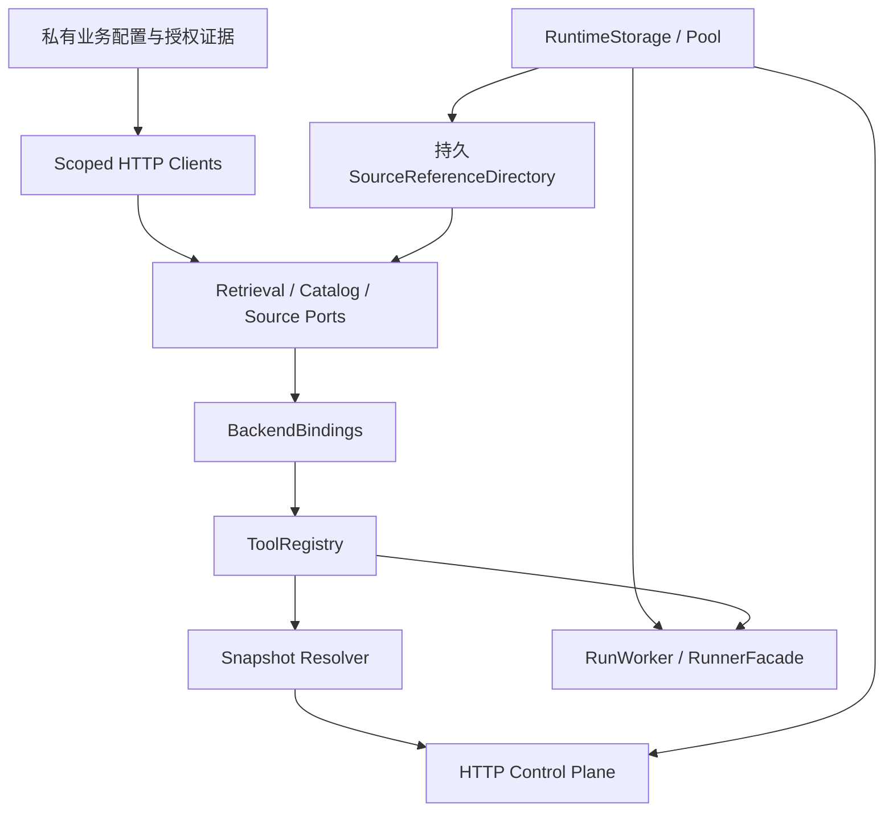
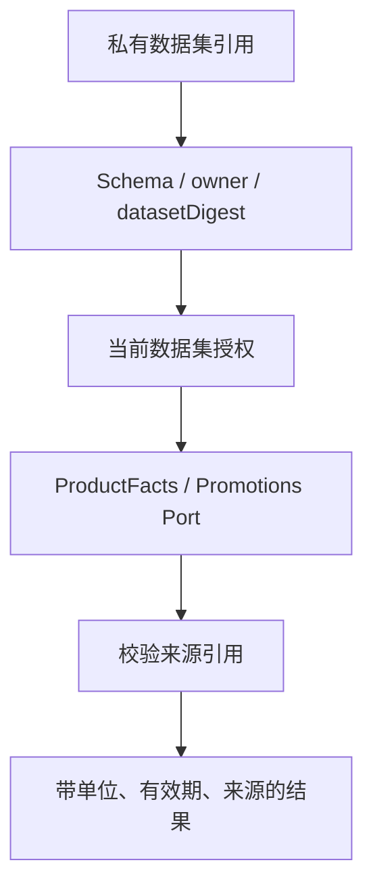
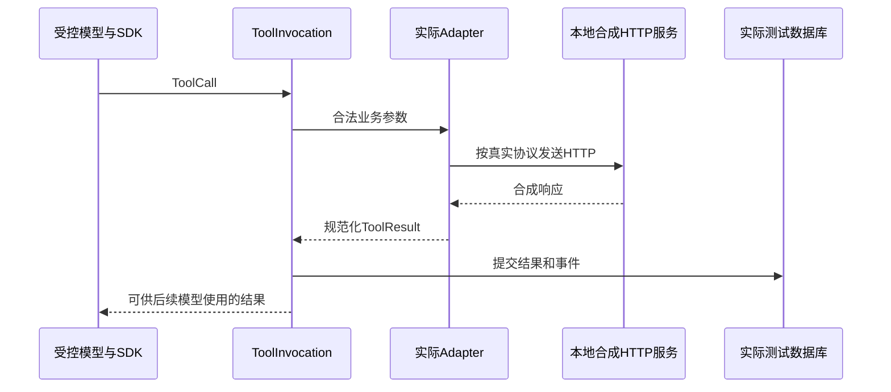

# 把工具接到真实业务系统：依赖装配、Port、Adapter 与数据模式

## 01｜合成工具已经能运行，真实接入还要完成什么？

> 查询示例保障甲的等待期，读取原始页面，并核对当前最低保费。

在合成环境里，几个函数就能返回这些数据。真实接入时，检索网关、产品目录和来源服务可能属于不同系统。它们使用不同的产品 ID、字段名称、分页方式和认证配置。

工具名称可以继续叫 `search_documents`。但内部要完成参数转换、资源授权、网络读取和结果归一。一个接口返回 HTTP 200，只说明请求得到了响应，还需要判断数据是否符合业务契约。

例如，最低保费返回 `10000`，仍需确认币种、缴费周期、适用产品和有效时间。一个检索结果包含文件名，也仍需确认文档版本与物理页。

这项工作适合分为四层：Port（业务接口契约）定义能力，Adapter（具体适配实现）连接上游，Binding（执行绑定）把能力与实现关联，Composition Root（依赖装配入口）选择并连接所有依赖。


这些层分别处理不同的变化。模型工具协议相对稳定，上游系统可以通过版本化适配逐步替换。

## 02｜Port 是什么？一个业务接口实际长什么样？

Port 是应用内部约定的业务能力接口。它规定函数名、输入、执行上下文和返回类型，不规定必须使用哪一种网络协议。

项目的 `RetrievalPort` 定义如下：[^ports]

```ts
export type BusinessInput<K extends ToolCapabilityId> =
  Omit<ToolInput<K>, "content">;

export type BusinessOutput<K extends ToolCapabilityId> = ToolOutput<K>;

export interface RetrievalPort {
  searchDocuments(
    input: BusinessInput<"knowledge.search_documents">,
    context: BusinessContext,
  ): Promise<BusinessOutput<"knowledge.search_documents">>;
}
```

`ToolInput` 和 `ToolOutput` 来自权威工具契约。`Omit<..., "content">` 从模型输入类型中去掉动作说明。业务服务只需要查询参数，不需要把模型自述作为检索条件。

其他接口采用相同形状：

| Port | 方法 | 业务能力 |
| --- | --- | --- |
| RetrievalPort | `searchDocuments` | 检索文档片段 |
| SourcePort | `getSourcePage` | 读取指定来源页 |
| CatalogPort | `listInsurers`、`listProducts` | 读取目录身份 |
| ProductFactsPort | `queryProductFacts` | 查询结构化产品字段 |
| PromotionsPort | `queryPromotions` | 查询日期范围内的优惠 |

TypeScript interface（类型接口）在开发阶段约束实现形状。实际 HTTP 响应仍需运行时 Schema（数据校验结构）。接口类型不会在编译后自动验证远端 JSON。

一个实现 RetrievalPort 的对象，可以返回合成数据，也可以调用已有 SDK。调用者依赖同一业务契约，不必知道具体网络地址。

## 03｜BusinessContext 与模型参数怎样分开？

模型生成 `query`、筛选 ID 和 `topK`。服务端提供 Principal（认证主体）、当前权限、取消信号和后端身份。这两类数据应通过不同入口传递。

```ts
export interface BusinessContext {
  readonly principal: Principal;
  readonly signal: AbortSignal;
  readonly runId?: string;
  readonly snapshotId?: string;
  readonly backendRevision: string;
  readonly dataMode: DataMode;
}
```

`runId` 关联本次执行，`snapshotId` 关联运行配置。`backendRevision` 指向选定后端修订。`dataMode` 表示合成、录制或真实业务数据。

```json
{
  "query": "示例保障甲 等待期 适用条件",
  "companyIds": null,
  "productIds": ["SYN-PRODUCT-A"],
  "topK": 5
}
```

这是业务参数样本。实际上下文另外由服务端注入。模型不能通过额外字段把自己变成另一个机构，也不需要提交上游凭证。

这还能简化工具说明。模型只需要知道怎样表达业务查询，身份和资源策略则由本地代码执行。

<details>
<summary><strong>展开：公开动作说明 content 保存在哪里？</strong></summary>

`content` 表示模型声明的动作目的，例如“读取等待期条款”。ToolInvocation（工具执行实例）将它与实际参数分别保存。

业务 Port 接收去掉 content 的参数。执行状态和结果由工具包装器记录。动作说明、实际查询和成功结果因此都有独立语义。

</details>

## 04｜Adapter 怎样把不同上游 API 转成同一能力？

Adapter 接受应用定义的输入，按上游协议发送请求，再把响应转换成统一业务结果。

假设两个检索服务返回不同格式：

```json
{
  "items": [
    {"id": "C1", "document": "D1", "page": 12, "content": "合成等待期正文"}
  ]
}
```

```json
{
  "hits": [
    {"chunk_id": "C1", "metadata": {"document_id": "D1", "page_index": 11}, "text": "合成等待期正文"}
  ]
}
```

第一个服务直接返回物理页，第二个服务返回零基页索引。适配器需要明确映射，而不是对字段随意取值。

下面的独立 Python 示例只演示结构转换。它不访问网络，也不代表本工程真实上游的完整协议。

```python
def require_text(value, field):
    if not isinstance(value, str) or not value:
        raise ValueError("INVALID_" + field)
    return value


def normalize(payload, dialect):
    result = []
    if dialect == "items":
        rows = payload["items"]
    elif dialect == "hits":
        rows = payload["hits"]
    else:
        raise ValueError("UNKNOWN_DIALECT")
    if not isinstance(rows, list):
        raise ValueError("ROWS_MUST_BE_ARRAY")

    for row in rows:
        if dialect == "items":
            cid, doc, page, text = row["id"], row["document"], row["page"], row["content"]
        else:
            meta = row["metadata"]
            raw = meta["page_index"]
            if not isinstance(raw, int) or isinstance(raw, bool) or raw < 0:
                raise ValueError("INVALID_PAGE_INDEX")
            cid, doc, page, text = row["chunk_id"], meta["document_id"], raw + 1, row["text"]
        if not isinstance(page, int) or isinstance(page, bool) or page < 1:
            raise ValueError("INVALID_PHYSICAL_PAGE")
        result.append({
            "chunkId": require_text(cid, "CHUNK"),
            "documentId": require_text(doc, "DOCUMENT"),
            "page": page,
            "text": require_text(text, "TEXT"),
        })
    return result


a = {"items": [{"id": "C1", "document": "D1", "page": 12, "content": "合成正文"}]}
b = {"hits": [{"chunk_id": "C1", "metadata": {"document_id": "D1", "page_index": 11}, "text": "合成正文"}]}
assert normalize(a, "items") == normalize(b, "hits")
print(normalize(a, "items"))
```

实际搜索结果还包含来源引用、元数据状态、评分度量和 provenance（数据来源记录）。结构映射完成后，还需要确认这些字段代表同一业务含义。

如果无法确认某个文档或页码，应保留 `null` 与缺失说明。用文件名猜文档 ID，可能让后续来源读取关联到错误资料。

## 05｜BackendBinding 怎样捕获实际执行方法？

`bindBusinessPorts()` 把业务接口对象转换成 Registry 可使用的后端绑定集合。它先捕获六个业务方法，再建立能力 ID 到方法的分派。[^bindings]

```ts
const search = ports.retrieval.searchDocuments.bind(ports.retrieval);
const source = ports.source.getSourcePage.bind(ports.source);
const products = ports.catalog.listProducts.bind(ports.catalog);

const dispatch = {
  "knowledge.search_documents": (input, context) => search(input, context),
  "knowledge.get_source_page": (input, context) => source(input, context),
  "catalog.list_products": (input, context) => products(input, context),
};
```

这是实际实现的局部摘编。完整分派还包括保司目录、产品事实和优惠查询。

每个 BackendBinding 包含一个经过 Schema 校验的 Descriptor（后端描述）和 `invoke()` 方法。绑定集合还有 `setId` 与 `revision`，供运行快照记录。

```text
BackendBindings
  setId / revision
  bindings
    retrieval → descriptor + invoke
    source    → descriptor + invoke
    catalog   → descriptor + invoke
    facts     → descriptor + invoke
    promotions→ descriptor + invoke
```

方法绑定保留选定对象的执行入口。调用者之后替换原 Port 对象的某个方法，不会自动替换已经捕获的函数。

客户端连接、凭证读取器和网络对象保留在本地闭包中。Snapshot（运行快照）保存可比较的配置身份，不序列化这些运行资源。

## 06｜Composition Root 怎样把组件装配成服务？

Composition Root 是创建组件并连接依赖的位置。在本工程中，业务装配与 Runtime 装配分别处理业务后端和运行设施。

`createConfiguredBusinessBackends()` 解析业务配置，创建受控客户端、目录与来源接口，再产生 BackendBindings。`composeRuntime()` 创建数据库、Worker、HTTP 和维护任务。[^composition]



SourceReferenceDirectory（来源引用目录）需要数据库连接。业务工厂先建立引用接口，在 Runtime 存储创建后通过 `attachPool()` 连接实际 Pool（数据库连接池）。它拒绝将另一个 Pool 再次替换进已经附加的业务图。

这是一项具体的依赖生命周期设计。业务资源的配置预检可以先进行，真正需要存储的来源发行则在 Pool 已经可用后执行。

HTTP 与 Worker 使用同一个 RuntimeStorage。前者保存 Turn 和 Run，后者领取 Run 并保存模型与工具事实。它们不会各自建立一份互不相干的运行历史。

## 07｜Synthetic、Recorded 和 Real 分别代表什么？

数据模式描述业务结果来源，模型模式描述谁产生模型响应。这是两条独立维度。

| 模型执行 | 业务数据 | 适合验证 |
| --- | --- | --- |
| ScriptedModel（脚本化模型替身） | synthetic（合成） | 状态、工具调用、失败和事件 |
| 真实模型 | synthetic | 工具选择与查询策略 |
| 受控模型或真实模型 | recorded（录制） | 固定响应形状和解析回归 |
| 真实模型 | real（真实） | 已授权资源上的业务执行 |

真实 HTTP 客户端和真实数据库可以处理合成业务数据。程序路径真实运行，不代表每个返回值都来自生产业务。

同样，真实模型可以调用合成工具，以较低成本研究工具说明和多步策略。报告应说明两条配置轴，避免只用“real mode”概括全部链路。

`provenance.mode`、`backendId` 和 `datasetVersion` 随工具结果保存。Registry 会核对来源声明与后端描述一致。这样录制响应不会在执行过程中被悄悄标为实时数据。

<details>
<summary><strong>展开：Recorded 能证明上游今天仍然可用吗？</strong></summary>

录制响应保存的是过去某个请求的结果形状。它适合重复验证解析器和错误处理。

上游的网络、授权、分页或数据内容今天可能已经变化。因此，录制回放与实际读回需要分别执行并记录。

</details>

## 08｜怎样设计保留业务难点的合成夹具？

Fixture（测试夹具）是可重复的输入和依赖集合。它不应只包含一条永远成功的查询。

对检索工具，可以构造没有文档 ID 的片段、同页重复 Chunk、空结果和来源尚未授权的结果。对目录，可以构造多页、重复 ID、未知覆盖和未找到筛选对象的情况。

对产品事实，数据还要包含单位、日期和未知值。金额未知时返回 null，比用0表示“没有数据”更准确。0可能是真实业务值，不能兼任缺失标记。

```json
{
  "case": "partial-product-facts",
  "productId": "SYN-PRODUCT-A",
  "minimumPremium": null,
  "currency": "CNY",
  "missing": ["MINIMUM_PREMIUM_NOT_VERIFIED"],
  "dataMode": "synthetic"
}
```

这是一份教学业务样本，不是项目完整 `query_product_facts` DTO。正式测试应使用实际工具 Schema，并在合法结构中表达同样的缺失语义。

好的夹具使业务资源尚未准备完成时，Runtime 仍然可以验证输入、工具结果、持久化和异常状态。真实接入后，再用相同契约检查上游行为。

## 09｜真实业务配置与授权回执怎样组织？

真实业务工厂使用三种重要数据结构：BusinessComposition（业务装配配置）、BusinessResourceGrant（业务资源授权）和 BusinessReadback（资源核验回执）。[^configuration]

装配配置描述需要连接哪些资源、使用什么解析方式和哪些能力。授权对象描述当前主体、有效期、配置摘要、资源与文档范围。读回回执描述某个资源的特定操作已经通过独立核验。

```text
BusinessComposition
  owner / profileId / setId / revision
  capabilityIds
  authorizationRef
  resources：retrieval / catalogInsurers / catalogProducts / source
  retrieval：gateway 或 python_dense
  catalog：分页规则与游标签名配置
  source：文档版本、页码基准与引用有效期
```

私有引用使用文件描述，例如 `{kind: "file", name: "..."}`。实际路径由部署环境提供，不是模型输入参数。

Grant（授权记录）保存 `configurationDigest`、scopes、有效时间和允许的资源摘要。文档授权还包含对象键、文档版本、后端修订和允许页码。

```json
{
  "owner": {"orgCode": "synthetic-org", "subjectId": "synthetic-user"},
  "resource": {"resourceId": "retrieval-A", "operation": "SEARCH_DOCUMENTS"},
  "documentScope": {"documentId": "SYN-DOC-A", "allowedPages": [12, 13]},
  "purpose": "合成示例：展示授权与具体资源的关联"
}
```

这只是授权关系的阅读视图，不能作为生产 Grant 文件。真正授权对象要求完整 Schema、内容摘要和受控证据来源。

## 10｜为什么解析一份配置不等于完成真实读回？

`privateBusinessReadbackVerifier()` 读取独立交付的核验回执，检查摘要、主体、资源、有效期和允许操作。它本身不会调用上游服务取得新的验证证据。

这一区分很关键：文件写着 `live_verified`，只是一个待验证的声明。业务工厂需要通过受控 verifier（验证器）检查它与当前资源配置的绑定。

源码明确约定：没有独立的 `verifyReadback`，真实资源保持待准入状态。配置存在、地址可达和实际操作已验证，是不同阶段。

```text
配置可解析
  → 身份与资源摘要一致
  → 独立核验回执有效
  → 当前授权允许具体操作
  → 业务资源进入可用状态
```

一次核验还应限定操作范围。某个目录接口通过测试，不代表同一主机上的任意路径都可用。回执因此保存方法、操作名和路径规则。

对于真实接入，报告应保留执行时间、资源身份和实际响应核对。不应使用一个非空摘要字符串代替这些事实。

## 11｜Scoped HTTP Client 怎样限制实际网络请求？

Scoped HTTP Client（受范围约束的 HTTP 客户端）将资源配置、权限和读取规则放在实际网络边界。它使用固定的 base URL 和允许 Origin（协议、主机、端口组合），调用方只提供受控操作和路径。[^http]

`assertBusinessContext()` 检查主体机构、所需 scope、数据模式和后端修订。`admit()` 检查资源准入与路径。客户端拒绝可疑的路径分隔、目录跳转和未经支持的查询拼接形式。

实际 fetch 使用重定向拒绝，并在发送前加载受控凭证：

```ts
response = await perform(url, {
  method,
  headers,
  signal,
  redirect: "error",
  ...(options.body !== undefined
    ? { body: JSON.stringify(options.body) }
    : {}),
});
```

客户端还按状态码区分权限、限流、未找到和其他后端失败。成功响应需要 JSON Content-Type，正文按流累计字节，并检查配置的最大响应大小。

```text
401 / 403 → TOOL_SCOPE_DENIED
429       → TOOL_UPSTREAM_RATE_LIMITED
404       → TOOL_UPSTREAM_NOT_FOUND
非成功状态 → TOOL_BACKEND_UNAVAILABLE
非法JSON或编码 → TOOL_RESPONSE_INVALID
正文超限 → TOOL_RESPONSE_TOO_LARGE
```

读取过程不是只相信 `Content-Length`。代码同时检查实际收到的字节数，再用严格 UTF-8 解码和 JSON 解析取得对象。

这些检查服务于当前 HTTP Adapter 的协议边界。完整的网络访问控制还取决于部署环境、DNS、TLS 信任和出口策略，不能把一个允许 Origin 数组解释为覆盖全部网络威胁的独立沙箱。

<details>
<summary><strong>展开：诊断日志为什么不记录完整请求正文？</strong></summary>

`HttpDiagnostic` 保存 resourceId、operation、code、statusCode、bytes 和 elapsedMs。它能定位资源与时延，不必把认证头或受限原文写入普通诊断。

诊断回调失败不会覆盖真实执行结果。业务事实仍由 ToolInvocation 和持久条目记录。

</details>

## 12｜目录与检索之间怎样保持实体语义？

模型可能提交稳定的 productId，上游检索却只接受产品名称过滤。Adapter 需要先通过授权目录解析 ID，再构造上游查询。

`configured-business.ts` 中的 `resolveEntityNames()` 会按目录分页查找所需 ID。它保留希望解析的集合，检查重复身份和覆盖范围，并限制最大解析页数。

```text
输入 productIds
  → 读取目录页面
  → 根据稳定 ID 查找名称
  → 检查重复与缺失
  → 确认完整范围或继续下一页
  → 生成有依据的上游筛选参数
```

第一页没有目标，不一定表示产品不存在。目录返回未知覆盖或不完整分页时，解析器不能随意构造名称。当前实现会报告实体解析不可用。

分页游标也应该绑定查询条件和身份。一个针对保司A的游标不能在另一个产品筛选条件下自然复用。具体编码、签名和缓存由目录 Adapter 处理。

返回100个产品，也不必然等于完整目录。如果上游采用页码分页，服务端需要确认是否还有下一页。只有明确的覆盖和结束条件，才能支持“列出全部符合条件产品”的业务结论。

## 13｜来源页与结构化事实怎样接入？

来源读取需要稳定的 `sourceRef` 和持久目录。业务工厂提供 SourceReferenceDirectory 接口，在存储 Pool 附加后使用 `PgSourceReferenceDirectory` 发行和解析引用。

文档授权检查对象键、documentId、sourceVersion、bindingRevision 和 allowedPages。资源服务可用，不代表当前用户能访问其中每一页。

结构化事实还可以来自经过单独核验的本地工程数据集。当前 `engineeringFactsRef` 指向受控文件，装配过程检查数据集摘要、版本、所有者和授权回执。

这类 dataMode=real 可以表示实际业务资料整理的数据，而不是实时网络查询。代码中的就绪状态适用于该绑定的准入协议。文章和运行报告应同时说明具体后端是本地数据集还是在线服务。



如果事实条目引用的来源不再可访问，后端需要按当前规则返回拒绝或缺失状态。不能只因为数值保存在本地文件，就绕过文档授权。

## 14｜懒初始化和多阶段请求怎样共享期限？

Lazy Initialization（懒初始化）在首次使用时才创建客户端或读取私有配置。它减少启动工作，但引入了新的等待窗口。

一次工具调用还可能包含目录解析、实体映射、检索和来源检查。如果每个内部步骤都重新获得完整超时时长，总耗时会超过用户以为的单工具预算。

当前业务装配把资源配置中的 timeout 作为能力的整体期限，并生成对应 ToolSpec。`configuredBusinessToolSpecs()` 将相关规格修订到 `1.0.1`，使工具超时与资源配置对齐。内部请求共享外层信号和总期限。

```text
一项工具总期限
  ├── 当前授权查询
  ├── 私有凭证读取
  ├── 目录解析
  ├── 上游检索
  └── 输出与来源复核
```

Run 总预算仍是另一项限制。这次配置对齐并不自动延长整个 Run 的执行时间。

授权同样需要靠近真实动作。某个当前权限检查之后若出现长时间等待，关键后续步骤应按相应协议复核。具体检查位置需要沿代码读取，不能假定一次入口鉴权就覆盖全部异步过程。

Cancel Signal（取消信号）应贯穿这些步骤。适配器既把信号传入网络请求，也在返回后检查。它能阻止过期结果继续推进，却不能撤销远端已经发生的动作。

## 15｜怎样沿真实 Adapter 分支做低成本联调？

联调可以分三层推进。

第一层使用纯函数样本。给解析器合法与非法 JSON，检查字段、页码、单位和缺失语义。这一层不需要网络。

第二层使用本地 HTTP 服务或注入的 fetch。让产品经过真实 HTTP Client、Adapter、Registry 和 ToolInvocation，但上游响应使用合成数据。这样可以验证编码、超时、限流、大小限制和结果提交。

第三层在授权环境完成少量真实请求读回。检查方法、路径、身份、响应和版本与前两层假设一致。之后再用真实模型研究工具选择与业务效果。



这条测试可以诚实地称为“真实 Adapter 分支联调”。它不能据此宣称真实生产数据已核验。

<details>
<summary><strong>展开：适配层的一组必要反例</strong></summary>

| 输入或故障 | 应检查什么 |
| --- | --- |
| 上游字段类型错误 | 解析器是否明确拒绝 |
| 目录分页未完成 | 是否保留未完成范围 |
| 响应体超过预算 | 流读取是否及时停止 |
| 上游返回重定向 | 是否按客户端策略拒绝 |
| 当前授权撤回 | 后续真实动作是否被阻止 |
| 后端数据模式声明不符 | provenance 检查是否失败 |
| 工具结果提交失败 | 下一次模型请求是否未发生 |

这些反例分别位于网络、业务、Registry 和持久化边界。测试报告应说明替换了哪一个外部依赖。

</details>

## 16｜启动失败和服务关闭怎样释放依赖？

依赖装配还要负责失败清理。数据库创建成功后，如果 HTTP 或 Worker 初始化失败，已打开的资源应按明确顺序释放。

`composeRuntime()` 定义幂等的 `dispose()`。它先停止 Worker，再停止维护任务，最后关闭 Storage。即使前一项停止抛错，也使用嵌套 finally 尝试后续清理。

```ts
// composition/runtime.ts，释放逻辑。
const dispose = async () => {
  if (disposed) return;
  disposed = true;
  try {
    if (worker) await worker.stop();
  } finally {
    try {
      await maintenance?.stop();
    } finally {
      await storage.close();
    }
  }
};
```

Worker 需要在数据库仍可用时收敛当前 Run。若先关数据库再要求执行器写取消终态，正常停机就会制造新的不确定状态。

HTTP 关闭还要处理事件观察者。观察连接拥有自己的计时器和取消信号，不能阻止后台资源释放。完整的停机效果需要测试真实关闭路径，而不是只确认函数被调用。

## 17｜怎样判断一项业务接入已经完成？

一次完整接入应能沿同一能力 ID 读到以下证据：

```text
ToolSpec 与输入输出Schema
  → 已选Profile
  → BackendDescriptor 与修订
  → 当前资源和文档授权
  → RunSnapshot
  → ToolInvocation
  → 合法ToolResult与sourceRefs
  → 已提交结果条目与运行事件
```

每个节点都要能解释自己与下一层的关系。配置、单元测试和真实读回共同提供证据，但不能相互替代。

例如，一项搜索能力完成 Schema 测试，说明参数和结果结构能够被处理。真实接口读回确认当前上游满足这些假设。真实模型工具调用确认它能在任务中使用这项能力。最后的业务评审才确认答案是否由证据支持。

```sql
-- $1 是实际测试 Run ID。
SELECT id, capability_id, version, data_mode,
       status, result_item_ref, source_refs
FROM runtime.tool_invocations
WHERE run_id = $1
ORDER BY started_at, id;
```

查询适用于已授权的隔离测试库。结果中的版本和数据模式应能与本次 Snapshot、BackendDescriptor 及业务 provenance 对应。

## 18｜稳定契约怎样支持后端持续演进？

Port 固定业务输入输出，Adapter 转换上游协议，Binding 选择具体实现，Composition Root 管理依赖生命周期。Registry 再把这些能力接入有版本、有权限的模型动作空间。

这样，替换业务后端就成为一次可以核验的工程变更：明确变更范围，更新配置与版本，运行契约测试，完成真实读回，再观察模型行为。

当模型和工具能够取得并提交业务结果，Harness 还需要把过程稳定地交给外部调用者。下一篇解释这个出口：[持久事件、内容引用与 SSE](11-durable-events-and-streaming.md)。

## 实现依据

[^ports]: Insurance Agent Runtime `c66112dfd8676b47b143dc2e26739278cf4b0dde`：`apps/runtime/src/business/ports.ts`。业务输入、上下文与输出类型由实际契约导出。
[^bindings]: 同一快照：`apps/runtime/src/registry/backends.ts`，`bindBusinessPorts()` 的方法捕获、分派和后端描述校验。
[^composition]: 同一快照：`apps/runtime/src/composition/runtime.ts` 与 `business/composition/configured-business.ts`。对象图与资源释放顺序以这些函数为准。
[^configuration]: 同一快照：`BusinessCompositionSchema`、`BusinessResourceGrantSchema`、`BusinessReadbackSchema`、`privateBusinessReadbackVerifier`、`createConfiguredBusinessBackends`。读取核验回执与产生真实验证证据是不同操作。
[^http]: 同一快照：`apps/runtime/src/business/adapters/http.ts`。当前 HTTP 客户端的路径、Origin、重定向、状态码、解码和大小限制来自实际代码。

业务目录和来源细节分别见 `business/adapters/catalog.ts`、`retrieval.ts`、`source.ts` 与 `engineering-facts.ts`。本文独立转换程序只演示结构归一，真实资源是否可用由对应授权与执行证据确定。
