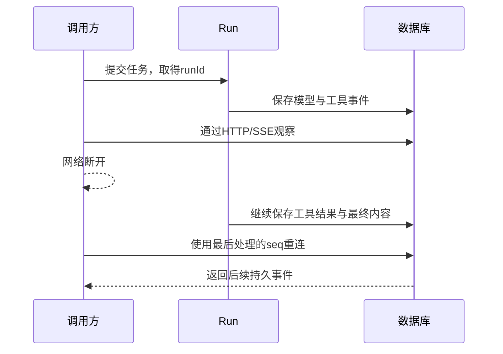
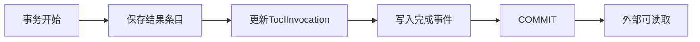
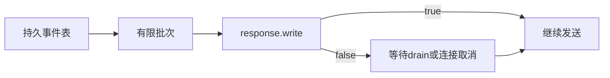

# Harness 最终输出什么：持久事件、内容引用与 SSE

## 01｜观察连接断开以后，任务究竟发生了什么？

> 系统正在核对示例产品的条款。调用方已经收到一段文字，网络连接随后断开。

重连后，调用方需要知道工具是否完成、模型是否继续运行，以及最终答案保存在哪里。它还要判断已经收到的事件是否会重复出现。

这些问题涉及两条不同的生命周期：Run（执行尝试）负责完成用户任务，Subscription（观察订阅）负责把运行变化送给一个调用者。关闭后者，不应自动取消前者。



可靠的出口因此需要持久状态、事件身份和续传位置。直接转发模型文本，只覆盖其中一部分。

## 02｜Runtime Event 是什么？它与模型流事件有什么区别？

Runtime Event（运行事件）描述 Harness（智能体执行控制系统）已经记录的产品变化，例如任务受理、模型步骤开始、工具结果提交和运行结束。

模型 API 也会返回流式事件，但它们只描述一次模型调用。SDK 可能产生文本增量、工具调用条目和响应完成事件。产品还需要表达队列、取消、恢复及数据库提交。

```text
模型增量 → 更新助手内容条目 → content.delta
模型响应结束 → 提交ModelStep → model_step.completed
工具结果提交 → 更新Invocation → tool_invocation.completed
任务结束 → 提交Turn/Run → turn.completed、run.completed
```

Control Command（控制命令）又是另一类对象。用户提交取消，是系统输入。数据库接受后产生 `run.cancel_requested`，才是已经成立的运行事实。

日志记录可以用于诊断，但日志时间与语句不能替代权威状态。事件接口应表达已经提交的产品变化，并有明确的数据契约。[^events]

## 03｜一条事件的信封和负载长什么样？

Event Envelope（事件信封）保存共同字段，Payload（事件负载）保存该事件类型特有的数据。下面是一条结构完整的合成工具完成事件：

```json
{
  "schemaVersion": "1.0",
  "eventId": "SYN-EVENT-18",
  "threadId": "SYN-T-01",
  "seq": "18",
  "turnId": "SYN-U-01",
  "runId": "SYN-R-01",
  "occurredAt": "2026-10-01T00:00:00Z",
  "type": "tool_invocation.completed",
  "payload": {
    "invocationId": "SYN-V-01",
    "resultItemRef": "SYN-RESULT-01"
  }
}
```

`eventId` 标识事件，`seq` 确定它在 Thread（持续对话）中的次序。`turnId` 和 `runId` 关联用户回合与执行尝试。某些 Thread 级事件可以没有 Turn 或 Run。

`type` 决定负载结构。工具完成事件需要执行 ID 和结果引用；运行完成事件需要 Run ID 与最终内容引用。Schema（数据结构约束）会检查这些关系。

| type | payload 主要字段 | 表达的变化 |
| --- | --- | --- |
| `turn.created` | turnId、userInputRef | 用户输入已受理 |
| `run.started` | runId | 后台执行已开始 |
| `model_step.completed` | stepId | 一次模型响应已提交 |
| `tool_invocation.completed` | invocationId、resultItemRef | 工具结果已提交 |
| `content.delta` | contentRef、delta、offset | 一个内容条目增加了文字 |
| `run.completed` | runId、finalContentRef | 当前 Run 完成终态提交 |

这些事件与内部实体共享稳定 ID。调用方可以先观察进度，再按引用读取详细内容，而不必让每帧复制所有内部数据。

## 04｜事件怎样与数据库状态共同提交？

`RuntimeStorage.emit()` 在当前事务中递增 Thread 的 `lastEventSeq`，构造合法事件并插入事件表。调用方不会在数据库提交前读取到这些变化。[^storage]

```ts
// emit 的核心顺序，源码摘编。
const [row] = await tx.update(schema.threads).set({
  lastEventSeq: sql`${schema.threads.lastEventSeq} + 1`,
  updatedAt: sql`clock_timestamp()`,
}).where(eq(schema.threads.id, threadId))
  .returning({ seq: schema.threads.lastEventSeq });

const envelope = Api.RuntimeEvent.parse({
  schemaVersion: "1.0",
  eventId: randomUUID(),
  threadId, turnId, runId,
  seq: row.seq.toString(),
  occurredAt: new Date().toISOString(),
  ...event,
});
// 随后使用同一个 tx 插入 schema.events。
```

工具完成事务会同时保存结果条目、Invocation 终态和完成事件。Run 完成事务会更新 Turn/Run，并保存最终事件。中途失败时，相关写入一起回滚。



这不等于完整 Event Sourcing（事件溯源）架构。当前系统同时维护状态表、内容表和事件表。事件适合观察和重放变化，但并非每种内部状态都已承诺可以只靠公共事件从零重建。

公开事件有时只携带引用。调用者需要读取对应实体才能取得完整内容。这样可以减少重复数据，并控制公开范围。

## 05｜Thread 序号为什么使用十进制字符串？

数据库使用 bigint（64 位整数）记录事件序号。JavaScript Number 无法精确表达全部64位整数。如果把大序号先转成 Number，再比较或重新序列化，就可能破坏身份。

```js
const assert = require("node:assert/strict");
const a = "9007199254740992";
const b = "9007199254740993";
assert.equal(Number(a), Number(b));
assert.notEqual(BigInt(a), BigInt(b));
assert.equal((BigInt(b) + 1n).toString(), "9007199254740994");
console.log("大序号使用字符串或BigInt保留精度");
```

JSON 不直接编码 JavaScript BigInt，因此 API 使用十进制字符串。客户端可以保持字符串，或在本地解析为精确整数类型。

时间戳用于观察时间，不作为唯一排序依据。同一个数据库事务可以产生多条事件，时间非常接近；不同进程也可能有时钟偏差。Thread 内次序以 `seq` 为准。

序号的作用域同样重要。两个不同 Thread 都可以有事件18。消费身份应至少包含 `(threadId, seq)`，不能只在全系统按一个数字去重。

## 06｜内容增量怎样关联到稳定条目？

模型流中的文本增量被记录为 `content.delta`。其中 `contentRef` 指向助手内容条目，`delta` 是新增文字，`offset` 表示新增文字在当前条目中的位置。

```json
{
  "type": "content.delta",
  "payload": {
    "contentRef": "SYN-ANSWER-01",
    "delta": "根据已取得的条款，",
    "offset": 0
  }
}
```

这是负载摘录。完整事件还包含信封字段。多个增量可以对应同一个 contentRef，后续通过同一 ID 收敛为完整内容。

当前源码使用 JavaScript 字符串长度计算 offset，即 UTF-16 code units（UTF-16 代码单元）。它不是 UTF-8 字节数，也不完全等于人眼看见的字符数。

```js
const assert = require("node:assert/strict");
assert.equal("😀".length, 2);
assert.equal(Buffer.byteLength("😀", "utf8"), 4);
assert.equal("条款😀".length, 4);
console.log("offset与网络字节预算采用不同单位");
```

跨语言消费方应按这个单位处理偏移。最终仍应以已提交的完整内容作为核对依据，避免只靠增量拼接留下错位。

### 最终内容一定产生 content.committed 吗？

不必假定所有成功路径都相同。`finishRun()` 接受已有 `finalContentRef` 时，复用模型边界已经提交的助手条目。如果调用方提交新的 `finalItem`，该路径会保存条目并产生 `content.committed`。

Runner 的正常成功路径要求找到合法最终助手条目，再提交 Run。外部应结合 Turn 的最终引用、内容状态与 Run 终态确认结果，而不是只等待某一种可选内容事件。

## 07｜SSE 在网络上一帧长什么样？

SSE（Server-Sent Events，服务器发送事件）通过 HTTP 持续发送文本帧。它使用 `text/event-stream`。常用字段是 id、event 和 data，空行结束一帧。[^sse]

```text
id: 18
event: tool_invocation.completed
data: {"schemaVersion":"1.0","eventId":"SYN-EVENT-18","threadId":"SYN-T-01","seq":"18","turnId":"SYN-U-01","runId":"SYN-R-01","occurredAt":"2026-10-01T00:00:00Z","type":"tool_invocation.completed","payload":{"invocationId":"SYN-V-01","resultItemRef":"SYN-RESULT-01"}}

```

此实现把 Thread 序号作为 SSE id，把产品事件 type 作为 event，把整个 RuntimeEvent JSON 作为 data。

心跳是注释帧：

```text
: heartbeat

```

心跳不分配产品事件序号，也不表示模型完成了一项工作。它只帮助保持观察连接并让双方知道传输仍然活跃。

网络读取的 Chunk（字节块）不等于一帧 SSE。一个帧可能分成多个块，一个块也可能包含多个帧。UTF-8 多字节字符还可能跨块。因此客户端需要增量解码和帧缓冲，不能对每次 read() 直接执行 JSON.parse。

本工程的 data 使用 JSON.stringify，会把正文换行编码为 JSON 转义字符。通用 SSE 客户端仍应按协议处理多行 data、注释与帧边界。

## 08｜为什么发送200以前先读取第一批事件？

SSE 响应一旦发出200和流式响应头，后续就不能再把它改成正常的401或410 JSON错误。入口应在此之前完成认证、资源归属和游标检查。

`DurableEventStreams.open()` 先登记观察连接，然后执行第一次持久读取。读取成功后，才接管响应并发送 SSE 头。[^stream]

```ts
let batch: RuntimeEvent[];
try {
  batch = await read(after, this.#options.batchSize);
  subscription.controller.signal.throwIfAborted();
} catch (error) {
  // 清理监听器与订阅登记，然后交给HTTP错误处理。
  this.#subscriptions.delete(subscription);
  throw error;
}
reply.hijack();
reply.raw.writeHead(200, {
  "Content-Type": "text/event-stream; charset=utf-8",
  "Cache-Control": "no-cache, no-transform",
  "Connection": "keep-alive",
  "X-Accel-Buffering": "no",
});
reply.raw.flushHeaders();
```

完整代码还移除 close/error 监听器。`hijack()` 表示流式处理接管响应生命周期。`X-Accel-Buffering` 是给兼容反向代理的提示，不代表所有代理都会自动采用相同缓冲策略。

如果第一批读取发现资源不可访问，接口仍能返回结构化错误。流开始之后发生授权撤回或保留窗口变化，当前实现结束观察流。调用者重连时，再获得对应的入口错误。

## 09｜历史重放与实时接续为什么使用同一查询？

一种实现方式是先查历史，再订阅消息代理。两步之间产生的事件需要额外机制填补，否则可能漏掉交接窗口中的变化。

当前实现始终查询同一张持久事件表。它从 after 之后读取一批事件，发送完成后移动游标，再查询下一批。

```ts
// #pump 的核心逻辑摘编。
let batch = firstBatch;
let cursor = after;
while (!signal.aborted) {
  for (const event of batch) {
    await writeFrame(event);
    cursor = event.seq;
  }
  if (batch.length < batchSize) {
    await waitForNextPoll(signal);
  }
  batch = await read(cursor, batchSize);
}
```

`writeFrame` 和 `waitForNextPoll` 是阅读用名称，对应源码中的 `#write()` 和可取消 delay。产品状态仍由数据库提供。

默认轮询间隔为250毫秒，批次大小100，空闲心跳间隔15000毫秒，最大连接数100。这些是该快照的实例配置，不是通用服务容量承诺。

优点是恢复路径简单：历史和后续事件共享相同查询语义。代价是空轮询延迟与数据库负载。后续可以增加通知唤醒减少空查，但持久序号仍应作为重放依据。

## 10｜after 与 Last-Event-ID 表示哪个消费位置？

`after` 查询参数或 `Last-Event-ID` 请求头，声明调用方要从哪个序号之后继续。当前接口要求两者同时提供时含义一致。

调用者应保存自己已确认处理的位置。服务端内部的 cursor 则代表本连接已经完成写入流程的最后事件。这不是同一种确认。

```text
数据库最大序号：25
服务端已写到连接：23
客户端已收到：22
客户端已完成业务处理：21

可靠重连起点：客户端已确认处理的21
```

这些数值是示意。服务端无法仅凭 response.write 的返回值知道客户端处理到哪里。

当前 `listEvents()` 对不小于最新序号的 after 返回空数组，包括未来游标。SSE 会继续等待。调用者不应故意提交远超当前值的游标，否则会错过后续较小序号的事件。

只观察某个 Run 时，也应谨慎处理 Thread 序号。其他 Run 或线程级事件可能占用中间数字，筛选后的事件序号出现间隙并不自动代表数据丢失。

## 11｜Backpressure 是什么？慢读者怎样影响发送？

Backpressure（背压）表示下游处理速度低于上游生成速度时，发送者需要等待，避免无限堆积数据。

Node.js 的 `response.write()` 返回 false，表示当前输出缓冲区需要等待 drain（可继续写入）事件。源码在此暂停发送和获取后续批次：

```ts
async function writeFrame(response, frame, signal) {
  signal.throwIfAborted();
  if (!response.write(frame)) {
    await once(response, "drain", { signal });
  }
  signal.throwIfAborted();
}
```

这是 `#write()` 的简化形状，`once` 来自 Node.js events。AbortSignal（取消信号）使连接关闭时可以解除等待。

背压限制本连接的发送速度。它不会自动降低后台 Run 的模型输出速度。运行事件继续保存，慢观察者按持久游标补读，直到保留窗口或连接策略要求重新建立观察。



写入网络缓冲成功也不证明客户端已经完成业务处理。需要严格业务确认的消费者，应把处理结果和消费游标放在自己的持久事务中。

## 12｜怎样去重并重建内容？

一个客户端可能在处理事件后、保存游标前退出。重连时再次收到该事件是合理情况。去重必须使用稳定事件身份，而不是比较自然语言文本。

下面的 Node.js 程序演示一个内存事件归并器。它检查 Thread、十进制序号、重复事件、内容 offset 和最终引用。输入使用合成事件。

```js
const assert = require("node:assert/strict");

function createProjection(threadId) {
  return { threadId, cursor: 0n, seen: new Map(), content: new Map(), finals: new Map() };
}

function apply(state, event) {
  if (event.threadId !== state.threadId || !/^[1-9][0-9]*$/.test(event.seq)) {
    throw new Error("EVENT_IDENTITY_INVALID");
  }
  const seq = BigInt(event.seq);
  const serialized = JSON.stringify(event);
  const prior = state.seen.get(event.seq);
  if (prior !== undefined) {
    if (prior !== serialized) throw new Error("EVENT_SEQUENCE_CONFLICT");
    return false;
  }
  if (seq <= state.cursor) throw new Error("UNEXPECTED_EVENT_ORDER");

  if (event.type === "content.delta") {
    const { contentRef, delta, offset } = event.payload;
    const text = state.content.get(contentRef) ?? "";
    if (typeof delta !== "string" || !Number.isInteger(offset) || offset !== text.length) {
      throw new Error("CONTENT_OFFSET_MISMATCH");
    }
    state.content.set(contentRef, text + delta);
  }
  if (event.type === "run.completed") {
    state.finals.set(event.runId, event.payload.finalContentRef);
  }
  state.seen.set(event.seq, serialized);
  state.cursor = seq;
  return true;
}

const make = (seq, type, payload) => ({
  schemaVersion: "1.0", eventId: "E" + seq, threadId: "T1",
  turnId: "U1", runId: "R1", seq,
  occurredAt: "2026-10-01T00:00:00Z", type, payload,
});
const projection = createProjection("T1");
const a = make("9007199254740992", "content.delta", { contentRef: "A1", delta: "😀", offset: 0 });
const b = make("9007199254740993", "content.delta", { contentRef: "A1", delta: "条款", offset: 2 });
const c = make("9007199254740994", "run.completed", { runId: "R1", finalContentRef: "A1" });
assert.equal(apply(projection, a), true);
assert.equal(apply(projection, a), false);
apply(projection, b);
apply(projection, c);
assert.equal(projection.content.get("A1"), "😀条款");
assert.equal(projection.finals.get("R1"), "A1");
assert.equal(projection.cursor.toString(), "9007199254740994");
assert.throws(() => apply(projection, { ...c, payload: { runId: "R1", finalContentRef: "A2" } }), /EVENT_SEQUENCE_CONFLICT/);
console.log("重复事件不重复追加，大整数和UTF-16偏移保持一致");
```

这是单进程教学投影，不是完整的通用事件消费者。它假定事件形状已通过 Schema 验证，并保留全部 seen 记录。生产消费者需要有界去重策略、持久事务和一致的序列化身份比较。

若接到 offset 不匹配，客户端应重新读取权威内容，而不是用空格补齐或静默拼接。Run 完成后也应核对 `finalContentRef` 对应的 committed 内容。

## 13｜事件保留窗口过期时，410 表示什么？

事件可以按维护策略清理。若调用者的 after 早于可重放范围，服务不能假装返回的剩余事件仍然构成完整历史。

`listEvents()` 检查 `earliestEventSeq`（最早保留序号）。当 after 小于 earliest−1 时，抛出 `EVENT_CURSOR_EXPIRED`，并提供当前 `lastEventSeq` 和快照路径。HTTP 将它映射为410。

```json
{
  "error": {
    "code": "EVENT_CURSOR_EXPIRED",
    "message": "The event cursor has expired.",
    "requestId": "SYN-REQUEST",
    "details": {
      "lastEventSeq": "250",
      "snapshotPath": "/v1/threads/SYN-T-01"
    }
  }
}
```

这是错误信封的合成示例。快照路径提供恢复入口，不等于旧的所有事件仍然存在。

### 保留窗口与事件行怎样保持一致？

同一批查询采用 repeatable read（可重复读）只读事务。窗口元数据和事件行来自同一数据库视图，避免在两次读取中间发生清理，产生不一致结果。[^postgres]

```ts
return this.db.transaction(async tx => {
  const thread = await this.ownedThread(principal, threadId, tx, false);
  checkRetentionWindow(thread, after);
  return readEventsAfter(tx, threadId, after, limit);
}, { isolationLevel: "repeatable read", accessMode: "read only" });
```

函数名是对实际检查和查询的阅读简化。下一批查询会观察新的数据库状态，因此仍可能在后续发现游标过期。

### 重建状态和恢复游标也要一致

调用者不能先单独读取内容，再读取一个更新的最新序号，然后从这个序号跳过中间事件。两次读取之间可能产生新的变化。

更稳妥的做法是使用包含一致快照序号的状态导出，再从该序号之后接续。本工程的 `exportThread()` 使用只读可重复读事务，返回 Thread、回合、运行、内容与工具记录。消费方还需明确它要重建哪些公开状态；导出不是完整事件账本的替代副本。

## 14｜权限撤回、删除和容量限制怎样影响长连接？

每批事件读取都会重新调用当前认证器，再检查 Thread 归属和可见状态。原令牌失效、主体权限收紧或 Thread 删除，后续读取就会受到限制。

已查询并开始发送的一批内容，不会因为随后撤权而从网络中被撤回。这里的保证是每次受控读取重新检查，而不是对已发送字节提供可撤销授权。

连接数量也有限制。默认 `maxConnections=100` 是当前 `DurableEventStreams` 实例的容量，不等于按用户计费或整个集群的全局配额。

达到容量或服务正在关闭时，入口返回 `429 EVENT_STREAM_CAPACITY_EXHAUSTED`。调用方应按服务策略退避重试，不要不断创建新的未关闭连接。

<details>
<summary><strong>展开：为什么要区分流开始前和流开始后的错误？</strong></summary>

开始前，服务可以返回401、404、410或429等结构化 HTTP 错误。

开始后，响应头已经提交。当前实现记录受限诊断并结束流。客户端再次连接时，再通过标准入口获得当前资源状态。

一条网络流结束不等于 Run 已失败。消费者应读取 Run 或重连事件通道确认。

</details>

## 15｜观察连接和后台执行器怎样分别关闭？

观察连接拥有自己的 AbortController、响应对象和发送任务。收到 close 或 error 时，取消发送等待、移除监听器并释放订阅登记。

服务整体关闭时，`close()` 标记停止接入，取消所有订阅，并 destroy（销毁）仍未结束的响应连接。

```ts
this.#closing = true;
const subscriptions = [...this.#subscriptions];
for (const subscription of subscriptions) {
  subscription.controller.abort();
  if (!subscription.response.destroyed) {
    subscription.response.destroy();
  }
}
await Promise.allSettled(subscriptions.flatMap(s => s.task ? [s.task] : []));
```

为什么不是只等待 drain？一个完全停止读取的客户端可能永远不释放缓冲区。停机需要主动解除这类等待，否则观察者可以阻塞应用关闭。

Run 的停止由 Worker 与 RunnerFacade 管理。它们需要在 Storage 仍可用时提交取消或中断状态。事件订阅清理和运行状态收尾分别执行，最后再关闭数据库。

## 16｜怎样用本地客户端核对实际事件？

在已有授权的本地测试实例中创建一个 Thread，并提交合成任务。取得真实 Thread ID 后，用 curl 持续观察：

```bash
: "${HARNESS_TEST_TOKEN:?请先设置本地测试令牌}"
: "${THREAD_ID:?请使用实际Thread ID}"
BASE_URL="http://127.0.0.1:3100"

curl --no-buffer --silent --show-error \
  -H "Authorization: Bearer $HARNESS_TEST_TOKEN" \
  -H "Accept: text/event-stream" \
  "$BASE_URL/v1/threads/$THREAD_ID/events?after=0"
```

记录自己已处理的最后 seq，结束当前观察连接，再使用相同位置重连：

```bash
: "${LAST_PROCESSED_SEQ:?请设置已经处理的事件序号}"
curl --no-buffer --silent --show-error \
  -H "Authorization: Bearer $HARNESS_TEST_TOKEN" \
  -H "Last-Event-ID: $LAST_PROCESSED_SEQ" \
  -H "Accept: text/event-stream" \
  "$BASE_URL/v1/threads/$THREAD_ID/events"
```

这些命令不提交取消。后台任务继续按自己的 Run 预算执行。curl 观察窗口结束，只能说明本次没有继续读取。

数据库端用参数化只读查询核对：

```sql
SELECT seq, type, run_id, turn_id, payload, occurred_at
FROM runtime.events
WHERE thread_id = $1
ORDER BY seq;
```

对于已完成的合成工具循环，核对工具完成事件的 `resultItemRef` 与实际 Invocation 一致。再核对运行完成事件的 `finalContentRef` 与 Turn 最终引用一致。

## 17｜怎样测试重放、背压和保留窗口竞争？

事件层可以独立于图形界面验收。测试使用真实 HTTP 流、真实测试数据库和受控运行输出。

| 测试 | 核心断言 |
| --- | --- |
| 首次连接 | HTTP/SSE 事件与数据库一致 |
| 收到部分事件后断线 | 后台 Run 继续，重连能读取后续事件 |
| 大整数序号 | 客户端和服务端没有精度损失 |
| 重复帧 | 消费方不重复追加内容 |
| 游标过期 | 开流前返回410与恢复信息 |
| 慢读取 | 等待 drain，批次不无限累积 |
| 授权撤回 | 后续读取按当前身份拒绝 |
| 服务关闭 | 慢客户端不能阻止订阅清理 |
| 事件清理与读取并发 | 当前批次元数据和事件处于同一视图 |

项目 `tests/events/` 与 `docs/implementation/events-sse-preparation.md` 记录了这些边界的实现验证。新的测试必须实际运行后再报告结果。[^tests]

观察指标包括 activeConnections、backpressureWaits、pendingDrainWaits 和 eventsWritten。它们帮助定位输出阻塞，但 eventsWritten 表示服务端写入，不是客户端已确认消费数量。

## 18｜稳定事件出口怎样成为产品契约？

模型生成内容，工具取得证据，数据库提交事实，事件表达变化，SSE 负责传输。每一层保留自己的完成条件。

调用方由此可以在断线、重连和服务恢复后重新建立一致认识。它知道哪条 Run 已结束，哪个结果引用有效，以及哪些事件需要再次处理。

这一出口同样服务于命令行、外部业务系统和测试程序。完整 Harness 的可用性可以直接通过公开协议验证，而不是只依赖页面展示。

下一篇进一步组织这些验证：[协议测试、故障注入与效果评测](12-testing-and-evaluation.md)。

## 实现依据

[^events]: Insurance Agent Runtime `c66112dfd8676b47b143dc2e26739278cf4b0dde`：`packages/contracts/src/events.ts`、`runner/model.ts`。模型增量、产品内容条目与事件负载分别按实际接口说明。
[^storage]: 同一快照：`storage/store.ts` 的 `emit`、`finishInvocation`、`finishRun`、`listEvents` 和 `exportThread`。事件表与状态表共同维护。
[^stream]: 同一快照：`transport/http/sse.ts` 的 `DurableEventStreams`，以及 `transport/http/app.ts` 的 `streamThreadEvents` 路由。容量、轮询、背压、重新认证和关闭行为绑定此版本。
[^sse]: [HTML Living Standard：Server-sent events](https://html.spec.whatwg.org/multipage/server-sent-events.html)。标准定义帧和事件 ID；产品持久化和游标策略由本工程实现。
[^postgres]: [PostgreSQL 16：Transaction Isolation](https://www.postgresql.org/docs/16/transaction-iso.html)。本工程为单批事件和导出选择只读可重复读事务。
[^tests]: `tests/events/` 与 `docs/implementation/events-sse-preparation.md`。文中合成事件和内存投影示例用于协议说明，不替代真实数据库与网络集成测试。
