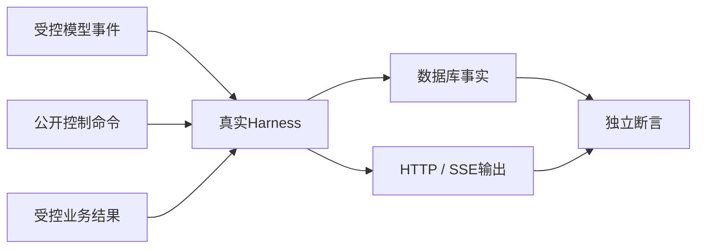
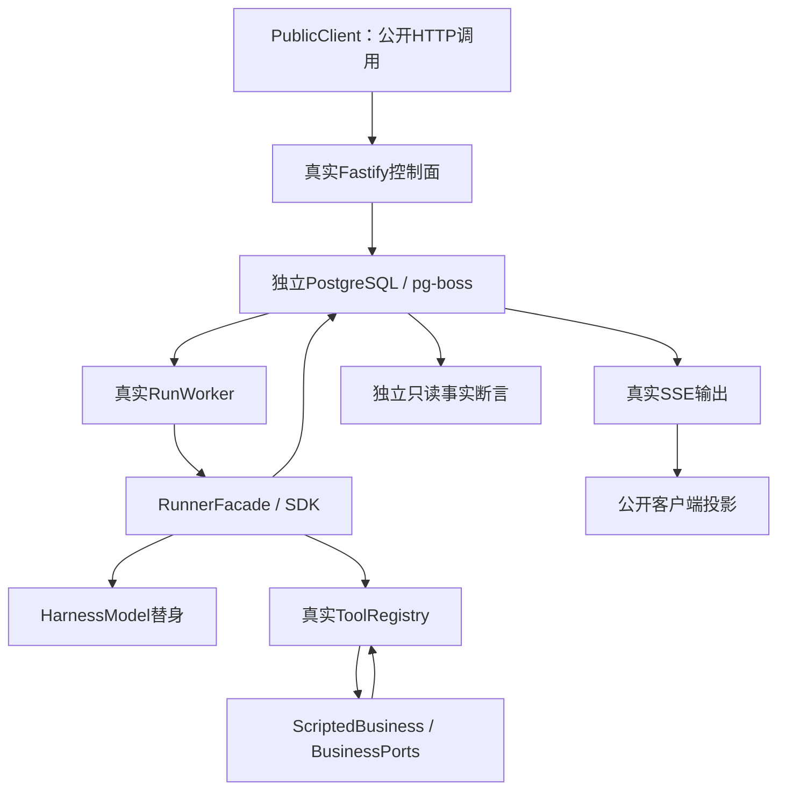
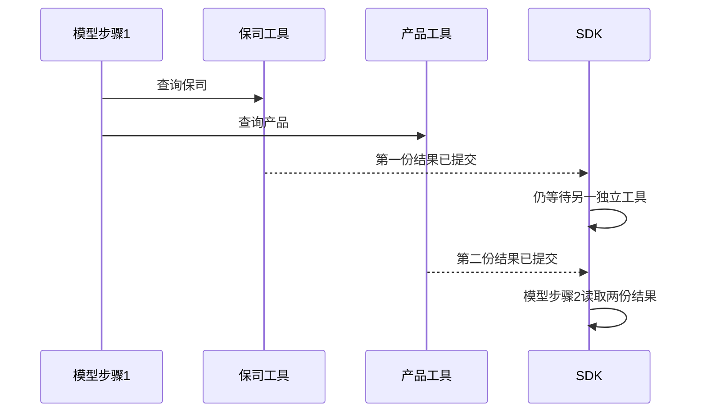
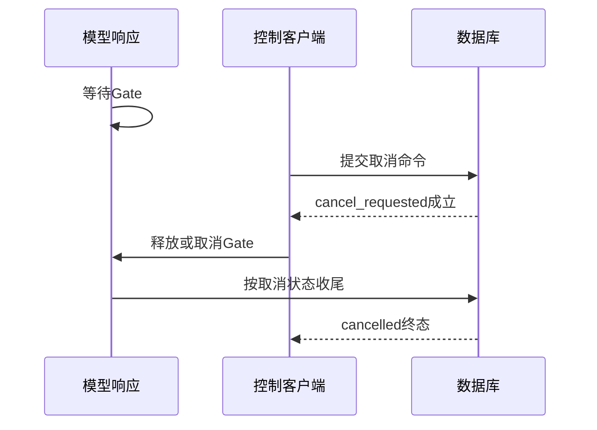
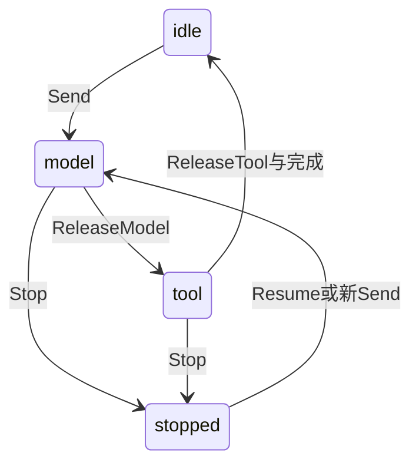

# 如何证明 Harness 工作正确：协议测试、故障注入与效果评测

## 01｜答案正确，为什么还要测试运行系统？

> 请核对示例保障甲的等待期，并给出正式条款出处。

第一次运行，Agent 查到资料并正确回答。第二次运行，它多查了一次，答案仍然正确。第三次运行，工具结果没有保存成功，模型却继续生成了答案。

前两次可能只是模型策略不同。第三次涉及执行协议：模型依赖了一份尚未成为持久事实的结果。进程一旦退出，系统可能无法还原这份答案的真实依据。

Harness（智能体执行控制系统）的测试因此需要区分四种判断：程序是否遵守执行规则，外部接口是否满足契约，模型是否选择有效动作，以及业务结论是否得到证据支持。

```text
工程协议：调用、状态、权限和引用是否正确？
外部接口：当前服务是否按约定返回数据？
模型行为：是否选择了合适的工具和查询？
业务质量：原文是否支持最终结论？
```

测试目标不同，替换的依赖、断言和报告范围也不同。一个答案正确，不能代替取消竞争或数据库回滚测试；一个确定性测试通过，也不能直接证明真实保险咨询质量。

## 02｜测试对象、测试替身与判定器分别是什么？

SUT（System Under Test，被测系统）是希望验证的实际程序。在这里，它可以是一项 Schema，也可以是完整 HTTP、Worker、SDK、工具和数据库执行链。

Test Double（测试替身）替换某个不稳定或难以控制的依赖。例如，用固定响应替换外部模型，用合成资料替换真实业务查询。

Fixture（测试夹具）准备输入、依赖、初始状态与清理方法。Oracle（测试判定器）判断实际结果是否满足预期。Invariant（不变量）则规定所有合法运行都必须满足的关系。

| 概念 | 一个具体例子 |
| --- | --- |
| 被测系统 | 真实 `RunnerFacade.execute()` 和 PostgreSQL 存储 |
| 测试替身 | 第一次返回 ToolCall、第二次返回文本的模型 |
| 测试夹具 | 独立测试数据库、合成工具、用户身份和 Thread |
| 判定器 | 检查工具结果在第二次模型请求前已提交 |
| 不变量 | 完成的 Turn 必须引用合法的最终助手内容 |

Mock（模拟替身）可以存在于很多位置。只说“Mock Agent”会让测试范围不清楚。应明确被替换的是模型边界、工具后端、网络传输，还是整个运行函数。

本文以项目已经实现的 `tests/harness/` 验收系统为主体。它保留真实产品主链，把不确定性替换在模型和业务接口边界。[^harness]

## 03｜Model Events 和控制命令怎样共同驱动测试？

Model Events（模型事件）是模型接口返回的输出，例如文本增量、工具调用和响应结束。Control Commands（控制命令）是外部对 Harness 的操作，例如发送、取消、恢复和重试。

这两类输入共同决定执行时序。测试可以让模型暂时停在完成前，再通过真实 HTTP 提交取消命令，然后释放模型响应。



模型可以输出一条规范化调用意图：

```json
{
  "type": "function_call",
  "callId": "search-1",
  "name": "search_documents",
  "arguments": "{\"content\":\"读取合成资料\",\"query\":\"等待期\",\"companyIds\":null,\"productIds\":[\"SYN-PRODUCT-1\"],\"topK\":1}"
}
```

这条意图来自 SDK Model（模型接口），还不是工具已完成的事实。Harness 执行并保存结果后，才会产生 `tool_invocation.completed` 事件。

同样，提交取消命令可能被权限或状态规则拒绝。只有命令被受理，数据库才记录 `run.cancel_requested`。测试应检查命令回执和持久状态，不能把测试驱动器发出请求直接等同于操作成功。

## 04｜从哪里替换模型，才能覆盖正确的边界？

不同替换位置带来不同覆盖范围。

```text
最外层替换 RunnerFacade
  → 只能检查调用者如何处理返回值

替换 SDK Model 接口
  → 保留 Agent Loop、工具执行、Session 与持久化

替换生产 Provider 的 fetch
  → 还保留请求序列化、模型客户端和响应解析

调用真实模型服务
  → 验证当前外部接口与实际模型行为
```

项目的普通 Runner 测试使用 ScriptedModel（脚本化模型替身）。完整验收使用 HarnessModel（带输入断言和严格消费检查的模型替身）。它们都实现 SDK 的 Model 接口。

Wire Test（传输协议测试）把替身放在真实模型工厂的 fetch 边界。产品仍然创建 OpenAI client、OpenAIResponsesModel，并执行授权、序列化和解析。网络返回使用合成协议样本。[^wire]

这种测试能够发现参数错误、响应结束缺失和错误映射问题，但仍未访问真实供应商。应将它报告为受控传输测试，而不是实际产品网络读回。

真实模型验证则使用独立的配置和调用预算。它适合确认当前服务兼容性与模型行为，不适合反复承担所有数据库竞争和进程故障测试。

## 05｜TestRig 怎样启动完整的 Harness？

TestRig（测试装配环境）把真实组件组装成可重复的本地服务。`createRig()` 创建独立 PostgreSQL 测试库、真实 HTTP 服务、Registry、Worker、RunnerFacade 和 Session。[^rig]

它只在合适的外部边界注入替身：HarnessModel 提供模型输出，ScriptedBusiness 提供业务响应。模型参数、工具权限、预算、结果提交和运行事件仍经过真实实现。



PublicClient（公开接口客户端）只消费 HTTP 与 SSE。它的状态投影不能从数据库读取内部答案后再假装由公开事件重建。

独立的 `assertFacts()` 可以查询内部内容、租约和调用记录，用于补充验证。两种判定并列存在，但私有查询不回填公开客户端的状态。

这能发现一种常见测试缺陷：如果测试直接把数据库终态复制给客户端，就可能掩盖 SSE 丢失事件或公开接口字段错误。

## 06｜脚本化模型怎样检查输入和调用次数？

一个可用的模型替身不应只依次返回几个固定字符串。它还需要检查每次请求是否携带了正确历史，并拒绝没有声明的额外调用。

项目的 `ScriptedEndpoint`（脚本化接口）为每一步保存 ID、输入检查函数和响应函数。调用时先复制并冻结请求，再消耗一个脚本条目。[^scripted]

```ts
// ScriptedEndpoint.invoke() 的核心形状。
const snapshot = immutable(request);
this.calls.push(snapshot);
const entry = this.entries[this.consumed++];
if (!entry) {
  const failure = new Error("Unexpected boundary call");
  this.failures.push(failure);
  throw failure;
}
entry.check?.(snapshot);
return await entry.reply(snapshot, signal);
```

实际代码还会单独保存输入断言错误。原因是业务运行器可能把抛出的异常处理成一次正常 Run 失败。测试结束时仍必须重新检查这些断言，避免把“测试本身发现错误”误当成“预期执行失败”。

`assertConsumed()` 检查脚本消耗数量。如果声明两次请求却只执行一次，正常完成场景应失败。如果取消场景预期只消耗第一步，则需要明确声明这个前缀。

```ts
const model = rig.plan(thread.threadId, [
  modelEntry("search", [call("search_documents", "search-1", {
    query: "合成等待期", companyIds: null,
    productIds: ["SYN-PRODUCT-1"], topK: 1,
  })], requestContract),
  modelEntry("final", [assistant("已完成核对。")], request => {
    requestContract(request);
    expect(toolResult(request, "search-1").status).toBe("ok");
  }),
]);
```

这些辅助函数来自实际测试框架。`call()` 自动补入合成动作说明，`toolResult()` 按精确 callId 查找后续模型输入中的工具结果。

## 07｜业务工具为什么在 Port 层替换？

Business Port（业务接口契约）位于工具执行治理与外部服务之间。把替身放在这里，可以保留真实工具参数校验、当前授权、预算和持久结果。

`ScriptedBusiness` 包装实际合成 Port。每次调用保存不含 AbortSignal 的不可变请求快照，包括能力 ID、业务参数和上下文身份。测试处理函数可以直接返回特殊结果，也可以先调用原合成实现，再调整个别字段。

```ts
// journeys.test.ts 中 partial 结果路径的阅读摘编。
rig.business.handlers["knowledge.search_documents"] = async (
  request, signal, delegate,
) => {
  rig.business.check(() => {
    expect(request.input.productIds).toEqual(["SYN-PRODUCT-1"]);
  });
  return {
    ...await delegate(),
    status: "partial",
    coverage: "partial",
    missing: ["SYN_CLAUSE_DETAIL"],
  };
};
```

这是结构合法的部分业务结果，不是执行异常。模型下一次输入应保留 `partial` 与缺失说明。超时、异常抛出和 Schema 错误则需要另设场景。

一个上层 Runner 测试可能使用非常简化的 ToolBinding，只验证工具循环。完整 TestRig 使用真实 Registry 和实际六项工具契约。两类测试都有效，但覆盖范围不同。

## 08｜一条最小全链路案例应该检查什么？

项目的 `basic-loop` 从公开 HTTP 创建 Thread（持续对话），提交 Turn（用户回合），由实际队列和 Worker 领取 Run（执行尝试），再完成一次搜索与最终回答。[^journeys]

它检查以下关系：

```text
一个受理命令
  → 一个Run
  → ModelStep 1：提出搜索
  → ToolInvocation 1：保存结果
  → ModelStep 2：输入包含该结果
  → 最终助手条目
  → finalContentRef
  → 完成事件和公开导出
```

ModelStep 是模型调用记录，ToolInvocation 是工具执行记录。两者分别有自己的身份、状态和结果引用。

实际用例在运行完成后同时验证公开输出与内部事实：

```ts
const accepted = await rig.client.send(
  thread.threadId,
  "基础链：查找合成资料",
  thread.revision,
);
expect((await rig.client.terminal(accepted.runId)).status).toBe("completed");
await observer.wait(event =>
  event.type === "run.completed" && event.runId === accepted.runId
);
const snapshot = await rig.client.export(thread.threadId);
observer.projection.assertMatches(snapshot);
model.assertConsumed();
await assertFacts(rig, accepted.runId);
```

`assertMatches()` 比较由 SSE 归并得到的公开状态与 API 导出。`assertFacts()` 再核对结果条目、模型步骤、工具身份、租约和终态事件。

用例还通过公开来源接口读取结果中的 sourceRef。运行外的来源读取有自己的上下文，不能将它算作原 Run 内额外的模型工具调用。

## 09｜怎样用一个长程任务验证连续性？

一个单工具案例无法覆盖并行结果合并、部分证据、动态来源参数和跨回合历史。项目的 `long-journey` 在一个确定剧本中连接这些行为：

| 模型调用 | 输出动作 | 输入必须包含什么 |
| --- | --- | --- |
| 1 | 同时查询保司与产品目录 | 合法工具集和当前问题 |
| 2 | 按产品 ID 检索条款 | 两份目录结果 |
| 3 | 读取 sourceRef 对应的来源页 | partial 检索与实际来源引用 |
| 4 | 查询结构化字段 | 来源读取结果 |
| 5 | 生成最终文本 | 字段值与前序证据 |

这条剧本包含5次模型调用和5项工具动作。第一步的两个目录工具并行，后续步骤具有数据依赖。

测试分别门控两个目录结果。先只释放其中一个，检查模型请求数仍为1。释放第二个后，SDK 才继续下一个模型步骤。



来源读取参数不是手工预填固定字符串。测试从前一步实际 ToolResult 中取得 `sourceRefs[0]`，再生成下一条调用。这验证真实数据关联，而不仅是工具出现顺序。

最后的助手文本包含两段相同的增量。测试检查拼接后保留两次出现，避免把重复字词错误去重。随后再发送新 Turn，检查新条件、前一回答与 partial 缺口同时进入模型历史。

<details>
<summary><strong>展开：为什么这是一条协议长程任务，而不是业务效果基准？</strong></summary>

工具选择由脚本明确规定，业务数据来自合成 Port。它验证复杂执行是否按因果关系完成。

真实模型能否自行找到同样有效的路径，需要独立行为评测。真实产品条款是否支持答案，也需要原文核验。

</details>

## 10｜Golden Trace 为什么应记录必要的先后关系？

Golden Trace（预期执行轨迹）用于描述受控场景。完全固定的单工具剧本可以要求两个模型步骤和一个执行实例。

并行场景更适合使用 Partial Order（因果偏序）：只规定必须成立的先后关系，允许独立动作采用不同完成顺序。

例如，工具开始前必须已经保存对应模型意图。工具成功结果必须在消费它的下一次模型请求前提交。最终 Run 完成必须引用合法的助手条目。

```text
模型意图提交 < 对应工具开始
工具开始 < 对应结果提交
参与本轮合并的全部工具结果提交 < 下一次模型开始
最终助手条目提交 < Run完成
```

两个独立工具谁先返回可以变化。测试若强制固定这个顺序，会把合法调度误判成失败。

同时，偏序并不是忽略缺失动作。仍需检查每个预期调用存在、身份准确、次数正确，并且脚本消耗与预期一致。

## 11｜怎样构造判定器，并确认它真的能发现错误？

项目的 `oracles.ts` 提供独立检查：最终引用有效、当前活动 Run 唯一、工具来自合法 ModelStep、后续模型没有提前开始、终态后不存在活动租约。[^oracles]

`assertFacts()` 还比较模型请求数量与 ModelStep 数量，检查输出条目确实存在且属于对应步骤。成功 Invocation 必须引用 committed（已提交）的结果。

下面的 Python 程序演示最小单工具轨迹判定。事件字段经过精简，输入全部为合成数据。

```python
from copy import deepcopy


def verify(events, items):
    sequences = [int(event["seq"]) for event in events]
    if sequences != sorted(set(sequences)):
        raise ValueError("SEQUENCE_INVALID")

    def one(kind, key, value):
        matches = [event for event in events
                   if event["type"] == kind and event["payload"].get(key) == value]
        if len(matches) != 1:
            raise ValueError("EVENT_COUNT_INVALID")
        return matches[0]

    model_done = one("model_step.completed", "stepId", "S1")
    tool_start = one("tool_invocation.started", "invocationId", "V1")
    tool_done = one("tool_invocation.completed", "invocationId", "V1")
    next_model = one("model_step.started", "stepId", "S2")
    turn_done = one("turn.completed", "turnId", "U1")
    run_done = one("run.completed", "runId", "R1")
    ordered = [model_done, tool_start, tool_done, next_model, turn_done, run_done]
    if any(int(left["seq"]) >= int(right["seq"])
           for left, right in zip(ordered, ordered[1:])):
        raise ValueError("CAUSAL_ORDER_INVALID")
    result = items.get(tool_done["payload"]["resultItemRef"])
    if not result or result["status"] != "committed":
        raise ValueError("TOOL_RESULT_NOT_COMMITTED")
    final = run_done["payload"]["finalContentRef"]
    if turn_done["payload"]["finalContentRef"] != final:
        raise ValueError("FINAL_REFERENCE_CONFLICT")
    if items.get(final) != {"role": "assistant", "status": "committed"}:
        raise ValueError("FINAL_NOT_COMMITTED")


def event(seq, kind, **payload):
    return {"seq": str(seq), "type": kind, "payload": payload}


trace = [
    event(1, "model_step.completed", stepId="S1"),
    event(2, "tool_invocation.started", invocationId="V1"),
    event(3, "tool_invocation.completed", invocationId="V1", resultItemRef="E1"),
    event(4, "model_step.started", stepId="S2"),
    event(5, "turn.completed", turnId="U1", finalContentRef="A1"),
    event(6, "run.completed", runId="R1", finalContentRef="A1"),
]
items = {"E1": {"role": "tool", "status": "committed"},
         "A1": {"role": "assistant", "status": "committed"}}
verify(trace, items)

bad_order = deepcopy(trace)
bad_order[2]["seq"], bad_order[3]["seq"] = "4", "3"
bad_order.sort(key=lambda row: int(row["seq"]))
bad_final = deepcopy(trace)
bad_final[-1]["payload"]["finalContentRef"] = "A2"
for bad_trace, bad_items in [
    (bad_order, items),
    (trace, {"A1": items["A1"]}),
    (bad_final, items),
]:
    try:
        verify(bad_trace, bad_items)
    except ValueError:
        continue
    raise AssertionError("判定器漏掉了预设错误")
print("合法轨迹通过；提前继续、缺失结果和冲突引用被拒绝")
```

这个程序只验证一个固定场景。真实判定器还要按 Run、ModelStep 和 Invocation 的实际 ID 泛化，并检查 Schema、权限与租约。

更重要的是最后一段：测试判定器本身。一个总是返回 true 的 Oracle 也会让所有正常场景通过，因此必须使用已知坏样本确认错误能够被发现。

## 12｜怎样在工具结果提交处注入真实故障？

Fault Injection（故障注入）是在指定边界主动制造失败。工具返回后、结果提交前是很有价值的位置，因为它连接外部效果与内部事实。

项目的 Runner 测试在独立测试数据库中加入临时 CHECK 约束，阻止 Invocation 进入 succeeded：

```sql
-- 仅展示测试夹具中的故障机制；只在隔离测试数据库使用。
ALTER TABLE runtime.tool_invocations
ADD CONSTRAINT reject_success_fixture
CHECK (status <> 'succeeded') NOT VALID;
```

`NOT VALID` 避免要求已有行立即满足新约束，但新的状态写入仍会受到约束。工具函数正常返回，成功结果提交则被数据库拒绝。

测试随后检查：Run 为 failed，模型只被调用一次，Invocation 为 outcome_unknown，结果引用和最终内容引用为空。最后在 finally 中移除该测试约束。[^runner]

```text
ModelStep 1：生成调用
  → 工具成功返回
  → 数据库拒绝成功提交
  → 记录结果不确定
  → 不发生ModelStep 2
```

完整 TestRig 还提供 before/after 存储方法钩子。必须明确故障发生在提交之前还是之后。提交后响应丢失时，数据库可能已经保存成功结果；调用者看到异常并不自动意味着事务回滚。

这种区别决定重试行为。故障测试应根据实际读回判断结果，而不是只断言代码抛出了一个异常。

## 13｜怎样精确控制取消与完成的竞争？

Gate（可控门）让模型或工具暂停在一个明确位置。测试驱动器在此期间发送控制命令，再释放结果。

```ts
const modelGate = rig.gate();
const model = rig.plan(thread.threadId, [
  modelEntry("held-response", [assistant("即将完成")], undefined, {
    gate: modelGate,
  }),
]);
```

Gate 的 `wait(signal)` 监听取消信号。`release()` 放行，`fail()` 注入失败。框架还记录等待者数量，清理时确认没有残留等待。

测试可以采用以下固定交错：



如果要模拟不响应取消的依赖，可把 Gate 设置为非协作等待，但必须确保测试最终释放或失败该 Gate。否则测试可能因为自己的夹具没有收尾而挂住。

取消场景通常只消耗脚本的一部分。明确预期为1次调用，再验证后面的成功输出没有被消费。这比单纯等待一个 cancelled 字符串更有约束力。

## 14｜为什么进程退出不能只用抛异常代替？

抛出异常仍然允许 catch、finally 和清理代码执行。真实进程被终止时，本地 Promise、计时器和内存状态都会消失，正常收尾可能完全没有运行。

项目的进程故障测试使用独立 Node Worker、同一个测试数据库和实际进程终止。IPC（进程间通信）只用于安排故障点和记录请求，运行状态仍由 PostgreSQL 和租约规则管理。[^harness]

```text
父进程创建公开任务
  → 子Worker领取Run并开始工具
  → 测试确认到达指定边界
  → 终止子进程
  → 等待真实租约过期
  → 监督逻辑收敛Run
  → 根据可恢复检查点建立新Run
```

断言应检查旧 Worker 不再提交结果、未完成工具进入相应不确定状态、已完成结果仍然存在，以及新运行按当前版本和权限继续。

测试需要有限观察时间。它可以用 watchdog（看门狗期限）识别卡死，但不要把看门狗超时自动记为产品正确结束。

跨平台行为也要分别验证。一个 Linux 子进程终止实验不能单独证明完整 Windows、WSL、容器和服务管理器的所有恢复链都已通过。

## 15｜Stateful Testing 怎样发现命令组合问题？

Stateful Testing（有状态测试）生成一系列操作，并在每一步比较产品与独立参考模型。它能探索“发送、取消、恢复、重放、改标题”组合产生的状态问题。

项目使用 fast-check（属性测试库）。参考模型只保存公开阶段和 Thread revision，避免把产品内部实现复制一遍：[^stateful]

```ts
type ReferenceState = {
  phase: "idle" | "model" | "tool" | "stopped";
  revision: number;
};
```

命令先检查前置条件。例如，ReleaseTool 只在工具等待阶段执行，Resume 只在停止状态执行。真实动作仍通过公开 HTTP 客户端发送。



实际命令还包括 Observe、Replay、BusySend、WrongRevision、Denied 和 Title。每步都会核对 Thread revision 和公开最终引用不变量。

发现错误后，Shrinking（反例缩减）尝试移除不必要的操作，得到更短的失败序列。报告保存 seed（随机种子）、path、replayPath 与缩减后的命令。

当前 PR 模式使用固定种子20261006、30个序列，每个最多40个命令。周期模式使用100个序列、每个最多100个命令。这些是版本特定的测试配置，不等于穷尽所有可能操作。

重放命令如下：

```bash
corepack pnpm test:harness:replay --bundle /absolute/path/to/failed-scenario.json
```

重放使用当前源码，因此修复后可以用同一个反例核验。报告仍需记录当前提交与工作树身份，避免把旧代码的失败与新代码的通过混为同一次运行。

## 16｜怎样定义全链路与覆盖范围？

全链路说明一个案例经过了预期的真实边界。例如从公开发送到 Worker、SDK、工具、结果提交和 SSE。它不等于所有参数、所有异常和所有控制组合已经穷尽。

覆盖矩阵应连接具体能力与测试证据：

| 覆盖维度 | 例子 |
| --- | --- |
| 接口与契约 | 所有支持的操作、合法与非法输入 |
| 状态转换 | queued、running、cancel_requested和终态 |
| 身份隔离 | 跨机构、跨主体、错误Run/Step/引用 |
| 故障边界 | 模型响应、工具、事务、租约、连接 |
| 事件协议 | 顺序、重复、重放、过期和最终引用 |
| 资源生命周期 | 计时器、连接、等待门和临时数据库 |

项目的 `coverage.ts` 维护 INV-01至INV-12，以及25项公开 API 的关联说明。统一报告把这些条目连接到实际 Vitest（测试执行器）结果。缺失或跳过的证据不能用总通过数量补足。[^harness]

产品支持范围也应明确。当前 Fork 以已完成 Turn 为边界；重试和恢复创建新 Run。运行中任意编辑、业务写入审批或子 Agent 调度不属于这些现有接口的自动承诺。

评估覆盖时，应报告“当前声明能力的测试矩阵”，再列出尚待扩展的场景。这个范围可以持续增加，不需要把一次回归描述成无法证明的绝对全覆盖。

## 17｜Soak、并发与清理测试验证什么？

Soak Test（持续负载测试）观察系统在重复执行后是否积累连接、内存或未结束任务。单次功能通过，无法说明连续运行100个回合后仍然稳定。

现有周期负载包括单 Thread 的100个 Turn、多 Thread 的反复执行，以及大量原生 SSE 连接。测试记录受理、完成、内存和流统计。

当前单 Worker 的本地 Run 执行并发为1。多个 Thread 可以同时受理，不代表模型同时执行。并发测试应分别报告接纳并发、运行并发与工具并发。

测试结束时，`dispose()` 关闭观察连接和 Runtime，解除所有未结束 Gate，再核对 HTTP 不再监听、数据库连接池已关闭、等待者为0。

```text
正常执行断言
  + 脚本精确消费
  + 业务输入断言
  + 终态无运行中步骤
  + 无活动租约
  + 连接与Gate清理
  = 一次可重复的完整测试结果
```

合成模型的吞吐适合观察 Harness 开销，不代表真实模型服务的延迟或商业配额。性能报告必须说明数据模式、模型模式、并发层和持续时间。

## 18｜模型行为与业务效果怎样独立评测？

确定性测试保证执行协议。真实模型评测则观察它是否选择正确工具、补充有效证据、及时停止，并控制成本。

一个合理对照是固定模型、问题集、语料与检索器，只改变是否允许继续查证。记录首次覆盖、最终累计覆盖、调用数量、重复查询、耗时和用量。

Gold Dataset（人工核验评测集）定义有效来源。AnyHit、MRR、EvidenceRecall 与 RequirementCoverage 分别衡量命中、排序和证据需求覆盖。具体定义已在第二篇展开。

离线 `deterministic_query_replay`（确定性查询重放）按照预设查询列表执行。它验证累计评分和结果导出，不代表模型自主发现了这些查询。

当前离线导出器直接调用业务绑定和模型，没有自动创建产品 Thread/Run/ToolInvocation。若要对真实 Harness Run 评分，需要显式导出其证据与实验身份，不能靠相同问题文本猜测对应关系。

<details>
<summary><strong>展开：业务提升如何避免错误归因？</strong></summary>

同时升级模型、检索器和语料，再把效果全部归因于 Harness，会混合多个变量。

Ablation（消融实验）只改变一个机制，例如是否允许补查、是否提供来源页工具。多次重复并保存失败案例，才能更清楚地解释差异。

未知用量保留 unknown，失败尝试仍计入已发生的消耗。合成价格只能用于模拟成本，不应混入真实费用结论。

</details>

## 19｜怎样运行测试并保存可复现证据？

在产品源码根目录、使用已授权的独立测试数据库配置运行：

```bash
export INSURANCE_STORAGE_TEST_CONFIG=/absolute/private/test-db.json

corepack pnpm test:harness
corepack pnpm test:harness:protocol
corepack pnpm test:harness:stateful
```

长时间和周期负载单独运行：

```bash
corepack pnpm test:harness:periodic
corepack pnpm test:harness:soak
```

普通 Vitest 允许缺少数据库配置时显式跳过相关组。统一 `test:harness` 则要求必测项实际执行、零跳过。配置缺失会报告 `blocked_environment` 并非通过结果。

入口创建 `local/harness/<timestamp-suite-uuid>/`，保存 summary.json、Vitest结果、日志和场景证据。报告记录源码 commit、工作树摘要、依赖锁、API动作、模型请求、业务调用、事件和脚本消费。

私有证据使用受控文件权限。授权头、测试令牌和数据库密码不应进入公开报告。需要对外说明时，引用源码、命令和脱敏结果即可。

真实模型验证使用独立入口和授权配置：

```bash
INSURANCE_SDK_PROBE_CONFIG=/absolute/private/probe.json \
  corepack pnpm test:harness:live
```

该入口会产生真实外部调用，必须使用经过批准的配置与预算。当前工程将文本、工具循环和流式取消限定为少量请求，并独立保存结果。缺少配置时记录待配置状态和零调用。

本文解释执行入口与现有测试代码，不把这些命令列为本轮已经重新执行的产品回归。

## 20｜怎样从验收报告回到明确的工程责任？

一份有用的报告要回答：测试了哪个版本，哪些依赖真实运行，哪些边界使用替身，输入与预期是什么，实际观察到什么，资源是否已经清理。

```json
{
  "scenario": "synthetic-tool-commit-boundary",
  "modelMode": "scripted",
  "businessDataMode": "synthetic",
  "realComponents": ["HTTP", "SDK", "Registry", "Worker", "PostgreSQL", "SSE"],
  "expected": {
    "modelCalls": 1,
    "invocationStatus": "outcome_unknown",
    "finalContentRef": null
  },
  "fault": "tool-result-commit-rejected"
}
```

这是报告要素的合成示意，不是完整项目报告 Schema。真实报告还应包含执行状态、版本和断言证据。

当问题出现时，可以沿模型接口、工具执行、持久事务或事件输出定位，而不是把所有失败都归为“模型不稳定”。当业务效果不足时，也可以把工程正确性与策略优化分开处理。

测试把 Harness 的可靠性变成一组可重复检查的关系。下一篇继续讨论如何把已验证代码、配置和数据交付为可维护服务：[部署生命周期、数据库恢复与版本证据](13-deployment-and-release.md)。

## 实现依据

[^harness]: Insurance Agent Runtime 源码快照 `c66112dfd8676b47b143dc2e26739278cf4b0dde`：`tests/harness/README.md`、`run.ts` 和 `tests/support/harness/coverage.ts`。统一入口、能力范围、报告和执行规模按该版本说明。
[^rig]: 同一快照：`tests/support/harness/rig.ts`，TestRig装配、BusinessPorts替身、故障钩子、当前授权和清理。
[^scripted]: 同一快照：`tests/support/harness/scripted.ts`，Gate、ScriptedEndpoint、HarnessModel和modelEntry。
[^wire]: `tests/support/harness/wire.ts` 与 `tests/harness/protocol.test.ts`；受控传输保留实际生产模型工厂和协议解析，外部响应为合成夹具。
[^journeys]: 同一快照：`tests/harness/journeys.test.ts` 的 basic-loop、long-journey 和 history-window。数量说明来自固定剧本，不代表新运行统计。
[^oracles]: 同一快照：`tests/support/harness/oracles.ts` 的 requestContract、finalReference、causalOrder和assertFacts。
[^runner]: 同一快照：`tests/runner/runner.test.ts` 中工具结果提交失败、持久取消和模型流预算测试。
[^stateful]: 同一快照：`tests/harness/stateful.test.ts`。生成命令、参考状态机、seed与反例重放来自实际实现。属性测试背景见 [fast-check：Model-based testing](https://fast-check.dev/docs/advanced/model-based-testing/)。
