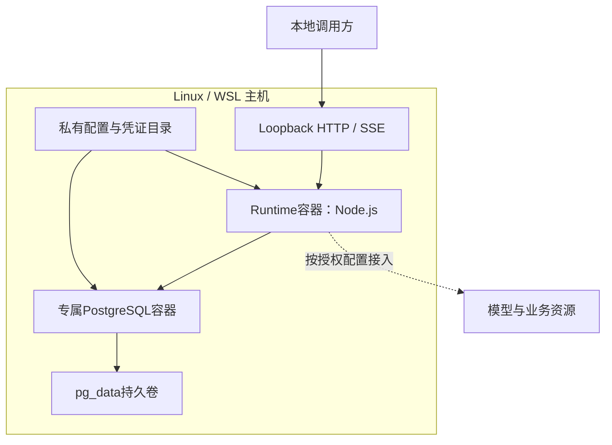

# 把 Harness 交付出去：部署生命周期、数据库恢复与版本证据

## 01｜代码能运行以后，交付还包含什么？

> 开发机器上的条款查询已经通过测试。现在需要让另一位维护者启动同一套服务，并在升级后继续读取已有对话。

交付对象不只有源码。维护者还需要运行环境、依赖版本、数据库结构、配置入口和恢复方法。

一个 Agent Harness（智能体执行控制系统）的实际行为由多种身份共同决定：模型、工具、业务数据、权限、程序版本和运行状态。仅记录一个 Git commit，无法说明完整部署采用了什么配置。

```text
源码提交与依赖锁
  → 镜像构建输入
  → 镜像内容身份
  → 实例配置与授权
  → 数据库结构和持久数据
  → 模型、工具与业务资源
  → 运行结果和验证证据
```

每一层都需要与前后层建立可核对关系。发生问题时，才能确定应该回滚代码、恢复数据、修正配置，还是重新验证外部服务。

## 02｜一个本地 Runtime 部署长什么样？

当前工程提供本地 Docker 部署：一个 Node.js Runtime 容器，一个专属 PostgreSQL 容器，以及独立配置目录和数据库卷。Runtime 内包含 HTTP、Worker、SDK Runner 和工具注册。



Loopback（本机回环地址）限制服务只在本机监听。当前 Runtime 要求回环监听，Compose 因此使用 Linux host network（共享宿主网络），数据库端口则绑定到宿主回环地址。[^ops]

Host network 与普通容器端口映射不同。该模式共享宿主网络命名空间，不再依靠 Runtime 的 `ports` 映射隔离流量。防护重点包括实际监听地址、主机访问规则和受控配置。[^docker]

历史生命周期验证在 Linux/WSL 环境进行。其他平台即使支持类似网络模式，也需要验证实际路径、文件权限和启动行为，不能仅凭同一份 YAML 推断完全一致。

## 03｜怎样把镜像绑定到准确的源码？

Git commit 标识提交，Git tree 标识该提交的文件树。Working Tree（工作树）还可能包含未提交修改。相同 HEAD 不代表两个工作目录拥有相同字节。

一种清晰的构建方法是使用 `git archive` 导出指定提交：

```bash
set -euo pipefail

releaseCommit="$(git rev-parse --verify HEAD)"
shortCommit="$(git rev-parse --short=12 "$releaseCommit")"
buildDirectory="$(mktemp -d)"
git archive "$releaseCommit" | tar -x -C "$buildDirectory"
image="insurance-agent-runtime:$shortCommit"

docker build \
  --build-arg SOURCE_COMMIT="$releaseCommit" \
  --tag "$image" \
  "$buildDirectory"
```

这个命令构建已提交的内容。工作树中的临时修改不会自动进入归档。需要发布修改时，应先完成对应提交与验证。

Dockerfile 将 `SOURCE_COMMIT` 写入镜像 revision label（修订标签）。构建后还应读回实际镜像身份：

```bash
docker image inspect "$image" \
  --format '{{.Id}} {{index .Config.Labels "org.opencontainers.image.revision"}}'
```

镜像 Tag（标签）是可移动的名称。Image ID（本地镜像内容身份）与 Registry Digest（镜像仓库内容摘要）用于识别具体产物。把提交号写入标签名字，并不能阻止标签以后指向其他镜像。

当前运维 helper 使用已验证的镜像名称，并核对最终 Compose 中实际采用的 image。发布记录应另外保存构建结果与读回身份。

## 04｜Dockerfile 怎样固定运行环境和依赖？

本工程 Dockerfile 固定 Node 基础镜像的标签与摘要，并在构建时检查 Node 和 pnpm 版本。项目依赖通过 frozen lockfile（冻结依赖锁）安装。[^image]

关键步骤如下：

```dockerfile
# 摘编，NODE_IMAGE 在原文件中绑定具体标签与sha256摘要。
FROM ${NODE_IMAGE} AS build
WORKDIR /opt/insurance
RUN npm install --global pnpm@12.8.1 --ignore-scripts --no-audit --no-fund \
 && test "$(node --version)" = "v24.18.1" \
 && test "$(pnpm --version)" = "12.8.1"
COPY package.json pnpm-lock.yaml pnpm-workspace.yaml ./
# 原文件随后复制各workspace的package.json。
RUN pnpm install --frozen-lockfile --child-concurrency=1 --network-concurrency=4
```

依赖安装完成后，构建阶段复制应用、契约和运维入口，再构建并核对产品静态资源。运行阶段复制允许的产物，使用非 root 用户启动 Node。

```dockerfile
FROM ${NODE_IMAGE} AS runtime
ARG SOURCE_COMMIT=unknown
LABEL org.opencontainers.image.revision="${SOURCE_COMMIT}"
WORKDIR /opt/insurance
COPY --from=build --chown=node:node /opt/insurance /opt/insurance
USER node
ENV NODE_ENV=production
CMD ["node", "tools/ops/start-runtime.mjs"]
```

这是多阶段构建的实际结构摘编。当前运行镜像保留完整锁定依赖树，不能仅因存在 runtime 阶段就宣称已裁剪所有开发依赖。

构建检查也有自己的范围。静态资源构建成功不代表真实模型调用已通过；依赖安装成功也不代表数据库迁移和旧会话恢复已验证。每种证据需要分别记录。

## 05｜为什么构建上下文需要明确范围？

Build Context（构建上下文）是构建器可以访问的文件集合。直接将整个开发目录传给 Docker，可能把私有配置、日志、备份或缓存一起纳入构建输入。[^context]

工程的构建说明采用允许列表，限定应用、契约、依赖清单和运维代码。`.git`、本地私有目录、token、key 和 dump 不属于运行镜像需要的源码。

```text
允许进入构建
  package.json / lockfile / workspace定义
  apps/ 与 packages/ 中的产品代码
  tools/ops/ 的启动和运维入口

独立保存
  私有凭证与授权回执
  本地数据库配置
  业务导出、备份与执行日志
```

`git archive` 能固定已提交内容，但如果秘密已经被提交，它仍然会进入归档。源码审查、私有文件隔离和构建上下文检查需要同时存在。

还应检查 Dockerfile 的 COPY 范围。一个宽泛 COPY 即使目前没有复制秘密，未来新增目录时也可能改变镜像内容。允许列表使这种变化更容易被识别。

## 06｜实例 Manifest 与私有配置是什么？

Manifest（实例清单）描述一套本地部署的身份。它记录 Compose project、数据库名称、当前活动数据库、镜像、端口、目录和运行用户。

```json
{
  "schemaVersion": "insurance-local-ops/1",
  "project": "insurance-d-m19-0123456789ab",
  "database": "insurance_d_m19_0123456789ab",
  "activeDatabase": "insurance_d_m19_0123456789ab",
  "httpPort": 18497,
  "dbPort": 55479,
  "image": "insurance-agent-runtime:example",
  "uid": 1000,
  "gid": 1000,
  "mode": "synthetic"
}
```

这是字段摘录，ID 与镜像名为合成值。实际 Manifest 还包含目录、私有目录、主体与时间等字段。

`configure()` 为新实例生成随机身份、数据库密码、测试令牌和游标签名密钥。目录权限为0700，配置文件为0600。实例目录必须尚不存在，以免覆盖已有配置。[^helper]

Runtime 接收的是配置路径。PostgreSQL 使用密码文件，真实秘密不应进入镜像构建参数、URL、命令行输出或公开文档。

`database` 保存初始数据库身份。`activeDatabase` 保存当前实际使用的数据库。恢复到新库后，两者可能不同，后续备份必须使用活动库。

## 07｜环境变量怎样避免覆盖实例身份？

Compose 会处理环境变量和配置插值。若运维命令直接继承任意 `COMPOSE_*` 或实例变量，操作者环境可能改变目标项目、镜像或挂载目录。

当前 helper 以已验证 Manifest 为权威来源。它清理外部的 `INSURANCE_OPS_*` 和 `COMPOSE_*` 变量，再注入由 Manifest 派生的环境。Compose 命令显式指定 project、文件、目录和空 env file。

```ts
// tools/ops/local.mjs：环境构造的核心形状。
const inherited = Object.fromEntries(
  Object.entries(process.env).filter(([name]) =>
    !name.startsWith("INSURANCE_OPS_") &&
    !name.startsWith("COMPOSE_") &&
    name !== "NODE_EXTRA_CA_CERTS" &&
    name !== "INSURANCE_RUNTIME_CA_REFERENCE"
  )
);
return {
  ...inherited,
  ...manifestVariables(manifest),
  COMPOSE_DISABLE_ENV_FILE: "1",
};
```

随后执行 `docker compose config --format json`，检查渲染后的服务、镜像、用户、挂载、网络与资源限制。渲染结果偏离 Manifest 时，效果命令被拒绝。

这使 `ops.env` 成为非秘密元数据记录，而不是可以随意覆盖目标实例的最终权威。维护者应使用当前受控管理入口修改实例配置，不能沿用旧说明只改一份环境文件。

`readManifest(directory)` 还先检查 Manifest 中的 directory 等于调用方选择的目录。把另一个实例的完整 Manifest 复制过来，不应静默让 stop 或 down 操作转向另一套服务。

<details>
<summary><strong>展开：实例身份为什么需要在产生效果前再次检查？</strong></summary>

读取配置后，环境或文件仍可能变化。helper 在执行普通命令和流式备份恢复前，都使用同一派生环境渲染并核对 Compose。

这不是为了多生成一份说明，而是为了让“将要操作的实例”与“调用方选择的实例”保持一致。

</details>

## 08｜怎样从干净源码启动一套隔离实例？

先准备已获授权的 Linux/WSL Docker 环境与非 root 账户。运维 helper 不负责启动或重配 Docker daemon（后台服务）。

构建前节所述镜像后，在新的独立目录初始化实例：

```bash
set -euo pipefail
: "${image:?请先构建并核对Runtime镜像}"
: "${HTTP_PORT:?请选择空闲的本地HTTP端口}"
: "${DB_PORT:?请选择空闲的本地数据库端口}"

stateParent="$HOME/harness-local"
mkdir -p "$stateParent"
instanceId="$(node -e 'process.stdout.write(require("node:crypto").randomBytes(6).toString("hex"))')"
opsDirectory="$stateParent/instance-$instanceId"

node tools/ops/local.mjs init \
  --directory "$opsDirectory" \
  --image "$image" \
  --http-port "$HTTP_PORT" \
  --db-port "$DB_PORT"

node tools/ops/local.mjs up --directory "$opsDirectory"
```

命令使用实际项目入口。`HTTP_PORT` 与 `DB_PORT` 需要选择未被其他服务占用的合法值。新实例目录由 helper 创建，不能提前创建成一个已有实例。

默认初始化生成 synthetic（合成）运行配置。它适合验证本地控制面、队列、SDK 和持久结果。真实模型与真实业务资源需要各自的授权配置和核验。

本例只说明操作步骤。实际执行会创建容器、数据库和私有文件，应在指定的隔离环境进行。

## 09｜Readiness 与能力目录分别证明什么？

Readiness（就绪状态）表示服务满足一组已定义条件。例如数据库可连接、队列可使用。它不自动证明所有真实业务接口已完成核验。

```bash
curl --fail-with-body --silent --show-error \
  "http://127.0.0.1:$HTTP_PORT/health/ready"
```

读取工具目录还需要当前授权。目录可以展示能力、数据模式和 ready/pending 状态。它说明当前开放的动作空间，不等于这些动作已经在本次启动后执行。

完整启动核对应包括三个层次：

| 层次 | 核对对象 |
| --- | --- |
| 基础就绪 | HTTP、数据库、队列与配置 |
| 能力状态 | 工具描述、模型配置、支持的恢复模式 |
| 实际运行 | 提交一个受控任务并读回最终内容与事件 |

默认合成模型可能直接返回固定文本，工具数为0。它验证基本生命周期。要验证工具循环，使用第十二篇的受控 TestRig 或已授权模型。

真实资源状态还应绑定验证时间与版本。一次健康检查通过，不能无限期替代外部接口读回。

## 10｜运行数据到底保存在哪里？

部署需要区分临时状态与持久状态。

```text
Runtime 内存
  当前Promise、取消信号、客户端对象、执行缓存

PostgreSQL volume
  Thread / Turn / Run
  ModelStep / ToolInvocation / Canonical Item
  Event / Checkpoint / Job / SourceReference

私有配置目录
  数据库连接引用、令牌、游标签名密钥、授权配置

外部系统
  模型服务、原始文档、检索索引和业务数据库
```

删除 Runtime 容器并不等于删除 PostgreSQL volume。相反，如果卷被移除，即使镜像还存在，也无法恢复原来的运行记录。

本项目的 `down` 停止并移除当前实例容器与网络，保留数据库卷。`stop` 只停止 Runtime，便于数据库继续运行以备份或恢复。实际数据清理属于单独的授权操作。

Session（模型历史视图）的 clear 操作也不等于删除持久历史。它改变当前引用视图，而原始内容、工具结果与审计事实仍在数据库中。

这些区别应写进维护流程。否则，维护者可能用重启容器处理数据问题，或者在需要保留历史时误删卷。

## 11｜为什么停机顺序是执行器在前、存储在后？

Graceful Shutdown（有序关闭）让系统停止接收新工作，并尽量提交当前运行的结束状态。

`composeRuntime()` 的释放函数先停止 Worker，再停止维护任务，最后关闭 Storage。HTTP/SSE 也清理自己的观察连接。[^runtime]

```text
停止新接入与观察
  → 通知当前Run停止
  → 等待Worker和监督任务收尾
  → 停止维护任务
  → 关闭数据库连接
```

Worker 需要在数据库仍然可用时保存 cancelled 或 interrupted。若先关闭存储，再让执行器写终态，就会主动制造未确认结果。

取消是协作式的。外部服务可能已经执行某个动作，但本地尚未收到返回。正常停机流程应按持久事实收尾，而不是假定所有远端请求都已撤销。

异常进程退出则可能完全没有执行 finally。重启后的租约监督负责识别失去执行者的 Run。已提交结果保留，未完成动作按实际状态进入恢复判断。

## 12｜数据库迁移怎样验证历史语义？

Migration（数据库迁移）改变结构或存储规则。SQL 执行成功只是第一项检查。Harness 还需要确认旧引用、状态与恢复数据仍可解释。

项目使用 Drizzle 迁移 SQL 和 journal（迁移记录）。迁移命令使用数据库锁管理执行，已经应用的迁移不应在重复启动时再次创建同样结构。

已有生命周期记录曾验证迁移数量从4变为5，再次执行仍为5。验证还读取原 Thread、工具结果、最终内容和来源身份，确认它们在对应版本中保持一致。该结果属于历史执行，不是本轮新运行。[^history]

```text
迁移前：Turn U1 → finalContentRef A1 → 已提交答案
迁移后：Turn U1 → 同一A1 → 同一答案与来源关系
```

升级检查应覆盖当前业务关心的语义：已完成 Turn 的最终引用有效，工具结果能读取，来源版本没有被静默替换，活动运行和检查点有明确处理规则。

应用镜像与数据库结构也需要兼容。如果旧程序无法读取新字段或状态，简单切换镜像可能无法完成回滚。

## 13｜一份数据库备份包含什么？

Backup（备份）保存可恢复的数据副本。当前 helper 使用 PostgreSQL 的 custom 格式 dump，后续由 pg_restore 恢复。[^postgres]

数据库备份可以包含运行历史、事件、检查点、队列任务与持久来源目录。它不自动包含外部模型状态、对象存储原文、操作系统文件凭证或 PostgreSQL 集群角色。

因此，完整恢复需要分别管理：

| 对象 | 需要保留什么 |
| --- | --- |
| 数据库 | 备份内容、摘要、创建时间、版本 |
| 镜像 | 已核对的内容身份与源码关系 |
| 私有配置 | 主体映射、模型与工具配置、密钥引用 |
| 外部资料 | 文档版本、索引和实际资源可用性 |
| 权限环境 | 数据库角色、当前业务授权与访问范围 |

源码的 helper 额外要求 Runtime 已停止，并拒绝覆盖已有 dump 文件。它输出文件路径、诊断字节数和 SHA-256 摘要，原始数据库内容留在私有文件中。

这比 PostgreSQL 工具自身的在线一致性快照要求更严格，是本地产品的运维策略。不要将“helper 要求停机”解释为 pg_dump 本身只能备份停机数据库。

旧备份可能包含后来删除或归档的数据。恢复前需要确认数据保留范围和授权，避免让历史备份重新暴露不应开放的资料。

## 14｜怎样在新数据库验证恢复？

恢复操作先创建独立新库，再导入备份。这样可以在原库保持不变的情况下核对结果。

```bash
node tools/ops/local.mjs stop --directory "$opsDirectory"

node tools/ops/local.mjs backup \
  --directory "$opsDirectory" \
  --file "$opsDirectory/snapshot.dump"

restoreDatabase="insurance_d_m19_restore_$(node -e \
  'process.stdout.write(require("node:crypto").randomBytes(6).toString("hex"))')"

node tools/ops/local.mjs restore \
  --directory "$opsDirectory" \
  --file "$opsDirectory/snapshot.dump" \
  --database "$restoreDatabase"
```

这是现有 helper 的命令形状。恢复库名称受到固定前缀与随机身份格式限制。已存在的目标库会使创建失败，helper 不会自动清空原库。

导入失败也不会自动激活新库。部分恢复结果和诊断保留在受控位置，便于分析。

恢复后需要只读核对重要身份：

```sql
SELECT id, thread_id, status, final_content_ref
FROM runtime.turns ORDER BY thread_id, ordinal;

SELECT id, run_id, model_step_id, status, result_item_ref
FROM runtime.tool_invocations ORDER BY started_at, id;

SELECT thread_id, min(seq), max(seq), count(*)
FROM runtime.events GROUP BY thread_id;
```

这些查询面向授权恢复环境。正式验证还应使用公开 API 核对主体隔离、最终内容与来源，而不是只比较数据库行数。

新库通过检查后，才进入活动库切换：

```bash
node tools/ops/local.mjs activate \
  --directory "$opsDirectory" \
  --database "$restoreDatabase"
node tools/ops/local.mjs up --directory "$opsDirectory"
```

启动后再次读回。数据库导入成功与产品在新库上正常工作，是两个完成条件。

## 15｜活动数据库切换为什么不只是改一个字符串？

同一实例可能有容器内数据库配置、宿主维护配置和 Manifest。它们都需要指向相同活动数据库。

`activateDatabase()` 要求 Runtime 已停止，并先确认目标库可以连接。随后分别更新两份数据库配置和 Manifest 的 activeDatabase。

```text
database.json          → 新数据库
 database-host.json    → 新数据库
manifest.activeDatabase→ 新数据库
```

每个文件通过同目录 `.next` 文件和 rename（重命名替换）更新。单个文件替换可以有清晰边界，但多个文件整体并不是一个数据库事务。

若进程在两次替换之间中断，配置可能暂时不一致。`readManifest()` 会核对各文件与 activeDatabase，发现不一致时拒绝继续产生效果。

恢复这类状态时，应保持 Runtime 停止，依据已保留的配置和实际目标库恢复一致关系。不能通过跳过校验强行启动。

后续备份使用 activeDatabase，而不是始终备份最初创建的 database。否则切换后新增的运行记录可能完全没有进入备份。

## 16｜镜像回滚、数据库恢复和 Run Resume 有什么区别？

Rollback（镜像回滚）切换应用程序版本。数据库恢复切换持久数据状态。Run Resume（运行恢复）则使用某个检查点创建新的执行尝试。

三种操作各有前提：

| 操作 | 必须核对 |
| --- | --- |
| 镜像回滚 | 旧程序是否能读当前Schema与配置 |
| 数据库恢复 | 备份完整性、主体与外部资源版本 |
| Run Resume | 检查点、SDK、模型、工具与当前授权 |

一个服务能启动，不代表它能继续所有旧检查点。SDK 序列化版本或工具 Schema 改变后，恢复接口仍可能按规则拒绝。

历史运维验证曾在明确兼容的两份镜像之间切换，并确认内容与来源读取保持一致。这个证据只覆盖当时的组合，不能扩展为未来任意版本都支持降级。

升级前应明确回退策略。如果数据库迁移不兼容旧程序，回滚可能需要对应的旧镜像、配置与升级前数据备份，而不是只改一个镜像标签。

## 17｜怎样验证实例隔离和资源限制？

当前 helper 对最终 Compose 配置核对多项边界：Runtime 非 root、根文件系统只读、私有目录只读挂载、移除 Linux capabilities（进程特权能力），并启用 no-new-privileges（禁止获得新的进程特权）。

它还检查 CPU、内存与进程数量限制。具体值来自实例模板和源码校验，部署后应通过真实容器配置读回。

```text
配置声明
  → docker compose config 渲染
  → helper逐项核对
  → 容器实际启动
  → image / user / mounts / network / limits读回
```

配置测试可以在不启动容器时验证环境覆盖和挂载偏差。真实生命周期测试再检查实际容器采用了相同条件。

共享宿主网络仍意味着网络隔离有限。非 root 和只读文件系统也不是对所有外部行为的完整沙箱。模型与业务资源继续由工具权限、受控客户端和部署出口策略约束。

<details>
<summary><strong>展开：隔离测试为什么要观察无关服务？</strong></summary>

本地机器可能同时运行其他数据库、开发服务和协作工具。一个运维测试应该只操作自己创建的 Compose project。

工程生命周期记录会比较相关共享服务的身份和启动状态，确认测试前后未被改变。独立端口、随机项目名和目录身份校验共同降低误操作风险。

</details>

## 18｜发布记录怎样连接源码、测试、镜像和数据？

Release Evidence（发布证据）不是把所有日志放在一个目录就完成。它需要明确每项结果绑定哪个产物。

| 证据 | 需要绑定的身份 |
| --- | --- |
| 源码检查 | commit、tree、工作树修改 |
| 自动测试 | 代码版本、依赖锁、实际执行与跳过项 |
| 镜像构建 | 构建来源、镜像ID或仓库digest |
| 容器核验 | 实际镜像、用户、挂载、网络与资源 |
| 数据迁移 | 迁移记录、旧数据读回、重复执行 |
| 备份恢复 | dump摘要、目标库、恢复后API核对 |
| 真实业务能力 | 当前授权、接口、数据版本和验证时间 |

如果测试在旧 commit 上完成，之后只修改文档，可以保留原测试身份并说明变更范围。不能把旧数字改成当前 HEAD 的“新执行结果”。

### 用稳定事实比较恢复前后结果

下面的 Python 示例从两份合成导出中提取稳定字段。它忽略导出时间，但比较内容、最终引用和工具结果身份。

```python
from copy import deepcopy


def stable_facts(exported):
    return {
        "threadId": exported["thread"]["threadId"],
        "turns": sorted((x["turnId"], x["status"], x["finalContentRef"])
                        for x in exported["turns"]),
        "items": sorted((x["itemId"], x["status"], x["text"])
                        for x in exported["items"]),
        "tools": sorted((x["invocationId"], x["status"], x["resultItemRef"])
                        for x in exported["toolInvocations"]),
    }


before = {
    "thread": {"threadId": "T1"},
    "turns": [{"turnId": "U1", "status": "completed", "finalContentRef": "A1"}],
    "items": [{"itemId": "A1", "status": "committed", "text": "合成答案"}],
    "toolInvocations": [{"invocationId": "V1", "status": "succeeded", "resultItemRef": "E1"}],
    "exportedAt": "2026-10-01T00:00:00Z",
}
after = deepcopy(before)
after["exportedAt"] = "2026-10-02T00:00:00Z"
assert stable_facts(before) == stable_facts(after)
broken = deepcopy(after)
broken["turns"][0]["finalContentRef"] = "A2"
assert stable_facts(before) != stable_facts(broken)
print("导出时间可以变化，稳定内容与引用必须保持一致")
```

这只是恢复核对的一部分。完整产品还要核对来源、授权、Run用量、检查点和事件。选择比较字段时，应明确哪些信息允许变化，哪些身份必须保持。

## 19｜怎样运行运维测试并判断交付完成？

配置测试检查 Manifest、目录、环境和 Compose 渲染，可先运行：

```bash
corepack pnpm typecheck
corepack pnpm exec vitest run tests/ops/config.test.ts
corepack pnpm check:contracts
corepack pnpm check:control
```

真实生命周期脚本使用新初始化、尚未迁移或运行的专属实例：

```bash
node tests/ops/lifecycle.ts "$opsDirectory"
```

这不是只读检查。脚本会操作指定实例的数据库和容器，执行迁移、任务、备份、恢复与重启。它应只在已授权的独立环境运行，不能指向已有生产实例。

历史记录证明了某些具体版本下的迁移、恢复、最终内容、来源读取和留卷重启。每份记录保留自己的执行版本与范围。当前文章没有把这些历史结果变成本轮新的部署验证。

维护者最终应该能够回答：当前实例是什么版本，哪些能力真实可用，数据保存在何处，怎样停止和备份，升级失败后恢复哪一组代码与数据，以及在哪里找到对应验证。

把这些问题落到配置、源码与实际读回，Harness 才能从开发程序进入可维护服务。最后一篇将所有模块重新放入一条具体请求：[从条款查询到持久事件的端到端实践](14-end-to-end-harness.md)。

## 实现依据

[^ops]: Insurance Agent Runtime 源码快照 `c66112dfd8676b47b143dc2e26739278cf4b0dde` 中的 `docs/implementation/local-ops-preparation.md`。不同历史验证条目保留各自的构建和执行版本。
[^image]: 同一快照根目录 `Dockerfile` 与 `package.json`。Node、pnpm和依赖版本描述该源码的构建选择，不作为所有项目的通用推荐版本。
[^helper]: 同一快照 `tools/ops/local.mjs` 中的 `configure`、`readManifest`、`composeEnvironment`、`inspectCompose`、`backup`、`restore` 和 `activateDatabase`。文中命令来自已读取的运维说明。
[^runtime]: 同一快照 `apps/runtime/src/composition/runtime.ts`、`runner/worker.ts`、`transport/http/sse.ts`，分别管理组件、运行与观察连接生命周期。
[^history]: `local-ops-preparation.md` 的历史镜像生命周期及2026-10-07读回说明。迁移4→5→5、新库恢复和留卷重启只支持对应记录的环境与版本。
[^docker]: [Docker：Host network driver](https://docs.docker.com/engine/network/drivers/host/)，说明共享宿主网络与端口映射的关系。
[^context]: [Docker：Build context](https://docs.docker.com/build/concepts/context/)，说明构建器可访问文件范围与dockerignore。
[^postgres]: [PostgreSQL 16：pg_dump](https://www.postgresql.org/docs/16/app-pgdump.html) 与 [pg_restore](https://www.postgresql.org/docs/16/app-pgrestore.html)。数据库工具能力与本项目额外的停止、实例及权限检查分别说明。
