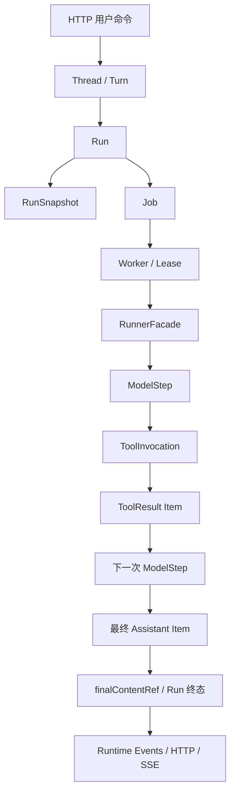
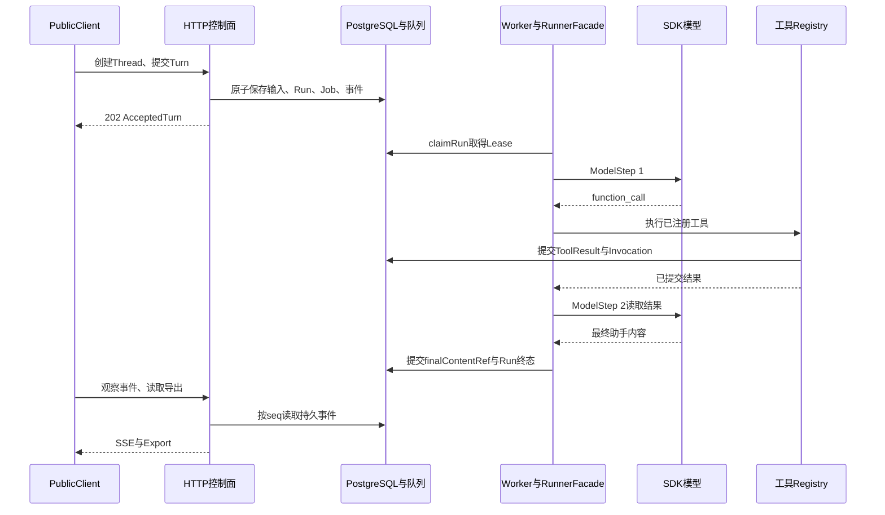
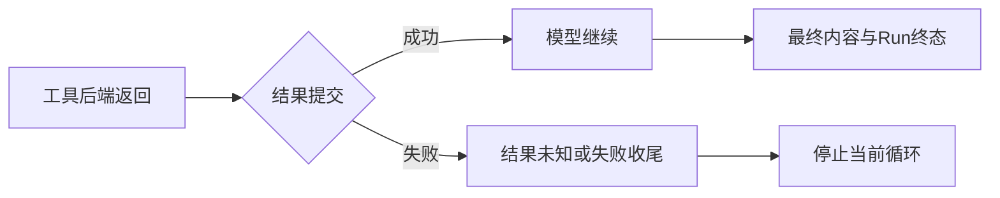
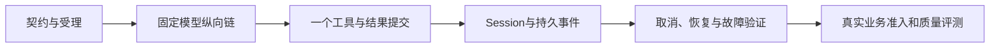

# 一条请求穿过整个 Harness：从条款查询到持久事件

## 01｜先为一条具体任务定义可核验的结果

> 请核对示例保障甲的等待期，并说明意外情形是否适用同样条件。请提供原文依据。

用户希望得到结论与来源。开发者还需要解释，这些来源经过什么调用取得，模型何时使用它们，结果是否已经保存，以及外部怎样知道任务结束。

Harness（智能体执行控制系统）把这些问题连接成一条可观察的执行链。它接收输入，建立任务身份，运行模型与工具，保存结果，再输出状态和事件。

先把这个任务拆成两组验收条件。

| 观察面 | 需要核对的结果 |
| --- | --- |
| 业务内容 | 等待期定义、意外情形条件、原文出处 |
| 请求受理 | 一次命令得到稳定的 Thread、Turn 和 Run 身份 |
| 模型输入 | 后续模型请求能读到先前已提交的工具结果 |
| 工具执行 | 参数合法，权限有效，结果与调用身份一致 |
| 最终内容 | 回合引用一份已提交的助手内容 |
| 外部事件 | 事件顺序与执行事实对应，终态与查询结果一致 |

Thread（对话线程）保存持续会话。Turn（用户回合）保存一次正式输入。Run（执行尝试）记录处理这个回合的一次运行。

业务结论与工程机制分别验证。一个合成测试可以证明工具结果确实进入第二次模型请求，却不能证明真实保险条款的解释正确。完整产品验收需要把两类证据连接起来。

## 02｜先确认实验真正替换了哪些依赖

这个工程可以使用固定合成模型、脚本化模型或真实模型。业务工具也可以使用合成、录制或真实后端。模型模式与业务数据模式是两条独立维度。

**固定合成模型**返回预先定义的文本，适合检查请求受理、Worker、模型步骤、内容提交和事件输出。它没有提出工具调用时，工具数量为零就是正常结果。

**Scripted Model（脚本化模型替身）**按剧本返回调用意图，并检查后续请求是否带回结果。它保留真实 SDK（软件开发工具包）循环，却让动作选择可重复。

**真实模型**通过实际提供方接口产生输出。它可以使用合成工具评估动作选择，也可以在授权环境中访问真实业务。

| 模型 | 业务后端 | 主要验证范围 |
| --- | --- | --- |
| 固定合成模型 | 已装配工具目录 | 基础服务生命周期 |
| 脚本化模型 | 合成工具 | 调用、权限、状态、恢复与事件协议 |
| 真实模型 | 合成工具 | 模型实际选择哪些动作 |
| 真实模型 | 已准入真实后端 | 当前接口行为与实际证据获取 |

本篇用项目已有的 TestRig（测试装配环境）走通完整主链。它真实运行 HTTP、PostgreSQL、持久队列、SDK、工具注册和事件输出。替换位置是模型接口与业务数据，既有产品代码仍然被执行。[^rig]

因此，演示中不会预设一个真实等待期数值。合成资料只用来证明证据的传递和引用。正式条款解释留给使用授权资料的独立评测。

## 03｜一条 Run 里有哪些对象和模块？

执行开始前，先看数据身份。每一个对象都对应可以查到的记录。

| 对象 | 实际作用 | 主要关联 |
| --- | --- | --- |
| Thread | 持续对话 | 主体、回合、事件序号 |
| Turn | 一次正式输入 | `userInputRef`、`currentRunId`、`finalContentRef` |
| Run | 一次执行尝试 | 快照、Job、模型与工具记录 |
| RunSnapshot | 运行配置快照 | 模型、工具集合、版本与预算 |
| Job | 持久队列任务 | 携带待领取的 Run ID |
| Lease | 执行租约 | 当前持有者、代次与有效期 |
| ModelStep | 一次模型调用尝试 | 输入边界、输出条目和用量 |
| ToolInvocation | 一次工具执行 | 调用 ID、参数和结果引用 |
| Runtime Item | 权威内容条目 | 用户、助手、工具意图与结果 |
| Runtime Event | 已提交的运行变化 | Thread 序号、类型和负载 |



RunnerFacade（运行门面）将单次 Run 接到 SDK。它提供模型、工具、会话、预算与取消能力。Worker（后台执行器）负责领取任务，数据库负责确认谁仍有写入资格。

图中的箭头表示主要执行关系，事件不只在最后生成。受理、模型完成和工具提交都会在各自的事务中记录事件。最后才出现 Run 的终态事件。

<details>
<summary><strong>展开：一次单工具执行的合成身份表</strong></summary>

```text
Thread T1
  Turn U1
    userInputRef = I1
    currentRunId = R1
    finalContentRef = A1

Run R1
  ModelStep S1 → function_call C1
  ToolInvocation V1
    modelStepId = S1
    providerCallId = C1.callId
    resultItemRef = E1
  ModelStep S2 → Assistant Item A1
```

这些是阅读用标识。实际测试生成唯一 ID，并检查引用是否指向同一份已提交事实。

</details>

## 04｜从启动入口建立可调用的服务

普通服务启动由 `composeRuntime()` 连接存储、HTTP 应用、Worker 与维护任务。TestRig 使用同一装配入口，并注入可控制的模型与合成业务 Port（接口契约）。

`createRig()` 的主要步骤如下：

```text
创建隔离 PostgreSQL 测试库
  → 创建临时目录和测试主体
  → 生成本地测试认证配置
  → 装配合成 BusinessPorts
  → 创建真实 ToolRegistry
  → 建立 Snapshot Resolver
  → composeRuntime：Storage、HTTP、Worker、RunnerFacade
  → 监听 127.0.0.1 的临时端口
  → 创建 PublicClient 与 SSE Observer
```

ToolRegistry（工具注册系统）管理能力定义、Profile（工具配置）和实际后端。Snapshot Resolver（快照解析器）根据服务端配置生成 RunSnapshot。测试不会让 HTTP 正文直接指定凭证或任意服务地址。

TestRig 中的模型配置使用脚本化模型。工具采用合成数据，工具集合包含六项能力。当前夹具将每次运行限制为最多八次模型调用、八次工具调用和两个并发工具。它将总执行时限设为十五秒。

这些值是**测试夹具配置**。普通 Runtime 的默认预算由运行门面解析，两者不必相同。区分配置来源，才能正确解释为何测试很快超时、正式实例却继续运行。[^rig]

PublicClient（公开接口客户端）通过真实 HTTP 创建 Thread、提交 Turn 和查询结果。SseObserver（事件流观察器）独立解析网络字节。私有数据库查询仅用于补充断言，不会给公开观察器补写缺失状态。

<details>
<summary><strong>展开：测试替身应放在哪里？</strong></summary>

```text
保持真实：
HTTP → 认证 → 控制面 → PostgreSQL / pg-boss
     → Worker → RunnerFacade → SDK → Registry
     → 结果提交 → Session → Events

替换依赖：
模型网络接口 → HarnessModel
业务数据接口 → ScriptedBusiness
```

如果直接替换 `RunnerFacade.execute()` 并返回 completed，就只能验证调用者怎样处理返回值。它没有经过模型、工具和存储之间的连接。

</details>

## 05｜用户输入怎样形成持久任务？

调用方先创建 Thread，再提交 Turn。请求正文采用实际 `SubmitTurn` 契约：

```http
POST /v1/threads/{threadId}/turns HTTP/1.1
Authorization: Bearer <LOCAL_TEST_TOKEN>
Idempotency-Key: example-command-001
Content-Type: application/json

{
  "input": {"text": "核对示例产品的等待期，并提供来源"},
  "agentProfileId": "synthetic-profile",
  "expectedThreadRevision": 0
}
```

`{threadId}` 与令牌需要使用测试环境的实际值。幂等键标识一次命令，资源版本说明客户端依据哪个 Thread 状态提交。

`submitTurn()` 在事务中检查主体、归属、幂等和线程状态，然后生成输入条目、Turn、Run、配置快照、事件与 Job（队列任务）。pg-boss 使用同一数据库事务，因此受理与任务交付记录共同提交。

响应的实际形状是：

```json
{
  "threadId": "SYN-T-01",
  "turnId": "SYN-U-01",
  "runId": "SYN-R-01",
  "threadRevision": 1,
  "eventsPath": "/v1/threads/SYN-T-01/events"
}
```

示例 ID 为合成值。`202 Accepted` 表示受理已经成立。模型可能尚未开始，调用方仍然可以用 `runId` 查询和控制执行。

重复发送同一键、同一正文，应返回原回执。这里复用的是任务身份，而非再次调用模型产生一份相似答案。后面的完整测试会直接比较两次响应。

## 06｜Worker 取得什么资格才能执行？

队列交付的消息包含 `runId`。Worker 还需要调用 `claimRun()`，检查当前 Run 是否可执行，并取得 Lease（有期限的执行资格）。

Lease 包含 Owner（执行者身份）、Fence（资格代次）和失效时间。它让每次后续写入能够确认“现在是不是这个 Worker 可以提交”。

```text
Job 可读取
  → 当前 Run 可领取
  → 当前授权仍允许执行
  → 写入 Lease
  → Run 进入 running
  → 提交 run.started 事件
  → 返回 ClaimedRun
```

ClaimedRun（已领取的运行对象）包含运行、当前主体、快照和租约。RunnerFacade 从这份对象开始装配，而不是使用未经核验的队列参数。

写入 ModelStep、ToolInvocation 和 Run 终态时，存储仍会检查租约。Worker 长时间失联后，旧执行器即使重新出现，也不能以过期资格覆盖新的状态。[^runtime]

TestRig 可以暂停 Worker，再创建任务。这样测试能够确定 Run 仍在 queued 边界，然后开始执行或触发取消。它比依赖机器速度猜测“此时大概还没开始”更稳定。

## 07｜第一次模型请求包含哪些数据？

RunnerFacade 建立 RunEnvironment（本地运行环境），其中有当前主体、存储、信号、预算、租约和配置。它再构造 Agent、Model、Tools 与 Session。

Session（会话历史接口）提供已提交的输入与历史。ModelRequest（模型请求对象）则是本次真正进入模型边界的数据，包含消息、工具定义、指令和设置。

```text
本地 RunEnvironment
  ├── Storage / Lease / Principal / AbortSignal
  └── 用于执行和授权

模型可见 ModelRequest
  ├── systemInstructions
  ├── input：用户输入与允许的历史
  ├── tools：本次工具定义
  └── modelSettings：输出预算等参数
```

Principal（认证主体）管理机构、用户和权限。模型不会因为本地环境持有连接池，就自动获得数据库操作权。模型只能选择本次提供的工具，服务端再执行授权检查。[^sdk]

工程的 `requestContract()` 是一个 Oracle（测试判定器）。它检查 TestRig 发给模型的指令、`maxTokens=512`、`store=false`、六个唯一工具名称及零个 Handoff（向其他 Agent 转交执行）。[^oracles]

`RecordedModel`（模型调用记录器）在请求发送前创建 ModelStep。完成后保存规范化响应。这里记录的是模型边界尝试；真实网络调用数与账单用量仍需结合实际传输记录核对。

## 08｜ToolCall 怎样成为一个真实工具动作？

模型返回 ToolCall（工具调用意图），例如搜索指定产品。SDK 规范化形状如下：

```json
{
  "type": "function_call",
  "callId": "article14-search",
  "name": "search_documents",
  "arguments": "{\"content\":\"查找合成条款\",\"query\":\"等待期\",\"companyIds\":null,\"productIds\":[\"SYN-PRODUCT-1\"],\"topK\":1}"
}
```

参数中的产品 ID 来自已知合成数据集。`arguments` 是 JSON 字符串。`content` 是模型公开的动作说明，实际业务参数是查询和筛选条件。

模型响应完成时，`RecordedModel` 将 callId 关联到 ModelStep 和调用条目。`createRunTools()` 再核对 Run、工具名、版本、权限和预算，创建 ToolInvocation（工具执行实例）。

```text
ModelStep S1 completed
  output：ToolCall C1
    ↓
ToolInvocation V1 started
  modelStepId = S1
  providerCallId = C1.callId
```

S1 的完成时刻早于 V1 开始。模型完成本次响应，并不代表用户任务结束。工具随后返回，SDK 才能继续请求模型。

如果一次模型响应包含两个工具意图，就会产生两个 Invocation。它们共享父模型步骤，各自保存结果和状态。

## 09｜后端返回之后，结果怎样被提交？

ToolRegistry 根据绑定调用业务 Port。合成检索器返回 Evidence（证据条目），其中包含片段、产品、文档、页码和来源引用。

```text
业务函数返回 JSON
  → 输出 Schema 校验
  → provenance 与后端身份校验
  → 结果体积和来源引用校验
  → SDK 生成规范化工具结果条目
  → finishInvocation 保存结果与终态
  → SDK 继续
```

Schema（结构约束）确认字段类型。Provenance（数据来源记录）说明数据模式、后端和版本。结构合法以后，仍需完成持久化。

项目在 `customDataExtractor`（SDK 结果条目回调）中等待 `finishInvocation()`。它保存 SDK 实际将要使用的 `rawItem`，而不仅是上游原始 JSON。

```ts
// runner/tools.ts：保留关键提交顺序的源码摘编。
const call = pending.get(toolCall.callId);
if (!call) throw new RunBoundaryError("TOOL_RESULT_IDENTITY_MISMATCH");
const itemId = randomUUID();
const resultItem = {
  ...runtimeItem(rawItem, itemId, call.stepId),
  sourceRefs: [...call.sourceRefs],
};
await storage.finishInvocation(lease, call.invocationId, {
  status: "succeeded",
  resultItem,
  sourceRefs: call.sourceRefs,
  checkpoint: true,
});
recordFact(facts, rawItem, itemId);
pending.delete(toolCall.callId);
```

`pending` 保存尚待提交的结果。`rawItem` 是 SDK 的规范化条目。`checkpoint=true` 请求保存适用的工具结果检查点。实际存储方法在同一事务里提交相应事实。[^runtime]

因此，**结果提交成功先于后续模型消费该结果**。这是一项可以通过故障注入验证的顺序，而不是日志上的口头描述。

<details>
<summary><strong>展开：工具执行成功与业务答案完整是两种状态</strong></summary>

Invocation 为 succeeded，表示合法结果已经执行并提交。ToolResult 为 partial，表示业务资料仍有缺口。二者可以同时成立。

模型下一次应看到这个 partial 状态，再决定补查。把部分业务结果直接当作调用异常，或把成功 Invocation 直接当作答案正确，都会混淆验证范围。

</details>

## 10｜第二次模型请求怎样证明自己读到了结果？

只查询数据库里的结果条目还不够。模型输入可能遗漏它，也可能在历史构造中错误引用另一份内容。

TestRig 的 `toolResult(request, callId)` 从模型实际收到的 `request.input` 中查找 `function_call_result`，并按 callId 解析结果。找不到对应结果时，断言直接失败。

```ts
// 用于第二次模型请求的实际输入断言。
modelEntry("answer", [assistant("已收到合成证据。")], request => {
  requestContract(request);
  const evidence = toolResult(request, "article14-search");
  expect(evidence.status).toBe("ok");
  expect(JSON.stringify(evidence.data)).toContain("SYN-PRODUCT-1");
});
```

`modelEntry()` 定义一项模型脚本，`assistant()` 构造合法助手输出。这些辅助函数来自项目的测试库。它们不是 SDK 公开 API 的新名称。[^scripted]

输入断言与响应脚本同时存在，形成一条因果要求：第二次调用必须读取首次工具结果，才能接受预定的最终响应。

模型脚本还必须被准确消费。`assertConsumed()` 检查已执行请求数与声明数是否一致。意外多调用一次，或尚未执行第二步就结束，都会在测试中被识别。

最终 Session 视图说明当前保留了哪些历史。逐次 ModelRequest 才能证明第 N 次调用实际看到了什么。TestRig 保存不可变请求快照，能够分别核对这两个层次。

## 11｜最终回答怎样成为产品终态？

模型输出完成后，`RecordedModel` 提交助手 Runtime Item（权威运行条目）。RunnerFacade 等待整个 SDK 执行结束，取得该条目 ID，再检查取消与租约。

`finalContentRef`（最终内容引用）指向已经保存的助手条目。`finishRun()` 使用该引用提交 Turn 和 Run 的终态。

```text
ModelStep S2 completed
  → Assistant Item A1 committed
  → Turn.finalContentRef = A1
  → Run R1 completed
  → turn.completed / run.completed
```

读取最终内容时，可以沿 Turn 的引用找到相同条目。历史导出、事件和公开读取无需分别复制一份答案。

`finalReference()` 判定器检查每个已完成 Turn 都有最终引用，且引用指向 committed（已提交）的 assistant（助手）条目。它还检查同一 Thread 最多只有一个活动 Run。

取消和完成发生竞争时，存储按当前状态裁决。模型已经返回文本，并不使旧执行器永远具有提交成功的权利。

对于历史 Run 还要保留关联边界。当前 Turn 的 `finalContentRef` 描述当前回合接受的结果，不一定属于任意一个旧失败尝试。读取旧 Run 时，应同时检查 `currentRunId`。

## 12｜事件怎样通过 HTTP/SSE 到达外部？

Runtime Event（运行事件）记录已经提交的产品变化。它包含事件 ID、Thread、Turn、Run、时间、类型及负载。

```json
{
  "schemaVersion": "1.0",
  "eventId": "SYN-E-18",
  "threadId": "SYN-T-01",
  "seq": "18",
  "turnId": "SYN-U-01",
  "runId": "SYN-R-01",
  "occurredAt": "2026-10-01T00:00:00Z",
  "type": "run.completed",
  "payload": {
    "runId": "SYN-R-01",
    "finalContentRef": "SYN-I-FINAL"
  }
}
```

SSE（服务器发送事件）将持久序号写成 `id`，类型写成 `event`，JSON 写成 `data`。传输帧之间使用空行分隔。

```text
id: 18
event: run.completed
data: {"schemaVersion":"1.0","eventId":"SYN-E-18","threadId":"SYN-T-01","seq":"18","turnId":"SYN-U-01","runId":"SYN-R-01","occurredAt":"2026-10-01T00:00:00Z","type":"run.completed","payload":{"runId":"SYN-R-01","finalContentRef":"SYN-I-FINAL"}}

```

这是结构完整的合成帧。实际序号由数据库产生，并以十进制字符串保留大整数精度。

TestRig 的 `SseObserver` 使用独立网络读取器处理分片，按 `threadId:seq` 去重，并更新 PublicProjection（仅由公开事件形成的状态视图）。随后 `assertMatches()` 将该视图与 HTTP 导出比较。

这个比较只能验证观察器实际处理的字段。它当前主要核对 Run 状态和已收到的文本增量，不是对每一种事件负载进行全等比较。内部 `assertFacts()` 则补充工具结果和因果顺序检查。[^client]



整个时序的关键是多个完成条件依次成立。接口受理、模型响应、工具提交、Run 完成和观察者读取，分别对应不同事实。

## 13｜用实际 TestRig 跑通一条最小工具链

下面的测试基于项目已有辅助函数。它通过公开 HTTP 创建和提交任务，使用脚本化模型完成一次搜索，再核对事件和持久事实。

在产品源码中，将代码保存为 `tests/harness/article14.test.ts`。文件只是本地实践用例；现有 `journeys.test.ts` 已有相近的基础链测试。此例另外加入了原命令回放断言。

```ts
import { randomUUID } from "node:crypto";
import { describe, expect, it } from "vitest";
import { scenario } from "../support/harness/rig.ts";
import { assistant, call, modelEntry } from "../support/harness/scripted.ts";
import { assertFacts, requestContract, toolResult } from "../support/harness/oracles.ts";
import { finalText } from "../support/harness/client.ts";

if (!process.env.INSURANCE_STORAGE_TEST_CONFIG) {
  throw new Error("INSURANCE_STORAGE_TEST_CONFIG_REQUIRED");
}

describe("article14: public causal journey", () => {
  it("persists one accepted command and joins the actual tool result", async () => {
    await scenario("article14-basic", async rig => {
      const thread = await rig.client.create("条款执行链观察");
      const observer = await rig.observe(thread.threadId);

      const model = rig.plan(thread.threadId, [
        modelEntry("search", [call("search_documents", "article14-search", {
          content: "查找合成产品的条款证据",
          query: "等待期",
          companyIds: null,
          productIds: ["SYN-PRODUCT-1"],
          topK: 1,
        })], requestContract),
        modelEntry("answer", [assistant("已读取合成条款，执行链验证完成。")], request => {
          requestContract(request);
          const result = toolResult(request, "article14-search");
          expect(result.status).toBe("ok");
          expect(JSON.stringify(result.data)).toContain("SYN-PRODUCT-1");
          expect(Array.isArray(result.sourceRefs)).toBe(true);
          expect((result.sourceRefs as unknown[]).length).toBeGreaterThan(0);
        }),
      ]);

      const commandKey = randomUUID();
      const text = "核对合成产品的等待期与来源";
      const accepted = await rig.client.send(
        thread.threadId, text, thread.revision, commandKey,
      );
      const replay = await rig.client.send(
        thread.threadId, text, thread.revision, commandKey,
      );
      expect(replay).toEqual(accepted);

      const run = await rig.client.terminal(accepted.runId);
      expect(run.status).toBe("completed");
      await observer.wait(event =>
        event.type === "run.completed" && event.runId === accepted.runId
      );
      const snapshot = await rig.client.export(thread.threadId);
      expect(snapshot.turns).toHaveLength(1);
      expect(snapshot.runs).toHaveLength(1);
      expect(finalText(snapshot, accepted.turnId))
        .toBe("已读取合成条款，执行链验证完成。");
      observer.projection.assertMatches(snapshot);
      model.assertConsumed(2);

      const facts = await assertFacts(rig, accepted.runId);
      expect(facts.usage).toMatchObject({ modelCalls: 2, toolCalls: 1 });
      expect(rig.business.calls.filter(value =>
        value.context.runId === accepted.runId
      )).toHaveLength(1);

      const sourceRef = snapshot.sourceRefs[0];
      expect(sourceRef).toBeTruthy();
      const source = await rig.client.raw(
        "GET", "/v1/sources/" + encodeURIComponent(sourceRef!),
      );
      expect(source.status).toBe(200);
    });
  }, 30_000);
});
```

这段代码需要项目已安装的依赖和受控 PostgreSQL 测试配置。它不会因为配置缺失就把测试算作成功，而是明确拒绝运行。

可以先执行项目既有验收入口，验证测试环境和原用例，再运行新增的局部练习：

```bash
# 在产品源码根目录执行。此变量指向专属测试配置。
export INSURANCE_STORAGE_TEST_CONFIG=/absolute/private/test-db.json

# 项目已有完整 Harness 验收入口。
corepack pnpm test:harness

# 单独运行刚保存的教学用例。
corepack pnpm exec vitest run tests/harness/article14.test.ts
```

`test:harness` 的预检要求本地 `insurance_d_preflight` 数据库，并通过夹具创建独立临时库。它检查实际测试结果和覆盖条目，阻止必需集成用例被跳过后仍标记通过。报告默认保存在受控的 `local/harness/`。[^suite]

新增练习与既有覆盖清单是不同层次。局部测试成功不自动扩展正式验收清单；正式合入时仍需更新对应测试索引。

### 这条测试究竟证明了什么？

同键重放只产生一个受理结果。模型第一次输出的 callId 对应一次真实工具执行。第二次模型请求读取了该结果。最终内容被持久保存，公开事件与查询结果一致。

测试最后通过来源 API 读取 `sourceRef`。这是模型 Run 之外的一次公开读取，其业务上下文没有该 Run ID。统计原 Run 的工具调用时，代码明确按 `context.runId` 过滤，避免把这次观察读回算成第二次模型工具动作。

<details>
<summary><strong>展开：预期可以取得的观察记录</strong></summary>

```text
HTTP POST /threads → 201
HTTP POST /turns   → 202，Run R1
HTTP POST /turns   → 202，仍为 R1

ModelStep S1 → 调用 article14-search
Invocation V1 → 返回并提交 E1
ModelStep S2 → 输入包含 E1
Assistant A1 → 已提交
Turn.finalContentRef → A1
Run R1 → completed

SSE run.completed → 同一 finalContentRef
HTTP export       → 同一最终内容
```

这是预期轨迹，运行时 ID 与时间由实际测试产生。正式结果应从报告中读取，不能把这段预期文本当作刚取得的实测日志。

</details>

## 14｜把基本链扩展为多跳、并行和后续追问

一个单工具测试还没有覆盖并行汇合、部分证据和连续回合。工程的 `long-journey` 用例将这些情况组合到同一条执行链中。[^journeys]

其脚本包含五次模型调用：

| 模型步骤 | 模型输出 | 后续依赖 |
| --- | --- | --- |
| 1 | 同时调用保司目录与产品目录 | 等待两项结果 |
| 2 | 根据产品 ID 搜索 | 查询限定到前一步产品 |
| 3 | 使用搜索结果中的真实合成 `sourceRef` | 读取对应来源页 |
| 4 | 查询产品币种字段 | 返回结构化事实 |
| 5 | 生成最终内容 | 验证事实结果已进入输入 |

第一步有两个 ToolInvocation，第二、三、四步各有一个。因此，本测试共五个 ModelStep 和五个工具调用。两个相同数字来自不同的结构，不能据此将模型步骤与工具次数视为同一对象。

### 并行工具怎样真正验证“等待全部结果”？

TestRig 使用 Gate（同步门闩）暂停两个业务调用。测试先释放保司结果，再检查模型请求数仍然为1。只有产品目录也返回后，下一次模型请求才发生。

```ts
// long-journey 的并行汇合检查摘编。
await until(
  async () => rig.business.calls.filter(value =>
    value.context.runId === accepted.runId
  ).length,
  count => count === 2,
);
expect(model.requests).toHaveLength(1);
insurer.release(undefined);
await until(() => rig.client.tools(accepted.runId), values =>
  values.some(value => value.status === "succeeded")
);
expect(model.requests).toHaveLength(1);
product.release(undefined);
```

`until()` 轮询一个明确谓词，`insurer` 和 `product` 是该用例创建的 Gate。它们使测试时序可重复，不依赖偶然网络速度。

### 部分证据怎样驱动下一步？

搜索 Handler（业务处理函数）使用原合成响应，但将状态改为 `partial`，并加入 `SYN_CLAUSE_DETAIL` 缺口。下一次模型输入断言必须看到这项缺口。

来源调用的参数从实际结果读取，而不是提前写死：

```ts
modelEntry("source", request => {
  const result = toolResult(request, "search");
  if (!Array.isArray(result.sourceRefs) || !result.sourceRefs.length) {
    throw new Error("SOURCE_REFERENCE_REQUIRED");
  }
  return [call("get_source_page", "source", {
    sourceRef: result.sourceRefs[0],
  })];
});
```

这使测试真正经过“上一结果决定下一参数”的多跳关系。合成 sourceRef 由主体、产品和数据集身份生成，仍然需要符合业务读取规则。

### 后续追问怎样继承执行历史？

第一回合完成后，测试提交“只查看产品甲”。新的 Turn 必须有新 ID。其模型输入应包含旧问题、最终回答、原来的部分证据状态和本次追问。

这证明 Session 继承了被接受的历史。它没有要求真实模型每次都采用同一查询策略。真实模型的工具选择与查询效果，仍应通过独立实验评价。

## 15｜安排一次结果提交失败，看模型是否继续

Fault Injection（故障注入）把异常放在可控制的位置。对这条执行链，一个关键位置是：工具后端已经返回，但 `finishInvocation()` 还没有成功提交。

测试预期很明确：后续模型请求不能消费这份未提交结果。

`createRig()` 接受 `faultHooks`（存储边界故障钩子）。下面的测试可以单独保存为 `tests/harness/article14-fault.test.ts`。它只对第一次成功结果提交注入失败，允许后续错误收尾正常执行。

```ts
import { describe, expect, it } from "vitest";
import { scenario } from "../support/harness/rig.ts";
import { assistant, call, modelEntry } from "../support/harness/scripted.ts";
import { assertFacts, requestContract } from "../support/harness/oracles.ts";

if (!process.env.INSURANCE_STORAGE_TEST_CONFIG) {
  throw new Error("INSURANCE_STORAGE_TEST_CONFIG_REQUIRED");
}

describe("article14: result commit boundary", () => {
  it("stops before the second model request when result commit fails", async () => {
    let injected = false;
    await scenario("article14-result-commit-failure", async rig => {
      const thread = await rig.client.create("工具结果提交故障");
      const model = rig.plan(thread.threadId, [
        modelEntry("search", [call("search_documents", "fault-search", {
          query: "等待期",
          companyIds: null,
          productIds: ["SYN-PRODUCT-1"],
          topK: 1,
        })], requestContract),
        modelEntry("must-not-run", [assistant("该响应不应被消费。")]),
      ]);
      const accepted = await rig.client.send(
        thread.threadId, "检查结果提交边界", thread.revision,
      );
      const run = await rig.client.terminal(accepted.runId);
      expect(injected).toBe(true);
      expect(["failed", "interrupted"]).toContain(run.status);
      model.assertConsumed(1);

      const tools = await rig.client.tools(accepted.runId);
      expect(tools).toHaveLength(1);
      expect(tools[0]?.status).toBe("outcome_unknown");
      expect(tools[0]?.resultItemRef).toBeNull();
      expect(model.requests).toHaveLength(1);
      await assertFacts(rig, accepted.runId);
    }, {
      faultHooks: {
        before: async (method, args) => {
          const result = args[2];
          if (!injected && method === "finishInvocation"
              && result !== null && typeof result === "object"
              && "status" in result && result.status === "succeeded") {
            injected = true;
            throw new Error("SYNTHETIC_RESULT_COMMIT_FAILURE");
          }
        },
      },
    });
  }, 30_000);
});
```

这是利用已读取 TestRig 接口编写的教学扩展。它需要在产品测试环境执行后，才能把结果记为本次通过。它不是本轮已经执行的 PostgreSQL 测试。

这里注入的是“成功结果提交调用前失败”，不是模拟数据库服务整体停机。因此，错误收尾仍可以保存 `outcome_unknown`（结果状态不确定）。若整个数据库不可用，连这个状态也可能暂时无法提交，必须由之后的监督流程收敛。

项目另有 `faults.test.ts`，在多个真实子进程边界终止 Worker。例如 `external-before-commit` 表示外部效果已发生但尚未提交，`result-before-continuation` 表示结果已经提交但模型尚未继续。后者可以在恢复后复用原工具结果，两者应得到不同的状态与恢复选择。[^faults]



## 16｜怎样只读观察一个已经存在的 Run？

部署环境中的排查，不一定需要新建任务。一个只读观察程序可以读取 Run 和对应 Turn，报告当前状态以及它是否仍为该回合的当前尝试。

下面的 Python 程序只使用标准库，并且只发送 GET。它限制为本地实例，关闭代理和重定向，限制响应大小，并按服务端返回的 Thread/Turn 身份进行核对。

保存为本地 `observe_run.py`：

```python
import argparse
import json
import os
from urllib.error import HTTPError, URLError
from urllib.parse import quote, urlsplit
from urllib.request import (
    HTTPRedirectHandler, ProxyHandler, Request, build_opener,
)

MAX_RESPONSE_BYTES = 2_000_000
TERMINAL = {"completed", "failed", "cancelled", "interrupted"}
RUN_STATUSES = TERMINAL | {"queued", "running", "cancel_requested"}


class NoRedirect(HTTPRedirectHandler):
    def redirect_request(self, req, fp, code, msg, headers, newurl):
        return None


def local_root(value):
    root = value.rstrip("/")
    parts = urlsplit(root)
    if (parts.scheme not in {"http", "https"}
            or parts.hostname not in {"127.0.0.1", "localhost", "::1"}
            or parts.username or parts.password
            or parts.path not in {"", "/"} or parts.query or parts.fragment):
        raise ValueError("LOCAL_ROOT_REQUIRED")
    _ = parts.port  # 校验端口格式和范围。
    return root


def nonempty_text(value, field):
    if not isinstance(value, str) or not value or len(value) > 256:
        raise ValueError("INVALID_" + field)
    return value


def observe(base, run_id, token):
    base = local_root(base)
    run_id = nonempty_text(run_id, "RUN_ID")
    if (not isinstance(token, str) or not token or len(token) > 16384
            or "\r" in token or "\n" in token):
        raise ValueError("INVALID_TOKEN")
    opener = build_opener(ProxyHandler({}), NoRedirect())

    def get(path):
        request = Request(base + path, method="GET", headers={
            "Authorization": "Bearer " + token,
            "Accept": "application/json",
        })
        try:
            with opener.open(request, timeout=5) as response:
                payload = response.read(MAX_RESPONSE_BYTES + 1)
                if len(payload) > MAX_RESPONSE_BYTES:
                    raise ValueError("RESPONSE_TOO_LARGE")
                value = json.loads(payload)
                if not isinstance(value, dict):
                    raise ValueError("EXPECTED_JSON_OBJECT")
                return value
        except HTTPError as error:
            raise RuntimeError("HTTP_" + str(error.code)) from None
        except URLError:
            raise RuntimeError("LOCAL_SERVICE_UNREACHABLE") from None

    run = get("/v1/runs/" + quote(run_id, safe=""))
    if run.get("runId") != run_id or run.get("status") not in RUN_STATUSES:
        raise ValueError("INVALID_RUN_RESPONSE")
    thread_id = nonempty_text(run.get("threadId"), "THREAD_ID")
    turn_id = nonempty_text(run.get("turnId"), "TURN_ID")
    turn = get("/v1/threads/" + quote(thread_id, safe="")
               + "/turns/" + quote(turn_id, safe=""))
    if turn.get("turnId") != turn_id or turn.get("threadId") != thread_id:
        raise ValueError("RUN_TURN_IDENTITY_MISMATCH")

    is_current = turn.get("currentRunId") == run_id
    final_ref = turn.get("finalContentRef")
    if final_ref is not None:
        nonempty_text(final_ref, "FINAL_CONTENT_REF")
    selected_final = (final_ref if is_current and run["status"] == "completed"
                      and turn.get("status") == "completed" else None)
    return {
        "runId": run_id,
        "observedRunStatus": run["status"],
        "observedTurnStatus": turn.get("status"),
        "selectedRunIsCurrent": is_current,
        "runIsTerminal": run["status"] in TERMINAL,
        "currentTurnFinalContentRef": final_ref,
        "selectedCurrentRunFinalContentRef": selected_final,
        "observation": "two_sequential_reads",
    }


def main():
    parser = argparse.ArgumentParser()
    parser.add_argument("--base-url", default="http://127.0.0.1:3100")
    parser.add_argument("--run-id", required=True)
    args = parser.parse_args()
    token = os.environ.get("HARNESS_TEST_TOKEN")
    if not token:
        raise SystemExit("HARNESS_TEST_TOKEN_REQUIRED")
    result = observe(args.base_url, args.run_id, token)
    print(json.dumps(result, ensure_ascii=False, indent=2))


if __name__ == "__main__":
    main()
```

运行时提供已经存在的 Run ID：

```bash
python observe_run.py --run-id '<实际RunID>'
```

这个程序有意保留 `two_sequential_reads`（两次顺序读取）标记。Run 与 Turn 在两次请求之间可能变化，输出不是一个跨接口事务快照。

若查询的是旧 Run，`selectedRunIsCurrent` 为 false。当前 Turn 的最终引用仍可显示，但程序不会把它标为这个旧尝试的最终结果。

<details>
<summary><strong>展开：三种只读观察结果</strong></summary>

| Run | Turn 当前尝试 | 程序应如何解释 |
| --- | --- | --- |
| running | 当前就是该 Run | 当前仍在执行，最终引用通常为空 |
| completed | 当前就是该 Run，Turn 也完成 | 可以关联当前最终引用 |
| failed 或 interrupted | 当前已切换到另一个 Run | 当前回合结果不归属所选旧尝试 |

历史尝试与当前回合是不同维度。排查工具保留这种区别，才能避免把重试后的成功答案写回原失败尝试的报告。

</details>

## 17｜怎样从 API、数据库和模型输入三侧核对？

公开 API 说明调用方当前能看见什么。数据库说明产品已经保存什么。模型请求快照说明 SDK 实际交给模型什么。三侧应保持可解释的关联。

在有权限的隔离测试数据库中，可以使用参数化查询：

```sql
-- $1 绑定目标 runId。
SELECT r.id AS run_id, r.status, r.turn_id,
       t.current_run_id, t.final_content_ref,
       r.model_calls, r.tool_calls
FROM runtime.runs AS r
JOIN runtime.turns AS t ON t.id = r.turn_id
WHERE r.id = $1;

SELECT id, ordinal, status, output_item_refs
FROM runtime.model_steps
WHERE run_id = $1 ORDER BY ordinal;

SELECT id, model_step_id, provider_call_id,
       status, call_item_ref, result_item_ref
FROM runtime.tool_invocations
WHERE run_id = $1 ORDER BY started_at, id;

SELECT seq, type, payload
FROM runtime.events
WHERE run_id = $1 ORDER BY seq;
```

首条查询同时返回当前回合尝试身份。只有 `current_run_id` 与目标 Run 一致时，才能按当前关系解释最终引用。

`assertFacts()` 还检查结果条目存在、模型输出归属正确、终态 Run 没有运行中的步骤或工具，以及活动租约已经清理。它按事件序号核对模型意图先提交，再开始工具；成功工具结果先提交，再开始后续模型步骤。[^oracles]

这个 Oracle 适用于当前 SDK 的工具汇合语义。未来若允许模型在部分并行工具返回后就提前继续，必须同时调整执行契约与断言，不能直接复用旧顺序要求。

事件读取也有范围。当前辅助断言一次最多读取一定数量事件。更长的运行需要分页读取，确认覆盖了所验证的全部步骤，不能把一页记录当成完整账本。

最后，原文来源需要使用 `sourceRef` 核对文档、页码与当前授权。来源存在性、语义支持性和运行因果关系分别检查，才能完整回答“这个答案为什么可信”。

## 18｜任务失败时，先看执行链的哪一层？

同一个“没有返回答案”，可以发生在多个不同位置。用运行身份排查，比直接重写 Prompt（提示词）更容易定位原因。

| 现象 | 第一检查位置 | 下一项证据 |
| --- | --- | --- |
| 提交被拒绝 | HTTP Schema、主体、版本和幂等键 | ErrorEnvelope 与当前 Thread 状态 |
| 已受理却长期 queued | Job、Worker 与 `claimRun()` | 队列记录、当前授权、领取结果 |
| running 但没有模型步骤 | 运行依赖装配 | 模型工厂、Snapshot、Session 初始化 |
| ModelStep 出错 | 模型适配边界 | 原始错误、规范化响应、预算和取消 |
| 有 ToolCall，没有工具开始 | 工具入口 | 名称、callId、Schema、版本、权限 |
| 工具有返回，模型未继续 | 结果提交与历史 | Invocation、resultItemRef、Session |
| 模型有文本，Run 未完成 | 最终提交 | SDK 完成条件、租约、取消与引用 |
| Run 完成，观察者缺少进度 | 事件与传输 | 序号、游标、保留窗口、连接状态 |

错误码来自其定义边界。一个被 SDK 包装的工具错误，可能需要展开其底层原因。报告应保留规范化代码和必要的关联 ID，受限正文与凭证留在私有诊断资料中。

排障也要区分预期结束和机制错误。预算耗尽可以是合法终态，空检索可以是合法业务结果。真正需要修复的是状态违反契约，或者任务效果没有达到产品目标。两种问题使用不同的实验和断言。

## 19｜从这条链倒推实际开发顺序

实现新 Harness 时，可以用同样的任务按纵向切片推进。Vertical Slice（纵向切片）指一个小功能真实经过多层，而不是每层分别写完后才首次连接。

第一片先固定请求、Run 和最终输出的契约。让一个合成输入经过 HTTP、存储和固定模型，最终被外部读取。它验证服务生命周期。

第二片接入一个工具。让受控模型提出调用，业务后端返回合成证据，结果持久化后进入第二次模型请求。它验证核心因果关系。

第三片加入历史和事件。后续 Turn 继承已完成历史，事件消费者可以重建已观察到的状态，并与查询结果对照。

第四片加入控制与故障。取消、预算、重试、恢复、权限撤回和进程退出都经过真实存储规则。它们补齐长期运行需要的边界。



真实资源接入最后仍需独立验证：接口返回结构、分页、单位、数据版本、来源权限和模型行为。前面的合成回归提供稳定工程基础，真实读回确认外部条件。

这样的顺序减少一次性集成的不确定性。每个阶段都有可运行的输入、输出和测试结果，后续问题可以沿已有链路定位。

## 20｜用一份可复核的证据结束交付

一次端到端实验应该保存它实际执行的身份。源码、锁文件、模型模式、业务模式、调用次数和测试结果需要能相互对应。

TestRig 的 scenario（测试场景包装器）先执行用例，再检查模型脚本和业务输入断言。随后关闭观察者、Runtime、门闩和临时数据库，最后保存场景证据。报告保留 API、模型请求、业务调用、事件、故障位置和资源清理状态。[^rig]

这使 teardown（清理阶段）成为验收的一部分。一个测试即使返回正确答案，若仍泄漏连接或挂起门闩，也不应被视为完整成功。

正式 `test:harness` 报告还记录源码工作树摘要、依赖锁摘要、测试通过与跳过数量，以及公共操作和不变量的覆盖范围。它对真实模型与真实业务调用另设独立报告，不把合成请求次数标为外部实际调用。[^suite]

<details>
<summary><strong>展开：交付结果应当能回答哪些问题？</strong></summary>

| 问题 | 应查的证据 |
| --- | --- |
| 运行的是哪份代码？ | commit、工作树摘要与依赖锁 |
| 替换了哪些依赖？ | 模型模式、业务后端与资源准入记录 |
| 脚本是否完整执行？ | 声明步骤、实际消费数量和输入断言 |
| 工具结果是否真正进入模型？ | 逐次 ModelRequest 与 callId 关联 |
| 最终状态是否一致？ | Turn、Run、Item、事件和公开查询 |
| 实验是否释放资源？ | 连接、监听端口、门闩和临时数据库清理 |
| 业务答案是否正确？ | 原始来源核验与独立质量评测 |

</details>

从最初的一句条款问题出发，我们已经能解释完整执行：控制面接纳命令，存储建立身份，Worker 获得资格，模型选择动作，工具提交结果，Session 构造后续输入，终态事务固定输出，事件将变化传给外部。

这就是一个完整 Harness 的工程价值。它把模型能力放进可控制、可追踪和可验证的软件系统。开发者可以沿具体对象定位问题，也可以通过同一条纵向案例验证新能力。

继续查阅：[请求与事务](03-request-admission-and-transactions.md)、[模型与工具循环](04-worker-and-model-loop.md)、[工具结果提交](07-tool-invocation-lifecycle.md)、[持久事件](11-durable-events-and-streaming.md)、[测试体系](12-testing-and-evaluation.md)。

## 实现依据

[^rig]: Insurance Agent Runtime 源码快照 `c66112dfd8676b47b143dc2e26739278cf4b0dde`：`tests/support/harness/rig.ts` 的 `createRig`、`ScriptedBusiness`、`faultStorage`、`scenario`。产品目录和受限配置保留在原工程中。
[^journeys]: 同一快照：`tests/harness/journeys.test.ts` 的 `basic-loop`、`long-journey` 和 `history-window`。正文描述代码中的验证结构，不把它记作本轮新取得的完整产品测试结果。
[^oracles]: 同一快照：`tests/support/harness/oracles.ts` 的 `requestContract`、`toolResult`、`finalReference`、`causalOrder`、`assertFacts`。每个判定器有明确覆盖范围。
[^scripted]: 同一快照：`tests/support/harness/scripted.ts` 的 `HarnessModel`、`ScriptedEndpoint`、`modelEntry`、`call`、`assistant` 和 `Gate`。
[^client]: 同一快照：`tests/support/harness/client.ts` 的 PublicClient、SseObserver、PublicProjection 与 finalText。公开观察状态不从私有数据库补写。
[^runtime]: 同一快照：`apps/runtime/src/runner/worker.ts`、`facade.ts`、`model.ts`、`tools.ts`、`session.ts`，以及 `storage/store.ts` 与 `transport/http/sse.ts`。
[^faults]: 同一快照：`tests/harness/faults.test.ts` 的真实进程故障窗口。本文新增 faultHooks 示例是局部受控实验，应与进程终止测试分别记录。
[^suite]: 同一快照：`tests/harness/run.ts`、根目录 `package.json`。本版本使用 Node.js 24、Agents SDK 0.18.0，测试预检与报告路径遵守脚本实际约束。
[^sdk]: [OpenAI Agents SDK：Running agents](https://openai.github.io/openai-agents-js/guides/running-agents/)、[Tools](https://openai.github.io/openai-agents-js/guides/tools/) 和 [Context](https://openai.github.io/openai-agents-js/guides/context/)。公开资料用于理解 SDK 职责，版本特定行为以产品锁定源码为准。
