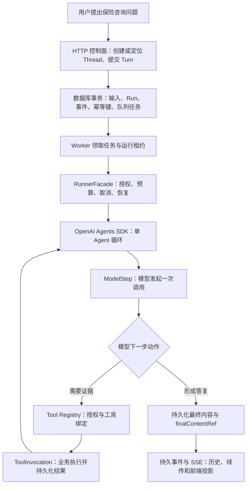

# 从保险业务 Agent 到可验证的 Harness Runtime：运行时链路、工具注册与执行闭环

> **Insurance Agent 实践项目 · D 方向每周分享**  
> **分享日期**：2026 年 10 月 14 日（日本时间）  
> **建议时长**：10–12 分钟  
> **内容范围**：近期架构学习、单 Agent 运行时实现、工具能力集成、工程验证与下一阶段任务  
> **证据截止**：2026 年 10 月 13 日 ACS 源码读取；历史门禁和实际运行记录主要形成于 10 月 7–8 日。

## 一、本周概览：从理解 Agent 到理解 Agent 如何可靠运行

这一阶段，我的学习与 D 方向实践主要围绕三个问题展开：

1. **执行链路**：一条保险咨询请求，如何从用户输入推进到多次模型调用、工具执行和最终答复？
2. **工具架构**：如何将检索、来源页、保司与产品目录、事实与优惠等业务接口统一注册为 Agent 可以使用的能力？
3. **工程验收**：如何验证执行过程的正确性、可恢复性与业务数据的可追溯性，并将模型效果留给独立的质量评测？

目前的阶段成果是：**单 Agent 的控制面、运行时、工具注册、持久状态、事件推送和业务适配已形成工程候选；原定 21 项工程模块门禁已有完整登记。** 正式交付继续按照源码身份复核、外部资源准入与业务质量评测推进。

> **一句话结论**：模型选择下一步行动；Harness（执行治理层）管理合法动作、状态与预算；Tool Registry（工具注册与能力目录）提供经过授权的业务能力；持久化事实与事件使执行过程可审计、可恢复、可展示。

## 二、学习重点一：理解一次 Run 的完整执行链路

### 2.1 关键概念

| 概念 | 中文理解 | 在本项目中的职责 |
|---|---|---|
| Thread（对话线程） | 一段持续存在的用户会话 | 关联历史回合、版本与归属 |
| Turn（用户回合） | 一次被正式接收的用户请求 | 保存输入及最终内容引用 |
| Run（执行尝试） | 完成某个 Turn 的一次执行 | 管理排队、运行、取消、失败、重试与恢复 |
| ModelStep（模型调用步骤） | 一次真实模型 API 调用 | 记录调用顺序、输出、状态和用量 |
| ToolInvocation（工具执行实例） | 一次获得授权的工具动作 | 记录参数、执行状态、结果与来源 |
| `finalContentRef`（最终内容引用） | 指向已提交答复事实的稳定引用 | 供历史、导出与界面复用同一份内容 |

### 2.2 用户请求进入产品后发生什么

这条链路可以归纳为六个步骤：

1. **接收**：API 控制面（Control Plane，控制接口层）验证身份、Thread 版本、幂等键和输入参数。
2. **受理**：PostgreSQL 在事务内保存用户输入、Turn、排队中的 Run 和事件；pg-boss（持久任务队列）负责交付执行任务。
3. **执行**：Worker（执行工作进程）取得租约后，由 RunnerFacade（运行时门面）建立本次执行环境及预算。
4. **决策**：OpenAI Agents SDK（智能体执行 SDK）驱动模型与工具循环；一次实际模型请求对应一个 ModelStep。
5. **调用**：模型提出工具动作，运行时检查工具版本、作用域、参数、次数与结果预算，再记录独立的 ToolInvocation。
6. **提交与展示**：工具结果先成为持久化事实，随后供模型继续使用；答复通过 `finalContentRef`（最终内容引用）定位，SSE（服务器发送事件）按持久游标向客户端推送。

### 2.3 我形成的架构认识

- **官方 SDK 负责模型循环**：工具选择、模型继续执行和最终结束由 SDK 与模型协作完成。
- **产品 Harness 负责运行治理**：受理、租约、持久取消、预算、权限、状态提交和检查点由自身产品层负责。
- **模型调用与工具执行分别建模**：ModelStep 在模型响应完成时结束，后续 ToolInvocation 继续记录工具动作与结果。两类实体用稳定关联关系重建完整轨迹。
- **事实存储与界面投影分层**：数据库记录权威内容和事件，模型历史、HTTP 历史、导出与界面都基于已有事实构建读取视图。

**对应源码**：`apps/runtime/src/runner/facade.ts`、`apps/runtime/src/runner/model.ts`、`apps/runtime/src/runner/worker.ts`、`apps/runtime/src/transport/http/sse.ts`。

## 三、学习重点二：Tool Registry 如何接入保险业务

### 3.1 从“业务接口”到“模型可执行能力”

Tool Registry（工具注册与能力目录）承担统一的能力管理入口。本项目采用以下四层组织方式：

| 层级 | 主要内容 | 解决的问题 |
|---|---|---|
| ToolSpec（工具规格） | 能力标识、版本、入参、出参、读写效果 | 工具能力如何标准化描述 |
| Profile（工具可见性配置） | 某类 Agent 可使用的工具集合 | 本次任务可以看到哪些能力 |
| BackendBinding（后端实现绑定） | 指向具体 Port（业务接口契约）与 Adapter（协议适配器） | 工具实际调用哪个业务实现 |
| ToolsetSnapshot（工具集快照） | 本次 Run 冻结的能力版本、绑定与策略摘要 | 执行、恢复与复现对应哪一组能力 |

**执行规则**：工具执行时重新验证当前主体权限、运行快照权限、工具所需权限、参数与预算；业务参数交给后端 Adapter，公开动作说明 `content` 用于记录模型意图及界面解释。

### 3.2 项目已定义的六项只读工具

| 工具标识 | 保险场景中的作用 | 当前工程证据 |
|---|---|---|
| `knowledge.search_documents` | 根据问题检索条款与知识证据 | 合成模式验证；真实检索组件已取得有限范围读回 |
| `knowledge.get_source_page` | 根据来源引用读取授权原文页 | 合成模式验证；已核对两组原始 PDF／解析结果 |
| `catalog.list_insurers` | 查询保险公司列表 | 合成模式验证；真实目录分页读回 |
| `catalog.list_products` | 查询产品目录及别名 | 合成模式验证；真实目录分页读回 |
| `facts.query_product_facts` | 查询结构化产品字段 | 合成／录制契约验证；B 方向真实数据接口待接入 |
| `facts.query_promotions` | 查询指定时点有效的优惠 | 合成／录制契约验证；B 方向业务规则与接口待接入 |

**保险顾问示例（架构说明，非特定实测回答）**：用户询问“某款保险产品有哪些关键保障责任，相关原文和优惠依据在哪里？”模型可以先查询产品目录，再检索条款、读取来源页，并按证据充分程度继续查询结构化事实或优惠。运行时负责确保每项查询都符合当前权限和可用工具集合；最终答复携带可追溯的来源引用。

### 3.3 这一设计带来的工程价值

- **业务扩展有统一入口**：RAG（检索增强生成）、产品目录、事实与优惠共用工具契约；后续业务能力沿相同准入流程扩展。
- **数据模式可切换**：Synthetic（合成）、Recorded（录制回放）、Real（真实后端）使用同一能力定义，验证报告明确来源类型。
- **授权可以持续生效**：Run 创建时冻结工具集身份，执行与来源读取时再次校验当前授权和来源范围。
- **恢复具有版本依据**：检查点绑定 SDK、模型、工具集合和授权版本；版本变化触发明确的兼容性处理。

**对应源码与说明**：`apps/runtime/src/runner/tools.ts`、`docs/implementation/registry-runtime-integration.md`、`docs/implementation/architecture-decisions.md`。

## 四、近期工作进展：从设计方案推进到工程候选

### 4.1 已形成的交付范围

| 工作面 | 已登记成果 |
|---|---|
| 产品控制面 | 25 项 HTTP 操作，覆盖 Thread、Turn、Run、来源、工具目录、取消、重试、恢复、历史、导出及事件读取 |
| 状态与执行 | 14 张 PostgreSQL 表、5 次迁移、pg-boss 持久任务队列、运行租约与恢复检查点 |
| 模型与工具 | 单 Agent、OpenAI Agents SDK 0.18.0、ModelStep／ToolInvocation 独立事实、六类只读工具 |
| 前端接入 | 同源 `/demo` API 演示、生成的 OpenAPI 契约、SSE 断线游标续传、历史与导出 |
| 工程验证 | 原计划 M00–M20 共 21 个工程模块门禁已登记；24 项运行时不变量与 32 项原始工程验收要求得到逐项工程核验 |
| 运维准备 | 已形成镜像、数据库迁移、备份恢复、留卷重启和隔离检查证据 |

### 4.2 验证数据：明确其来源与含义

**最新 D 方向报告记录的工程门禁基线**：

- TypeScript 测试 **987 项**，环境检查 **18 项**，Python 评测检查 **16 项**，Python 实验检查 **42 项**；记录为 **0 失败、0 跳过**。
- 历史累计真实业务请求 **324 次**，SDK 模型调用 **145 次**，并逐一关联了 **145 个 ModelStep**；另记录独立协议探针和模型元信息读取。
- M13 自主工具路由的专项证据记录 **6 个已完成 Run、21 次 SDK 调度及 21 个 ModelStep**，并额外核验模型预算边界。
- 检索和来源页组件已形成真实读回；目录组件记录过 **20 家保司、796 个产品、321 个别名候选** 的分页与一致性验证。

**证据身份与完成范围**：这些测试和调用数字来自项目已保存的验收材料，主要绑定至封存候选 `fb21fa4…` 及此前各模块的精确源码。2026 年 10 月 13 日通过 ACS 直接读取到 `main` 分支 `c66112d…`，工作树为 clean（干净状态）。当前源码的最终终态封存读回与独立审查仍是正式交付步骤。

**当前业务验收状态**：真实检索来源覆盖为 partial（部分覆盖）；上游语料版本与部分原始文档标识需要补齐；B/C 方向的数据与优化接口继续等待准入；人工 Gold（人工标注的标准答案）为 0，真实课程案例完成计数为 0，语义质量状态为 `UNREVIEWED`（待评审），成本金额为 `UNKNOWN`（待核算）。因此，本阶段能够汇报的是**工程机制和已授权组件的验证成果**；实际回答质量与成本收益将由后续独立实验给出。

### 4.3 与个人学习直接相关的三个突破

1. **实体模型已经清晰**：用户视角的 Thread／Turn、执行视角的 Run／ModelStep／ToolInvocation、持久化视角的内容和事件能够相互关联，同时保持职责独立。
2. **工具治理形成实现路径**：工具注册、运行快照、后端绑定、执行授权与来源追溯可以组成一条完整的实现链。
3. **验收方式有分层标准**：通过 Scripted Model（脚本化模型模拟）、Mock Tool（模拟工具）、Control Events（控制事件）以及 Golden Trace（预期执行轨迹）验证 Harness 行为；使用真实业务读回验证接口适配；使用人工 Gold 和固定对照实验验证模型质量。

## 五、一次失败或中断为什么也能成为工程证据

对于 Agent 产品，可靠性可以通过以下三个典型场景观察：

- **重复提交**：同一幂等键和相同请求映射到同一 Turn／Run；不同请求内容得到明确冲突反馈。
- **取消与重启**：取消意图先持久化，再传递到执行中的模型和工具；租约与检查点让已提交结果得到保留，并由版本规则决定可用恢复边界。
- **客户端断线**：浏览器断开 SSE 事件流后，后台 Run 按自己的状态继续推进；客户端通过持久事件游标读取后续事件。

这使测试从“模型答对了吗”进一步拓展为“**每一次状态变化、工具调用、取消和恢复是否符合协议及预期不变量**”。相关验收场景已进入工程回归体系，真实业务语义质量按照独立评测流程继续开展。

## 六、下一阶段计划与需要协作的输入

| 优先级 | 下一步动作 | 可交付证据 |
|---|---|---|
| P0 | 对当前源码身份、已封存候选、运行镜像、最终交付包执行终态读回和独立审查 | 可追溯的 commit/tree、哈希、测试与交付清单 |
| P1 | 与 B/C 方向核对事实、优惠、检索优化和来源映射的业务接口、版本、权限及有效期 | 真实 BackendBinding（后端绑定）、逐项读回与支持矩阵 |
| P1 | 扩充原文页与文档标识的授权覆盖，核对原始 PDF／解析页映射 | 来源引用、文档版本及可访问页的证据记录 |
| P2 | 整理小规模人工 Gold、固定数据集和模型／策略对照组 | 检索覆盖、回答依据、token 用量、成本与质量分析 |

后续效果实验拟采用**原始／改进方案 × 当前／增强方案**的四格对照，并使用固定任务、数据、权限和预算进行留出集验证。该实验属于下一阶段的真实质量验收。

**希望和小组对齐的两个问题**：B/C 方向可提供的最小稳定接口和数据版本分别是什么？人工 Gold 与来源页核验准备先覆盖哪些保险咨询任务？

## 七、收尾表述（30 秒）

> 本周的核心进展，是把保险 Agent 从业务能力的功能清单推进到可解释、可验证的运行时结构。我重点梳理了用户输入到 Run、ModelStep、ToolInvocation 和最终答复的全链路，也进一步理解了 Tool Registry 在业务扩展、权限治理和恢复一致性中的作用。D 方向已经留下完整的工程候选及多层验证记录，下一阶段重点是最终源码封存、跨方向真实接口准入，以及基于人工证据的质量和成本评测。

---

## 附录 A：口头分享时间安排

| 时间 | 内容 |
|---|---|
| 0:00–1:00 | 研究目标及本周一句话结论 |
| 1:00–4:00 | Thread → Run → ModelStep → ToolInvocation → 最终内容的链路图 |
| 4:00–6:30 | Tool Registry 四层模型与六项保险业务工具 |
| 6:30–9:00 | 工程实现、专项测试与真实读回结果 |
| 9:00–11:00 | 测试认识、验收边界及下一阶段计划 |
| 11:00–12:00 | 讨论 B/C 接口与人工 Gold 任务 |

## 附录 B：工程证据索引

以下均为 `insurance-agent-d-product` 源码仓库内的相对路径，便于会议后定位：

| 证据 | 路径 |
|---|---|
| 交付目标与边界 | `docs/development-pack/goal-objective.md` |
| 运行时架构决策 | `docs/implementation/architecture-decisions.md` |
| Runner 与持久模型步骤 | `apps/runtime/src/runner/facade.ts`、`apps/runtime/src/runner/model.ts` |
| 工具执行与结果持久化 | `apps/runtime/src/runner/tools.ts` |
| Worker 与队列租约 | `apps/runtime/src/runner/worker.ts` |
| SSE 事件续传 | `apps/runtime/src/transport/http/sse.ts` |
| Registry 与运行入口 | `docs/implementation/registry-runtime-integration.md` |
| 最近工程状态汇总 | `docs/implementation/D-REPORT.current.md` |
| 21 项工程模块支持状态 | `docs/implementation/evidence/delivery-support.current.json` |
| M13 真实自主工具链专项 | `docs/implementation/evidence/M13-original-dod-gate-20261008.json` |
| M09/M10 真实检索与来源页 | `docs/implementation/evidence/M09-real-component-gate-20261007.json`、`docs/implementation/evidence/M10-real-component-gate-20261007.json` |
| D7 镜像与 ACS 读回 | `docs/implementation/evidence/d7-release-image-lifecycle.json`、`docs/implementation/evidence/d7-release-acs-readback.json` |
| 原始工程验收矩阵 | `docs/implementation/evidence/acceptance-current-standing.json` |

> **复核说明**：README 中的 964 项属于 D6 历史回归基线；会议正文优先采用 D-REPORT 中登记的较新 **987 + 18 + 16 + 42** 分项数据。数据只代表其精确证据源码和当时执行范围；正式发布依据最终审查结果。
