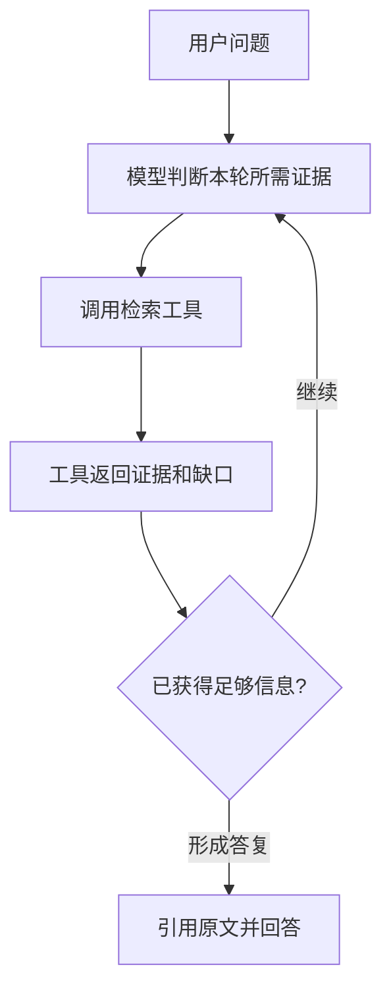

# 从评估调用到 Agent 决策：第三周专项分享的外部研究与写作依据

> 性质：公开可复用的研究底稿，供第三周专项正文扩写与后续证据审阅使用  
> 核查日期：2026-10-21  
> 源码基准：Tencent/WeKnora `9224b1f40313eca00f6e5441b83174eda59a4f44`；具体结论同时绑定所列文件及源码行为  
> 范围：WeKnora 源码与文档、Ragas / DeepEval、RAG/Agent 评估论文、保险行业评估、已发布的 Harness 教学文档  
> 结论类型：源码核实（S）、官方能力说明（O）、研究论文（P）、从实现推导的待实验风险（H）、本项目结果待填（E）

本文件提供**外部事实、评测概念、实现风险和写作证据边界**。本地 WeKnora 的实际运行、保险 XLSX 的字段与分数、真实样本根因、Harness 当前源码身份和截图，待 Codex 私有 ZIP 到达后据其原始数据补齐。本研究本身不等同于本轮成功运行了系统。

## 01｜一次问答和一次评估分别发生什么？

先用一个保险问题建立观察对象：

```text
用户问题
  → 保险 RAG：检索 → 重排 → 上下文 → 生成 → 答案 / 来源
                       ↓
          评估输入：问题 + 相关证据 / 参考答案
                       ↓
          评估计算：检索命中与排名 + 生成文本对照
                       ↓
          结果：聚合指标 / 可复核逐题记录
```

WeKnora 是一个完整的知识管理、RAG 和 Agent 项目；其文档说明了文档解析、切块、索引、混合检索、重排、快速问答以及多步骤 Agent。**目前原生 Evaluation 路线调用的是 RAG 管道**，`internal/application/service/evaluation.go` 中每题通过 `KnowledgeQAByEvent(ctx, chatManage, types.Pipline["rag"])` 执行。这不是对 Agent 轨迹的直接打分。（S/O）

WeKnora 的 Agent 模式有另外的 ReAct 循环、工具注册表、上下文管理和执行控制。文档区分 `quick-answer`（经典 RAG）与智能推理模式。因此，分享正文应先让读者看懂固定 RAG，再说明 Agent 把「是否再查、查什么、何时停止」变成运行决策。（O）

可引用源码/文档：

- [Evaluation Service](https://github.com/Tencent/WeKnora/blob/main/internal/application/service/evaluation.go)，`EvalDataset` / `KnowledgeQAByEvent`
- [Agent 机制](https://github.com/Tencent/WeKnora/blob/main/website-docs/03-features/07-agent.md)
- [检索引擎](https://github.com/Tencent/WeKnora/blob/main/website-docs/03-features/05-retrieval-engines.md)
- [系统架构](https://github.com/Tencent/WeKnora/blob/main/website-docs/02-architecture/01-overview.md)

## 02｜WeKnora Evaluation 接口的真实契约

原生评估目前通过 API 调用，未提供独立的 Evaluation UI；演示证据宜来自真实 API 请求/响应、配置、运行日志及可用追踪视图。REST API 使用 `/api/v1` 路径前缀。（O/S）

```http
POST /api/v1/evaluation
Content-Type: application/json

{
  "dataset_id": "default",
  "knowledge_base_id": "<可选的参考知识库ID>",
  "chat_id": "<可选的聊天模型ID>",
  "rerank_id": "<可选的重排模型ID>"
}
```

创建后取得任务 ID，再通过 `GET /api/v1/evaluation?task_id=<返回ID>` 查询。状态 `0/1/2/3` 分别代表等待、运行、成功、失败；返回 `finished/total` 和 `retrieval_metrics`、`generation_metrics`。创建需要 Admin，查询 Viewer；受限 API Key 需要对应评估能力。

内置数据从固定 `./dataset/samples/` 读取，下列文件是接口要求，而不是保险项目必须重建的人工标注工程：

| 文件 | Schema | 含义 |
| --- | --- | --- |
| `queries.parquet` | `id:int64, text:string` | 问题 |
| `corpus.parquet` | `id:int64, text:string` | 候选段落 |
| `answers.parquet` | `id:int64, text:string` | 参考答案 |
| `qrels.parquet` | `qid:int64, pid:int64` | 问题与相关段落 ID |
| `qas.parquet` | `qid:int64, aid:int64` | 问题与参考答案 ID |

代码 `GetDatasetByID(ctx, datasetID)` 当前直接加载 `DefaultDataset()`；`dataset_id` 并不选择不同的磁盘目录。（S）

运行模式：POST 同步进行任务准备与注册，后台 goroutine 读取数据、导入评估专用知识库、逐题执行 RAG 并更新统计；按 CPU 设置并发上限。结果由进程内 `evaluationMemoryStorage` 保存，服务重启后不再可读。（S）

可引用：

- [WeKnora 官方评估文档](https://weknora.weixin.qq.com/docs/03-features/15-evaluation)
- [Dataset Service](https://github.com/Tencent/WeKnora/blob/main/internal/application/service/dataset.go)
- [Evaluation Handler](https://github.com/Tencent/WeKnora/blob/main/internal/handler/evaluation.go)
- [Evaluation Service](https://github.com/Tencent/WeKnora/blob/main/internal/application/service/evaluation.go)

## 03｜源码级需要专门验证的评分边界

本节包含两个值得独立测试的源码机制。结论是**源代码行为和可能影响指标的条件推导**；本轮测试实例及真实数据上的实际影响，应使用受控样本复核。

### A. 语料导入是关联段落的并集

`DefaultDataset()` 读取 `corpus` 和 `qrels`，但 `dataset.Iterate()` 给每道题设置的 `qaPair.Passages` 只来自该题的 `qrels`；`EvalDataset` 使用 `getPassageList(dataset)` 汇总这些相关段落后入库。**没有出现在任何 qrels 中的 corpus 段落当前不会通过这条路径进入评估知识库。** 因此一个只有一题的最小评估集，可能只包含它的正确段落，不能据此衡量真实库中的噪音干扰。（S/H）

源码：

- [dataset.go · Iterate](https://github.com/Tencent/WeKnora/blob/main/internal/application/service/dataset.go)
- [evaluation.go · getPassageList](https://github.com/Tencent/WeKnora/blob/main/internal/application/service/evaluation.go)

### B. 原始不相关结果可能在构造评分输入时消失

`metric_hook.go` 的 `recordFinish` 采用：重排结果优先、空时回退初始检索结果；随后遍历原始检索结果，仅用与**当前问题的相关段落**进行双向字符串包含匹配，成功匹配的段落才加入 `RetrievalIDs`，且会去重。（S）

这会导致一个可构造的偏差情形：

```text
原始检索顺序：
  rank 1 = 其他题的无关段落 X
  rank 2 = 本题正确段落 A

理想的原始序列评分：
  Precision@2 = 1 / 2 = 0.5
  第一条相关结果在第2位 → RR = 1 / 2 = 0.5

当前 recordFinish 匹配后的 RetrievalIDs：
  [A] （X没有映射到本题的相关 passage ID）
再送入 Precision/MRR：
  Precision = 1/1 = 1
  RR = 1/1 = 1
```

以上是依据当前代码构建的**逻辑复现样例**，并非已经从本轮部署中获得的真实系统指标。应在实际环境用包含明确无关段落的受控输入，核对原始搜索排名、重排排名、传给 Metric 的 ID 列表及最终分数。还要核对短 Chunk 与原始段落的包含匹配、相似内容碰撞和去重对排名的影响。（H）

源码：

- [metric_hook.go · recordFinish](https://github.com/Tencent/WeKnora/blob/main/internal/application/service/metric_hook.go)
- [precision.go](https://github.com/Tencent/WeKnora/blob/main/internal/application/service/metric/precision.go)
- [mrr.go](https://github.com/Tencent/WeKnora/blob/main/internal/application/service/metric/mrr.go)
- [ndcg.go](https://github.com/Tencent/WeKnora/blob/main/internal/application/service/metric/ndcg.go)

### C. API 主要返回总体评分

`MetricList.Avg` 将逐题指标平均成总体结果；`EvaluationDetail` 主要暴露任务、配置和聚合指标。逐题归因需要独立保存原始检索结果、回答、样本身份与辅助评分，而不能仅依赖 GET 接口的总体均值。（S）

## 04｜各类指标具体评价哪个对象？

| 评价目标 | 可用框架/指标 | 所需输入 | 技术解释与边界 |
| --- | --- | --- | --- |
| 检索覆盖 | WeKnora Recall、已有 EvidenceRecall | 真实相关段落/页面关联，实际检索序列 | 检查相关证据是否被取得；WeKnora 原生指标还需验证上节评分口径 |
| 检索排序 | MRR、NDCG、Precision | 真实排名、正确性判断或相关段落标签 | 首条有效证据的位置、相关内容是否靠前；原始排名必须保留 |
| 字段完整性 | 既有 RequirementCoverage | 已存在的证据需求与检索材料 | 一道题的多个信息需求是否都得到支持；不同于只命中一条 |
| 回答文本重合度 | WeKnora BLEU / ROUGE | 生成文本、参考答案 | 语言表面重合度；不能单独作为保险事实准确率 |
| 答案是否切题 | Ragas Response Relevancy；DeepEval Answer Relevancy | 问题、实际回答，按实现可能需要 LLM/Embedding | 与问题相关性；不负责事实的真伪 |
| 回答是否基于已检索内容 | Ragas / DeepEval Faithfulness | 实际回答、实际 retrieved context、评审模型 | 语义支持与证据忠实度；检索上下文若错用产品/版本，也可能出现高分 |
| 检索段落相关性 | Ragas Context Precision without reference 等 | 问题、回答、检索段落和评审模型 | 可无人工参考答案；模型判断的质量与输入本身相关，宜用原标注抽查 |
| Agent 是否选对工具 | DeepEval Tool Correctness / Argument Correctness | 实际 ToolCall；前者通常还需 expected_tools | 需要真实工具调用记录，历史 XLSX 单独存在问答/检索记录未必足够 |
| Agent 是否完成任务、步骤是否合理 | DeepEval Task Completion / Step Efficiency | 完整 Trace、可复核任务目标与评审器 | 第四周真实 Agent loop 形成轨迹后更适合应用 |

Ragas 中 Reference-free（无参考标准答案）与 Reference-based（有参考依据）指标可以共存。每项评估必须按所需输入选择具体实现。回答和上下文均由同一个系统生成时，参考外的相关性高分不等于独立真值。

DeepEval Tool Correctness 默认名称匹配；可以增加参数/输出匹配或候选工具集合来评估选择质量。具有多条合理路径的自主 Agent，不宜把唯一一条预设工具序列当成所有成功路径的判据。完整轨迹指标依赖真实运行 Trace。

来源：

- [Ragas 指标目录](https://docs.ragas.io/en/latest/concepts/metrics/available_metrics/)
- [Ragas Faithfulness](https://docs.ragas.io/en/stable/concepts/metrics/available_metrics/faithfulness/)
- [Ragas Context Recall](https://docs.ragas.io/en/stable/concepts/metrics/available_metrics/context_recall/)
- [Ragas Context Precision](https://docs.ragas.io/en/v0.4.0/concepts/metrics/available_metrics/context_precision/)
- [DeepEval 指标分类](https://deepeval.com/docs/metrics-introduction)
- [DeepEval Faithfulness](https://deepeval.com/docs/metrics-faithfulness)
- [DeepEval Tool Correctness](https://deepeval.com/docs/metrics-tool-correctness)
- [DeepEval Task Completion](https://deepeval.com/docs/metrics-task-completion)
- [DeepEval Step Efficiency](https://deepeval.com/docs/metrics-step-efficiency)

## 05｜保险问答中为什么需要独立的错误归因？

以结构和操作为主，而不是只报出某个模型的分数：

```text
源文档是否存在且生效
  → 解析页与 Chunk 是否正确
    → 检索是否召回正确产品和条件
      → 是否还需要补充检索/结构化查询
        → 生成时是否使用了足够而准确的证据
          → 最终答复是否完整、引用是否可定位
```

真实保险问答需要区分至少四种情况：

1. **证据位置错误**：产品、文档、版本、物理页码不对应，属于证据身份与检索问题。
2. **重要条件缺失**：只得到产品权益的一部分，漏掉适用周年、时间窗、年龄、疾病条件、有效月份等，属于证据覆盖和业务规则问题。
3. **回答与证据不一致**：检索资料正确但答复外推或误读，属于生成问题。
4. **查询行动缺口**：在可获得的补充证据存在时，固定链路已经结束，可能属于 D 方向可验证的改造机会。

统计结果应区分：观测现象、归因假设、支持证据、反证/替代解释、建议验证实验。A/B/C/D 可同时构成责任，不要求每题只能落入单一模块。

与保险相关的学术参考支持对保险常识、结构化事实和原始文档分别评估，以及按问题类型采用不同准确性/完整性测量方式。它们是方法论背景，**不是本项目准确率基准**：

- [InsQABench：中文保险问答](https://arxiv.org/abs/2501.10943)：保险常识、结构化数据库、非结构化文档及 SQL-ReAct / RAG-ReAct。
- [INSEva：保险领域多维评测](https://arxiv.org/abs/2509.04455)：结构化问题与开放问答采用不同指标，关注忠实度和完整性。
- [OmniEval：金融领域 RAG 多维评估](https://aclanthology.org/2025.emnlp-main.292/)：分别观察检索与生成阶段。

## 06｜从归因设计最小 Agent 验证

对于 D 方向，一条值得测试的案例满足如下条件：

- 第一次检索的原始证据尚未覆盖完整问题；
- 所需信息确实位于当前可访问语料；
- 使用可说明目的的补充查询，有机会取得先前缺失的材料；
- 测试记录可以区分首次检索、追加检索、最终证据与真实 Agent 决策。

应明确区分三个层次：

| 实验层级 | 具体做法 | 能证明什么 |
| --- | --- | --- |
| 历史回放 | 对既有检索和人工标注离线打分 | 过去已经发生的真实问题和检索现象 |
| 受控补查 | 固定检索服务、语料、配置，手工或预定义额外查询 | 补充查询是否具有提升证据覆盖的潜力 |
| 自主 Agent 运行 | 允许模型自主选择 ToolCall 和继续/停止，在相同语料与预算约束下记录轨迹 | Agent 能否稳定地产生有效补查及其质量/成本 |

最小 Agent 循环：



建议逐轮记录：累计证据覆盖、首次/最终覆盖、工具调用次数、唯一查询次数、相同查询重复率、延迟、费用及停止条件。工程测试另行判断参数权限、状态提交、取消和恢复；这些不是语言模型质量评分。

研究依据：

- [SoK: Agentic RAG](https://arxiv.org/abs/2603.07379)：把动态检索看成带状态的顺序决策过程，重视工具、记忆、评估与可靠性。
- [RAGCap-Bench](https://arxiv.org/abs/2510.13910)：评估中间步骤能力，以区分最后答对与检索规划是否有效。
- [已发布 D 方向第12篇](../../12-testing-and-evaluation.md)：Harness 协议验证、模型行为、业务质量分别评测。

## 07｜模型评审可信度与小样本解释

LLM Judge（大模型评审）便于得到质量评分与理由，但其结果属于模型对输入的判断。评审模型、具体 Prompt、评分标准与被评内容应一并记录。需要注意：

- **证据真实度与忠实度**：回答可能忠实于一个错误产品的文本；需要来源身份核对。
- **人工评价与自动指标分层**：上周正确/部分正确/错误/无法判断是历史人工判断，和新构造的连续分数并非同一评价量纲。
- **独立性**：使用被测系统生成的回答作为另一指标的相关性参照时，可能出现自我确认；参考原标注交叉检查。
- **样本规模**：5–10题适于演示接口、发现局部故障，不代表全量语料或总体保险业务表现。
- **公平比较**：相同样本、相同评分单位、语料与模型/检索器配置、明确的分母，才使数值比较有解释性。必要时对多次运行和配对样本差值做统计分析。

研究依据：

- [RAGAS 原始论文](https://arxiv.org/abs/2309.15217)：无需人工答案的 RAG 评估维度。
- [ARES，NAACL 2024](https://aclanthology.org/2024.naacl-long.20/)：自动评审结合人工标注校准的思路。
- [Don't Use LLMs to Make Relevance Judgments](https://arxiv.org/abs/2409.15133)：用于平衡理解自动生成检索相关性标签的局限。
- [Judging LLM-as-a-Judge](https://arxiv.org/abs/2306.05685)：评审偏置问题，包括位置和篇幅等。
- [DeepEval 自定义 G-Eval](https://deepeval.com/docs/metrics-llm-evals)：可用规则与评价字段构建业务口径，但评审仍受模型限制。

## 08｜与14篇 Harness 分享保持一致的写作契约

已核查 [第一篇正文](../../01-from-rag-to-harness.md)、[第二篇正文](../../02-contracts-and-runtime-facts.md)、[第三篇正文](../../03-request-admission-and-transactions.md)、[第四篇正文](../../04-worker-and-model-loop.md)、[第五篇正文](../../05-session-and-context.md)、[第八篇正文](../../08-evidence-and-source-references.md)、[第12篇正文](../../12-testing-and-evaluation.md)及其现有大纲。

### 文风与结构

- 以**一条具体的保险咨询问题**开场，让读者先看到输入与结果。
- 用 `## 01｜...` 连续编号，标题多用「是什么」「怎样工作」「为什么」「如何验证」的问句，保证每章围绕一个读者问题。
- 首次出现的英文词组配准确中文技术含义：例如 RAG（检索增强生成）、Retrieval（检索）、Ground Truth（参考标准）、Faithfulness（证据忠实度）、ToolInvocation（工具执行实例）。
- 先讲概念的**形状**（JSON、接口、表、目录、程序链路），再讲实际运行、边界、职责和取舍。
- 采用简洁、短句的技术博客语言（以 ASD-STE100 清晰表达为主要倾向），用段落建立因果关系。
- 使用有具体字段的代码、Mermaid 图和必要的 GitHub HTML `<details>`，增强理解与查证；视觉排版服务于内容而不是装饰。
- 区分真实运行、官方源码、合成教学案例、理论机制和未验证假设。引用提供源码位置/版本或外部文档。
- 章节结尾自然衔接下一个执行步骤；正文最后提供「实现依据与延伸阅读」而非大量泛泛参考清单。
- 标题、开篇和提交说明来自已采用的最终目标；采用 [no-negative-echo](https://github.com/LB623/no-negative-echo/blob/main/no-negative-echo/SKILL.md) 的正向收口方式，同时准确保留技术边界、错误和安全验证事实。

### 与原14篇大纲保持一致

已有 `outlines/` 正式大纲的实际结构是「`# 标题｜内容大纲` → 开篇说明本篇主线 → `## 01｜...` 顺序章节 → 各章用一段精炼文字说明证据、样例和必须解释的技术内容 → `## 实践与图示设计` → `## 源码与依据`」。

第三周专项大纲沿用此写法，保留已确定的8章讲述顺序，采用一个贯穿案例、源码路径、实验结果占位、可追溯的引用，并以 D 方向最小 Agent 循环自然收束。约10–12分钟的口头分享可以从更充分的 Markdown 正文提炼，不必让正文的知识厚度受逐页演讲时长限制。

## 09｜到达实验 ZIP 后应优先核验的事实

| 输入对象 | 必须复核 | 正文引用方式 |
| --- | --- | --- |
| 上周 XLSX | Sheet、列定义、人工评价语义、样本数、Chunk 顺序和来源 | 现有样本被怎样使用 |
| WeKnora 环境 | 实际 Git SHA、镜像版本、API、模型、配置 | 说明本次具体运行版本 |
| 官方样例评估 | 原始 POST/GET、task_id、终态、返回的真实12项指标 | 证明原生评估已运行 |
| 保险历史输出 | 实际系统的输出、检索列表和人工评价 | 证明原系统评测对象 |
| 自有样本评分 | 哪些指标可计算、参数、分母、原始结果 | 数字与判断一致 |
| 源码级检索口径 | corpus 是否全量入库、排名及 `recordFinish` 实际 ID 映射 | 判断 WeKnora 原生分数可靠范围 |
| 失败案例 | 原始问题、证据身份、具体返回、标注理由与反例 | 建立可追溯归因 |
| D 工程 | 真实 Runner、Tool Registry、Evidence、ModelStep / ToolInvocation 的源码与版本 | 从评估问题转入 Harness 实践 |
| 实验图像 | 终端/实际界面截图、配置、响应、失败案例图 | 仅用真实运行图像支持事实 |

**写作验收重点**：外部技术背景与 ZIP 中的运行证据必须共同支持具体主张。已经验证的源码行为、真实评估结果、人工标注事实和推论分开叙述。每一个主要指标附评测对象、样本分母和执行配置；每一个工程结论能追溯到源码或实际测试。

## 10｜来源索引

### WeKnora 一手来源

- [Evaluation Docs](https://github.com/Tencent/WeKnora/blob/main/website-docs/03-features/15-evaluation.md)
- [Evaluation Service](https://github.com/Tencent/WeKnora/blob/main/internal/application/service/evaluation.go)
- [Dataset Service](https://github.com/Tencent/WeKnora/blob/main/internal/application/service/dataset.go)
- [Metric Hook](https://github.com/Tencent/WeKnora/blob/main/internal/application/service/metric_hook.go)
- [Precision 实现](https://github.com/Tencent/WeKnora/blob/main/internal/application/service/metric/precision.go)
- [MRR 实现](https://github.com/Tencent/WeKnora/blob/main/internal/application/service/metric/mrr.go)
- [Agent Execution](https://github.com/Tencent/WeKnora/blob/main/website-docs/03-features/07-agent.md)
- [Retrieval Engines](https://github.com/Tencent/WeKnora/blob/main/website-docs/03-features/05-retrieval-engines.md)
- [Observability](https://github.com/Tencent/WeKnora/blob/main/website-docs/03-features/16-observability.md)

### 评测与相关方法

- [Ragas 官方文档](https://docs.ragas.io/en/latest/)
- [DeepEval 官方文档](https://deepeval.com/docs/metrics-introduction)
- [RAGAS](https://arxiv.org/abs/2309.15217)
- [ARES](https://aclanthology.org/2024.naacl-long.20/)
- [SoK: Agentic RAG](https://arxiv.org/abs/2603.07379)
- [RAGCap-Bench](https://arxiv.org/abs/2510.13910)
- [InsQABench](https://arxiv.org/abs/2501.10943)
- [INSEva](https://arxiv.org/abs/2509.04455)
- [OmniEval](https://aclanthology.org/2025.emnlp-main.292/)
- [LLM Judge Bias](https://arxiv.org/abs/2306.05685)
- [LLM Relevance Judgments Limitations](https://arxiv.org/abs/2409.15133)

研究完成后，第三周最终技术正文应从真实样本启程，让每一个概念对应可观测的执行对象，再用运行数据与外部方法交叉解释。
