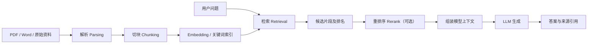
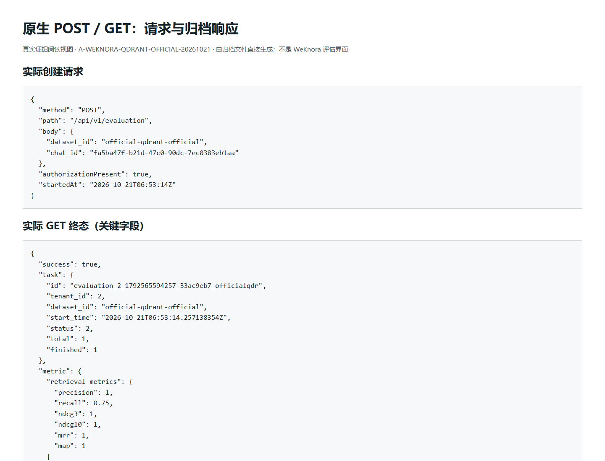
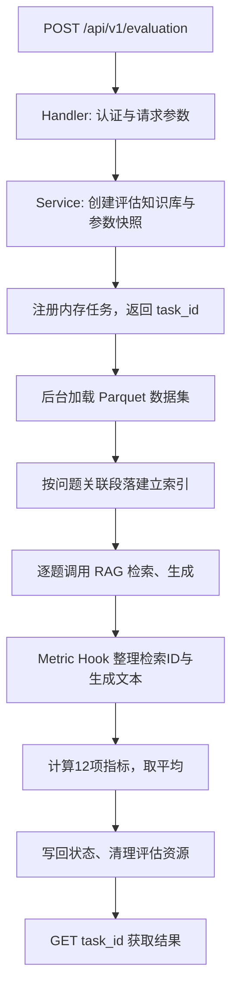
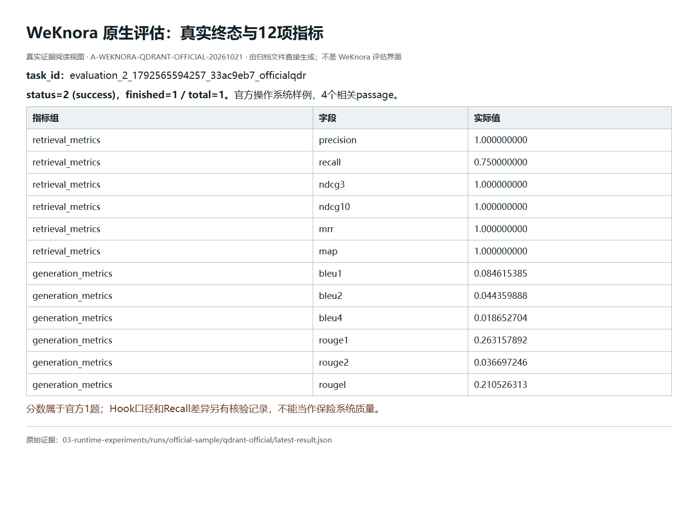
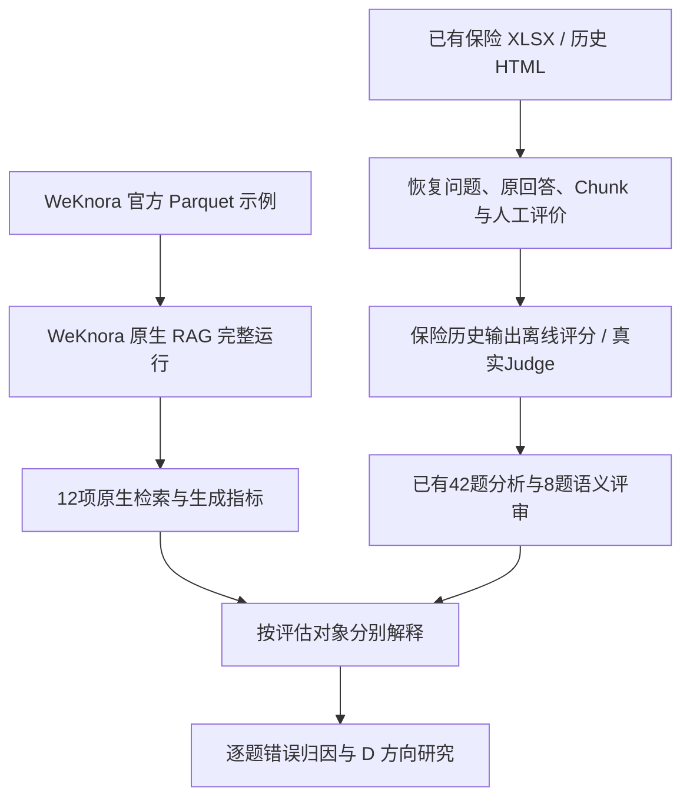
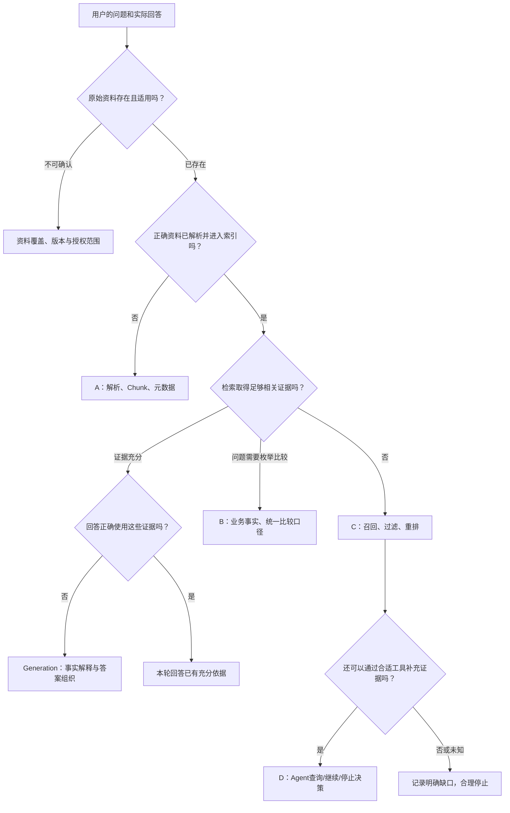
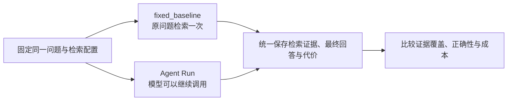
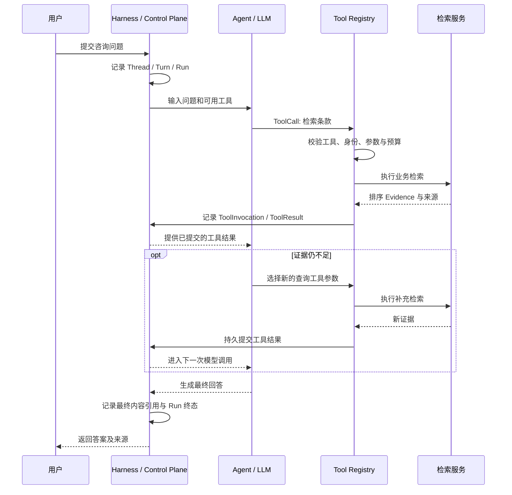
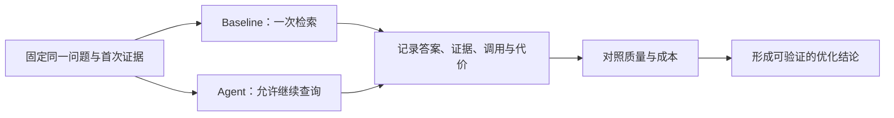

# 从一份保险问答标注认识 RAG 评估：WeKnora、错误归因与 Agent Harness

> **Insurance Agent 实践项目 · 第三周专项分享**  
> 研究日期：2026 年 10 月 21 日  
> 学习主线：从既有人工标注出发，理解 WeKnora 评估机制、读取真实结果、定位问题并连接 D 方向 Harness  
> 文档范围：公开技术研究与脱敏聚合结论；完整业务数据及运行证据留存于课程授权的私有实验包。

一位保险顾问提出问题：**某款产品中，一种亲属关系是否符合投保要求？**

问答系统找到了产品手册。里面确实出现了亲属关系表，最终回答也提到了相应条款。但如果表格中的两列分别是「保单持有人与受保人的关系」和「受益人与受保人的关系」，同一种亲属关系出现在后一列，并不能自动证明前一列的适用规则。

开发者需要分清三个问题：**检索找到了什么？原始资料实际支持什么？模型有没有正确使用这些证据？**

第二周，我们已经通过标注页面记录过类似问题。第三周希望把这些观察转化为可以重复计算、可以复核、能够解释失败原因的评测结果，并判断哪些问题值得进一步采用 Agent（智能体）自主检索。

本文沿一条完整链路展开：**已有标注 → RAG 执行与评估 → 实际得分 → 错误归因 → D 方向 Agent 与 Harness**。章节先展示输入、代码和实际输出，再解释职责、限制及下一步工程取舍。已有公开框架的机制依据来自 WeKnora、Ragas、DeepEval 的源码和文档；本文的实验数字来自本轮保留原始响应、脚本、截图和校验记录的私有证据包。

## 01｜上周的标注记录是什么、长什么样？

### 从一条问题看到四种不同的数据

上周的 HTML 标注页面里，一道题通常具有四部分：用户提出的原始问题、当前系统的参考 Chunk（检索片段）、模型生成的答案，以及人工做出的正确性和来源判断。

本轮实际提供的主文件是从该页面导出的 XLSX（Excel 工作簿）。程序读取了两个工作表：

| 工作表 | 实际规模 | 主要字段 |
| --- | ---: | --- |
| `标注结果` | 42 道问题，25 列 | `qid`、问题、类型、旧系统检索状态、当前系统检索状态、人工正确性、评价理由、来源线索 |
| `当前参考块` | 317 条记录，13 列 | `qid`、排名、文档名、页码起止、检索分数、Chunk 正文、引用情况 |

这里的 `qid`（Question ID，问题身份）把两张表连接起来。一条题目对应若干参考块，`qid + rank`（问题身份与检索排名）用于恢复参考块的原始顺序。它与保险文档中的文件名、页码构成不同层次的定位信息：问题 ID 指向一项用户需求，Chunk ID 指向一个检索片段，文件与物理页码指向原始资料。

最简单的结构可以这样理解：

```json
{
  "caseId": "SYN-Q-01",
  "question": "示例保障甲的权益何时可以申请？",
  "generatedAnswer": "一次历史生成的答案",
  "humanReview": {
    "correctness": "部分正确",
    "reason": "时间条件正确，部分适用限制未完整说明"
  },
  "retrievedChunks": [
    {
      "rank": 1,
      "chunkId": "SYN-C-01",
      "document": "示例保障甲条款.pdf",
      "physicalPage": 12,
      "score": 0.72,
      "text": "合成的条款文本……"
    }
  ]
}
```

这是教学示例，字段表示真实导出过程需要关联的对象，并非某款真实保险的条款。真实 XLSX 并没有单独保存完整模型回答与全部 Chunk ID，因此本轮还读取了先前归档的 HTML：程序按 `qid` 和排名恢复了**42份历史回答、317个参考块的身份**，并核对问题、正文、文件名和起始页码。全部题目和参考块均匹配。最新 XLSX 中已有的人工评价仍作为本轮记录依据。

这一步相当于把原来分散的“题目、答卷、参考书页和老师评语”连接起来。只有这些身份关系保持准确，后面的自动评分才知道自己正在评价哪一道题、哪个版本的回答以及哪些检索证据。

### 人工标注告诉了我们什么？

42题的关键结论评价为：

| 人工评价 | 题数 |
| --- | ---: |
| 正确 | 6 |
| 部分正确 | 16 |
| 错误 | 1 |
| 无法判断 | 19 |
| **总计** | **42** |

另有历史自动初筛字段显示，当前系统被记录为“检索成功”的有41题，旧系统为31题。**检索成功、回答正确和能够完成用户的整个任务是不同的判断对象。**找到一段看起来相关的文本，并不证明条件、适用范围和所有子问题都获得了解答；“无法判断”也不能直接算为“错误”。

317个参考块里，195条有起始页码，122条缺少起始页码。重复 Chunk ID 还可能在不同题目里指向不同文本，因此本轮保留原始 `qid + rank`，而不是把所有 Chunk ID 合并成一份全局唯一的事实表。

上周还曾对124项可疑解析或分块情况进行原 PDF 复查。它们属于专门的质量核查范围；在本次主 XLSX 中，19条参考块标有解析异常。两份记录的版本与统计对象不同，后续进行 A 方向归因时需要先核对具体 Chunk 和原始文件。

这些事实确定了第三周的数据起点：我们已有**真实问答的历史输出和人工观察**，可以从中选择可计算的指标。接下来先看看被评估的问答系统究竟在执行什么。

## 02｜WeKnora 是什么？一次 RAG 问答究竟怎样发生？

### 先看一个固定 RAG 问答程序

RAG（Retrieval-Augmented Generation，检索增强生成）让模型在回答前获取外部文档中的证据。模型仍负责组织语言，检索系统则负责提供与问题有关的资料。



一份保险 PDF 可以先被解析为带标题和页面信息的文本，再切分成 Chunk。检索时，系统使用问题中的关键词或 Embedding（向量表示）找出若干片段，再按当前配置排序，把最重要的部分交给模型。

| 环节 | 职责 | 保险问答中的典型质量问题 |
| --- | --- | --- |
| Parsing（解析） | 提取表格、标题、正文及来源位置 | 表格列名丢失，导致持有人与受益人的关系被混同 |
| Chunking（切块） | 组织可索引的检索单位 | 主规则和例外条件分离，模型只看到其中一段 |
| Embedding（向量表示） | 在语义空间中寻找相近内容 | 同词但不同产品的条款被召回 |
| Retrieval（检索） | 从索引中取得候选内容 | 真正的适用资料未进入候选集 |
| Rerank（重排序） | 调整候选的优先级 | 相关标题靠前，真正能支持结论的片段被压后 |
| Generation（答案生成） | 解释、组合证据并回答 | 已取得资料却发生无依据的概念扩写或规则套用 |

[WeKnora](https://github.com/Tencent/WeKnora) 是覆盖文档、知识库、检索和问答的开源系统，也提供可使用工具的 Agent 引擎。它的检索实现支持向量、关键词与混合检索等配置；具体执行哪些步骤取决于知识库的索引后端与模型设置。[¹](#实现依据与延伸阅读)

### RAG 和 Agent 从哪里开始不同？

固定 RAG 的基本形式是：

```text
问题 → 预设检索 → 候选证据 → 模型回答 → 结束
```

Agent 则将部分检索行动交给模型决定：

```text
问题
  → 模型选择一次工具调用
  → 工具返回材料
  → 模型判断现在缺少什么
      ├─ 需要资料：继续查询、改写或拆分问题
      └─ 信息足够：形成最终回答
```

例如，问题需要比较三款产品，第一次检索若只找到其中一款，Agent 有机会将剩余两款拆成独立查询，并在拿到材料后继续判断是否足以作答。

需要区分两条事实：WeKnora **具备** Agent 能力；但其当前原生 Evaluation（评估）接口在源码中调用的是 `KnowledgeQAByEvent(..., Pipline["rag"])`，即 RAG 事件管道，而非 Agent 的多轮 ReAct（推理—行动）轨迹。**一次 WeKnora 原生评估不能自动证明 Agent 的工具选择、继续检索或停止决策质量。**

下面沿 Evaluation 的真实接口，观察这条评估链路到底怎样运行。

## 03｜Evaluation 是什么？一次真实评估请求怎样执行？

### Evaluation 是给一次系统执行建立评分过程

若把 RAG 比作“查阅资料后作答”，Evaluation 是“提供题目与参考依据，记录查找和作答过程，再根据规则给分”。它包含运行、结果采集和指标计算，不只是请另一个模型看一句回答好不好。

WeKnora 原生评估读取五种 Parquet（列式数据文件）：

| 文件 | 字段 | 作用 |
| --- | --- | --- |
| `queries.parquet` | `id`, `text` | 提供问题 |
| `corpus.parquet` | `id`, `text` | 提供段落文本 |
| `answers.parquet` | `id`, `text` | 提供参考答案 |
| `qrels.parquet` | `qid`, `pid` | 指定问题与正确段落的对应关系 |
| `qas.parquet` | `qid`, `aid` | 指定问题与参考答案的对应关系 |

`qid`（问题 ID）、`pid`（Passage ID，段落 ID）、`aid`（答案 ID）是不同身份。评估程序依靠这些关联关系对实际结果进行比较。当前 Dataset Service 读取的是固定 `./dataset/samples/` 目录；请求中的 `dataset_id` 主要进入任务身份，不会自动切换为同名数据目录。输入的存储格式和真实字段应以运行版本为准。[²](#实现依据与延伸阅读)

典型创建请求是：

```http
POST /api/v1/evaluation HTTP/1.1
Content-Type: application/json
Authorization: Bearer <实验环境会话令牌>

{
  "dataset_id": "official-demo",
  "chat_id": "<实验环境实际模型ID>"
}
```

请求可以包含参考知识库和重排模型等配置。POST 返回的是**评估任务回执**，后台仍可能正在计算。随后使用：

```http
GET /api/v1/evaluation?task_id=<POST实际返回的任务ID>
Authorization: Bearer <同租户有效会话令牌>
```

再读取 `task.status`、`finished/total` 与评分信息。状态 `0 / 1 / 2 / 3` 分别代表待执行、运行中、成功和失败。HTTP 200 只说明这次接口调用得到响应；`status=2` 才代表评估任务成功完成。创建需要相应管理权限，查询则需要该空间的读取权限。



*图：归档证据阅读视图由真实 API JSON 生成，便于复核请求与终态；它不是 WeKnora 内置的评估 UI，也不是终端截图。*

### 从 HTTP 到内置评分器的真实顺序



源码对应 `internal/handler/evaluation.go`、`internal/application/service/evaluation.go`、`dataset.go`、`metric_hook.go`。其中，`CreateKnowledgeFromPassageSync` 会同步等待评估段落索引完成；数据评估在后台执行，结果存于进程内 `evaluationMemoryStorage`。服务重启后，旧任务与聚合指标不再从该内存对象中恢复，因此本轮将 GET 的原始返回单独归档。[³](#实现依据与延伸阅读)

这次原生样例输入已是准备好的段落，并**没有重新上传和 OCR 解析保险 PDF**。WeKnora 的文档解析机制通过源码了解；实际运行证明的是 Passage 入库、索引、检索、生成及评分链路。

### 本轮真实部署与运行

本次采用 WeKnora **v0.8.3** 对应的官方发布二进制，在隔离 Debian 容器中运行，并保存相应源码快照 `3e22822c1d2397be730c458c7539d0eb8c113a24`。主要环境是：

| 项目 | 实际观察值 |
| --- | --- |
| 元数据 | SQLite |
| 检索后端 | Qdrant 1.16.2 |
| 聊天模型返回身份 | `gpt-6.1-sol` |
| Embedding（向量模型） | `BAAI/bge-m3`，1024维 |
| 重排模型 | 本轮未配置 |
| 原生数据 | 官方示例1题、4个相关 Passage、1个参考答案 |

模型输入经过本地兼容适配层调用真实模型服务，实际输出由模型本次生成，并非录制答案；上游精确权重版本和费用未取得独立证明。官方镜像未以完整 Docker Compose 套件启动，本轮直接使用了经校验的发布二进制与本地配套服务，因而也不能把未启动的 Redis、Docreader 或独立重排功能算作实测。

运行还保留了一次明确的失败：SQLite 全文索引模式下，任务返回 `FTS5 query failed: no such table: lite_embeddings_fts`。调整为 Qdrant 后取得成功任务：**`status=2`，`finished=1 / total=1`**。这证明了真实评估闭环已经完成，同时说明“入口可访问”与“后台评分完成”是两种不同的事实。

本轮原生任务与12项指标的证据阅读截图如下。该图片是**根据真实 API 结果制作的归档阅读视图**，不是 WeKnora 自带的 Evaluation 页面。



随后我们需要回答：这些分数究竟测量了什么，为什么不能直接将它们当成保险系统质量？

## 04｜指标是什么、怎么算、真实分数意味着什么？

### 检索指标要分清“数量”和“位置”

最常见的检索指标有三个关注点：

- **Recall（召回率）**：全部被认定为相关的证据中，实际取到了多少。
- **Precision（精确率）**：实际返回的候选中，有多少是相关证据。
- **MRR（Mean Reciprocal Rank，平均倒数排名）**：第一条相关证据在结果中的位置，取排名倒数后对问题求平均。

NDCG（Normalized Discounted Cumulative Gain，归一化折损累计增益）还考虑多条结果的相关程度与先后顺序，越靠前的相关证据获得越高权重。

用一条合成排序直观理解：假设库里一共有4条相关证据，检索按顺序返回：

| 排名 | 结果 | 相关性 |
| ---: | --- | --- |
| 1 | 同词的另一款产品 X | 不相关 |
| 2 | 正确条款 A | 相关 |
| 3 | 正确条款 B | 相关 |
| 4 | 另一段无关内容 Y | 不相关 |

在这一条排序上，`Recall = 2/4 = 0.5`，`Precision = 2/4 = 0.5`，第一条相关证据排第二，故该题的 reciprocal rank 是 `1/2 = 0.5`。NDCG 会进一步对第二、第三位的相关结果按位置折损计算。

**找到一条正确资料，与完整取得答案所需的证据不是同一个目标。**例如同时比较三款保险的缴费年期、保单货币和收益演示，只找到其中一款的五个 Chunk，并不意味着这道比较题已有足够材料。

### 生成指标测的是哪一层？

WeKnora 的生成指标包括 BLEU-1/2/4 和 ROUGE-1/2/L。BLEU主要观察词或词组的重合精度，配合长度惩罚；ROUGE 通过词、词组或最长公共子序列的重合衡量文本接近程度。

两份回答可以正确表达同一个条件，但因为用词不同而得到较低重合分数。反过来，答案与参考文本非常相似，也可能在**时间窗口、金额条件、适用主体或版本**上说错一个关键事实。因而生成文本的相似性不能单独代替保险业务准确性。

### 本轮真实的12项 WeKnora 原生指标

成功任务来自官方公开操作系统知识问答样例，仅包含1道问题和4段相关材料：

| 组别 | 指标 | 实测结果 |
| --- | --- | ---: |
| 检索 | Precision | 1.000000 |
| 检索 | Recall | 0.750000 |
| 检索 | NDCG@3 | 1.000000 |
| 检索 | NDCG@10 | 1.000000 |
| 检索 | MRR | 1.000000 |
| 检索 | MAP | 1.000000 |
| 生成 | BLEU-1 | 0.084615 |
| 生成 | BLEU-2 | 0.044360 |
| 生成 | BLEU-4 | 0.018653 |
| 生成 | ROUGE-1 | 0.263158 |
| 生成 | ROUGE-2 | 0.036697 |
| 生成 | ROUGE-L | 0.210526 |

该表的分母和对象是**WeKnora 官方单题样例**，并非上周42道保险问答。这也是为什么“已经跑出了真实分数”和“已经证明原保险系统质量”是两种不同的结论。

### 源码给出的一个问题：四段进入模型，上报的 Recall 却是0.75

本轮有一个值得追查的实际现象：原生检索日志中，向量检索和关键词检索均返回了4段，过滤后保留4段；后续合并上下文与真实模型输入中，也能找到官方样例的4个相关段落。可是最终返回的 Recall 为 **0.75**。

要理解它，不能只背 Recall 的公式，而需要打开 `internal/application/service/metric_hook.go` 的 `recordFinish()`。

其当前路径大致为：

1. 优先使用重排结果；如果没有重排结果，则使用初始检索结果。
2. 遍历这些结果的正文，尝试与**当前题目所关联的正确段落文本**做双向包含匹配。
3. 只有文本匹配成功的段落才转换为 `pid`，加入供评分器使用的 `RetrievalIDs`；同一个 `pid` 还会去重。
4. Precision、MRR、NDCG 等根据这个经过转换的列表评分。

这会产生一种可由源码推导的风险：

```text
原始检索排名：    [不相关的 X, 相关的 A]

以原始排名评分：
  Precision@2 = 1 / 2
  RR          = 1 / 2

如果未匹配的 X 被过滤：
  RetrievalIDs = [A]

下游计算可能得到：
  Precision = 1 / 1
  RR        = 1 / 1
```

数学公式可以是正确的，但**输入序列如果丢掉了负例和原始位置，就不再测量原始检索的实际排序质量**。[⁴](#实现依据与延伸阅读)

这个差异也能用几行独立 Python 重现：

```python
def precision_and_rr(ranked_ids, relevant_ids):
    precision = sum(x in relevant_ids for x in ranked_ids) / len(ranked_ids)
    rr = next((1 / rank for rank, x in enumerate(ranked_ids, 1)
               if x in relevant_ids), 0)
    return precision, rr

print(precision_and_rr(["X", "A"], {"A"}))  # (0.5, 0.5)
print(precision_and_rr(["A"], {"A"}))       # (1.0, 1.0)
```

代码使用合成数据，并非 WeKnora 的原样实现；它仅用于说明**丢失候选位置会怎样改变下游指标**。


另外，当前 `getPassageList` 通过各题关联的相关段落来组织入库数据。只放在 `corpus.parquet`、但未被任何题目的 `qrels` 关联的干扰段落，不会通过这条路径自动进入评估知识库。这使得官方单题样例与真实、充满相似但不相关内容的业务知识库具有不同的检索难度。

<details>
<summary><strong>展开：怎样给评分输入做三个最小工程测试？</strong></summary>

- **排名保真测试**：把检索结果固定为 `[无关 X, 相关 A]`，检查评分输入是否仍保留 X 所占的位置。
- **文本表示测试**：在 Passage 中加入 `>` 等符号，检查原文、索引、合并后的上下文以及评分匹配能否保留稳定的原始段落身份。
- **合并 Chunk 测试**：多块合并成一个模型上下文后，检索侧能否保留每个原始段落的 `pid`，而不是依靠包含字符串反向猜测。

稳定方案是让 Dataset Passage ID 沿知识库 Chunk、检索结果和 MetricInput 传递，并完整保留未命中候选的位置。本轮核验了源码行为，**没有修改评分器，也没有将原生结果人为改写为其他分数**。

</details>

需要进一步区分**已证明**和**尚待定位**的部分：源码已经证实文本匹配和未匹配候选丢弃的逻辑；本轮 Recall=0.75 与模型上下文包含4段这一差异也确实存在。但原生 API 未导出逐题 `MetricInput` 的完整中间列表，所以暂时不能精确证明这一次是哪个中间步骤让1条 `pid` 未匹配。真实模型上下文中的 HTML 转义现象提供了进一步核查线索，却不能直接被写成已经确认的根因。

从一条真实分数回到源码，我们才知道：**评价指标不仅有定义，还有其输入构造、排名单位和统计分母。** 接下来再看我们的保险 XLSX 能支持哪些评分。

## 05｜已有保险标注怎样接入评估，得到的又是哪一种分数？

### 两套输入，两种评估对象

本轮实践实际上有两条平行路线：



WeKnora 的原生任务是对**它自己生成的结果**评分。本轮42道保险题的分析，则是对**历史系统已经生成过的回答和参考块**评分。把两套数据直接写到同一张“模型质量排行榜”中，会混淆评估对象、语料、评分单位和分母。

### 先用已有的 Chunk 核查结果分析检索排序

在此前的317条参考块核查记录中，本轮恢复了每条候选的“证据角色”：

| 既有核查角色 | 块数 |
| --- | ---: |
| 直接支持关键结论 | 20 |
| 支持部分结论 | 64 |
| 仅为线索，结论待核实 | 51 |
| 未选为关键结论出处 | 180 |
| 只支持其他披露事项 | 2 |
| **总计** | **317** |

这里的“未选为关键结论出处”并不等于严格不相关；角色反映的是先前人工核查时如何使用这块证据。因此可以将前两类84条定义为**已展示且已被选为支持证据的候选集合**，计算其在当前展示列表内的排序表现。

有22道题至少包含一个这样的支持候选。本轮得到：

| 指标 | 值 | 实际评估范围 |
| --- | ---: | --- |
| Retained selected-evidence Recall@5 | **0.8293** | 22道有正例题目，前5位覆盖展示窗口内的已选支持证据比例 |
| Selected-evidence MRR@5 | **0.9129** | 同22题，首条已选支持证据的倒数排名 |
| Graded selected-evidence NDCG@5 | **0.8159** | 直接支持记2，部分支持记1的排序质量 |
| Selected-support density@5 | **0.3254** | 全42题的前5个展示位置中，已选支持候选的比例 |

最容易误读的是 `Recall@5=0.8293`。其分母**只有已保留的展示候选**，并不包含所有本应被检索、但从未出现在结果中的正确材料。因此它是“保留支持证据覆盖率”，而不是“整个保险知识库的召回率”。同理，该保留集到了前8名会达到全量覆盖，属于定义上的自然结果，不能等同于系统已经找齐全部正确文档。

对于人工评价为正确的6道题，还利用已有来源文档与物理页做过定位代理分析：`AnyHit@5=1.0`、`MRR@5≈0.7639`、已列来源页覆盖约`0.6813`。它只描述这个经过正确性筛选的6题子集，来源页线索也不是独立穷尽的全部有效证据。这两套统计分别面向“被选中的支持块”和“来源页定位”，不能混合比较。

### 从相关证据走到模型回答：8题真实评审

有了检索片段和模型原回答，我们还可以问：**这些回答里的断言，有多少能被当前提供的上下文支持？**

本轮选择8道具有不同失败类型的旧题，使用真实模型 `gpt-6.1-sol` 运行一套自定义 LLM-as-a-Judge（大模型评审）规则：先提取关键断言，再逐项判断能否从所提供的展示 Chunk 中获得支持，并独立给出0–2分的切题程度评价。

它的实际结果如下：

| 项目 | 本轮值 |
| --- | ---: |
| 评审题目 | 8题 |
| 提取断言 | 59项 |
| 被评审模型判定有证据支持的断言 | 38项 |
| Micro（微平均）支持比例 | **38/59 = 64.4%** |
| Macro（宏平均）支持比例 | **70.6%** |
| 切题程度均值 | **1.75 / 2** |

Micro（微平均）按全部断言的数量直接计算；Macro（宏平均）先计算每道题的支持比例，再平均8道题。两个值不同，来自各题断言个数不同，而不是互相矛盾。

**这是一套本轮定制的断言支持和切题评审规则。**我们参考了 Ragas、DeepEval 的评价维度，但没有把其原生 Faithfulness、Answer Relevancy 或 Task Completion 当作已经安装运行的结果。真实模型调用、提示词、断言列表、原始理由与用量都保存在私有证据包中；评审费用因为缺少可独立验证的价格及账单，仍记为未知。

### 同一题“评审支持度=1”，为什么人工仍然认为部分正确？

一条典型旧题询问投保年龄。历史答案给出的年龄范围有依据，但进一步把合同的年龄计算术语解释为另一个并不等义的算法。人工将其评价为“部分正确”。

真实模型评审却把“原术语，即另一个算法”合并成一个断言，仅凭其中前半部分有出处就判定整个断言得到支持，因而这道题的支持度达到 **1.0**。

这暴露了 **Claim Decomposition（断言拆分）粒度** 的问题：同一句话包含一项正确事实与一项错误解释，整体打分可能把后者漏掉。

另有一条题在关键业务实体上发生混淆，人工判错，模型评审仍给出约 **0.7143** 的断言支持度。这是另一种风险：多个一般事实判断正确，会在等权平均时稀释少数关键错误。

还有些历史回答明确说“当前资料不足以作出确定判断”，评审可以认为这种保守说明切题且有根据。这里的“回答受证据支持”与“已经完成用户所需的承保判断”不是同一个目标。

我们因此需要将三个问题分开评分：**回答是否切题、是否忠实于现有证据、业务关键结论是否成立**。

### Ragas 与 DeepEval 在后续可以补什么？

| 对象 | 可能采用的方法 | 本次证据状态 |
| --- | --- | --- |
| 回答相对检索上下文的证据支持 | Ragas / DeepEval 的 Faithfulness 类指标 | 运行了自定义8题断言支持评审 |
| 回答是否回应了问题 | Response / Answer Relevancy | 运行了自定义0–2切题评分 |
| 检索片段是否支持用户需求 | Context Precision / Context Relevancy | 已有历史角色与位置分析；尚不具备全库完整相关集合 |
| 模型是否选择正确工具、正确参数 | DeepEval Tool Correctness / Argument Correctness | 旧 HTML 缺少完整工具轨迹及期望工具，暂无法正式评分 |
| 自主任务是否完成、步骤是否有效 | DeepEval Task Completion / Step Efficiency | 第四周获得真实 Agent Trace 后进一步评估 |

Ragas 的评测框架和相关研究表明，可以分别度量检索与生成质量；DeepEval 的工具与轨迹指标则能延伸到 Agent 的行动过程。[⁵](#实现依据与延伸阅读) 但是这些指标始终依赖明确的输入。不能因为某个评审模型认为一段回答“有根据”，就顺带证明引用的是正确保险产品、正确业务角色或现行条款。

最后，我们回到原始 PDF 和历史问答，一次只解释一个具体失败原因。

## 06｜一个问题为什么答错？怎样从分数追到具体责任？

### 先按照真实执行顺序定位问题

看到低分时，最容易想到的是“把模型换强一点”或者“再检索几次”。这两种办法都可能有用，但如果失败的根源是表格列名丢失、资料属于另一款产品，或者回答把不等价的术语写成同义词，那么增加检索次数不一定解决问题。

本轮采用 A/B/C/D 与 Generation 的分层分析：



一题可以拥有主要原因和共同因素。不能为了归类方便把每道题强制贴上一个唯一标签。尤其需要区分“观察到的结果”与“根据结果推断的实现原因”：检索结果中缺少一款产品，是直接可见的事实；究竟是索引没有该产品、召回策略失效还是权限过滤导致，需要额外信息才能判断。

### 案例一：同一页关系表，为什么不能直接推出投保结论？

一条历史咨询问题涉及**某种家庭关系是否满足新投保资格**。原系统找到了有关产品手册，回答较为保守，没有直接承诺适用。

本轮进一步读取了有对应页码的原始 PDF，发现该页出现不同的关系表：

- 一张表规定的是**持有人与新受保人之间的可接受关系**；
- 另一张表规定的是**受益人与新受保人之间的可接受关系**；
- 某项亲属关系只在后者出现，不能因此认为前者也满足要求。

接着复核另一页被历史标记为“核保规则”的内容，发现实际文字讨论的是体检和保费阈值，并没有补齐**新投保时该关系的适用规则**。因此，“找到了核保章节”与“找到了能回答这个问题的规则”仍然有很大区别。

这道题的原回答**合理地保留了不确定性**。本轮真实资料核验能支持的结论是：当前查看的页面不足以给出确定性的投保判断。后续可以研究让 Agent 主动识别缺失的规则类型、定向寻找来源页；但在找到新的有效证据前，继续查询也可能仍然无法解决。

从工程角度，这个案例同时体现：A 需要保存表格的列关系，C 需要找到正确的业务片段，D 需要判断具体缺口和继续动作，Generation 必须严格区分角色与条件。它适合学习**证据充分性**，不是拿来证明“本周增加检索已经成功”。

### 案例二：相关证据排第一，为什么答案仍可能部分错误？

另一个历史问题涉及某款产品的投保年龄范围及年龄计算方式。模型在首位检索证据中已经取得了正确的术语与范围，但在最终回答中进一步把一个年龄计算概念改写成**另一种不等价的算法**。

人工评价为“部分正确”，本轮定制 Judge 却把包含正确前半句的复合断言整体判为有支持，于是自动分数给出了1.0。这说明这里同时存在两个独立问题：

1. 模型生成发生了超出来源的解释扩写。
2. 评审器的断言拆分未把错误解释从正确事实里分离出来。

首位证据已经足够解释原术语，这一题更适合在相同证据下测试生成约束、定义核对和关键断言检查。将它盲目归类为“需要多轮检索”反而可能增加成本。

### 案例三：比较多款产品时，为什么“检索成功”仍不足以回答？

还有一条历史问题要求比较三款产品。原回答显示，系统对第一款掌握了比较完整的资料，对第二款只取得部分内容，对第三款缺少完整产品规格。页面显示的几个参考 Chunk 也明显集中于第一款。

对这种问题，必须先明确比较所需要的条件：产品身份、货币、保费、缴费方式、时间范围、收益演示口径等。一个产品的多段文字不等于多产品比较的完整证据。

因此它是 D 方向更典型的补检索候选：模型可以尝试识别三款产品，按产品分别查询，再检查每项字段是否取得资料。但在此之前，还需要确认另外两款产品确实位于当前可访问的知识库，才能判定“拆分查询”有无作用。

### 案例四：引用未出现在展示窗口，能直接称为幻觉吗？

还有一类情况，历史回答引用了若干 Chunk ID，但这些引用不在当前 HTML 展示的参考块列表里。本轮统计了**466次引用出现位置，其中320次能在展示窗口中按 Chunk ID 找到，146次不能**，对应可定位出现比例约68.7%。

这里记录的是**显示窗口的引用定位能力**，并非语义忠实度。没有出现在前几个展示 Chunk 里，不代表这条引用从未被检索，也不能推出它一定由模型捏造。需要取到该会话完整的工具结果或引用内容，再判断来源是否真实、文本是否支持回答。

这个问题已经从模型回答质量延伸到 Harness 的可观测性：一次回答要可审阅，不仅要保存最终文本，还要让引用能够反向定位到当次工具执行、其返回证据和原始资料。

### 归因的真正产物是什么？

本轮把8条代表性旧题整理为可追溯的归因案例，按“实际现象—证据—可能责任—验证动作”保存。归因的目标并非获得更多抽象标签，而是把下一次实验范围缩小：

| 观察到的现象 | 优先优化方向 | 最小验证方式 |
| --- | --- | --- |
| 同词异产品干扰 | C：产品身份过滤与排序 | 只改变过滤或排序，比较正确证据位置和延迟 |
| 表格的主体关系混淆 | A：表格结构；Generation：规则适用 | 保留表头并固定证据，检查回答是否混用角色 |
| 关键实体或术语错误 | Generation：严格证据解释 | 固定首次证据，重新生成与核验关键断言 |
| 三产品中缺少若干产品资料 | B/C/D：事实口径、检索与继续决策 | 分产品查询，检查新增证据与完整比较所需字段 |
| 回答包含当前窗口外的引用 | Evidence/Observability：完整执行记录 | 读取所有引用所对应的工具返回，不凭存在性判语义 |

到这里，我们才真正从“系统得分怎么样”进入“下一步应该改哪里”。

## 07｜固定检索为什么有时不够？已有 Harness 怎样支撑改造？

### 先区分“可提出查询”和“已实际取得新证据”

根据上面的三产品、业务关系与错误产品案例，本轮已经提出了补充查询的候选方案，也编写了针对性的受控查询脚本。

但实验启动前，原业务检索服务的元信息读取返回了错误码 `-2050`（服务返回的 `InexistentCluster`）。旧入口3次、按此前正式生产桥引用核对1次，均未进入业务查询阶段。**本周真正执行的补充检索为0次。**

这一事实决定了本周结论的边界：

- 我们确实发现了历史答案与展示证据的具体缺口；
- 我们能提出值得验证的拆分或改写查询；
- 但尚未观察到这些查询从**当前授权索引**中补回资料；
- 更没有证明自主 Agent 已在这些旧题上稳定提升准确率。

资源不可访问也不是“资料从来不存在”的证据。资源状态、查询行为、检索结果必须独立记录，过去其他环境的成功轨迹不能直接变成今天的可用性。

### 在现有 D 项目里，固定基线与 Agent Loop 分别是什么？

Insurance Agent D 已经有评测用的 `fixed_baseline`：按原问题检索一次，再执行一次生成，并导出完整的实验清单、检索证据和回答。另有 `deterministic_query_replay`，按给定查询序列重放多次检索，用于验证累计覆盖和评分逻辑；它不是模型自主做出的查询决策。

真正的产品 Runtime 则已经使用 OpenAI Agents SDK 的 `Runner.run`，模型可以在工具结果进入上下文后继续选择工具或形成答复。换句话说，**Agent 循环的工程基础已经存在**。第四周不是重新发明一个循环，而是验证它能否在真实保险问题上选择有效的补检索动作。

二者关系如下：



严格对照还必须说明：历史 HTML 展示的是部分参考 Chunk 和最终回答，不是旧保险问答服务器的完整调用轨迹。不能据此断言**历史服务内部永远只检索一次**。一检索基线应由项目的 `fixed_baseline` 真正执行并记录。

### 模型选择行动，Harness 管理执行事实

接下来理解 Harness（Agent 执行治理层）的位置。它负责让一次智能体运行在权限、预算、状态、持久化和恢复规则内进行，并暴露可追溯的实际结果。它与模型决定“下一步问什么”承担不同职责。



其中几个关键对象分别是什么？

| 工程对象 | 中文理解 | 为什么对后续评测重要 |
| --- | --- | --- |
| Thread | 连续的对话线程 | 知道本次问题依赖什么历史 |
| Turn | 一次被正式受理的用户回合 | 稳定定位是哪道题 |
| Run | 为完成 Turn 发起的一次执行尝试 | 将失败、重试和独立实验区分开 |
| ModelStep | 一次实际模型调用步骤 | 记录模型何时决定调用工具或回答 |
| ToolInvocation | 一次工具执行实例 | 保留工具、参数、调用位置与执行状态 |
| ToolResult | 工具结果事实 | 记录这次调用实际返回什么以及是否成功提交 |
| Evidence / SourceRef | 候选证据及原始来源引用 | 回答能否追溯到可授权的原文 |
| `finalContentRef` | 指向最终答复的内容引用 | 用同一份最终事实供历史、导出和界面使用 |

在实际 D 源码中，`runner/facade.ts` 装配 Agent、Runner、工具和 Session；`runner/model.ts` 记录 ModelStep；`runner/tools.ts` 负责工具调用与结果提交；`registry/registry.ts` 定义可使用的能力与输入输出契约；`storage/store.ts` 保存受理、状态及工具执行事实。检索适配器保存 Chunk、文档、页码、文本、分数及来源信息，并在缺失元数据时表达不完整状态。[⁶](#实现依据与延伸阅读)

模型提出调用意图以后，Harness 需要校验权限和预算，执行工具并将可用结果持久保存，再把已提交结果交还模型。这样，后续可以区分**模型是否选择了正确的查询**和**执行系统是否真的完成、保存了这次查询**。

### 已有工程做到了什么、真实验证到什么程度？

本轮核查的 D 项目源码提交为 `c66112dfd8676b47b143dc2e26739278cf4b0dde`。评测模块的当前定向验证结果是**26项 TypeScript 测试与16项 Python 测试通过**，验证的是程序契约、导出与评分机制。

此外，私有证据包保留了较早源码及模型版本下的**7个真实 Agent 运行场景、20次真实模型调用与20个 ModelStep**，其中5次完成、1次失败、1次中断。它们能说明实际 SDK、Tool 与 Harness 链路曾经跑起来，也保留了不成功的终态；但这些场景并非本周42道题的重新运行，更不能直接宣称业务回答质量提升。

这里与此前发布的 Harness 实践分享自然连接：

- [第02篇：数据契约、运行事实与证据评测](../02-contracts-and-runtime-facts.md)解释 Evidence、来源身份和模型/工具结果怎样被反向核对。本轮 XLSX 的 qid、Chunk 与页码映射恰好是同一个问题的业务侧输入。
- [第03篇：请求受理、幂等与执行事务](../03-request-admission-and-transactions.md)解释一次输入怎样产生 Turn、Run 和执行回执。对照实验只有保留这些身份，才不会把重放和新的执行混在一起。
- [第12篇：Harness 协议测试与效果评测](../12-testing-and-evaluation.md)强调工程协议、真实接口、模型行为与业务质量需要分别验证。本周的42项定向测试、WeKnora原生评分、保险历史评审正好对应不同判定对象。

Harness 提供的是**可以控制、记录与恢复的执行环境**。本周的失败归因告诉我们，下一次该验证模型的哪些行动才具有实际业务价值。

## 08｜本周到底取得了什么？第四周从哪里开始？

### 先把不同层次的成果放在同一张清单里

| 实践对象 | 本周实际成果 | 对应的证据含义 |
| --- | --- | --- |
| 现有人工标注 | 42题、317个参考块、两个工作表、历史回答关联核验 | 真实历史数据能够进入可重复的评分流程 |
| WeKnora 官方样例 | 1题、4个相关 Passage，任务成功、12项原生指标 | 评估 API、入库、检索、生成与评分实际执行成功 |
| 保险检索历史分析 | 22题保留支持证据的排序与覆盖、6题来源页代理指标 | 解释已有展示资料中的有效证据位置，尚非全库严格 Recall |
| 自定义模型评审 | 8题、59个断言、38个被判支持，Macro 70.6% | 发现答案支持性与人工关键结论的差异，也观察到 Judge 误判 |
| 归因案例 | 8个代表案例，原始 PDF 的相关页核对 | 能分层提出数据、检索、生成或决策的优化假设 |
| D 工程能力 | 26 TS +16 Python 定向通过，历史7场景运行记录 | Harness 循环、工具、状态和评测基础已有工程证据 |
| 上游补检索 | 资源读回返回 `-2050`，实际新查询0次 | 动态检索收益需要在服务恢复后独立验证 |

这张表很重要，因为其中存在三种不同类型的“真实结果”：WeKnora 官方样例的原生 RAG 运行、本轮对保险历史记录的评分、以及历史 D Harness 真实运行。三者都真实存在，但**所评估的系统和问题不是同一个**。

### 第四周的最小 Agent 实验应该怎样设计？

建议从四类已知问题建立对照，不要求所有案例都通过“多查几次”解决：

1. **多产品比较**：观察模型能否自主识别每款产品的资料缺口，完成必要的分产品查询。
2. **规则适用范围**：观察模型能否区分主体、角色和时点，取得真正的业务规则；找不到时准确说明缺口。
3. **目标产品被其他产品干扰**：测试产品筛选和查询参数是否改善有效证据的排名。
4. **首次证据已充分但生成有误**：作为对照，衡量继续检索是否只增加成本，并测试固定证据下的生成约束。

对照应固定问题、语料版本、模型身份、初次检索证据及基础工具配置。一条路径只做一次查询，另一条路径允许 Agent 在明确预算下继续（例如最多三次检索）；各题重复多次，保存实际参数、证据、状态及耗时。

指标不只有最终答案，还包括：

| 评价维度 | 建议记录 |
| --- | --- |
| 检索价值 | 首轮与最终累计证据覆盖、每次新增有用证据数量 |
| 任务质量 | 关键条件是否满足、准确回答或合理说明缺口 |
| 决策效率 | 查询次数、唯一查询数、完全重复查询率 |
| 资源代价 | 模型与工具用量、延迟、可核验费用 |
| 运行可靠性 | 完成、超时、失败、取消、预算中断以及来源缺失 |

对于多个检索调用，累计覆盖应根据各轮证据的并集计算；MRR 等与排序有关的值应保留每次检索的真实排名，避免把各轮结果拼接成一次事实上并不存在的“全局排序”。



**第三周解决的是如何把系统行为变成可度量、可解释的事实；第四周要验证的是，在相同条件下，Agent 自主决定再次查询能否真正带来新增证据与正确答案。**现有 Harness 已为这种实验提供了工具、运行身份、预算与执行事实；后续只需围绕真实候选问题建立公平的系统效果对照。

最初那张关系表的例子说明了本周最重要的学习：**发现一段相关文本，并不等于理解它的适用对象；得到一个高分，也不等于证明关键业务结论正确。**只有沿着原文、检索、模型、工具和最终结果逐层核对，评估才能成为真正有效的开发依据。

---

## 实现依据与延伸阅读

### WeKnora 官方源码与评估机制

本轮实际运行 WeKnora v0.8.3 的对应源码快照为 [`3e22822c1d2397be730c458c7539d0eb8c113a24`](https://github.com/Tencent/WeKnora/tree/3e22822c1d2397be730c458c7539d0eb8c113a24)，源码版本与本轮检索到的公开 main 后续提交分开理解。

1. [WeKnora 官方评估文档](https://weknora.weixin.qq.com/docs/03-features/15-evaluation)：数据格式、接口、指标、任务状态与评估流程。
2. [Evaluation Service](https://github.com/Tencent/WeKnora/blob/3e22822c1d2397be730c458c7539d0eb8c113a24/internal/application/service/evaluation.go)：任务注册、同步入库、执行 RAG、汇总评分。
3. [Dataset Service](https://github.com/Tencent/WeKnora/blob/3e22822c1d2397be730c458c7539d0eb8c113a24/internal/application/service/dataset.go)：五个 Parquet 文件、问题与段落关联、固定加载目录。
4. [Metric Hook](https://github.com/Tencent/WeKnora/blob/3e22822c1d2397be730c458c7539d0eb8c113a24/internal/application/service/metric_hook.go)：把检索结果映射到段落 ID，再调用12个指标计算器。
5. [Evaluation Handler](https://github.com/Tencent/WeKnora/blob/3e22822c1d2397be730c458c7539d0eb8c113a24/internal/handler/evaluation.go)：创建评估与获取结果的 HTTP 契约。
6. [WeKnora 检索引擎](https://weknora.weixin.qq.com/docs/03-features/05-retrieval-engines)及[Agent 引擎](https://weknora.weixin.qq.com/docs/03-features/07-agent)：固定 RAG 与动态工具执行的职责。

### RAG 与 Agent 评测方法

- [Ragas 指标目录](https://docs.ragas.io/en/latest/concepts/metrics/available_metrics/)及 [RAGAS 论文](https://arxiv.org/abs/2309.15217)：检索与答案的多维评测。
- [DeepEval 指标目录](https://deepeval.com/docs/metrics-introduction)、[Tool Correctness](https://deepeval.com/docs/metrics-tool-correctness)、[Task Completion](https://deepeval.com/docs/metrics-task-completion)：工具决策与执行轨迹评测的输入和方法。
- [ARES](https://aclanthology.org/2024.naacl-long.20/)：自动评审与人工标注校准。
- [SoK: Agentic RAG](https://arxiv.org/abs/2603.07379) 与 [RAGCap-Bench](https://arxiv.org/abs/2510.13910)：动态检索与中间能力评估的研究视角。
- [InsQABench](https://arxiv.org/abs/2501.10943)：保险领域问答、结构化与非结构化证据的区别。

### 本轮实验的原始证据

内部证据包 `insurance-agent-week03-weknora-evidence-20261021.zip` 包括完整 XLSX、恢复的历史问答、模型请求、原生评估响应、12项指标、8题 Judge 逐断言记录、8个归因案例、原始 PDF 复核、相关 PNG、D 工程源码及测试日志。该包的 `02-EXPERIMENT-MANIFEST.json` 与 `03-EVIDENCE-INDEX.md` 提供可追溯的来源身份和证据索引。

| 证据索引 | 本文引用的事实 | 对应的私有材料 |
| --- | --- | --- |
| E01–E03、E18 | 42题、317块、关联核验与人工标注 | `01-source-data/` |
| E07–E10 | 原生 WeKnora 运行、12项分数与评分输入诊断 | `03-runtime-experiments/`、`04-evaluation-results/`、源码快照 |
| E04–E06 | 保留支持证据排序、8题评审与Judge误判 | `04-evaluation-results/`、实际模型输出 |
| E11、E14–E15 | 原 PDF 的规则范围核查、检索资源状态及D候选 | `05-failure-attribution/`、`06-agent-d-and-harness/` |
| E12–E13、E16 | D Runtime 实现、定向测试与历史轨迹 | `06-agent-d-and-harness/`、测试日志 |

公开正文使用经脱敏的概念性案例、必要的聚合分数和官方样例执行截图。原始保险产品数据、真实问答原文、人员信息与私有配置保留在课程授权的实验环境。

### 与已发布 Harness 教学系列的关联

- [第02篇：一次 Agent 回答怎样才能被核验](../02-contracts-and-runtime-facts.md)——Evidence、SourceRef、数据契约与证据评测。
- [第03篇：用户点击发送之后](../03-request-admission-and-transactions.md)——请求受理、幂等与 Turn / Run 事实。
- [第12篇：如何证明 Harness 工作正确](../12-testing-and-evaluation.md)——确定性测试、故障注入和模型/业务效果的边界。
- [第三周专项外部研究与源码依据](research/week03-weknora-evaluation-source-notes.md)——本篇涉及的外部机制、实现风险及评估方法背景。
