# 从一份保险问答标注认识 RAG 评估：WeKnora、错误归因与 Agent Harness

## 01｜WeKnora 的 Evaluation 是什么？一套评测系统实际怎样工作？

### 1.1｜先看 WeKnora：普通问答与 Evaluation 分别负责什么？

[WeKnora](https://github.com/Tencent/WeKnora) 是腾讯开源的知识管理与智能问答项目。用户可以创建 Knowledge Base（知识库），导入 PDF 等文件，配置模型，检索资料，再通过对话得到回答。项目也提供可以多轮调用工具的 Agent（智能体）能力，以及本文重点研究的 Evaluation（评估）功能。

先看一次普通 RAG 问答发生什么。

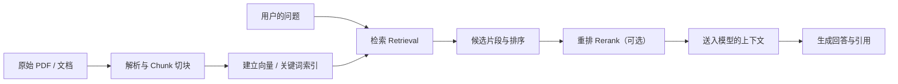

**RAG（Retrieval-Augmented Generation，检索增强生成）**可以理解为“先从外部资料中找依据，再让大模型组织回答”。其中 Chunk 是一段可检索的文档内容；Embedding 是把文字转换为便于相似性搜索的向量表示；Rerank 是在候选结果已经取得后，进一步调整顺序。

如果顾问的问题指向储蓄计划甲，而检索器返回年金计划乙的规则，即使两份资料都包含“货币转换”四个字，它们对这道题的业务意义也不同。RAG 的每个步骤都可能影响最终回答。

Evaluation 则站在另一条流程上：它**组织测试题和可用参考依据，让被测 RAG 实际运行，再计算检索与生成指标**。

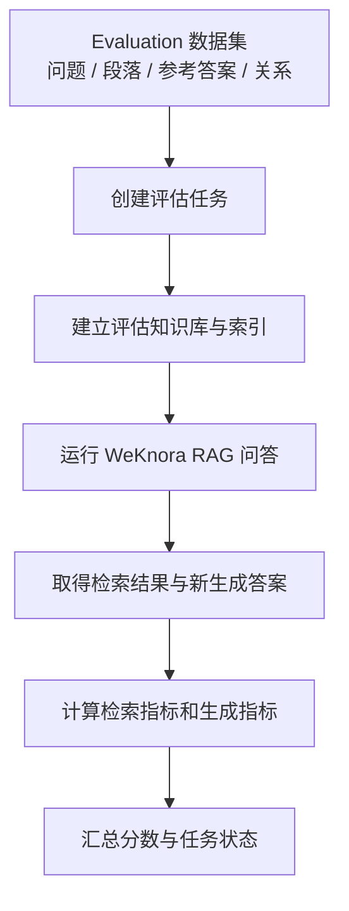

这里要认识两个角色：**RAG 是被测系统，Evaluation 是实验过程**。WeKnora 也有 Agent 引擎，但本次使用的原生 Evaluation 入口实际调用固定的 `rag` 管道，而不是对 Agent 多轮工具决策的直接评分。将来要评价“Agent 是否选对第二次查询”，还需要工具调用轨迹及另一套指标。[^weknora]

### 1.2｜为什么要单独评分？一份正确答案包含哪些不同要求？

以“申请货币转换”为例，我们至少会问三件事。

| 希望确认的事实 | 需要观察什么 | 对应的评估方向 |
| --- | --- | --- |
| 是否找到了目标储蓄计划甲的条款？ | 检索返回的文件、Chunk、排名 | 检索质量 |
| 时间、申请窗口和次数是否有证据支持？ | 模型取得的文本与最终表述 | 证据覆盖和答案支持性 |
| 最终有没有回答用户的完整问题？ | 条款适用范围和人工判断 | 业务正确性与任务完成 |

这三件事的评价单位不同。**“搜到资料”不能直接计为“答对”，而“回答流畅”也不能证明条款适用。** 这正是为什么自动评估不只有一种分数。

### 1.3｜WeKnora 的五份 Parquet 到底是什么？

Evaluation 首先需要知道：要问什么、有哪些材料、什么内容算参考依据。当前 WeKnora v0.8.3 的默认数据集读取五个 Parquet 文件。**Parquet（列式数据文件）**是一种供程序高效读取表格记录的格式，不是保险条款本身，也不是新建人工标注的工作要求。

用最小教学例子理解它们的关联：

```text
queries： qid=1，问题=“储蓄计划甲何时可申请货币转换？”
corpus：  pid=1，正文=“第1周年起，每周年后30日内可申请……”
         pid=2，正文=“另一款产品的货币转换安排……”
answers： aid=1，参考回答=“第1个保单周年日起，在规定窗口申请……”
qrels：   (qid=1, pid=1)   # 现有标注认为pid=1支持问题
qas：     (qid=1, aid=1)   # 这道题对应哪份参考回答
```

| 文件 | 必要列（类型） | 执行时的作用 |
| --- | --- | --- |
| `queries.parquet` | `id:int64`, `text:string` | 提供评估问题 |
| `corpus.parquet` | `id:int64`, `text:string` | 保存候选文本段落 |
| `answers.parquet` | `id:int64`, `text:string` | 保存参考回答 |
| `qrels.parquet` | `qid:int64`, `pid:int64` | 保存问题与已知相关段落的关联 |
| `qas.parquet` | `qid:int64`, `aid:int64` | 保存问题与参考回答的关联 |

`qid`（Question ID）是问题身份，`pid`（Passage ID）是段落身份，`aid`（Answer ID）是参考回答身份。程序通过这几个身份才能确定：当前检索到的段落是否属于这道题的参考材料，以及生成的答案该与哪份文本比较。

注意 **Reference Answer（参考回答）与 Gold（独立核验的标准答案）不必然相同**。假如参考回答只是原系统过去生成、经人工判为正确的一段文本，那么它可以支持一次受限的文本对照实验，却不天然成为独立的、覆盖所有条件的业务标准。这一区别在第二章会直接影响 BLEU、ROUGE 的解释。

<details>
<summary>展开：从五份表恢复一条问答的程序关系</summary>

```python
# 简化的教学伪代码：说明ID连接，不代表WeKnora实际源码
query = queries[1]             # qid=1
relevant_pids = qrels[1]      # [1]
reference_answer = answers[qas[1]]
relevant_texts = [corpus[p] for p in relevant_pids]
# 对被测系统新执行：
# retrieved_chunks, generated_answer = run_rag(query)
# retrieval_score = compare(retrieved_chunks, relevant_pids)
# generation_score = compare(generated_answer, reference_answer)
```

完整实现还涉及知识库、模型、权限、日志、重排、输入转换与状态管理。上面只表达“为什么五种数据要互相关联”。

</details>

### 1.4｜真正使用 Evaluation API 时，要发送和等待什么？

本轮确认的 WeKnora Evaluation 以 HTTP API 为主要入口。客户端先使用 `POST` 创建任务，再凭 `task_id` 使用 `GET` 查询。

```http
POST /api/v1/evaluation
Content-Type: application/json
Authorization: Bearer <本地实验令牌>

{
  "dataset_id": "insurance-native-q40-final"
}
```

请求中还可以指定参考知识库 `knowledge_base_id`、聊天模型 `chat_id` 和重排模型 `rerank_id`。上面仅保留本次理解所需的字段；正式请求还要满足当前实例的鉴权和模型配置。

服务器首先返回包含任务 ID 的结构。这个返回代表**评估任务被创建**，不是得分已经产生。随后访问：

```http
GET /api/v1/evaluation?task_id=<上一步返回的任务ID>
Authorization: Bearer <有效令牌>
```

重要的返回字段只有几个：

```json
{
  "task": {
    "status": 2,
    "total": 1,
    "finished": 1
  },
  "metric": {
    "retrieval_metrics": {"recall": 0.6666666666666666},
    "generation_metrics": {"rougel": 0.2073170686734088}
  }
}
```

*这是本轮 Q40 成功响应的关键字段摘录，不是完整原始响应。*

`status=0/1/2/3` 在本版本中分别表示待运行、运行中、成功、失败。HTTP 状态 `200` 与后台任务 `status=2` 属于不同事实。我们确实曾遇到创建回执已产生，但后台读取输入时失败的实验；此时只有完整任务终态和日志才能证明评估完成。

### 1.5｜POST 发出去以后，源码里究竟发生什么？

现在已经看见接口的输入输出，再沿着 WeKnora 源码往内部看。

| 执行顺序 | 真实代码位置 | 做的事 |
| --- | --- | --- |
| 1 | `internal/handler/evaluation.go` | 接收、校验请求并调用服务 |
| 2 | `evaluation.go` 的 `Evaluation()` | 准备评估知识库、模型参数和任务身份 |
| 3 | `evaluationMemoryStorage` | 注册任务、按 ID 保存进度与指标 |
| 4 | `dataset.go` 的 `DefaultDataset()` | 从 `./dataset/samples/` 读取五份 Parquet |
| 5 | `CreateKnowledgeFromPassageSync()` | 将本次关联的段落导入知识库、等待索引完成 |
| 6 | `KnowledgeQAByEvent(..., Pipline["rag"])` | 逐题执行检索及生成 |
| 7 | `metric_hook.go` 的 `recordFinish()` | 整理检索段落身份与生成文本 |
| 8 | `MetricList.Avg()` | 汇总检索和生成指标 |

数据集当前实际从固定目录读取，`dataset_id` 并不自动选择独立磁盘目录。任务和评分存放在进程内存里，服务重启后不能指望旧 `task_id` 继续读出原分数。我们因此需要把请求、返回和环境快照单独保存。[^code]

另外，**原生 Evaluation 的输入语料构造有一个重要实现特点**：当前 `Dataset.Iterate()` 为每题取得它在 `qrels` 中关联的 Passage；`getPassageList()` 从这些关联段落汇集入库文本。只存在于 `corpus.parquet`、但没有被任一 qrels 关联的干扰段落，在这条路径中并不会自动进入临时评估库。因此它运行的检索难度可能低于包含大量相似异产品材料的完整业务知识库。

### 1.6｜十二项指标怎么读？先用四条候选手算

假设某题总共有三条已知支持证据 `A/B/C`，实际检索前五名为：

```text
原始排名：  1 X（不相关）
          2 A（支持）
          3 Y（不相关）
          4 B（支持）
          5 Z（不相关）
未返回的正确证据：C
```

由此可以手工计算：

- **Recall@5（前五召回率）**：已找到 `A/B` 两条，已知相关总数为3条，所以 `2/3≈0.667`。
- **Precision@5（前五精确率）**：五条返回中只有两条支持，所以 `2/5=0.4`。
- **Reciprocal Rank（首次命中位置的倒数）**：第一条正确证据排第2名，因此这一题是 `1/2=0.5`；多题平均才叫 MRR。
- **NDCG（归一化折损累计增益）**：对每条相关结果按实际位置和相关等级计分，再除以最理想顺序的分数。相同的正确证据越靠前，分数通常越高。
- **MAP（平均精度均值）**：在不同相关命中位置累计检索精度，再按规定的相关总数和问题数归一化；具体实现口径必须核对。

生成指标是另一组：**BLEU-1/2/4** 主要比较生成与参考回答中词组序列的重合；**ROUGE-1/2/L** 比较词、词组或最长公共子序列。它们通常无法单独判断金额、时间窗口、适用主体这类业务关键事实是否正确。

比如“首周年起30日内申请”和“在第一个周年后的三十天窗口办理”语义相近，文字重合不一定高。反过来，把“第一周年”误写成“第三周年”时，整段回答其余内容很相似，也可能取得一定文本重合分数。

[WeKnora 的12项内置指标](https://weknora.weixin.qq.com/docs/03-features/15-evaluation)描述检索与生成的不同维度。我们后面另使用 LLM-as-a-Judge（大模型评审）检查业务断言支持性；它不是 WeKnora 的原生 BLEU/ROUGE，也不是自动化人工标准答案。

### 1.7｜本轮原生 Evaluation 跑通了什么？为什么还要核对算法实现？

第一轮实验已经使用 WeKnora **v0.8.3** 成功跑通官方操作系统问答样例：1题、4段、12项指标。新的补充包又用一条真实保险题完成两次独立的原生成功任务。**第二章会详细展示这条保险题，而不是用官方样例替代实际操作。**

在解释指标之前还有一道工程检查。WeKnora 当前 `metric_hook.go` 的 `recordFinish()` 会尝试用候选 Chunk 的**文本包含关系**反查其 Passage ID。没有匹配到对应参考段落的候选可能从评分输入列表里消失，导致原始负例、排序位置或合并后的段落身份丢失。某些内置 NDCG/MAP 的归一化细节也与常见定义不同。

一张合成表就能看出这种风险：

| 真正检索到的顺序 | 进入评分的序列 | 对首次相关命中的解释 |
| --- | --- | --- |
| `[不相关 X, 相关 A]` | 完整 `[X,A]` | 第二名，倒数排名 0.5 |
| `[不相关 X, 相关 A]` | 只剩 `[A]` | 看起来变成第一名，倒数排名 1.0 |

第二种情况并非检索器变好，只是**评分之前改变了被评估的排序**。本轮补充包用原始 Go 函数完成了11项受控测试，其中多项重现了这一机制。具体的真段落案例和条件留到第二章再解释。[^metric]

### 1.8｜我们上周的 XLSX 与这些输入有什么关系？

上周导出的 Excel 工作簿有两张主表：`标注结果` 42题、`当前参考块` 317行。前者保存问题和人工结论，后者保存问题对应的检索片段、排名、来源及部分分数。归档 HTML 还能恢复历史回答和 Chunk ID。

因此我们已有一条很有价值的起点：**真实用户问题、真实历史回答、真实展示证据和人工核查意见**。接下来先拿出一个历史人工判为正确的案例，观察它如何转换为 WeKnora 真正能读取的数据，又怎样产生新的评分和归因。

## 02｜一条保险问题怎样从 XLSX 走到 WeKnora 的真实评分与归因？

这一章只追踪 **Q40** 一道题。它来自上周的实际保险问答标注，选择它不是因为错误最严重，而是因为**人工已经判断关键结论正确、历史证据身份清楚、原 PDF 关键页面也经过复核**。这样的题适合先学会正确的执行和评分，然后再观察检索质量与评估机制的差异。

### 2.1｜我们拿到的这道题，原本是什么样？

Q40 的去标识版本如下：

> **问题**：储蓄计划甲从第几年可以申请货币转换？
>
> **历史模型回答的核心结论**：从第1个保单周年日起，每个保单周年后的规定30日窗口内可以提出申请；每个保单年度仅可申请一次，且须满足相应行政条件并获得批准。
>
> **上周人工评价**：关键结论“正确”，回复评价“完美”。

在历史 Excel 对应的8条参考块中，候选顺序是：

| 原排名 | 去标识后的来源 | 物理页 | 历史检索分数 | 既有人工证据角色 |
| ---: | --- | ---: | ---: | --- |
| **1** | 储蓄计划甲条款 | 38 | 0.7167 | **直接支持关键结论** |
| 2 | 年金计划乙条款 | 16 | 0.7010 | 未选为关键结论出处 |
| 3 | 年金计划乙条款 | 10 | 0.6992 | 未选为关键结论出处 |
| 4 | 年金计划乙条款 | 4 | 0.6959 | 未选为关键结论出处 |
| **5** | 储蓄计划甲条款 | 37 | 0.6956 | **直接支持关键结论** |
| 6 | 年金计划乙产品手册 | 22 | 0.6940 | 未选为关键结论出处 |
| 7 | 储蓄计划甲行政规则 | 48 | 0.6938 | 未选为关键结论出处 |
| **8** | 储蓄计划甲销售手册 | 58 | 0.6919 | **直接支持关键结论** |

**先观察，后判断。** 正确的关键依据出现在第1位、第5位和第8位；第2、3、4、6位涉及另一产品，说明候选中存在可见的产品干扰。但在本题中，第1位已经提供了关键规则，原模型也作出了人工确认的正确回答，所以不能仅凭“检索里有无关内容”就说这道题答错。

相似产品的货币转换条件可能不同。正是这种混入会在其他问题中构成风险：如果模型误把乙产品的规则套给甲产品，最终答案便可能改变。Q40 能同时展示**回答正确与检索结果不纯净**这两件事。

### 2.2｜怎样从 Excel 找到原问题、参考块和完整回答？

这次直接读取上周的工作簿，原问题在 `标注结果!E2`，问题 ID 在 `标注结果!B2`，人工关键结论在 `标注结果!R2`。另一个 Sheet `当前参考块` 保存同一 ID 的8行参考块及其排名。

```text
标注结果 (42行题目记录)
  B2：qid → Q40的历史稳定问题ID
  E2：问题原文
  R2：关键结论正确性 = 正确
  S2：为什么判为正确

当前参考块 (317行候选)
  选择 qid 相同的8行
  保留 rank = 1 ... 8
  同时读出 文件名 / 起始页 / 分数 / 正文
```

有一个很具体的数据缺口：**本轮主 XLSX 没有独立存储完整历史回答和全部 Chunk ID**。Codex 因此按 `qid + rank` 连接先前归档的 HTML，从中恢复答案文本和 CID，并对照问题、Chunk 正文、文件名与页码。全体42题、317块的关联检查通过，Q40 也得到完整的可供程序使用的中间对象。

这个步骤看起来只是读表，却直接决定后续结果是否可信。如果两题使用了相同的显示排名“第1名”，只根据排名合并就会把它们的证据串在一起；必须连同问题身份一起使用。

<details>
<summary>展开：真实 XLSX 转换脚本的关键数据结构</summary>

下面是本轮 `01-single-case/scripts/convert_case.py` 的核心结构化片段（省略路径、业务正文和校验辅助函数）：

```python
# q: 已按 qid 找到的规范化历史单题对象
# relevant: 既有核查认定的直接支持位置 [1, 5, 8]
data = {
    "queries": [{"id": 1, "text": q["question"]}],
    "corpus": [
        {"id": c["rank"], "text": c["参考块内容"]}
        for c in q["chunks"]
    ],
    "answers": [{"id": 1, "text": answer}],
    "qrels": [{"qid": 1, "pid": r} for r in relevant],
    "qas": [{"qid": 1, "aid": 1}],
}
```

本次 Parquet 的整数 `qid=1` 是**实验局部身份**，通过另存的 `identity-mapping.json` 对应回原始 Excel 问题 ID。`pid` 取历史排名1至8，映射文件仍保存其原 CID、文档与页码。实验局部 pid 不等于 WeKnora 生成的数据库随机 Chunk ID。

</details>

### 2.3｜我们实际生成了哪五份文件？

Q40 最终生成的数据文件情况如下：

| 文件 | 实际行数 | 内容来源 |
| --- | ---: | --- |
| `queries.parquet` | 1 | Excel 原问题 |
| `corpus.parquet` | 8 | Excel 中保存的8条参考块 |
| `answers.parquet` | 1 | 既有人工判为正确的历史回答，去除旧引用标签 |
| `qrels.parquet` | 3 | 已有核查标出的支持关系：`(1,1)、(1,5)、(1,8)` |
| `qas.parquet` | 1 | `(1,1)`：问题1对应参考回答1 |

这五个数据文件都经程序写入、读回、比对类型和实际文本，校验状态为 `passed`。独立映射表保存了原始问题身份和每个 pid 的来源位置。

下面有两处容易被误解。

**第一，为什么 `answers` 使用旧模型回答？** 因为原来的人工已经判定 Q40 的关键回答正确，我们可以沿用它作为一次**弱参考（weak reference）**来演示原生 Evaluation 的格式转换与生成文本对照。它来自原系统，**并没有经过独立标准答案建设**；新 WeKnora 回答与它有较高或较低的文本重合，都不能单独当作保险答案准确率。

**第二，为什么 `corpus` 有8条，`qrels` 却只有3条？** 因为这3条是历史人工已选中的关键支持证据，其他5条并没有被重新人工判定为“严格不相关”。我们保存了全部8条候选及其原排序，但 WeKnora 当前原生评估构造知识库时，只读取 `qrels` 关联过的 Passage。实际本次新建的临时评估知识库因而只含那3段，不包含其余5段干扰文本。

程序中的 `getPassageList()` 生成一个长度为9的稀疏数组（最大 pid=8，包含0位置），实际仅3个位置非空。因此日志中“Creating knowledge from 9 passages”的9是数组槽位数，**不是9段有效语料**。这也意味着：我们可以研究输入转换和评分机制，却不能拿该原生新任务来衡量原历史8条候选组成的完整业务库检索难度。

### 2.4｜Parquet 已经生成，为什么第一次还是没有跑通？

Q40 数据转换后，Python 的 PyArrow 可以正常读回文件。但第一次写入使用默认 Parquet metadata 格式，在实际 WeKnora 后台 `DefaultDataset` 读取时遇到了 `unexpected EOF` 并出现 panic。HTTP 创建请求已经发出，后台并未产生一个可核验的正常成功终态。

本轮使用以下写入选项生成兼容的文件：

```python
import pyarrow as pa
import pyarrow.parquet as pq

# 变量 rows / schemas / dataset_dir 来自上面的转换与校验程序
pq.write_table(
    pa.Table.from_pylist(rows, schema=schemas[name]),
    dataset_dir / f"{name}.parquet",
    version="1.0",
    data_page_version="1.0",
    store_schema=False,
    write_statistics=False,
)
```

**改变的是文件编码兼容性，而不是保险问题、参考答案或相关性标签。** 使用这组选项重新写出五份文件后，两个真实 Q40 原生 Evaluation 任务都成功结束。实验只能证明**这组兼容选项能够工作**，尚未定位是哪一个底层 metadata 字段单独导致首次失败。

这一小段排障过程很能说明实际软件工程：Python 能读取，不代表另一套 Go Parquet 读取器一定兼容；而 POST 已经返回，也不代表后台评分真正完成。

### 2.5｜本次真正运行时配置了什么？

补充实验复用了已经核验的 WeKnora v0.8.3 官方发布二进制，在隔离环境中运行。主要组件和配置如下：

| 组件 | 实际运行记录 |
| --- | --- |
| WeKnora | v0.8.3；源码对应提交 `3e22822c...` |
| 元数据 | SQLite |
| 检索引擎 | Qdrant 1.16.2 |
| 向量模型 | BAAI/bge-m3（1024维） |
| 聊天模型返回身份 | `gpt-6.1-sol`（通过本地兼容适配层） |
| 重排 | 未配置 Rerank 模型 |
| 数据集 | Q40，一题、3个已选支持段落 |

这里不涉及把完整保险 PDF 重新 OCR 或解析一遍。Evaluation 的数据入口已经是可直接索引的段落；源 PDF 的页码关系保存在本轮适配器的独立映射文件里。

实际创建任务的关键请求字段为：

```json
{
  "dataset_id": "insurance-native-q40-final"
}
```

正式原始请求还关联了当时真实创建的模型 ID。归档包中保存创建响应、逐次轮询和模型调用，公开稿只展示必要字段。

### 2.6｜请求发出后，哪一刻说明评估真的完成了？

最终选定的 Q40 任务在 UTC `2026-10-21 09:34:10` 创建，`09:34:24` 结束。关键状态是：

```text
09:34:10  POST 创建任务，status = 0
09:34:10  GET 观察运行中，status = 1，total = 1
     ... 后续多次 GET 继续观察 ...
09:34:24  GET 获得完成结果，status = 2，finished = 1/1
```

它有真实 `task_id`，完整身份在私有 API 记录里。两次 Q40 成功运行都是独立真实执行，生成文本可能有所区别，并不代表其中一次对另一次进行了系统优化。

具体执行日志还告诉我们，程序做过这些动作：

```text
评估数据 → 关联 qrels 中的 3 段 → 建索引
向量检索返回 3 个候选
关键词检索返回 0 个候选
过滤后保留 3 个候选
上下文合并记录：3 → 1
最终模型输入仍包含原始3段的可读内容
模型生成新的 Q40 回答
Metric Hook 计算12项指标
GET 返回成功
```

本次 provider 请求里包含三个可引用内容 handle，形状类似：

```text
<chunk id="c1" index="1">...第1段支持材料...</chunk>
<chunk id="c2" index="5">...第5段支持材料...</chunk>
<chunk id="c3" index="8">...第8段支持材料...</chunk>
```

这些 handle 对应的是本次实验使用的 pid1、5、8。这里的引用 `c1/c2/c3` 是模型输入中的临时引用身份，不是上周 Excel 的 Chunk ID。模型实际上读取过三段有效文字，这一点由真实的 provider 输入得到支持。

新 WeKnora 答案重新给出了第1周年、30日窗口、每年一次以及申请条件，关键时间规则与保存的原条款页面一致。但**历史回答与新回答是两份不同模型执行的内容**：上周人工的“正确”标签直接评价的是历史回答，不能直接复制到新运行结果上。

### 2.7｜先不用 WeKnora，我们怎样手算原来的8条检索结果？

回到2.1的小表：8个历史展示候选中，第1、5、8名被原有核查列为直接支持关键结论。

现在只考虑保存下来的这一组**已选支持证据**，计算“前5名是否覆盖这些已选材料”。

**保留选中证据 Recall@5：**

$$
\frac{\text{前五位已选支持块数量}}{\text{全部8个展示候选内已选支持块数量}}
= \frac{2}{3}\approx0.667
$$

**Selected-support density@5（前五位已选支持密度）：**

$$
\frac{\text{前五位已选支持块数量}}{\text{前五位候选总数}}
=\frac{2}{5}=0.4
$$

**RR@5（本题首次有效证据排名的倒数）：** 第1名就有一条支持证据，所以 `1/1=1`。

若将直接支持的等级记为2、其他未选中候选在这个**特定代理评分**里记为0，前五分级 NDCG 为约 `0.6508`。这能用代码复算，但不能因此说其他5条在业务上已经被验证为不相关。

这四个数字回答的是**历史8个展示候选的排序和证据分布**，与原始完整知识库的 Recall/Precision 不同。它尤其不能证明“模型只查过这8条”。旧 HTML 展示的是窗口，不是完整历史工具轨迹。

### 2.8｜WeKnora 原生新任务给出了什么分数？

本次最终 Q40 原生任务成功返回以下12项指标：

| 类型 | 指标 | 原生返回 |
| --- | --- | ---: |
| 检索 | Precision | 1.000000 |
| 检索 | Recall | **0.666667** |
| 检索 | NDCG@3 | 1.000000 |
| 检索 | NDCG@10 | 1.000000 |
| 检索 | MRR | 1.000000 |
| 检索 | MAP | 1.000000 |
| 生成 | BLEU-1 | 0.131275 |
| 生成 | BLEU-2 | 0.087689 |
| 生成 | BLEU-4 | 0.039955 |
| 生成 | ROUGE-1 | 0.268293 |
| 生成 | ROUGE-2 | 0.092050 |
| 生成 | ROUGE-L | 0.207317 |

注意两个看起来一样的数字：**历史保留集 Recall@5 = 2/3**，而 **WeKnora 原生 Recall = 2/3**。它们虽然数值相同，却评价了不同的检索序列、参考集合与实现路径。前者按8个旧展示候选和已选支持位置计算；后者来自新建三段索引、WeKnora 管道和 Metric Hook 的输出。不能把这次“相等”当作两套评测器已经互相证明正确。

生成指标也有明确边界。新的回答比作为弱参考的历史回答更简洁，BLEU/ROUGE 会受到长度、引用清理、用词和分句方式的影响。这些指标比较的是新旧文本的形式重合，不自动检查业务规则是否已经完整、正确。

### 2.9｜三段都进入模型，为什么原生 Recall 仍然是2/3？

这是本次补充实验中最值得用源码解释的一处现象。

我们能够**直接观察**到：新评估知识库实际返回3段，provider 输入中的 `c1/c2/c3` 有对应内容。原生评分结果却是 `Recall=2/3`。

真正的评分入口位于 `metric_hook.go` 的 `recordFinish()`。它优先拿重排结果，没有时回退检索结果，再根据检索内容与参考 Passage 的**双向字符串包含关系**猜测原来的 `pid`。

补充包没有直接从正在运行的二进制导出 `MetricInput`（评分器中间输入），所以我们没有把猜测直接当作线上内部事实。Codex 另外提取了运行版本对应的 Go 原函数，在无网络的受控环境中执行 **11项测试，全部通过**，并保存输入、输出和精确函数绑定。

其中最有用的是三组：

| 受控测试 | 输入或现象 | Go 测试结果 |
| --- | --- | --- |
| **C01** | 原始排名 `[无关X, 正确A]` | 未匹配的 X 被排除后，下游 Precision/RR 从原始口径0.5变为1 |
| **C10** | Q40真实保存的3段文本 | 合并前 ID 对应3/3；模拟已核验入库处理并用原始合并/Hook后得到 `[5,8]`，Recall=2/3 |
| **C11** | 上轮官方样例的4段文本 | 合并前4/4；受控合并及Hook后得到3/4，与旧官方原生 Recall=0.75 一致 |

为什么会这样？这里存在一条可以在受控输入里精确重现的数据变化链：

```text
原始 Passage 保留某段末尾的换行
  ↓
入库阶段执行 TrimSpace：去掉首尾空白
  ↓
相邻、连续坐标的 Chunk 合并，可能复用并修改 SearchResult 对象
  ↓
用于评分的字符串与原始 Passage 不再逐字双向包含
  ↓
Metric Hook 无法恢复其中一个原始 pid
  ↓
Recall 按恢复出的ID计数，得到 2/3
```

更直观地说，**模型看见的资料，与评分器拿来识别身份的字符串，不一定是同一个数据形态**。即使模型最后能引用三个原块，评分器仍可能在合并、去空白之后丢失原本的段落身份。

上面的 C10/C11 真实文本测试与原生标量结果一致，是比第一轮单纯猜测更强的**受控机制证据**；但由于运行二进制没有直接导出那个中间 ID 列表，我们保留最后一步的确认边界。Go 测试还验证了 NDCG/MAP 的某些短列表分母与通常的全相关集定义不同，故原生 Precision/MRR/NDCG/MAP=1 不能被解释成完整业务库里“没有排序或噪音问题”。[^metric]

### 2.10｜这条题最后应该怎样归因？

现在可以把第一章提出的三个判断对象放回同一张表。

| 观察对象 | 本题的真实情况 | 适合的结论 |
| --- | --- | --- |
| **历史回答** | 对第1周年、30日窗口和每年一次作出正确说明 | 已有人工评价“正确” |
| **历史检索结果** | 第2/3/4/6名出现同词异产品材料 | 可见候选噪音，优先考虑产品身份过滤与检索排序 |
| **新 WeKnora 任务** | 实际仅入库3条已选支持段落；新生成回答 | 是受限语料的原生 Evaluation 演示，不是旧库重放 |
| **原生评分实现** | 三段进入模型、返回 Recall=2/3；受控 Go 测试复现匹配机制 | Evaluation 身份映射与计算口径的可靠性问题 |
| **Agent 决策实验** | 关键证据在首次检索中已经存在 | 适合作为“证据已足够，应及时停止”的对照样本 |

下一轮若测试产品过滤，可以保持问题、模型与检索库不变，只改变允许检索的产品身份，比较正确材料的原始位置、历史支持密度和回答效果。若测试评估代码，应沿稳定 `pid` 记录原始排名、合并前后对象和最终模型输入，不用文本包含猜测来恢复身份。

到这里，一条 XLSX 记录已经走完了：**原始标注 → 数据关联 → 五文件转换 → 创建原生任务 → 检索和模型生成 → 自动指标 → 受控复核 → 分层归因**。第三章将使用相同的分析习惯处理其余41题：哪些是程序能直接确认的事实，哪些需要模型理解，哪些原因还必须保留为待验证。

## 03｜怎样对42道保险问答建立可复算的批量归因方法？

单题分析让我们认识了数据、评分和证据身份。现在扩大到42题，问题变了：

> **不是“这道题得多少分”，而是“哪些问题反复出现、这些现象关联哪个环节、已有证据能支持什么原因，以及下一轮应该怎样验证改进”。**

这要求一套可以批量运行、可以逐题审阅的程序，而不是让模型给每题投票选择一个 A/B/C/D 标签。本轮补充实验实现了这条完整链：**确定性数据检查 → 真实模型语义分析 → 既有人工标注对照 → 分层归因 → 统计图 → 优化实验建议**。

### 3.1｜为什么人工“正确/部分正确”还不足以说明该改哪里？

先看最直接的数据：上周42题的人工关键结论评价。

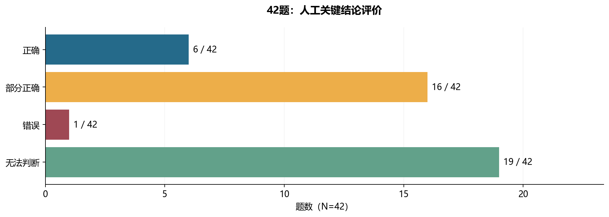

*图1：来自实际 XLSX 的42题人工评价。6题正确、16题部分正确、1题错误、19题无法判断。每题计一次。*

这张图可以告诉我们已有人工判断的分布，却不能直接解释错误原因。例如两道“部分正确”的题，可能分别是：检索没取得另一份产品资料，或者模型取得了正确原文却错误解释一个年龄术语。它们的工程改造方向完全不同。

更需要注意“无法判断”有19题。这个状态代表**在已有人工观察条件下尚不能确定**，不等于19道错误，也不等于系统做出了19次合理拒答。想进一步判断，必须回到原始问题、展示证据和回答。

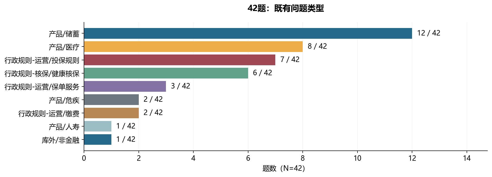

*图2：来自原 XLSX 的问题类型标签。类型总计42题；储蓄类12题、医疗类8题、运营/投保规则7题和核保/健康核保6题等。*

不同问题需要的证据也可能不同。单一产品条款查询强调精确定位；多产品比较需要逐一获得足够资料；核保适用问题可能涉及主体、时间及其他限制。**问题类型是有用的分析入口，但不能直接当作根因。**

### 3.2｜第一步：将42题、317个 Chunk 变成稳定的分析记录

本轮程序读取两张主 XLSX 工作表，并通过 `qid + rank` 与历史 HTML 连接，恢复旧回答和 Chunk ID，再附加先前人工核查过的证据角色。得到的权威逐题输出为 `CASE-RESULTS-42.json`，CSV 是便于阅览的扁平版本。

每道题记录了四层内容：

```json
{
  "caseId": "SYN-Q-EXAMPLE",
  "questionType": {"level1": "产品", "level2": "储蓄"},
  "humanEvaluation": {"correctness": "部分正确"},
  "retrievedChunks": [
    {"rank": 1, "pageStart": 12, "existingEvidenceRole": "支持部分结论"}
  ],
  "deterministicChecks": {"...": "程序复算事实"},
  "semanticAnalysis": {"...": "模型提出的语义判断"},
  "attributions": [{"...": "现象、证据、核验状态、下一次实验"}]
}
```

*这是公开的结构化教学摘录，省略业务原文；完整实际字段和每题原始关联保存在授权证据包。*

这一结构的核心不是字段越多越好，而是**事实分层**。原 Excel 人工标注不会因为本轮模型作出另一种判断而被覆盖；模型的候选原因也不会自动升级为程序已经证实的上游故障。

还有一项需要区分的历史事实：上周另一批核查曾讨论124条解析或 Chunk 异常，它与本轮主 XLSX 使用的标记来源和版本不同。本次主工作簿直接记录的解析异常是 **11题、19块**。旧核查记录仍可用于寻找原 PDF 线索，但不能把124和19简单相加。

### 3.3｜第二步：哪些特征能由代码直接计算？

有些问题不需要模型。比如一个 Chunk 是否填写起始页码、某个引用 CID 是否出现在当前展示的候选窗口，以及前五名中有几条原人工选中的支持证据，直接读表就能确定。

本轮 `scripts/analyze_batch.py` 对所有42题执行统一检查，保留原始证据。最有代表性的数字是：

| 可观察事实 | 实际数量 | 正确理解 |
| --- | ---: | --- |
| 至少一块缺起始页的题 | **31 / 42** | 当前保存的数据存在来源定位缺口 |
| 缺起始页的 Chunk | **122 / 317** | 数据字段缺失；原因未被此数字直接证实 |
| 存在窗口外引用的题 | **20 / 42** | 回答引用的部分 CID 不在当前保存的显示候选里 |
| 窗口外引用出现次数 | **146 / 466** | 是引用出现次数，不是独立幻觉数量 |
| 带主 XLSX 解析异常标记 | **11题、19块** | 属于历史记录的异常观察 |
| 有既有选中支持证据的题 | **22 / 42** | 可以对这部分题计算保留集排序指标 |

**这里存在两条很重要的判断纪律：**“缺少页码”不自动等于 PDF 解析器发生了错误；“引用不在显示窗口”也不自动等于模型编造了引用。前者可能来自元数据、导出或者字段映射，后者可能来自当前仅保存了部分工具结果。这些都必须通过更完整的执行记录才能继续定位。

再看317条 Chunk 的既有核查角色。

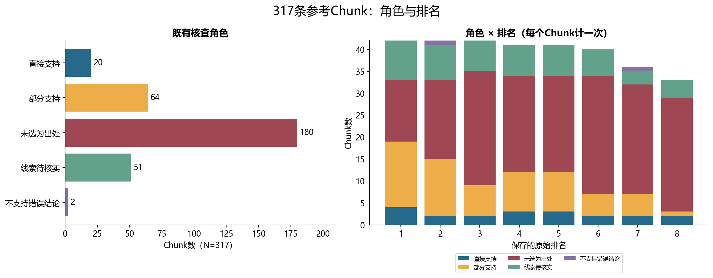

*图3：既有核查角色与原始展示排名。20条直接支持、64条部分支持、51条待核查线索、180条未选为关键出处、2条不支持错误结论。每块计一次。*

在22道具备已选支持块的题里，本轮可以计算保留集 Recall@5 平均约 **0.8293**，首条已选支持块的 MRR@5 约 **0.9129**。另一个“前五名已选支持块密度”对42题计算，平均约 **0.3254**。

它们不是“真实全库检索召回率”和“答案准确率”。这些分母都来自已经**展示并被核查**的候选。尤其到显示窗口结束时，保留集的覆盖可能自然变成1，不能由此证明系统在整个知识库里找齐了所有正确证据。

### 3.4｜第三步：机器能数出候选块，谁来判断回答的含义？

程序知道一段文本的排名，却未必知道模型是不是把“受益人”理解成“投保人”，或把某个年龄计算术语扩写成另一套算法。这个层面需要 **Semantic Analysis（语义分析）**。

本轮复用了原来的 LLM-as-a-Judge 流程，升级为冻结的 `atomic-critical-v2` 规则，向真实模型服务逐题提交：**问题、历史回答、保存的检索 Chunk 和来源字段**。模型输入里没有加入上周人工的“正确/错误”标签，以便能够独立对照它的判断。

评审要求模型按如下顺序工作：

```text
原始问题有什么子要求？
    ↓
历史回答写出了哪些独立的事实断言？
    ↓
其中哪些是年龄、主体、期限、金额等关键断言？
    ↓
逐条对照保存的证据：有支持 / 有反证 / 证据不足
    ↓
另行评价是否切题、是否完成任务
    ↓
提出潜在问题类别与仍然缺少的核验信息
```

模型返回结构化结果，同时保留原始请求、原始响应、模型返回身份、提示词版本、响应 ID、用量和失败记录。这里的“切题”与“完成”必须拆开：回答“现有证据不足”可能完全切题，但没有产生用户想要的最终确定结论；在资料确实不足时，这又可能是唯一正确的做法。

<details>
<summary>展开：批量模型评审怎样避免把人工答案喂给模型？</summary>

```python
# 工作流形状摘录（非完整业务提示词）
input_for_judge = {
    "question": case["question"],
    "historical_answer": case["historicalAnswer"],
    "ranked_evidence": case["retrievedChunks"],
}

# 人工评价留待计算完成后再做交叉对照
# 输入不包含 case["humanEvaluation"]
result = call_model(input_for_judge, prompt_version="atomic-critical-v2")
```

批量实现实际使用固定提示词哈希、每题保存结果，并对输出 JSON 做结构校验及引文形式检查；不是每次临时编写一套评分说明。旧8题参与了评审规则的校准，因而并不能再作为独立的验证集声称泛化准确率提升。

</details>

### 3.5｜第四步：42题真实语义评审得出了什么？

本轮 **42题均有可供分析的语义输出**。自动模型提取了486条事实断言：

| 模型对断言的判断 | 断言数 | 占486条的比例 |
| --- | ---: | ---: |
| 有展示证据支持（supported） | **332** | **68.3%** |
| 具有反证（contradicted） | **5** | **1.0%** |
| 现有展示证据不足（insufficient） | **149** | **30.7%** |
| **合计** | **486** | **100%** |

把所有断言合起来计算的 **Micro（微平均）支持代理 ≈68.3%**；先算每题支持占比、再对42题取均值的 **Macro（宏平均）≈69.5%**。这两个统计口径不同，主要因为一道题可能只有几条断言，另一道题却有十余条。

本轮还增加了“引文形式核验”：要求模型为已支持或反证的断言提供可以在保存证据中找到的短文本片段。对正文做严格匹配或仅空白归一化后，仍有 **32条已标 supported/contradicted 的断言没有通过精确引文形式检查**。把通过这类形式检查的支持项计入更保守的代理，宏平均约 **60.8%**。

这不意味着32条业务断言全部错误。一个模型可能引用了改写的短句、不同标点或跨多个 Chunk 的内容。精确字串匹配只能证明文字形式上的可定位性，**不能替代业务上的语义蕴含判断**。

最终批量分析状态为：

| 处理状态 | 题数 | 含义 |
| --- | ---: | --- |
| `complete_analysis` | **29** | 语义结构与本轮要求的证据形式检查齐备 |
| `partial_analysis` | **13** | 已取得语义输出，但部分引文或初步证明要求尚不完整 |
| **合计** | **42** | 全部有可追溯的程序处理记录 |

原始模型调用层另有 **41题正常 scored，1题 `partial_proof_validation_failed`**，后者保留两次未满足证据要求的原响应及部分分析结果。这两套状态分别描述“模型评审记录”和“统一分析材料”，均**不表示历史问答的业务成功率**。

### 3.6｜第五步：为什么还要与上周人工评价对照？

现在可以把每题的人工评价放在横轴，把模型的断言支持比例放在纵轴。

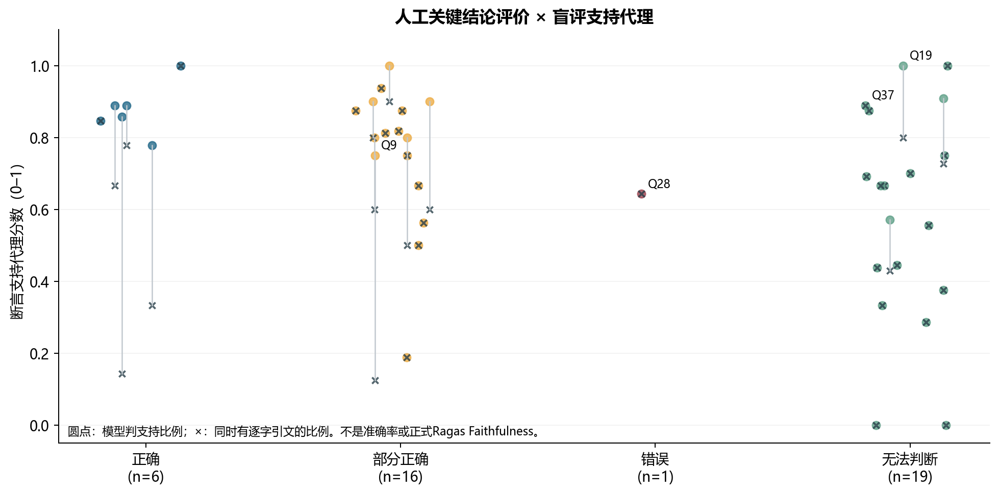

*图4：圆点为模型断言支持比例，叉号为同时满足逐字引文形式检查的支持比例。人工标签与支持代理不是同一量纲，不属于准确率混淆矩阵。*

这张图中，有些人工标为“部分正确”或“错误”的题，模型仍给出相对较高的支持比例。为什么？原始材料提供了至少三种不同的解释。

**Q9：正确范围掩盖了错误的术语等价。** 旧8题评审（V1）把正确的年龄范围与错误的等价解释混在同一个断言中，得到1.0支持。V2 将错误等价关系单列，在保存证据中判为不足，单题代理降到0.75。这个变化说明更细的原子断言有助于发现问题，**不是对独立样本集准确率提高了25%的证明**。

**Q28：一条关键业务实体错误，被多个一般正确描述稀释。** 该题原人工判断为“错误”，而 V2 仍给出约0.6429的支持代理。评审还提取了若干确实有证据的普通描述，但它们无法抵消决定核心业务结论的主体或疾病实体错误。后续应该把关键断言单独审核，而不是只看平均数。

**Q19/Q37：回答切题，与完成任务是两件事。** 一条多产品比较可能正确说明“资料尚未齐全”，支持性很高，却没有完成用户要的完整比较；另一条关系规则题在现有证据不足时合理保留未知，不能因未给确定结论就一律判断生成错误。

这正是批量归因系统要处理的难点：**正确的事实断言、完整的任务覆盖、合适的拒答或停止，是不同的评价对象**。

### 3.7｜第六步：如何把可观察现象组织成有证据的归因？

归因不是让一个模型选择“这题属于 C 检索层”就结束。原因至少有五个证据层级：

| 层级 | 实际含义 | 可以得出什么结论 |
| --- | --- | --- |
| **确定性观察** | 原始数据有缺页码、CID不在保存窗口等 | 已发生可复核的数据现象 |
| **历史人工记录** | 上周人工指出某个关键问题或解析异常 | 存在历史业务核查依据 |
| **局部材料交叉支持** | 已有回答、Chunk、PDF 等共同支持某种错误机制 | 可以解释局部问题，但不一定确认整个内部链路 |
| **模型候选** | Judge 推测检索、生成、Agent 决策等责任 | 值得验证的假设，仍需独立证据 |
| **因果路径确认** | 完整原系统 Trace 或实际干预实验能排除其他解释 | 才能较强地确认某个内部机制导致结果 |

例如：一题的参考块没有页码，我们可以确定“**当前保存的来源位置不完整**”；但无法仅凭空值确认是 PDF 解析、检索、UI 展示、还是导出步骤导致。又如模型用错另一个产品的条款，可能与检索噪音有关，也可能是生成时错误使用证据，需要查看真正输入模型的上下文和原始来源。

本轮分类采用 A（解析/元数据）、B（业务事实/口径）、C（检索/排序）、D（工具与继续决策）、Generation（生成）、Evidence/Observability（来源和轨迹）、Evaluation（评分管道）、Resource（当前外部服务）。一题允许有多个标签，因为实际问题经常跨层发生。

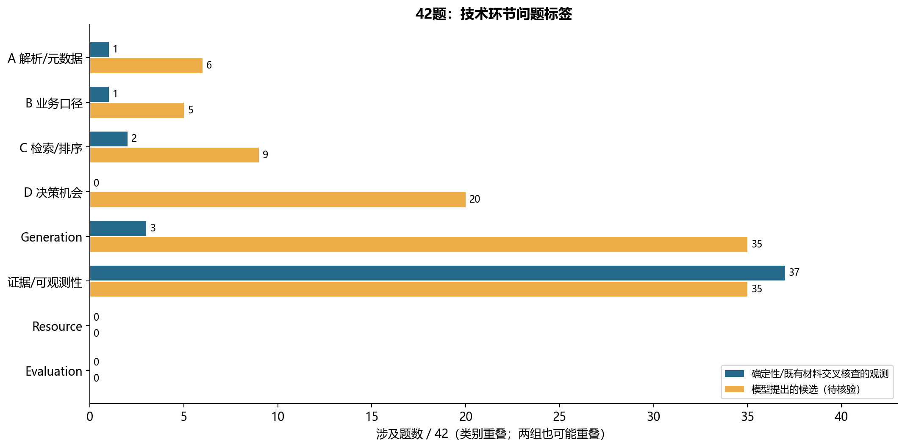

*图5：黄色为模型候选，蓝色为确定性/已有材料交叉支持的观察。标签可多选，每题每类只计一次；蓝色不代表该技术层的全因果路径已验证。*

从模型候选看，Generation 35题、D 20题、Evidence/Observability 相关信号39题；这些是**涉及范围，不是“35题已确认生成器故障、20题已确认应进行Agent补查”**。尤其 D 层当前没有经过真实业务补查证实的归因案例。

现在只看已有材料支持的观察，图形会有很大变化。

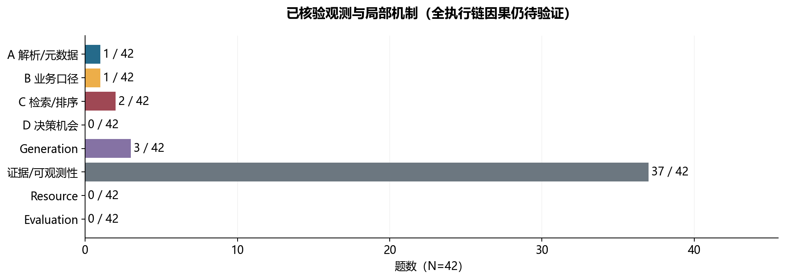

*图6：归档证据与确定性检查支持的观察按问题涉及数量统计。可观测性37题、生成局部机制3题、检索局部机制2题等。全执行链因果验证仍待实验。*

这里最突出的不是“Agent 决策错误”，而是**来源和执行证据的可追溯性**。如果当前只有展示的部分 Chunk，却没有完整 ModelStep 输入与 ToolResult，就很难证明模型究竟有没有见过那些资料。把这个约束意识放进归因系统，比对所有题硬性选择一个责任层更可靠。

### 3.8｜第七步：怎样把标签变成有意义的图，而不是堆统计？

在得到每题统一记录之后，本轮 `scripts/plot_results.py` 从数据源生成8组 PNG/SVG 图，原始统计另以 CSV/JSON 保留。图表本身也是一种工程结果，需要知道单位是什么。

一张有帮助的交叉图是「问题类型 × 关联技术环节」。

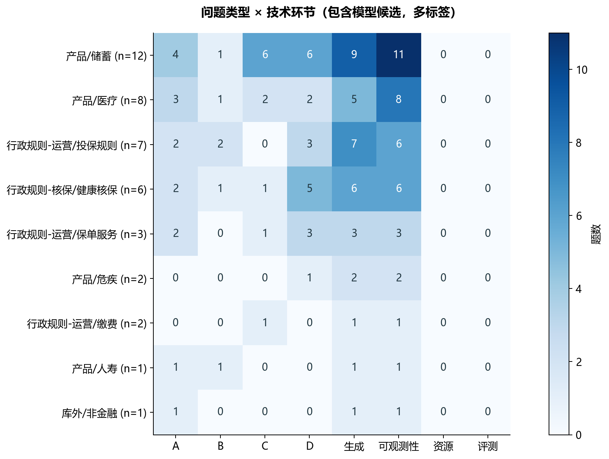

*图7：同一题可以关联多个技术环节，色块值为每题每类去重后的数量。包含模型候选，不表示因果概率。*

例如，储蓄类问题中出现较多 Generation 候选和证据可追溯性信号；运营投保规则问题中也可能出现较多生成解释方面的候选。这可以帮助我们决定**下一轮抽查哪些类型、对哪些字段实施验证**。它不能证明某个题型天生会让某一模块出错，因为样本数小、各题难度不同，而且大部分标签仍是模型候选。

图表设计需要记住三条原则：

1. **分母清楚**：42是题数，317是 Chunk 行数，486是模型拆出的断言数，466是引用出现次数。单位不同，百分比不能直接混算。
2. **重叠清楚**：一题同时有缺页和错误解释，A/C/Generation 等标签可以交叠，类别数相加可能超过42。
3. **证据强度清楚**：人工事实、程序确定性观察、模型候选和真正的因果确认，不能仅用一条普通柱状图混为一个“错误率”。

### 3.9｜第八步：批量分析最后怎样转化为优化行动？

分析方法真正有用的结果应该像下面这样：

| 实际可见的现象 | 对应证据 | 主要应检查的环节 | 可以执行的下一轮验证 |
| --- | --- | --- | --- |
| 31题保存了缺页 Chunk | Excel 起始页字段、来源映射 | Evidence / 元数据链 | 对照入库→检索→工具→导出各步来源字段 |
| 20题有显示窗口外引用 | 原回答引用与候选 CID 对照 | 运行记录与上下文投影 | 导出该 Turn 完整 ToolResult/模型输入，核对引用位置 |
| Q9 年龄术语发生错误等价扩写 | 原回答、条款术语、人工评价、V2原子断言 | Generation / 业务语义 | 固定证据，仅调整生成约束和关键断言核验 |
| Q28 关键业务实体混同 | 原回答及人工“错误”、模型评审 | Generation / B | 对关键实体独立判断，不以普通断言平均抵消 |
| Q19 多产品比较资料不完整 | 各产品候选分布、未完成的回答 | B/C/D 候选 | 确认其他产品在授权库可用，受控分产品查询 |
| Q40 相似产品材料混入 | 历史原始排名2/3/4/6 | C / 检索过滤 | 固定其余配置，仅比较产品过滤策略的有效证据与时延 |
| 新 Q40 的原生评分身份遗漏 | 真实 API 及 C10 受控 Go 测试 | Evaluation | 对比合并前后稳定 pid、原排名和 `MetricInput` |

最后一张图把“问题信号→建议工程环节”连起来。

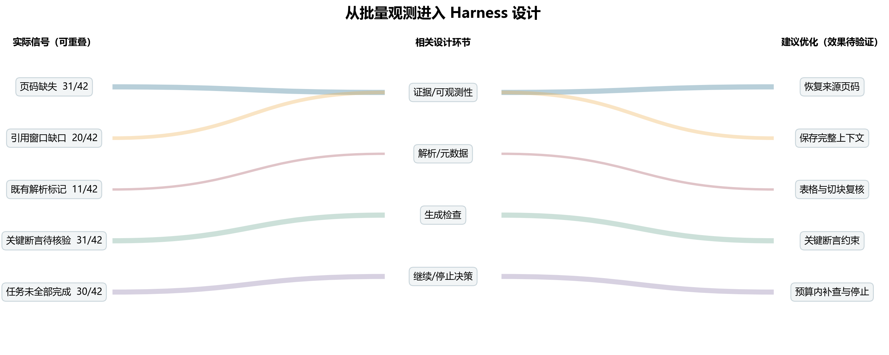

*图8：线条表示分析中使用的关联关系，不代表改造后的因果收益。部分信号（例如“任务未完成”）来自模型的任务覆盖判断，尚需业务核验。*

这张图不是为了得出「全部 Harness 模块都应该加功能」，而是帮助区分：**现在哪些事实还取不到、哪个动作尚不能执行、具体要通过什么实验检验收益。**

### 3.10｜第三周的批量归因最终证明了什么？

现在可以回顾整个批量方法，形成一条真正可重复的工程流程。

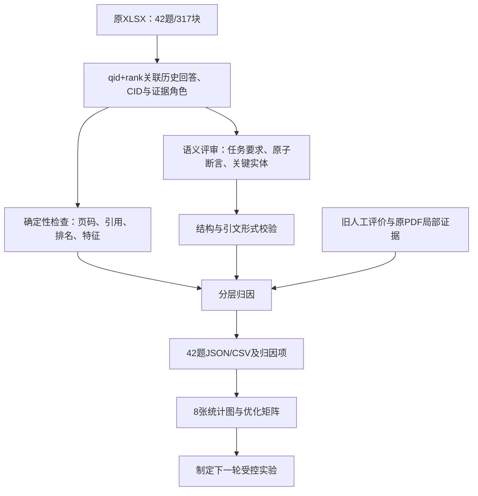

两轮实验最终支持这些具体结论：

- **全部42题与317块已经完成规范化关联，42题均有语义分析输出**；29题资料形式完整，13题仍有部分引文或验证缺口。
- **批量最清楚的直接问题是可观测性**：31题缺部分来源页，20题有展示窗口外引用。它们影响我们事后确定模型究竟看到了什么。
- **自动模型评审确实能够将一些关键错误拆出来**，但486条断言的支持比例不是人工业务正确率；Q9、Q28等仍需独立核查关键实体与定义。
- **多产品比较等问题值得设计自主补查实验**，但当前无法确定是否能在原授权库中补出缺失材料。
- **完整内部因果路径已被严格确认的题数仍为0**：本轮没有原旧系统完整的 Trace 或针对每种故障的干预回放；已有局部 PDF/人工证据不会因这一状态而失去价值。

本次原业务检索服务再次返回错误码 `-2050`（InexistentCluster），实际新增业务补检索次数为 **0**。WeKnora 本地 Q40 评估成功，是另一套临时知识库环境，不能由此宣布原业务检索服务恢复，也不能声称 Agent 已提升这42题的准确性。

批量归因的成果不在于得到了一个“大而全的错误率”，而在于建立了一个**可以从42条问题一直反查到原始证据、可以重复运行、可以解释不确定性，并能导出下一步行动**的工作方法。第四章再讨论，这些事实对 D 方向的 Harness 意味着什么。

## 04｜批量归因能给 Agent Harness 的设计带来什么启发？

到这里已经有真实可复核的现象：有时资料混入其他产品，有时模型把正确术语解释错，有时答案引用不在保存窗口里，有时用户要求比较三个产品而系统只取得了部分证据。现在我们换一个问题：

> **如果我是正在完成这项保险问答任务的 Agent，我到底能看到什么、能调用什么、怎么知道自己还缺什么，以及系统怎样帮我把每一步记录清楚？**

这比罗列 Harness 模块清单更接近实际开发。Harness（Agent 运行治理系统）不替模型决定保险条款含义，而是为模型提供受控的运行环境：合法工具、准确上下文、执行预算、状态、已提交结果和可追溯引用。

### 4.1｜Context：模型到底看到了哪几段内容？

Q40 的原生实验告诉我们“真实检索结果”“合并之后的检索对象”“最终 provider 输入”和“Metric Hook 用来匹配的字符串”可以处于不同形态。42题中20题有展示窗口外引用，更说明只看最终页面不能还原模型当时的全部上下文。

**Context（上下文）**不是把所有历史全文扔给模型，而是某一次模型调用实际可使用的消息、工具结果与资料投影。对于 Agent 来说，理想的上下文至少回答：当前用户要做什么？已经拿到了哪些证据？每段证据来自哪个文档与页？还有哪些未满足的任务要求？之前做过哪些查询？

本地 D Runtime 已有 `Session`、历史投影和上下文预算代码，能管理模型调用的输入。下一步可以围绕 `beforeModelCall` 等真实执行边界收集 **Context Manifest（上下文清单）**：实际输入引用了哪些 Evidence/Item、使用了什么版本、裁剪了什么、为什么裁剪。这个完整清单是从本轮归因提出的增强方向，不是已验证上线的现成功能。

### 4.2｜Tool Design：模型拿到的检索工具是否真正便于完成任务？

Q40 的历史候选显示，同词异产品会混入结果；多产品比较案例则需要分别查找不同产品的规格。它们首先提出的是**工具能力与参数可理解性**问题。

D Runtime 的工具契约中已有 `search_documents`，包含查询内容、`companyIds`、`productIds`、`topK` 等字段。假设模型需要查三款产品，它可以形成如下结构化意图：

```json
{
  "tool": "search_documents",
  "arguments": {
    "query": "储蓄计划甲货币转换首次申请时间与条件",
    "productIds": ["SYN-PRODUCT-A"],
    "topK": 5
  }
}
```

*这是符合参数设计思路的合成调用示意，不是本轮模型已实际自主发出的业务查询。*

**Tool Design（工具设计）**要让模型理解何时调用、需要传什么参数、结果包含哪些字段，以及资料不完整时如何表达缺口。工具返回不应只给一大段正文，还应该尽可能保留文档身份、排序、来源位置和本次检索的覆盖范围。

这不等于“参数越少越好”。从 Agent 的实际使用视角，更关键的是：**这个参数是否表达了模型为了完成任务而必须作出的选择**。像产品身份往往正是需要明确选择的对象；权限、执行记录及重试细节则更适合由运行系统处理。

### 4.3｜Guardrail 与 Hook：关键答案怎样被检查，执行过程怎样被观察？

Q9 和 Q28 说明，模型有时找到正确证据，仍可能错误解释关键定义或混同业务实体。**Guardrail（护栏）**的任务是检查某项输入、动作或输出是否满足明确规则。

现有 D Harness 已实现结构化参数 Schema、身份与权限范围、工具预算和只读边界等确定性约束。它们能判断 `topK` 是否在合法范围、工具是否可用、调用者是否有权限，却不能自动判断“两个年龄计算术语是否等价”或“该疾病是否属于正确保障类别”。**关键业务断言的语义核验仍是本轮归因提出的待验证能力**。

**Hook（生命周期钩子）**则回答另一个问题：系统在哪个执行时点可以观察或扩展行为？例如模型调用前、工具开始/结束、模型响应提交或最终 Run 完成。它不自动代表某一条判断规则。

从本轮 WeKnora 身份映射问题得到的具体启发是：在检索原始排名、Chunk 合并后、模型上下文投影后分别保留带稳定身份的快照，能够使未来评分直接知道“模型看见什么、评分器拿到什么”，减少事后依靠字符串猜测来源的困难。需要区分已有可观测边界与将来要增加的完整快照机制。

### 4.4｜Continuation：什么情况下值得继续检索，什么时候应当停止？

多产品比较题属于“值得验证补查”的候选，Q40 则属于“关键证据已在首轮出现”的停止对照。固定 RAG 通常沿预设查询步骤走到生成；Agent 可以在取得 ToolResult 后，再由模型决定是否调用新工具。

**Continuation（继续执行判定）**在这里涉及两个不同层次：模型判断“还有什么资料需要取得”，Harness 则在预算、权限、状态及错误处理条件内推动或终止后续执行。

D Runtime 已有使用 OpenAI Agents SDK Runner 的模型—工具循环、工具执行记录与结果提交机制；但本次42题没有成功开展业务自主补查，因而尚不能确定模型是否能在真实资料和真实预算下做出有效的继续/停止选择。

最小对照实验可以选取四种角色不同的题：

| 案例角色 | 需要测试什么 | 合理的成功表现 |
| --- | --- | --- |
| Q19：多产品资料缺口 | 模型是否分别查询缺失产品，取得新证据 | 条件齐备后回答；否则明确仍缺哪些资料 |
| Q37：主体关系规则 | 是否区分持有人、受益人、受保人关系，寻找适用条件 | 找到可靠条款或合理保留不确定性 |
| Q9：已有资料但术语被误读 | 固定证据的语义约束是否优于额外查询 | 减少关键错误，避免无效调用 |
| Q40：关键证据已经足够 | Agent 是否及时停止 | 正确答复且没有无收益补查 |

实验需要先恢复原业务检索资源。随后冻结问题、资料版本、初次证据、模型与工具设置，比较**一次检索、固定证据重新生成、允许最多三次自主检索**三条路径，记录新增有效证据、关键断言、任务完成、工具调用次数、Token、延迟和可查证费用。自动化的固定查询脚本可以验证补查有没有价值，**不能代替模型自主选择查询的 Agent 实验**。

### 4.5｜回到既有工程：为什么评估与 Harness 最终是一条链？

本地 D Runtime 已建立 Thread（对话线程）、Turn（用户回合）、Run（执行尝试）、ModelStep（一次模型 API 调用）、ToolInvocation（一次工具执行）和 ToolResult（工具结果）的身份关系。最终回答通过已保存的内容引用定位到相应事实。已有评估导出器和评分器还提供了固定查询基线、受控重放与确定性测试的基础。

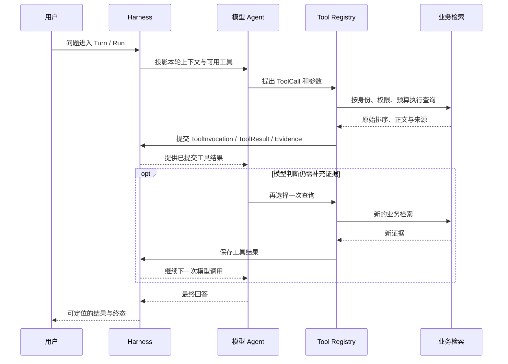

模型的自主决策、Harness 的运行正确性和最终保险业务正确性，需要分开测量。这与已有实践系列的三篇文章相连：[第02篇·数据契约与证据评测](../02-contracts-and-runtime-facts.md)讨论证据身份与事实，[第03篇·请求受理与事务](../03-request-admission-and-transactions.md)讨论 Turn/Run 的稳定执行身份，[第12篇·Harness 测试与评测](../12-testing-and-evaluation.md)区分协议、工具与模型质量。

本轮已完成的是一条保险题的原生 WeKnora 评估、42题可复现的批量归因，以及足够明确的下一轮工程实验输入。第三周真正留下的方法是：**先保存实际发生的事实，再选择能解释它的指标；先检查证据与原因，再决定应该修改模型、检索还是 Harness；最后用受控实验验证改造的实际价值。**

---

## 实现依据与延伸阅读

### 一、WeKnora 官方实现及指标

- [WeKnora v0.8.3 对应源码快照](https://github.com/Tencent/WeKnora/tree/3e22822c1d2397be730c458c7539d0eb8c113a24)：与本轮真实二进制配对的代码版本。
- [Evaluation Handler](https://github.com/Tencent/WeKnora/blob/3e22822c1d2397be730c458c7539d0eb8c113a24/internal/handler/evaluation.go)：POST/GET 处理及参数。
- [Evaluation Service](https://github.com/Tencent/WeKnora/blob/3e22822c1d2397be730c458c7539d0eb8c113a24/internal/application/service/evaluation.go)：建库、后台任务、RAG 执行与结果存储。
- [Dataset Service](https://github.com/Tencent/WeKnora/blob/3e22822c1d2397be730c458c7539d0eb8c113a24/internal/application/service/dataset.go)：五份 Parquet、问题与 Passage 关联。
- [Metric Hook](https://github.com/Tencent/WeKnora/blob/3e22822c1d2397be730c458c7539d0eb8c113a24/internal/application/service/metric_hook.go)：检索结果映射、生成分数输入。
- [WeKnora Evaluation 文档](https://weknora.weixin.qq.com/docs/03-features/15-evaluation)：API、指标和任务形态。
- [WeKnora Agent 引擎](https://github.com/Tencent/WeKnora/blob/main/website-docs/03-features/07-agent.md)：自主工具循环的另一套执行路径。

### 二、相关评估研究与方法

- [RAGAS：RAG 评估研究](https://arxiv.org/abs/2309.15217)；[Ragas 官方指标](https://docs.ragas.io/en/latest/concepts/metrics/available_metrics/)：检索与答案评估维度。
- [ARES：自动评审与人工校准](https://aclanthology.org/2024.naacl-long.20/)：如何审视模型评审的可靠性。
- [DeepEval 官方指标](https://deepeval.com/docs/metrics-introduction)及[Tool Correctness](https://deepeval.com/docs/metrics-tool-correctness)：模型生成、工具调用与轨迹指标。
- [InsQABench：中文保险问答](https://arxiv.org/abs/2501.10943)：结构化事实、文档与复杂保险任务的不同评测需求。
- [SoK: Agentic RAG](https://arxiv.org/abs/2603.07379)：多步检索作为顺序决策的研究视角。
- [本系列第三周外部技术研究底稿](research/week03-weknora-evaluation-source-notes.md)：资料、源码和研究论文的进一步索引。

### 三、本轮实验的证据范围

本篇实际实验数据来自两轮**内部授权** ZIP：

- `insurance-agent-week03-weknora-evidence-20261021.zip`：原始标注、首轮官方样例、8题 V1 评审、历史资料与 D 工程证据。
- `insurance-agent-week03-attribution-supplement-20261021.zip`：Q40 的五 Parquet 及原生 API 运行、全部42题 V2 语义分析、11项 Go 受控测试、8张原始图表及复现记录。

补充包按 S01–S18 维护证据索引，并映射此前 E01–E19。权威批量输出为 `02-batch-attribution/CASE-RESULTS-42.json`、`statistics/summary.json`；11项受控测试在 `03-weknora-verification/fixtures/controlled-results.json`；Q40 实际执行在 `01-single-case/`。这些文件保留在私有实验材料中，公开文章仅展示经去标识化的案例、技术机制和聚合统计。

D Runtime 源码基准为 `c66112dfd8676b47b143dc2e26739278cf4b0dde`，关联 `apps/runtime/src/runner/`、`registry/`、`storage/store.ts`、`business/adapters/retrieval.ts` 和 `tools/evaluation/`。此前记录的26项 TypeScript 和16项 Python 定向测试，验证评估导出与评分工程契约，并非本轮42题业务正确率测试。

[^weknora]: WeKnora `evaluation.go` 的 `EvalDataset()` 调用 `KnowledgeQAByEvent(..., types.Pipline["rag"])`。其 Agent Engine 的 ReAct 工具循环属于另一条产品路径。
[^code]: 本版本 `DatasetService.GetDatasetByID()` 读取固定默认文件；`EvaluationService` 将任务与结果保存在 `evaluationMemoryStorage`。源码版本绑定本文实际运行快照。
[^metric]: 受控执行复制对应 Go 版本的 `recordFinish`、Metric 计算、Dataset/Passage 汇集和合并实现。C10/C11 对真实段落进行了入库 TrimSpace 与连续坐标处理，再运行原始合并/Hook/评分函数，数值与原生结果吻合；部署二进制没有直接导出 `MetricInput`。受控测试证明具体机制在该输入下可复现，不代替完整生产检索链路的审计。
