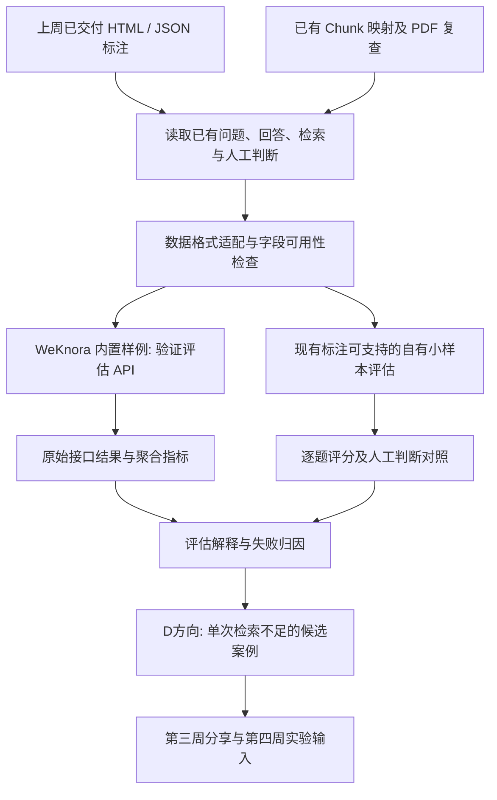

# Week 03 实验任务｜基于现有标注的 WeKnora 评估与 Agent 失败归因

> 课程：保险条款智能问答助手（14 周） · 第三周  
> 方向：D｜Agent 编排  
> 状态：任务说明；真实评估结果待填充  
> 更新：2026-10-21

这份文件用于第三周**使用现有测评数据、学习 WeKnora 评估接口、实际跑分与归因分析**。继续保留原14篇 Harness 工程分享及对应大纲；[原第03篇：请求受理、幂等与执行事务](../03-request-admission-and-transactions.md)属于 Harness 工程教学主线，本文件属于课程实践支线。

## 一、任务定义与范围

导师本周的直接要求是：学习 WeKnora、Ragas 和 DeepEval；在本地跑通 WeKnora（可只解析少量知识库）；**使用上周已完成的标注数据进行评分和归因分析**；在课程全量测试服部署后继续实验。

第三周直接复用之前已经交付的 HTML、标注 JSON、模型回答、检索 Chunk、原始 PDF 和复查结论。**本轮不新增独立 Gold Set 整理、人工再标注或标准答案建设阶段。**数据适配仅负责读取已有字段、建立接口所需的技术对应关系和记录数据可用性。

本周应回答：

1. 已有标注数据如何被 WeKnora 或其他评估器使用？
2. 在小样本上如何完成真实评估接口调用与得分解释？
3. 现有保险问答系统有哪些可观察的失败现象，主要责任层可能在哪里？
4. 哪些问题可能因多次检索、查询改写或拆解受益，从而成为第四周 Agent 实验的起点？

## 二、输入资产：从上周 HTML 开始

| 已有资产 | 本周用途 |
| --- | --- |
| 42题标注 HTML / 导出 JSON | 原问题、系统回复、参考 Chunk、人工判断与问题分类 |
| 原始 PDF、Chunk 映射、复查报告 | 用于解释检索错误、验证需要关注的原始资料 |
| 现有保险 D 工程 `tools/evaluation/` | 已实现合成测试、固定检索导出与证据覆盖相关评分逻辑 |
| WeKnora 官方源码 / 文档 | 执行原生小样本评估及指标学习 |
| Ragas / DeepEval | 补充理解答案证据支持度、Agent 工具行为等不同评测对象 |

既有42题的“回答正确/部分正确/错误/无法判断”属于对**历史输出**的人工评价；它不等同于 WeKnora 所有指标所需的逐段相关性标签和参考答案。直接消费可用字段，缺失信息在实验报告中明确标出，并选择可计算的指标。

真实保险文档、问题明细、个人信息、密钥及完整检索正文仅在已获授权的私有环境使用。公开 GitHub 保存方法、脱敏示例、公开指标及源码引用。

## 三、完整执行链路

### 路线 A：WeKnora 原生评估

当前 WeKnora 接口是 `POST /api/v1/evaluation`（创建）与 `GET /api/v1/evaluation?task_id=...`（查询）。内置数据读取服务要求 `dataset/samples/` 内五个 Parquet 文件：

| 文件 | 必需字段 | 含义 |
| --- | --- | --- |
| `queries.parquet` | `id:int64, text:string` | 问题 |
| `corpus.parquet` | `id:int64, text:string` | 用于检索的文本段落 |
| `answers.parquet` | `id:int64, text:string` | 已存在且可信的参考答案 |
| `qrels.parquet` | `qid:int64, pid:int64` | 已存在的题目与正确段落关系 |
| `qas.parquet` | `qid:int64, aid:int64` | 题目与参考答案关系 |

这些是**接口输入格式**，不构成新建 Gold Set 的工作要求。转换时沿用原有已明确的关联信息；如果缺少必要的正确段落关联或参考答案，则优先用 WeKnora 官方自带数据验证原生链路，按实际可用字段选择自己的评测方法，不生成未经确认的“标准答案”来填满接口。

**评估对象边界**：WeKnora 的原生任务会把 `corpus` 导入临时评估知识库，运行**WeKnora 自己的检索、重排与生成链路**。它产生的是该配置下 WeKnora 的效果，不会自动给上周保存的保险模型历史输出打分。

### 路线 B：使用现有标注评估原系统历史输出

读取上周 HTML / JSON 的实际模型回答、Chunk 顺序、历史人工评价，复用 D 工程已有 `tools/evaluation/score.py` 等工具，并在必要时使用 Ragas / DeepEval 的适用评估器补充。具体指标随实际拥有的参考字段决定：

- 有经过确认的相关证据映射：可以计算 AnyHit、MRR、EvidenceRecall 或 RequirementCoverage 等适用指标。
- 有历史系统回答及人工正确性标注：可进行人工评价分布、错误类别与逐题诊断，也可在允许的环境中比较语义评审结果。
- 缺少相关性标签或参考答案：对应指标记为不可计算，继续推进其它可行的评测与归因。

只有评价对象、语料版本与指标定义一致时，才直接比较两个系统的分数。

## 四、本周执行顺序

1. **读取资产与字段**：确认42题 HTML/JSON 的实际结构、版本及已有证据，输出字段可用性概览。
2. **跑通 WeKnora**：独立实验目录部署官方版本；用内置样例至少完成一次真实 POST/GET 评估，保存 task_id、任务终态、配置和原始指标 JSON。
3. **复用自有小样本**：从已有标注直接抽取5–10题；适配所需格式，并根据现有字段选择原生或离线评分方法。
4. **生成可解释结果**：保存配置、结果、可计算指标、样本数量/分母、失败案例和无法计算项。
5. **归因**：结合原始 PDF 与 Chunk 复查，识别 A（解析/切块）、B（结构化事实）、C（检索/排序）、D（工具选择/继续/停止）、Generation（答案生成）及多因素问题。
6. **D 方向专项**：阅读现有固定问答链路，绘制流程图；筛选单次检索不足的真实案例。通过已有检索结果或可授权补充查询验证额外检索能否取得所缺资料。区分“可作为 Agent 改造候选”和“已经证明 Agent 能稳定改善”。
7. **形成分享成果**：10–12分钟内讲清评测接口如何工作、已有标注怎么用、测出什么问题以及第四周要验证什么。

本周采用小样本完成闭环，后续共享全量测试服上线后再扩展数据规模与正式对比实验。

## 五、交付物与验收证据

| 交付 | 必须包含 |
| --- | --- |
| 可复现的本地评估 | WeKnora 版本、配置、运行命令、真实 API 请求与返回 |
| 既有标注数据适配 | 读取与映射代码、样本清单、字段可用性检查（不新建 Gold Set） |
| 评分与结果 | 原始指标 JSON、逐题结果（按可获得程度）、样本数和指标解释 |
| 失败归因 | 代表性问题、原系统表现、相关 Chunk/PDF 线索、责任层及解释依据 |
| D 方向研究 | 固定链路流程图、补充检索候选案例及第四周最小 Agent 循环的验证目标 |
| 分享材料 | 本文更新为真实结果 + 可公开的脱敏演示，不发布业务原件 |

**完成条件**：真实跑通一次 WeKnora 评估，实际使用上周已有标注进行可支持的评分或分析，提供一个可追溯的失败归因案例，并明确第四周 Agent 检索循环的首个验证目标。

## 六、结果记录（实验后填写）

| 项目 | 实际结果 |
| --- | --- |
| WeKnora 源码版本 | 待执行 |
| 使用的已有标注文件版本 | 待核实 |
| 评估样本数量及选取规则 | 待填写 |
| 官方样例 API 终态 | 待执行 |
| 自有样本评分方法与指标 | 待执行 |
| 逐题失败案例 | 待分析 |
| D 方向下一步实验 | 待确定 |

## 七、参考资料

- [WeKnora：评估功能](https://weknora.weixin.qq.com/docs/03-features/15-evaluation)
- [WeKnora 源码](https://github.com/Tencent/WeKnora)
- [Ragas](https://github.com/vibrantlabsai/ragas)
- [DeepEval](https://github.com/confident-ai/deepeval)
- [本系列第02篇：数据契约、运行事实与证据评测](../02-contracts-and-runtime-facts.md)
- [本系列第03篇：请求受理、幂等与执行事务](../03-request-admission-and-transactions.md)
