# Week 03 实验任务｜用 WeKnora 评估保险 RAG，并定位 Agent 改造机会

> 课程：保险条款智能问答助手（14 周） · 第三周  
> 方向：D｜Agent 编排  
> 状态：实验任务说明，真实运行结果待填充  
> 更新：2026-10-21

本文件用于课程第三周的**动手实验、评测证据与周三分享**。14 篇 Harness 工程分享沿用原有规划；本周主线正文是 [《用户点击发送之后：请求受理、幂等与执行事务》](../03-request-admission-and-transactions.md)。两篇材料分别呈现工程机制与课程实践。

## 一、本周应解决的问题

第二周通过人工核对原始 PDF，建立「哪个文件、哪一页能支持正确答案」的 Gold（人工标准）数据，并以同一套评分规则比较检索系统。

第三周将这套证据标准应用到真实系统实验：

1. **可运行**：让 WeKnora 对一个小型问答数据集完成检索、答案生成与自动打分。
2. **可复现**：记录输入数据、配置、源码/模型版本、API 请求与原始响应。
3. **可归因**：结合原始证据与执行记录，解释分数背后的失败原因。
4. **聚焦 D 方向**：识别「单次检索返回证据不足，但后续查询或查询拆解可能补足」的真实案例，为第四周最小 Agent 检索循环提供输入。

本周以小样本完成完整链路；全量评测后续使用课程测试服统一执行。

## 二、资产与保密边界

| 资产 | 作用 | 使用方式 |
| --- | --- | --- |
| 第二周人工 Gold 标注 | 问题、答案可得性、来源文件、页码及证据要求 | 私有存储；挑选已核验的小样本 |
| 原始 PDF / Chunk 映射 | 从文档与页码定位证据段落 | 只读取所选样本需要的内容 |
| 原系统检索轨迹、回答和配置 | 建立原系统基线，保留检索排名及结果 | 保留原始顺序、语料/模型版本 |
| WeKnora 代码及评估文档 | 提供评估执行流程与指标 | 使用固定源码版本和可复现配置 |
| Insurance Agent D 工程评估器 | 已有合成用例、离线导出与证据覆盖评分 | 复用项目 `tools/evaluation/`，以真实数据明确区分 `synthetic / recorded / real` |

课程真实 PDF、问题明细、检索正文、密钥及私有服务信息仅进入获授权的内部环境。公开 GitHub 仅保存方法、脱敏示例、聚合结果与可公开的源码引用。

历史检索质量复查材料与课程正式 Gold Set 使用不同的标注目标；从历史材料抽取小样本时，应重新确认参考答案及段落级正确证据。

## 三、先理解评估的数据流

```mermaid
flowchart TD
    A[第二周 Gold: 问题、来源、页码、证据要求] --> B[筛选已核验的代表性案例]
    C[原始 PDF 与检索语料] --> D[建立稳定的证据段落 ID]
    B --> E[数据转换与质量校验]
    D --> E
    E --> F[WeKnora Parquet 五文件数据集]
    F --> G[WeKnora 评估 API: 检索、重排、生成]
    G --> H[12项内置聚合指标]
    G --> I[逐题执行结果与检索轨迹]
    I --> J[原始 PDF 核对与失败归因]
    H --> J
    J --> K[第四周 Agent 循环的候选用例]
```

WeKnora 当前评估功能通过 API 使用：`POST /api/v1/evaluation` 创建任务，`GET /api/v1/evaluation?task_id=...` 查询。官方要求五个 Parquet 文件，放在服务读取的 `dataset/samples/`（容器内 `/app/dataset/samples/`）。`dataset_id` 当前只参与任务标识，**不会按名称自动切换数据目录**。

| 文件 | 必需字段 | 内容 |
| --- | --- | --- |
| `queries.parquet` | `id: int64, text: string` | 问题 |
| `corpus.parquet` | `id: int64, text: string` | 可检索段落（含一定数量无关干扰段落） |
| `answers.parquet` | `id: int64, text: string` | 经确认的参考答案 |
| `qrels.parquet` | `qid: int64, pid: int64` | 问题到相关段落的映射 |
| `qas.parquet` | `qid: int64, aid: int64` | 问题到参考答案的映射 |

**映射口径**：课程 Gold 最初以文档身份与页码表示证据；WeKnora 需要具体 passage ID。应保留独立映射清单 `PDF → 页码 → passage ID`，并校验目标段落确实支持对应问题。WeKnora 内部的 `ChunkIndex` 不是 `pid`，不能直接充当评分真值。

## 四、执行顺序和验收

### A. 环境与样例

1. 在隔离的本地或课程授权环境部署 WeKnora，配置所需聊天/向量/重排模型。
2. 首先用项目样例完成一次评估 API 调用；保存创建响应、任务 ID、终态和原始指标 JSON。
3. 保存 WeKnora commit/版本、模型名称、参数、知识库配置和运行日期；记录实际调用成本及失败原因（若有）。

官方部署入门：[WeKnora README](https://github.com/Tencent/WeKnora)；评估接口：[官方评估文档](https://weknora.weixin.qq.com/docs/03-features/15-evaluation)。

### B. 真实小样本

1. 从第二周 Gold 中选取一批已核验案例，兼顾普通条款、表格、多页/多文档和可能需要二次检索的问题；可先用 5–10 题打通转换流程。
2. 将现有标注与证据转换成上面的五个 Parquet 文件，并输出稳定 ID 映射、数据版本及校验报告。
3. 在独立的数据挂载目录中运行评估，保留原始数据集快照。与第二周评分器使用相同评分单位时再进行横向数值比较。
4. WeKnora 内置任务结果保存在内存；每次任务完成后将结果导出到私有实验目录，确保服务重启后仍可复盘。

### C. 指标解释

WeKnora 当前原生检索指标包括 Precision、Recall、NDCG@3/10、MRR、MAP；生成指标包括 BLEU-1/2/4 和 ROUGE-1/2/L。

- 检索指标回答「证据是否进入结果集、排在何处」。
- BLEU / ROUGE 回答「生成文本与参考答案的词语重合程度」，不能单独代表保险业务事实正确性。
- 回答是否受到证据支持、工具调用是否合理，后续可采用 Ragas / DeepEval 的相应指标或经人工校准的评审。
- WeKnora 的总体均值不是完整归因；逐题证据与执行轨迹需要单独保留。

### D. 方向 D 的归因

每个候选问题保留：原问题、Gold 证据、第一次检索的原始结果与排名、参考答案、实际生成回答、数据/模型配置、失败现象、候选责任层，以及复核证据。

责任层：A（解析与切块）、B（结构化事实与业务口径）、C（检索与重排）、D（工具选择、继续查询或停止）、答案生成；允许记录主要原因与共同因素。

针对 D 候选至少核对：

1. 正确证据确实存在于可访问语料中。
2. 固定检索器下，拆分或改写查询可额外取得所缺证据。
3. 固定首轮检索证据后，继续查询的实验能改善完整证据覆盖。
4. 将结论描述为「可通过 Agent 进一步验证的机会」，直到真实 Agent 运行对比成立。

第四周只需基于这批已验证候选，接通最小 Agent 工具循环。当前第三周的重点是定位、测量和归因。

## 五、与现有 D 工程对接

本地 `insurance-agent-d` 项目已有 `tools/evaluation/cli.ts`、`exporter.ts`、`score.py`、`evaluation.schema.json` 和合成样本。

优先复用其证据评分：

- `AnyHit@K`：至少取得一个正确证据单元。
- `MRR@K`：第一个正确证据的排名倒数。
- `EvidenceRecall@K`：取到多少人工要求的证据。
- `RequirementCoverage`：多个证据需求是否被完整满足。

这些指标与 WeKnora 原生评分对象的粒度不同；报告应同时保留各自定义与样本分母，特别是多页、多文档、无法回答的案例。

## 六、本周三分享建议（10–12 分钟）

| 模块 | 内容 |
| --- | --- |
| 背景 | 第二周 Gold 如何成为第三周的评测标准 |
| 原理 | RAG 链路与 WeKnora / Ragas / DeepEval 的侧重点 |
| 实操 | 数据转换、评估 API 请求、真实输出和指标解释 |
| 归因 | 用一个真实失败案例区分数据、检索、生成和 Agent 决策 |
| 后续 | 第四周最小 Agent 循环如何使用本周找到的案例 |

### 结果记录模板

| 证据 | 实际记录 |
| --- | --- |
| WeKnora 源码版本 | 待填写 |
| 数据集版本 / 案例数 | 待填写 |
| 本地样例 API 终态 | 待运行 |
| 自有样本 API 终态 | 待运行 |
| 检索指标 | 待实际读取 |
| 第三周 D 候选案例 | 待人工复核 |
| 实验限制 / 下一动作 | 待填写 |

**本周完成标准**：能够解释评估机制、完成至少一次真实 API 运行、复用一小部分人工证据数据、呈现分数及其含义，并对至少一个失败案例给出可验证的归因路径。

## 七、资料

- [WeKnora：评估功能](https://weknora.weixin.qq.com/docs/03-features/15-evaluation)
- [WeKnora 源码](https://github.com/Tencent/WeKnora)
- [Ragas](https://github.com/vibrantlabsai/ragas)
- [DeepEval](https://github.com/confident-ai/deepeval)
- [本系列第02篇：数据契约、运行事实与证据评测](../02-contracts-and-runtime-facts.md)
- [本系列第03篇：请求受理、幂等与执行事务](../03-request-admission-and-transactions.md)
